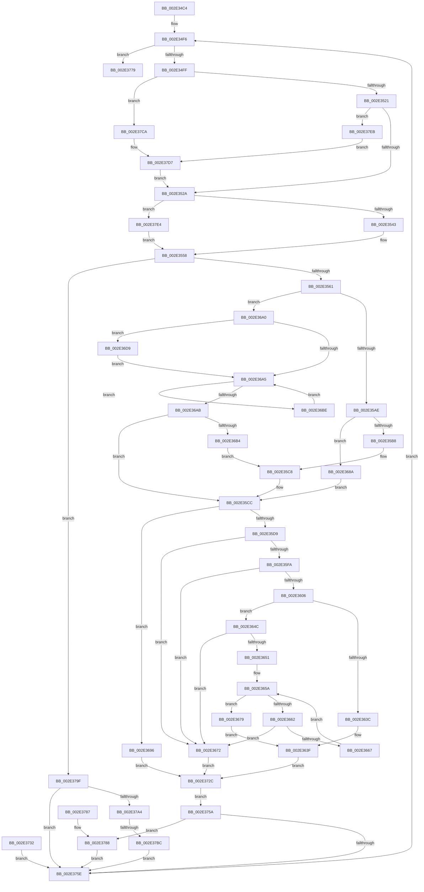

# RtlCSparseBitmapBitsClear

- RVA: `0x002E34C4`–`0x002E37F3` (길이 `815` bytes)
- VA: `0x00000001402E34C4`
- 실행 섹션: `.text`
- PDB 이름 있음: `예`; PDB Function 태그: `예`
- unwind 정보 RVA: `0x00070E84`
- 디코드: `219`개 명령, `815/815` bytes 표시
- 미해석 바이트: `0` (있으면 어셈블리에 `.byte`로 보존)

> 이 문서는 커널 이미지의 기계어와 PDB 기호를 분석해 생성했습니다. 4번과 5번은 함수 원형과 자료형을 바이너리 사용 방식에서 추정한 C 해석이며 원본 소스 복구 결과는 아닙니다.

## 1. Dependencies

- 직접 호출 지점: **1**; 고유 호출 대상: **1**
- 직접 호출자로 확인된 함수: **5**
- RIP 상대 이미지 참조: **0**

### Outgoing calls
- `0x002E3798` → [RtlpCSparseBitmapPageDecommit](RtlpCSparseBitmapPageDecommit_function_002EFAD4.md) (function, `0x002EFAD4`)

### Direct callers
- [sub_002E3191](Unknown_function_002E3191.md) at `0x002E32D1`
- [RtlpHpVaMgrRangeCleanup](RtlpHpVaMgrRangeCleanup_function_002EE0F0.md) at `0x002EE148`
- [RtlpHpVaMgrRangeCleanup](RtlpHpVaMgrRangeCleanup_function_002EE0F0.md) at `0x002EE192`
- [RtlCSparseBitmapBitmaskWrite](../2F/RtlCSparseBitmapBitmaskWrite_function_002F0A8C.md) at `0x002F0B83`
- [RtlpHpSegSegmentFree](../47/RtlpHpSegSegmentFree_function_00471328.md) at `0x004713F2`
- [sub_006DED14](../6D/Unknown_function_006DED14.md) at `0x006DED3D`

### Static image references
- 디코드된 RIP-relative 메모리 참조가 없습니다.

## 2. Other-region calls and transfers

- 다른 실행 섹션으로 향하는 call: **0**
- call이 아닌 외부 분기/꼬리 이동: **1**
  - `0x002E37B6` → [sub_006DDFB8](../6D/Unknown_function_006DDFB8.md) (`tail-transfer`)

## 3. Assembly (complete function range)

```asm
002E34C4  48 8B C4                        mov rax, rsp
002E34C7  4C 89 40 18                     mov qword ptr [rax + 0x18], r8
002E34CB  48 89 50 10                     mov qword ptr [rax + 0x10], rdx
002E34CF  48 89 48 08                     mov qword ptr [rax + 8], rcx
002E34D3  53                              push rbx
002E34D4  56                              push rsi
002E34D5  57                              push rdi
002E34D6  41 54                           push r12
002E34D8  41 55                           push r13
002E34DA  41 57                           push r15
002E34DC  48 83 EC 68                     sub rsp, 0x68
002E34E0  49 8B F8                        mov rdi, r8
002E34E3  48 8B F2                        mov rsi, rdx
002E34E6  4C 8B F9                        mov r15, rcx
002E34E9  0F 57 C0                        xorps xmm0, xmm0
002E34EC  0F 11 40 B8                     movups xmmword ptr [rax - 0x48], xmm0
002E34F0  41 BC 00 80 00 00               mov r12d, 0x8000
002E34F6  48 85 FF                        test rdi, rdi
002E34F9  0F 84 7A 02 00 00               je 0x1402e3779
002E34FF  4C 8B CE                        mov r9, rsi
002E3502  41 81 E1 FF 7F 00 00            and r9d, 0x7fff
002E3509  48 8B DF                        mov rbx, rdi
002E350C  48 89 9C 24 B8 00 00 00         mov qword ptr [rsp + 0xb8], rbx
002E3514  49 8D 04 39                     lea rax, [r9 + rdi]
002E3518  48 85 FF                        test rdi, rdi
002E351B  0F 88 A9 02 00 00               js 0x1402e37ca
002E3521  49 3B C4                        cmp rax, r12
002E3524  0F 8F C1 02 00 00               jg 0x1402e37eb
002E352A  4C 8B EE                        mov r13, rsi
002E352D  49 C1 ED 0F                     shr r13, 0xf
002E3531  49 8B C5                        mov rax, r13
002E3534  48 C1 E8 0F                     shr rax, 0xf
002E3538  49 0F A3 47 38                  bt qword ptr [r15 + 0x38], rax
002E353D  0F 83 A1 02 00 00               jae 0x1402e37e4
002E3543  49 8B 07                        mov rax, qword ptr [r15]
002E3546  4C 0F A3 28                     bt qword ptr [rax], r13
002E354A  0F 92 C0                        setb al
002E354D  0F B6 C8                        movzx ecx, al
002E3550  F7 D9                           neg ecx
002E3552  1B C0                           sbb eax, eax
002E3554  F7 D8                           neg eax
002E3556  FF C0                           inc eax
002E3558  83 F8 02                        cmp eax, 2
002E355B  0F 82 3E 02 00 00               jb 0x1402e379f
002E3561  49 8B D5                        mov rdx, r13
002E3564  48 C1 E2 0C                     shl rdx, 0xc
002E3568  49 03 57 08                     add rdx, qword ptr [r15 + 8]
002E356C  4C 89 64 24 50                  mov qword ptr [rsp + 0x50], r12
002E3571  48 89 54 24 58                  mov qword ptr [rsp + 0x58], rdx
002E3576  48 8B CB                        mov rcx, rbx
002E3579  48 89 5C 24 40                  mov qword ptr [rsp + 0x40], rbx
002E357E  4C 89 4C 24 38                  mov qword ptr [rsp + 0x38], r9
002E3583  48 83 64 24 28 00               and qword ptr [rsp + 0x28], 0
002E3589  49 8B C1                        mov rax, r9
002E358C  48 C1 E8 05                     shr rax, 5
002E3590  4C 8D 04 82                     lea r8, [rdx + rax*4]
002E3594  4C 89 44 24 28                  mov qword ptr [rsp + 0x28], r8
002E3599  4D 8B D1                        mov r10, r9
002E359C  41 83 E2 1F                     and r10d, 0x1f
002E35A0  49 8D 04 1A                     lea rax, [r10 + rbx]
002E35A4  48 83 F8 20                     cmp rax, 0x20
002E35A8  0F 87 F2 00 00 00               ja 0x1402e36a0
002E35AE  48 83 FB 20                     cmp rbx, 0x20
002E35B2  0F 84 D2 00 00 00               je 0x1402e368a
002E35B8  B8 01 00 00 00                  mov eax, 1
002E35BD  D3 E0                           shl eax, cl
002E35BF  FF C8                           dec eax
002E35C1  41 8B CA                        mov ecx, r10d
002E35C4  D3 E0                           shl eax, cl
002E35C6  F7 D0                           not eax
002E35C8  F0 41 21 00                     lock and dword ptr [r8], eax
002E35CC  48 81 FB 00 02 00 00            cmp rbx, 0x200
002E35D3  0F 8D BD 00 00 00               jge 0x1402e3696
002E35D9  49 81 E1 00 FE FF FF            and r9, 0xfffffffffffffe00
002E35E0  4C 89 4C 24 48                  mov qword ptr [rsp + 0x48], r9
002E35E5  48 83 64 24 30 00               and qword ptr [rsp + 0x30], 0
002E35EB  48 8B 4C 24 50                  mov rcx, qword ptr [rsp + 0x50]
002E35F0  48 8B 44 24 48                  mov rax, qword ptr [rsp + 0x48]
002E35F5  48 3B C1                        cmp rax, rcx
002E35F8  73 78                           jae 0x1402e3672
002E35FA  48 2B C8                        sub rcx, rax
002E35FD  48 81 F9 00 02 00 00            cmp rcx, 0x200
002E3604  72 6C                           jb 0x1402e3672
002E3606  4C 8D 98 FF 01 00 00            lea r11, [rax + 0x1ff]
002E360D  48 C1 E8 06                     shr rax, 6
002E3611  48 8B 54 24 58                  mov rdx, qword ptr [rsp + 0x58]
002E3616  4C 8D 04 C2                     lea r8, [rdx + rax*8]
002E361A  4C 89 44 24 30                  mov qword ptr [rsp + 0x30], r8
002E361F  49 8B C3                        mov rax, r11
002E3622  48 C1 E8 06                     shr rax, 6
002E3626  4C 8D 14 C2                     lea r10, [rdx + rax*8]
002E362A  49 8B C9                        mov rcx, r9
002E362D  48 83 C8 FF                     or rax, 0xffffffffffffffff
002E3631  48 D3 E0                        shl rax, cl
002E3634  49 8B 08                        mov rcx, qword ptr [r8]
002E3637  4D 3B C2                        cmp r8, r10
002E363A  75 10                           jne 0x1402e364c
002E363C  48 85 C8                        test rax, rcx
002E363F  B8 00 00 00 00                  mov eax, 0
002E3644  0F 94 C0                        sete al
002E3647  E9 E0 00 00 00                  jmp 0x1402e372c
002E364C  48 85 C8                        test rax, rcx
002E364F  75 21                           jne 0x1402e3672
002E3651  49 83 C0 08                     add r8, 8
002E3655  4C 89 44 24 30                  mov qword ptr [rsp + 0x30], r8
002E365A  49 8B 10                        mov rdx, qword ptr [r8]
002E365D  4D 3B C2                        cmp r8, r10
002E3660  74 17                           je 0x1402e3679
002E3662  48 85 D2                        test rdx, rdx
002E3665  75 0B                           jne 0x1402e3672
002E3667  49 83 C0 08                     add r8, 8
002E366B  4C 89 44 24 30                  mov qword ptr [rsp + 0x30], r8
002E3670  EB E8                           jmp 0x1402e365a
002E3672  33 C0                           xor eax, eax
002E3674  E9 B3 00 00 00                  jmp 0x1402e372c
002E3679  41 8A CB                        mov cl, r11b
002E367C  F6 D1                           not cl
002E367E  48 83 C8 FF                     or rax, 0xffffffffffffffff
002E3682  48 D3 E8                        shr rax, cl
002E3685  48 85 D0                        test rax, rdx
002E3688  EB B5                           jmp 0x1402e363f
002E368A  41 C7 00 00 00 00 00            mov dword ptr [r8], 0
002E3691  E9 36 FF FF FF                  jmp 0x1402e35cc
002E3696  B8 01 00 00 00                  mov eax, 1
002E369B  E9 8C 00 00 00                  jmp 0x1402e372c
002E36A0  4D 85 D2                        test r10, r10
002E36A3  75 34                           jne 0x1402e36d9
002E36A5  48 83 F9 20                     cmp rcx, 0x20
002E36A9  73 13                           jae 0x1402e36be
002E36AB  48 85 C9                        test rcx, rcx
002E36AE  0F 84 18 FF FF FF               je 0x1402e35cc
002E36B4  83 C8 FF                        or eax, 0xffffffff
002E36B7  D3 E0                           shl eax, cl
002E36B9  E9 0A FF FF FF                  jmp 0x1402e35c8
002E36BE  41 C7 00 00 00 00 00            mov dword ptr [r8], 0
002E36C5  49 83 C0 04                     add r8, 4
002E36C9  4C 89 44 24 28                  mov qword ptr [rsp + 0x28], r8
002E36CE  48 83 E9 20                     sub rcx, 0x20
002E36D2  48 89 4C 24 40                  mov qword ptr [rsp + 0x40], rcx
002E36D7  EB CC                           jmp 0x1402e36a5
002E36D9  41 8B C1                        mov eax, r9d
002E36DC  83 E0 1F                        and eax, 0x1f
002E36DF  BA 20 00 00 00                  mov edx, 0x20
002E36E4  2B D0                           sub edx, eax
002E36E6  8B CA                           mov ecx, edx
002E36E8  B8 01 00 00 00                  mov eax, 1
002E36ED  D3 E0                           shl eax, cl
002E36EF  FF C8                           dec eax
002E36F1  49 8B CA                        mov rcx, r10
002E36F4  D3 E0                           shl eax, cl
002E36F6  F7 D0                           not eax
002E36F8  F0 41 21 00                     lock and dword ptr [r8], eax
002E36FC  8B C2                           mov eax, edx
002E36FE  48 8B CB                        mov rcx, rbx
002E3701  48 2B C8                        sub rcx, rax
002E3704  48 89 4C 24 40                  mov qword ptr [rsp + 0x40], rcx
002E3709  49 8B C1                        mov rax, r9
002E370C  48 83 E0 E0                     and rax, 0xffffffffffffffe0
002E3710  48 89 44 24 38                  mov qword ptr [rsp + 0x38], rax
002E3715  48 83 C0 20                     add rax, 0x20
002E3719  48 89 44 24 38                  mov qword ptr [rsp + 0x38], rax
002E371E  49 83 C0 04                     add r8, 4
002E3722  4C 89 44 24 28                  mov qword ptr [rsp + 0x28], r8
002E3727  E9 79 FF FF FF                  jmp 0x1402e36a5
002E372C  89 44 24 20                     mov dword ptr [rsp + 0x20], eax
002E3730  EB 28                           jmp 0x1402e375a
002E3732  41 BC 00 80 00 00               mov r12d, 0x8000
002E3738  48 8B BC 24 B0 00 00 00         mov rdi, qword ptr [rsp + 0xb0]
002E3740  48 8B B4 24 A8 00 00 00         mov rsi, qword ptr [rsp + 0xa8]
002E3748  4C 8B BC 24 A0 00 00 00         mov r15, qword ptr [rsp + 0xa0]
002E3750  48 8B 9C 24 B8 00 00 00         mov rbx, qword ptr [rsp + 0xb8]
002E3758  EB 04                           jmp 0x1402e375e
002E375A  85 C0                           test eax, eax
002E375C  75 2A                           jne 0x1402e3788
002E375E  48 03 F3                        add rsi, rbx
002E3761  48 89 B4 24 A8 00 00 00         mov qword ptr [rsp + 0xa8], rsi
002E3769  48 2B FB                        sub rdi, rbx
002E376C  48 89 BC 24 B0 00 00 00         mov qword ptr [rsp + 0xb0], rdi
002E3774  E9 7D FD FF FF                  jmp 0x1402e34f6
002E3779  48 83 C4 68                     add rsp, 0x68
002E377D  41 5F                           pop r15
002E377F  41 5D                           pop r13
002E3781  41 5C                           pop r12
002E3783  5F                              pop rdi
002E3784  5E                              pop rsi
002E3785  5B                              pop rbx
002E3786  C3                              ret
002E3787  CC                              int3
002E3788  45 33 C0                        xor r8d, r8d
002E378B  49 3B DC                        cmp rbx, r12
002E378E  41 0F 94 C0                     sete r8b
002E3792  49 8B D5                        mov rdx, r13
002E3795  49 8B CF                        mov rcx, r15
002E3798  E8 37 C3 00 00                  call 0x1402efad4
002E379D  EB BF                           jmp 0x1402e375e
002E379F  83 F8 01                        cmp eax, 1
002E37A2  74 BA                           je 0x1402e375e
002E37A4  48 8B C6                        mov rax, rsi
002E37A7  25 FF FF FF 3F                  and eax, 0x3fffffff
002E37AC  48 8B DF                        mov rbx, rdi
002E37AF  48 8D 0C 38                     lea rcx, [rax + rdi]
002E37B3  48 85 FF                        test rdi, rdi
002E37B6  0F 89 FC A7 3F 00               jns 0x1406ddfb8
002E37BC  8B D8                           mov ebx, eax
002E37BE  48 F7 D3                        not rbx
002E37C1  48 85 C9                        test rcx, rcx
002E37C4  48 0F 49 DF                     cmovns rbx, rdi
002E37C8  EB 94                           jmp 0x1402e375e
002E37CA  49 8B D9                        mov rbx, r9
002E37CD  48 F7 D3                        not rbx
002E37D0  48 85 C0                        test rax, rax
002E37D3  48 0F 49 DF                     cmovns rbx, rdi
002E37D7  48 89 9C 24 B8 00 00 00         mov qword ptr [rsp + 0xb8], rbx
002E37DF  E9 46 FD FF FF                  jmp 0x1402e352a
002E37E4  33 C0                           xor eax, eax
002E37E6  E9 6D FD FF FF                  jmp 0x1402e3558
002E37EB  49 8B DC                        mov rbx, r12
002E37EE  49 2B D9                        sub rbx, r9
002E37F1  EB E4                           jmp 0x1402e37d7
```

## 4. C-style interpretation (structured pseudocode)

```c
__int64 __fastcall RtlCSparseBitmapBitsClear(__int64 a1, __int64 a2, __int64 a3)
{
    __int64 result;
    __int64 v_r10;
    __int64 v_r13;
    __int64 v_rbx;
    __int64 v_rdi;
    __int64 v_rsi;
    __int64 v_rsp;
    unsigned __int64 v_stack_m40;
    unsigned __int64 v_stack_m48;
    unsigned __int64 v_stack_m50;
    unsigned __int64 v_stack_m58;
    unsigned __int64 v_stack_m60;
    unsigned __int64 v_stack_m68;
    unsigned __int64 v_stack_m70;
    unsigned int v_stack_m78;
    unsigned __int64 v_stack_p10;
    unsigned __int64 v_stack_p18;
    unsigned __int64 v_stack_p20;
    unsigned __int64 v_stack_p8;
    unsigned __int64 v_stack_pB8;

    *(unsigned __int64 *)(v_rsp + 24) = a3;
    *(unsigned __int64 *)(v_rsp + 16) = a2;
    *(unsigned __int64 *)(v_rsp + 8) = a1;
    v_rsp = (v_rsp) - (104);
    *(unsigned __int64 *)(v_rsp - 72) = v_xmm0;
loc_002E34F6:
    if (a3 == 0) goto loc_002E3779;
    a4 = (unsigned int)((a2) & (0x7FFFULL));
    v_stack_p20 = a3;
    if (sign_flag) goto loc_002E37CA;
    if ((a4 + a3 * 1) > ((unsigned int)(0x8000ULL))) goto loc_002E37EB;
loc_002E352A:
    v_r13 = (a2) >> (15);
    result = (v_r13) >> (15);
    if (condition_is_above_or_equal) goto loc_002E37E4;
    result = (condition_is_below) ? 1 : 0;
    a1 = (unsigned int)(-((unsigned __int8)(result)));
    result = (unsigned int)(-(result));
    result = (unsigned int)((result) + 1);
loc_002E3558:
    if (((unsigned int)(result)) < 2) goto loc_002E379F;
    a2 = (v_r13) << (12);
    a2 = (a2) + (*(unsigned __int64 *)(a1 + 8));
    v_stack_m48 = (unsigned int)(0x8000ULL);
    v_stack_m40 = a2;
    v_stack_m58 = a3;
    v_stack_m60 = a4;
    result = (a4) >> (5);
    v_stack_m70 = a2 + result * 4;
    v_r10 = (unsigned int)((a4) & (31));
    if ((v_r10 + a3 * 1) > 32) goto loc_002E36A0;
    if (a3 == 32) goto loc_002E368A;
    result = (unsigned int)((1) << ((unsigned __int8)(a3)));
    result = (unsigned int)((result) - 1);
    result = (unsigned int)((result) << ((unsigned __int8)((unsigned int)((unsigned int)(v_r10)))));
    result = (unsigned int)(~(result));
loc_002E35C8:
loc_002E35CC:
    if (a3 >= 512) goto loc_002E3696;
    a4 = (a4) & (-512);
    v_stack_m50 = a4;
    if (v_stack_m50 >= v_stack_m48) goto loc_002E3672;
    a1 = (v_stack_m48) - (v_stack_m50);
    if (a1 < 512) goto loc_002E3672;
    result = (v_stack_m50) >> (6);
    v_stack_m68 = v_stack_m40 + result * 8;
    result = (v_stack_m50 + 511) >> (6);
    result = (result) | (-1);
    result = (result) << ((unsigned __int8)(a4));
    if ((v_stack_m40 + result * 8) != (v_stack_m40 + result * 8)) goto loc_002E364C;
loc_002E363F:
    result = (((result) & (*(unsigned __int64 *)(v_stack_m40 + result * 8))) == 0) ? 1 : 0;
    goto loc_002E372C;
loc_002E364C:
    if (((result) & (*(unsigned __int64 *)(v_stack_m40 + result * 8))) != 0) goto loc_002E3672;
    a3 = (v_stack_m40 + result * 8) + (8);
    v_stack_m68 = a3;
loc_002E365A:
    if (a3 == (v_stack_m40 + result * 8)) goto loc_002E3679;
    if (*(unsigned __int64 *)(a3) != 0) goto loc_002E3672;
    a3 = (a3) + (8);
    v_stack_m68 = a3;
    goto loc_002E365A;
loc_002E3672:
    result = 0;
    goto loc_002E372C;
loc_002E3679:
    a1 = (unsigned __int8)(~((unsigned __int8)(v_stack_m50 + 511)));
    result = (result) | (-1);
    result = (result) >> ((unsigned __int8)(a1));
    goto loc_002E363F;
loc_002E368A:
    *(unsigned int *)(a3) = 0;
    goto loc_002E35CC;
loc_002E3696:
    goto loc_002E372C;
loc_002E36A0:
    if (v_stack_m40 + result * 8 != 0) goto loc_002E36D9;
loc_002E36A5:
    if (a1 >= 32) goto loc_002E36BE;
    if (a1 == 0) goto loc_002E35CC;
    result = (unsigned int)((1) | (0xFFFFFFFFULL));
    result = (unsigned int)((result) << ((unsigned __int8)(a1)));
    goto loc_002E35C8;
loc_002E36BE:
    *(unsigned int *)(a3) = 0;
    a3 = (a3) + (4);
    v_stack_m70 = a3;
    a1 = (a1) - (32);
    v_stack_m58 = a1;
    goto loc_002E36A5;
loc_002E36D9:
    result = (unsigned int)(((unsigned int)((unsigned int)(a4))) & (31));
    a2 = (unsigned int)((32) - ((unsigned int)(result)));
    result = (unsigned int)((1) << ((unsigned __int8)((unsigned int)((unsigned int)(a2)))));
    result = (unsigned int)((result) - 1);
    result = (unsigned int)((result) << ((unsigned __int8)(v_stack_m40 + result * 8)));
    result = (unsigned int)(~(result));
    a1 = (a3) - ((unsigned int)((unsigned int)(a2)));
    v_stack_m58 = a1;
    result = (a4) & (-32);
    v_stack_m60 = result;
    result = (result) + (32);
    v_stack_m60 = result;
    a3 = (a3) + (4);
    v_stack_m70 = a3;
    goto loc_002E36A5;
loc_002E372C:
    v_stack_m78 = (unsigned int)(result);
    goto loc_002E375A;
loc_002E375A:
    if ((unsigned int)(result) != 0) goto loc_002E3788;
loc_002E375E:
    v_rsi = (a2) + (a3);
    v_stack_p10 = v_rsi;
    v_rdi = (a3) - (a3);
    v_stack_p18 = v_rdi;
    goto loc_002E34F6;
loc_002E3779:
    v_rsp = (v_rsp) + (104);
    return result;
loc_002E3788:
    a3 = 0;
    a3 = (0 == ((unsigned int)(0x8000ULL))) ? 1 : 0;
    result = RtlpCSparseBitmapPageDecommit(a1, v_r13, a3, a4);
    goto loc_002E375E;
loc_002E379F:
    if (((unsigned int)(result)) == 1) goto loc_002E375E;
    result = (unsigned int)((v_rsi) & (0x3FFFFFFFULL));
    v_rbx = ~((unsigned int)((unsigned int)(result)));
    if (!sign_flag) { v_rbx = v_rdi; }
    goto loc_002E375E;
loc_002E37CA:
    v_rbx = ~(a4);
    if (!sign_flag) { v_rbx = v_rdi; }
loc_002E37D7:
    v_stack_pB8 = v_rbx;
    goto loc_002E352A;
loc_002E37E4:
    result = 0;
    goto loc_002E3558;
loc_002E37EB:
    v_rbx = ((unsigned int)(0x8000ULL)) - (a4);
    goto loc_002E37D7;
}
```

## 5. (Beta) C Style

```c
int64_t RtlCSparseBitmapBitsClear(void *Arg1, void *Arg2, int64_t Arg3)
{
    uint8_t *arg1 = (uint8_t *)Arg1;
    uint8_t *arg2 = (uint8_t *)Arg2;

    int64_t result;
    int64_t local_r10;
    int64_t local_r13;
    int64_t local_rbx;
    int64_t local_rdi;
    int64_t local_rsi;
    int64_t local_rsp;
    uint64_t v_stack_m40;
    uint64_t v_stack_m48;
    uint64_t v_stack_m50;
    uint64_t v_stack_m58;
    uint64_t v_stack_m60;
    uint64_t v_stack_m68;
    uint64_t v_stack_m70;
    uint32_t v_stack_m78;
    uint64_t v_stack_p10;
    uint64_t v_stack_p18;
    uint64_t v_stack_p20;
    uint64_t v_stack_p8;
    uint64_t v_stack_pB8;

    *(uint64_t *)(local_rsp + 0x18) = Arg3;
    *(void **)(local_rsp + 0x10) = Arg2;
    *(void **)(local_rsp + 0x8) = Arg1;
    local_rsp = (local_rsp) - (104);
    *(uint64_t *)(local_rsp - 0x48) = v_xmm0;
loc_002E34F6:
    if (Arg3 == 0) goto loc_002E3779;
    a4 = (uint32_t)((Arg2) & (0x7FFFULL));
    v_stack_p20 = Arg3;
    if (sign_flag) goto loc_002E37CA;
    if ((a4 + Arg3 * 1) > ((uint32_t)(0x8000ULL))) goto loc_002E37EB;
loc_002E352A:
    local_r13 = (Arg2) >> (15);
    result = (local_r13) >> (15);
    if (condition_is_above_or_equal) goto loc_002E37E4;
    result = (condition_is_below) ? 1 : 0;
    Arg1 = (uint32_t)(-((uint8_t)(result)));
    result = (uint32_t)(-(result));
    result = (uint32_t)((result) + 1);
loc_002E3558:
    if (((uint32_t)(result)) < 2) goto loc_002E379F;
    Arg2 = (local_r13) << (12);
    Arg2 = (Arg2) + (*(uint64_t *)(arg1 + 0x8));
    v_stack_m48 = (uint32_t)(0x8000ULL);
    v_stack_m40 = Arg2;
    v_stack_m58 = Arg3;
    v_stack_m60 = a4;
    result = (a4) >> (5);
    v_stack_m70 = Arg2 + result * 4;
    local_r10 = (uint32_t)((a4) & (31));
    if ((local_r10 + Arg3 * 1) > 32) goto loc_002E36A0;
    if (Arg3 == 32) goto loc_002E368A;
    result = (uint32_t)((1) << ((uint8_t)(Arg3)));
    result = (uint32_t)((result) - 1);
    result = (uint32_t)((result) << ((uint8_t)((uint32_t)((uint32_t)(local_r10)))));
    result = (uint32_t)(~(result));
loc_002E35C8:
loc_002E35CC:
    if (Arg3 >= 512) goto loc_002E3696;
    a4 = (a4) & (-512);
    v_stack_m50 = a4;
    if (v_stack_m50 >= v_stack_m48) goto loc_002E3672;
    Arg1 = (v_stack_m48) - (v_stack_m50);
    if (Arg1 < 512) goto loc_002E3672;
    result = (v_stack_m50) >> (6);
    v_stack_m68 = v_stack_m40 + result * 8;
    result = (v_stack_m50 + 511) >> (6);
    result = (result) | (-1);
    result = (result) << ((uint8_t)(a4));
    if ((v_stack_m40 + result * 8) != (v_stack_m40 + result * 8)) goto loc_002E364C;
loc_002E363F:
    result = (((result) & (*(uint64_t *)(v_stack_m40 + result * 8))) == 0) ? 1 : 0;
    goto loc_002E372C;
loc_002E364C:
    if (((result) & (*(uint64_t *)(v_stack_m40 + result * 8))) != 0) goto loc_002E3672;
    Arg3 = (v_stack_m40 + result * 8) + (8);
    v_stack_m68 = Arg3;
loc_002E365A:
    if (Arg3 == (v_stack_m40 + result * 8)) goto loc_002E3679;
    if (*(uint64_t *)(Arg3) != 0) goto loc_002E3672;
    Arg3 = (Arg3) + (8);
    v_stack_m68 = Arg3;
    goto loc_002E365A;
loc_002E3672:
    result = 0;
    goto loc_002E372C;
loc_002E3679:
    Arg1 = (uint8_t)(~((uint8_t)(v_stack_m50 + 511)));
    result = (result) | (-1);
    result = (result) >> ((uint8_t)(Arg1));
    goto loc_002E363F;
loc_002E368A:
    *(uint32_t *)(Arg3) = 0;
    goto loc_002E35CC;
loc_002E3696:
    goto loc_002E372C;
loc_002E36A0:
    if (v_stack_m40 + result * 8 != 0) goto loc_002E36D9;
loc_002E36A5:
    if (Arg1 >= 32) goto loc_002E36BE;
    if (Arg1 == NULL) goto loc_002E35CC;
    result = (uint32_t)((1) | (0xFFFFFFFFULL));
    result = (uint32_t)((result) << ((uint8_t)(Arg1)));
    goto loc_002E35C8;
loc_002E36BE:
    *(uint32_t *)(Arg3) = 0;
    Arg3 = (Arg3) + (4);
    v_stack_m70 = Arg3;
    Arg1 = (Arg1) - (32);
    v_stack_m58 = Arg1;
    goto loc_002E36A5;
loc_002E36D9:
    result = (uint32_t)(((uint32_t)((uint32_t)(a4))) & (31));
    Arg2 = (uint32_t)((32) - ((uint32_t)(result)));
    result = (uint32_t)((1) << ((uint8_t)((uint32_t)((uint32_t)(Arg2)))));
    result = (uint32_t)((result) - 1);
    result = (uint32_t)((result) << ((uint8_t)(v_stack_m40 + result * 8)));
    result = (uint32_t)(~(result));
    Arg1 = (Arg3) - ((uint32_t)((uint32_t)(Arg2)));
    v_stack_m58 = Arg1;
    result = (a4) & (-32);
    v_stack_m60 = result;
    result = (result) + (32);
    v_stack_m60 = result;
    Arg3 = (Arg3) + (4);
    v_stack_m70 = Arg3;
    goto loc_002E36A5;
loc_002E372C:
    v_stack_m78 = (uint32_t)(result);
    goto loc_002E375A;
loc_002E375A:
    if ((uint32_t)(result) != 0) goto loc_002E3788;
loc_002E375E:
    local_rsi = (Arg2) + (Arg3);
    v_stack_p10 = local_rsi;
    local_rdi = (Arg3) - (Arg3);
    v_stack_p18 = local_rdi;
    goto loc_002E34F6;
loc_002E3779:
    local_rsp = (local_rsp) + (104);
    return result;
loc_002E3788:
    Arg3 = 0;
    Arg3 = (0 == ((uint32_t)(0x8000ULL))) ? 1 : 0;
    result = RtlpCSparseBitmapPageDecommit(Arg1, local_r13, Arg3, a4);
    goto loc_002E375E;
loc_002E379F:
    if (((uint32_t)(result)) == 1) goto loc_002E375E;
    result = (uint32_t)((local_rsi) & (0x3FFFFFFFULL));
    local_rbx = ~((uint32_t)((uint32_t)(result)));
    if (!sign_flag) { local_rbx = local_rdi; }
    goto loc_002E375E;
loc_002E37CA:
    local_rbx = ~(a4);
    if (!sign_flag) { local_rbx = local_rdi; }
loc_002E37D7:
    v_stack_pB8 = local_rbx;
    goto loc_002E352A;
loc_002E37E4:
    result = 0;
    goto loc_002E3558;
loc_002E37EB:
    local_rbx = ((uint32_t)(0x8000ULL)) - (a4);
    goto loc_002E37D7;
}
```

### 관측된 메모리 오프셋

구조체 형식이 확인되지 않은 접근은 인자 기준의 오프셋으로만 기록했습니다.

| 기준 인자 | 오프셋 표현 | 폭 (bit) | 접근 |
|---|---:|---:|---|
| `Arg1` | `+ 0x0` | `64` | `R` |
| `Arg1` | `+ 0x8` | `64` | `R` |
| `Arg1` | `+ 0x38` | `64` | `R` |
| `Arg2` | `+ 0x0 + rbx*1` | `64` | `R` |
| `Arg2` | `+ 0x0 + rdi*1` | `64` | `R` |

## 6. Execution-region graph

[열기: 2D/3D 그래프와 함수 탐색 컨트롤 패널](../../../control-panel.html?section=text&rva=0x002E34C4&view=graph)

- 2D 그래프는 위에서 아래로 흐르고, 3D 그래프는 빈 공간을 드래그해 회전합니다. Shift+드래그는 이동, 휠은 확대·축소, 함수 노드 선택은 대상 보고서 이동입니다.

### Static fallback


