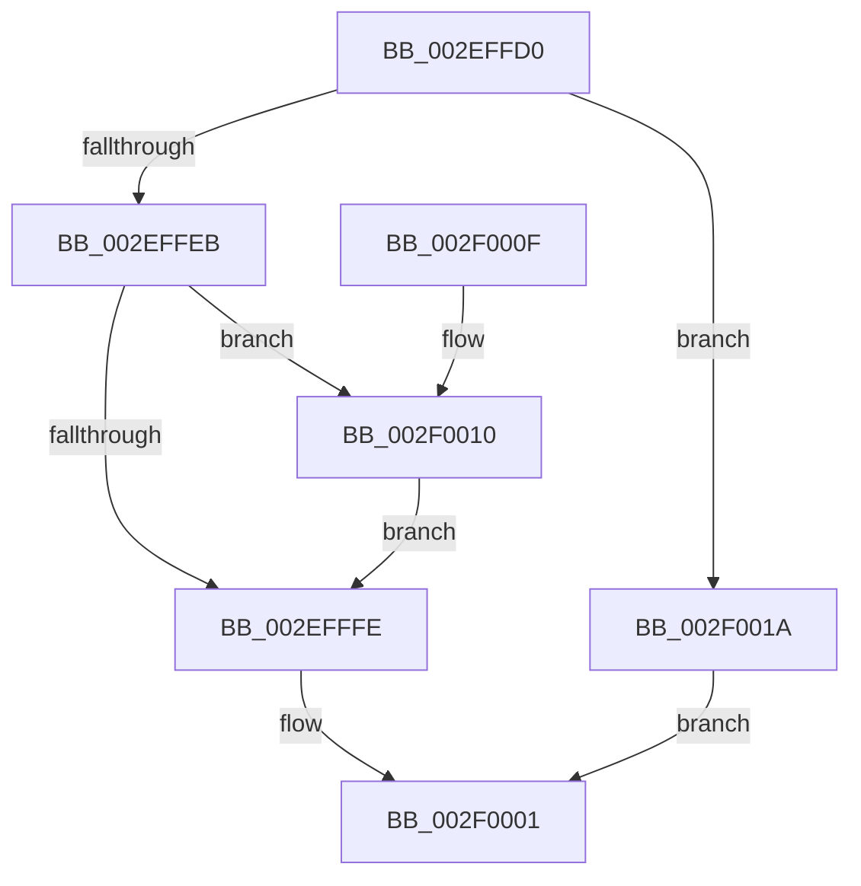

# RtlCSparseBitmapEnterLockingRegion

- RVA: `0x002EFFD0`–`0x002F0030` (길이 `96` bytes)
- VA: `0x00000001402EFFD0`
- 실행 섹션: `.text`
- PDB 이름 있음: `예`; PDB Function 태그: `아니요`
- unwind 정보 RVA: `0x0005D368`
- 디코드: `29`개 명령, `96/96` bytes 표시
- 미해석 바이트: `0` (있으면 어셈블리에 `.byte`로 보존)

> 이 문서는 커널 이미지의 기계어와 PDB 기호를 분석해 생성했습니다. 4번과 5번은 함수 원형과 자료형을 바이너리 사용 방식에서 추정한 C 해석이며 원본 소스 복구 결과는 아닙니다.

## 1. Dependencies

- 직접 호출 지점: **1**; 고유 호출 대상: **1**
- 직접 호출자로 확인된 함수: **1**
- RIP 상대 이미지 참조: **1**

### Outgoing calls
- `0x002F0013` → [KiRaiseIrqlProcessIrqlFlags](../4F/KiRaiseIrqlProcessIrqlFlags_function_004F56FC.md) (function, `0x004F56FC`)

### Direct callers
- [RtlpCSparseBitmapPageDecommit](RtlpCSparseBitmapPageDecommit_function_002EFAD4.md) at `0x002EFB71`

### Static image references
- `0x002EFFF6` → RVA `0x00FC6D20` (`ALMOSTRO`; read)

## 2. Other-region calls and transfers

- 다른 실행 섹션으로 향하는 call: **0**
- 별도 외부 분기/꼬리 이동을 확인하지 못했습니다.

## 3. Assembly (complete function range)

```asm
002EFFD0  48 89 5C 24 08                  mov qword ptr [rsp + 8], rbx
002EFFD5  57                              push rdi
002EFFD6  48 83 EC 20                     sub rsp, 0x20
002EFFDA  33 C0                           xor eax, eax
002EFFDC  48 8B D9                        mov rbx, rcx
002EFFDF  48 89 01                        mov qword ptr [rcx], rax
002EFFE2  48 89 51 08                     mov qword ptr [rcx + 8], rdx
002EFFE6  38 42 30                        cmp byte ptr [rdx + 0x30], al
002EFFE9  74 2F                           je 0x1402f001a
002EFFEB  44 0F 20 C7                     mov rdi, cr8
002EFFEF  8D 50 02                        lea edx, [rax + 2]
002EFFF2  44 0F 22 C2                     mov cr8, rdx
002EFFF6  39 05 24 6D CD 00               cmp dword ptr [rip + 0xcd6d24], eax
002EFFFC  75 12                           jne 0x1402f0010
002EFFFE  40 88 3B                        mov byte ptr [rbx], dil
002F0001  48 8B C3                        mov rax, rbx
002F0004  48 8B 5C 24 30                  mov rbx, qword ptr [rsp + 0x30]
002F0009  48 83 C4 20                     add rsp, 0x20
002F000D  5F                              pop rdi
002F000E  C3                              ret
002F000F  CC                              int3
002F0010  40 8A CF                        mov cl, dil
002F0013  E8 E4 56 20 00                  call 0x1404f56fc
002F0018  EB E4                           jmp 0x1402efffe
002F001A  C6 01 FF                        mov byte ptr [rcx], 0xff
002F001D  65 48 8B 04 25 88 01 00 00      mov rax, qword ptr gs:[0x188]
002F0026  66 FF 88 E6 01 00 00            dec word ptr [rax + 0x1e6]
002F002D  90                              nop
002F002E  EB D1                           jmp 0x1402f0001
```

## 4. C-style interpretation (structured pseudocode)

```c
__int64 __fastcall RtlCSparseBitmapEnterLockingRegion(__int64 a1, __int64 a2)
{
    __int64 result;
    __int64 v_rsp;
    unsigned __int64 v_stack_p8;

    v_stack_p8 = v_rbx;
    v_rsp = (v_rsp) - (32);
    result = 0;
    *(unsigned __int64 *)(a1) = 0;
    *(unsigned __int64 *)(a1 + 8) = a2;
    if ((*(unsigned __int8 *)(a2 + 48)) == 0) goto loc_002F001A;
    if ((*(unsigned int *)(v_rip + 13462820)) != 0) goto loc_002F0010;
loc_002EFFFE:
    *(unsigned __int8 *)(a1) = (unsigned __int8)(v_cr8);
loc_002F0001:
    v_rsp = (v_rsp) + (32);
    return a1;
loc_002F0010:
    result = KiRaiseIrqlProcessIrqlFlags((unsigned __int8)(v_cr8), result + 2, a3, a4);
    goto loc_002EFFFE;
loc_002F001A:
    *(unsigned __int8 *)((unsigned __int8)(v_cr8)) = 255;
    goto loc_002F0001;
}
```

## 5. (Beta) C Style

```c
void *RtlCSparseBitmapEnterLockingRegion(void *Arg1, void *Arg2)
{
    uint8_t *arg1 = (uint8_t *)Arg1;
    uint8_t *arg2 = (uint8_t *)Arg2;

    int64_t result;
    int64_t local_rsp;
    uint64_t v_stack_p8;

    v_stack_p8 = local_rbx;
    local_rsp = (local_rsp) - (32);
    result = 0;
    *(uint64_t *)(arg1) = 0;
    *(void **)(arg1 + 0x8) = Arg2;
    if ((*(uint8_t *)(arg2 + 0x30)) == 0) goto loc_002F001A;
    if ((*(uint32_t *)(v_rip + 0xCD6D24)) != 0) goto loc_002F0010;
loc_002EFFFE:
    *(uint8_t *)(arg1) = (uint8_t)(v_cr8);
loc_002F0001:
    local_rsp = (local_rsp) + (32);
    return Arg1;
loc_002F0010:
    result = KiRaiseIrqlProcessIrqlFlags((uint8_t)(v_cr8), result + 2, a3, a4);
    goto loc_002EFFFE;
loc_002F001A:
    *(uint8_t *)((uint8_t)(v_cr8)) = 255;
    goto loc_002F0001;
}
```

### 관측된 메모리 오프셋

구조체 형식이 확인되지 않은 접근은 인자 기준의 오프셋으로만 기록했습니다.

| 기준 인자 | 오프셋 표현 | 폭 (bit) | 접근 |
|---|---:|---:|---|
| `Arg1` | `+ 0x0` | `8` | `W` |
| `Arg1` | `+ 0x0` | `64` | `W` |
| `Arg1` | `+ 0x8` | `64` | `W` |
| `Arg2` | `+ 0x30` | `8` | `R` |

## 6. Execution-region graph

[열기: 2D/3D 그래프와 함수 탐색 컨트롤 패널](../../../control-panel.html?section=text&rva=0x002EFFD0&view=graph)

- 2D 그래프는 위에서 아래로 흐르고, 3D 그래프는 빈 공간을 드래그해 회전합니다. Shift+드래그는 이동, 휠은 확대·축소, 함수 노드 선택은 대상 보고서 이동입니다.

### Static fallback


