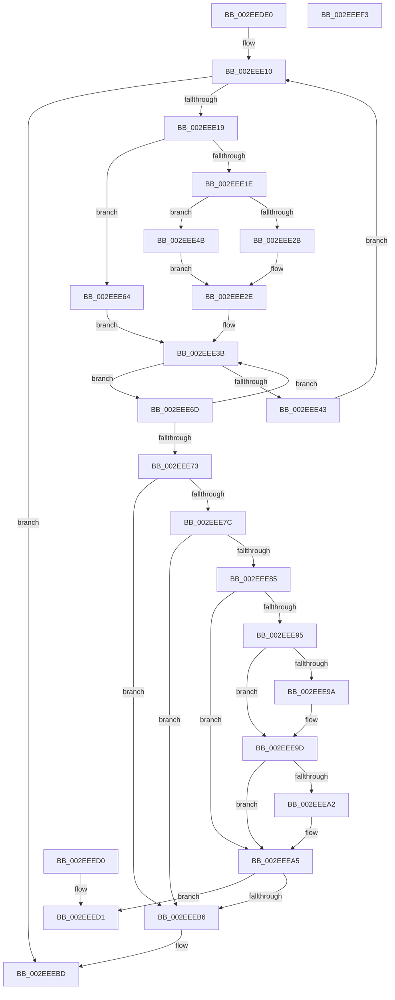

# RtlEnumerateEntryHashTable

- RVA: `0x002EEDE0`–`0x002EEEF4` (길이 `276` bytes)
- VA: `0x00000001402EEDE0`
- 실행 섹션: `.text`
- PDB 이름 있음: `예`; PDB Function 태그: `아니요`
- unwind 정보 RVA: `0x00071A30`
- 디코드: `84`개 명령, `276/276` bytes 표시
- 미해석 바이트: `0` (있으면 어셈블리에 `.byte`로 보존)

> 이 문서는 커널 이미지의 기계어와 PDB 기호를 분석해 생성했습니다. 4번과 5번은 함수 원형과 자료형을 바이너리 사용 방식에서 추정한 C 해석이며 원본 소스 복구 결과는 아닙니다.

## 1. Dependencies

- 직접 호출 지점: **0**; 고유 호출 대상: **0**
- 직접 호출자로 확인된 함수: **4**
- RIP 상대 이미지 참조: **0**

### Outgoing calls
- 직접 디코드된 call 명령이 없습니다.

### Direct callers
- [SepCleanupMarkedForDeletionEntries](SepCleanupMarkedForDeletionEntries_function_002EEC84.md) at `0x002EED43`
- [SepFindMatchingLowBoxNumberEntries](../../page/7A/SepFindMatchingLowBoxNumberEntries_function_007A3058.md) at `0x007A30BC`
- [SepFindMatchingLowBoxNumberEntries](../../page/7A/SepFindMatchingLowBoxNumberEntries_function_007A3058.md) at `0x007A30F3`
- [SepRmDestroyCapTable](../../page/7A/SepRmDestroyCapTable_function_007A4894.md) at `0x007A48E6`
- [SepDeleteCachedHandlesTable](../../page/AC/SepDeleteCachedHandlesTable_function_00ACCE28.md) at `0x00ACCEE0`

### Static image references
- 디코드된 RIP-relative 메모리 참조가 없습니다.

## 2. Other-region calls and transfers

- 다른 실행 섹션으로 향하는 call: **0**
- 별도 외부 분기/꼬리 이동을 확인하지 못했습니다.

## 3. Assembly (complete function range)

```asm
002EEDE0  48 89 5C 24 10                  mov qword ptr [rsp + 0x10], rbx
002EEDE5  48 89 6C 24 18                  mov qword ptr [rsp + 0x18], rbp
002EEDEA  48 89 74 24 20                  mov qword ptr [rsp + 0x20], rsi
002EEDEF  57                              push rdi
002EEDF0  8B 5A 20                        mov ebx, dword ptr [rdx + 0x20]
002EEDF3  48 8B F2                        mov rsi, rdx
002EEDF6  44 8B 59 08                     mov r11d, dword ptr [rcx + 8]
002EEDFA  48 8B F9                        mov rdi, rcx
002EEDFD  44 8B C3                        mov r8d, ebx
002EEE00  33 ED                           xor ebp, ebp
002EEE02  44 8D 93 80 00 00 00            lea r10d, [rbx + 0x80]
002EEE09  0F 1F 80 00 00 00 00            nop dword ptr [rax]
002EEE10  45 3B C3                        cmp r8d, r11d
002EEE13  0F 83 A4 00 00 00               jae 0x1402eeebd
002EEE19  44 3B C3                        cmp r8d, ebx
002EEE1C  74 46                           je 0x1402eee64
002EEE1E  48 8B 57 20                     mov rdx, qword ptr [rdi + 0x20]
002EEE22  41 81 FB 80 00 00 00            cmp r11d, 0x80
002EEE29  77 20                           ja 0x1402eee4b
002EEE2B  45 8B C8                        mov r9d, r8d
002EEE2E  41 8B C1                        mov eax, r9d
002EEE31  48 C1 E0 04                     shl rax, 4
002EEE35  48 03 C2                        add rax, rdx
002EEE38  48 8B D0                        mov rdx, rax
002EEE3B  48 8B 12                        mov rdx, qword ptr [rdx]
002EEE3E  48 3B D0                        cmp rdx, rax
002EEE41  75 2A                           jne 0x1402eee6d
002EEE43  41 FF C0                        inc r8d
002EEE46  41 FF C2                        inc r10d
002EEE49  EB C5                           jmp 0x1402eee10
002EEE4B  41 0F BD CA                     bsr ecx, r10d
002EEE4F  41 B9 01 00 00 00               mov r9d, 1
002EEE55  41 D3 E1                        shl r9d, cl
002EEE58  45 33 CA                        xor r9d, r10d
002EEE5B  8D 41 F9                        lea eax, [rcx - 7]
002EEE5E  48 8B 14 C2                     mov rdx, qword ptr [rdx + rax*8]
002EEE62  EB CA                           jmp 0x1402eee2e
002EEE64  48 8B 46 18                     mov rax, qword ptr [rsi + 0x18]
002EEE68  48 8B D6                        mov rdx, rsi
002EEE6B  EB CE                           jmp 0x1402eee3b
002EEE6D  48 39 6A 10                     cmp qword ptr [rdx + 0x10], rbp
002EEE71  74 C8                           je 0x1402eee3b
002EEE73  48 8B 0E                        mov rcx, qword ptr [rsi]
002EEE76  48 39 71 08                     cmp qword ptr [rcx + 8], rsi
002EEE7A  75 3A                           jne 0x1402eeeb6
002EEE7C  4C 8B 4E 08                     mov r9, qword ptr [rsi + 8]
002EEE80  49 39 31                        cmp qword ptr [r9], rsi
002EEE83  75 31                           jne 0x1402eeeb6
002EEE85  49 89 09                        mov qword ptr [r9], rcx
002EEE88  4C 89 49 08                     mov qword ptr [rcx + 8], r9
002EEE8C  48 8B 4E 18                     mov rcx, qword ptr [rsi + 0x18]
002EEE90  48 3B C8                        cmp rcx, rax
002EEE93  74 10                           je 0x1402eeea5
002EEE95  48 39 09                        cmp qword ptr [rcx], rcx
002EEE98  75 03                           jne 0x1402eee9d
002EEE9A  FF 4F 18                        dec dword ptr [rdi + 0x18]
002EEE9D  48 39 00                        cmp qword ptr [rax], rax
002EEEA0  75 03                           jne 0x1402eeea5
002EEEA2  FF 47 18                        inc dword ptr [rdi + 0x18]
002EEEA5  44 89 46 20                     mov dword ptr [rsi + 0x20], r8d
002EEEA9  48 89 46 18                     mov qword ptr [rsi + 0x18], rax
002EEEAD  48 8B 02                        mov rax, qword ptr [rdx]
002EEEB0  48 39 50 08                     cmp qword ptr [rax + 8], rdx
002EEEB4  74 1B                           je 0x1402eeed1
002EEEB6  B9 03 00 00 00                  mov ecx, 3
002EEEBB  CD 29                           int 0x29
002EEEBD  33 C0                           xor eax, eax
002EEEBF  48 8B 5C 24 18                  mov rbx, qword ptr [rsp + 0x18]
002EEEC4  48 8B 6C 24 20                  mov rbp, qword ptr [rsp + 0x20]
002EEEC9  48 8B 74 24 28                  mov rsi, qword ptr [rsp + 0x28]
002EEECE  5F                              pop rdi
002EEECF  C3                              ret
002EEED0  CC                              int3
002EEED1  48 8B 5C 24 18                  mov rbx, qword ptr [rsp + 0x18]
002EEED6  48 8B 6C 24 20                  mov rbp, qword ptr [rsp + 0x20]
002EEEDB  48 89 06                        mov qword ptr [rsi], rax
002EEEDE  48 89 56 08                     mov qword ptr [rsi + 8], rdx
002EEEE2  48 89 70 08                     mov qword ptr [rax + 8], rsi
002EEEE6  48 8B C2                        mov rax, rdx
002EEEE9  48 89 32                        mov qword ptr [rdx], rsi
002EEEEC  48 8B 74 24 28                  mov rsi, qword ptr [rsp + 0x28]
002EEEF1  5F                              pop rdi
002EEEF2  C3                              ret
002EEEF3  CC                              int3
```

## 4. C-style interpretation (structured pseudocode)

```c
__int64 __fastcall RtlEnumerateEntryHashTable(__int64 a1, __int64 a2)
{
    __int64 result;
    __int64 v_r10;
    __int64 v_rbp;
    unsigned __int64 v_stack_p10;
    unsigned __int64 v_stack_p18;
    unsigned __int64 v_stack_p20;
    unsigned __int64 v_stack_p28;

    v_stack_p10 = v_rbx;
    v_stack_p18 = v_rbp;
    v_stack_p20 = v_rsi;
    v_rbp = 0;
loc_002EEE10:
    if (((unsigned int)((unsigned int)((unsigned int)((unsigned int)(*(unsigned int *)(a2 + 32)))))) >= ((unsigned int)((unsigned int)(*(unsigned int *)(a1 + 8))))) goto loc_002EEEBD;
    if (((unsigned int)((unsigned int)((unsigned int)((unsigned int)(*(unsigned int *)(a2 + 32)))))) == ((unsigned int)((unsigned int)(*(unsigned int *)(a2 + 32))))) goto loc_002EEE64;
    if (((unsigned int)((unsigned int)(*(unsigned int *)(a1 + 8)))) > 128) goto loc_002EEE4B;
loc_002EEE2E:
    result = ((unsigned int)((unsigned int)((unsigned int)((unsigned int)((unsigned int)((unsigned int)((unsigned int)(*(unsigned int *)(a2 + 32))))))))) << (4);
    result = (result) + (*(unsigned __int64 *)(a1 + 32));
loc_002EEE3B:
    if ((*(unsigned __int64 *)(result)) != result) goto loc_002EEE6D;
    a3 = (unsigned int)(((unsigned int)((unsigned int)((unsigned int)(*(unsigned int *)(a2 + 32))))) + 1);
    v_r10 = (unsigned int)(((unsigned int)(*(unsigned int *)(a2 + 32)) + 128) + 1);
    goto loc_002EEE10;
loc_002EEE4B:
    a4 = (unsigned int)((1) << ((unsigned __int8)(a1)));
    a4 = (unsigned int)((a4) ^ ((unsigned int)(v_r10)));
    goto loc_002EEE2E;
loc_002EEE64:
    goto loc_002EEE3B;
loc_002EEE6D:
    if ((*(unsigned __int64 *)(a2 + 16)) == 0) goto loc_002EEE3B;
    if ((*(unsigned __int64 *)(*(unsigned __int64 *)(a2) + 8)) != a2) goto loc_002EEEB6;
    if ((*(unsigned __int64 *)(*(unsigned __int64 *)(a2 + 8))) != a2) goto loc_002EEEB6;
    *(unsigned __int64 *)(*(unsigned __int64 *)(a2 + 8)) = *(unsigned __int64 *)(a2);
    *(unsigned __int64 *)(*(unsigned __int64 *)(a2) + 8) = *(unsigned __int64 *)(a2 + 8);
    if ((*(unsigned __int64 *)(a2 + 24)) == (*(unsigned __int64 *)(a2 + 24))) goto loc_002EEEA5;
    if ((*(unsigned __int64 *)(*(unsigned __int64 *)(a2 + 24))) == (*(unsigned __int64 *)(a2 + 24))) {
    }
    if ((*(unsigned __int64 *)(*(unsigned __int64 *)(a2 + 24))) == (*(unsigned __int64 *)(a2 + 24))) {
    }
    *(unsigned int *)(a2 + 32) = (unsigned int)(a3);
    *(unsigned __int64 *)(a2 + 24) = *(unsigned __int64 *)(a2 + 24);
    if ((*(unsigned __int64 *)(*(unsigned __int64 *)(a2) + 8)) == a2) goto loc_002EEED1;
loc_002EEEB6:
loc_002EEEBD:
    result = 0;
    return result;
loc_002EEED1:
    *(unsigned __int64 *)(v_stack_p20) = 0;
    *(unsigned __int64 *)(v_stack_p20 + 8) = a2;
    *(unsigned __int64 *)(result + 8) = v_stack_p20;
    *(unsigned __int64 *)(a2) = v_stack_p20;
    return a2;
}
```

## 5. (Beta) C Style

```c
int64_t RtlEnumerateEntryHashTable(void *Arg1, void *Arg2)
{
    uint8_t *arg1 = (uint8_t *)Arg1;
    uint8_t *arg2 = (uint8_t *)Arg2;

    int64_t result;
    int64_t local_r10;
    int64_t local_rbp;
    uint64_t v_stack_p10;
    uint64_t v_stack_p18;
    uint64_t v_stack_p20;
    uint64_t v_stack_p28;

    v_stack_p10 = local_rbx;
    v_stack_p18 = local_rbp;
    v_stack_p20 = local_rsi;
    local_rbp = 0;
loc_002EEE10:
    if (((uint32_t)((uint32_t)((uint32_t)((uint32_t)(*(uint32_t *)(arg2 + 0x20)))))) >= ((uint32_t)((uint32_t)(*(uint32_t *)(arg1 + 0x8))))) goto loc_002EEEBD;
    if (((uint32_t)((uint32_t)((uint32_t)((uint32_t)(*(uint32_t *)(arg2 + 0x20)))))) == ((uint32_t)((uint32_t)(*(uint32_t *)(arg2 + 0x20))))) goto loc_002EEE64;
    if (((uint32_t)((uint32_t)(*(uint32_t *)(arg1 + 0x8)))) > 128) goto loc_002EEE4B;
loc_002EEE2E:
    result = ((uint32_t)((uint32_t)((uint32_t)((uint32_t)((uint32_t)((uint32_t)((uint32_t)(*(uint32_t *)(arg2 + 0x20))))))))) << (4);
    result = (result) + (*(uint64_t *)(arg1 + 0x20));
loc_002EEE3B:
    if ((*(uint64_t *)(result)) != result) goto loc_002EEE6D;
    a3 = (uint32_t)(((uint32_t)((uint32_t)((uint32_t)(*(uint32_t *)(arg2 + 0x20))))) + 1);
    local_r10 = (uint32_t)(((uint32_t)(*(uint32_t *)(arg2 + 0x20)) + 128) + 1);
    goto loc_002EEE10;
loc_002EEE4B:
    a4 = (uint32_t)((1) << ((uint8_t)(Arg1)));
    a4 = (uint32_t)((a4) ^ ((uint32_t)(local_r10)));
    goto loc_002EEE2E;
loc_002EEE64:
    goto loc_002EEE3B;
loc_002EEE6D:
    if ((*(uint64_t *)(arg2 + 0x10)) == 0) goto loc_002EEE3B;
    if ((*(uint64_t *)(*(uint64_t *)(arg2) + 0x8)) != Arg2) goto loc_002EEEB6;
    if ((*(uint64_t *)(*(uint64_t *)(arg2 + 0x8))) != Arg2) goto loc_002EEEB6;
    *(uint64_t *)(*(uint64_t *)(arg2 + 0x8)) = *(uint64_t *)(arg2);
    *(uint64_t *)(*(uint64_t *)(arg2) + 0x8) = *(uint64_t *)(arg2 + 0x8);
    if ((*(uint64_t *)(arg2 + 0x18)) == (*(uint64_t *)(arg2 + 0x18))) goto loc_002EEEA5;
    if ((*(uint64_t *)(*(uint64_t *)(arg2 + 0x18))) == (*(uint64_t *)(arg2 + 0x18))) {
    }
    if ((*(uint64_t *)(*(uint64_t *)(arg2 + 0x18))) == (*(uint64_t *)(arg2 + 0x18))) {
    }
    *(uint32_t *)(arg2 + 0x20) = (uint32_t)(a3);
    *(uint64_t *)(arg2 + 0x18) = *(uint64_t *)(arg2 + 0x18);
    if ((*(uint64_t *)(*(uint64_t *)(arg2) + 0x8)) == Arg2) goto loc_002EEED1;
loc_002EEEB6:
loc_002EEEBD:
    result = 0;
    return result;
loc_002EEED1:
    *(uint64_t *)(v_stack_p20) = 0;
    *(void **)(v_stack_p20 + 0x8) = Arg2;
    *(uint64_t *)(result + 0x8) = v_stack_p20;
    *(uint64_t *)(arg2) = v_stack_p20;
    return Arg2;
}
```

### 관측된 메모리 오프셋

구조체 형식이 확인되지 않은 접근은 인자 기준의 오프셋으로만 기록했습니다.

| 기준 인자 | 오프셋 표현 | 폭 (bit) | 접근 |
|---|---:|---:|---|
| `Arg1` | `+ 0x8` | `32` | `R` |
| `Arg1` | `+ 0x18` | `32` | `R/W` |
| `Arg1` | `+ 0x20` | `64` | `R` |
| `Arg2` | `+ 0x0` | `64` | `R` |
| `Arg2` | `+ 0x0` | `64` | `W` |
| `Arg2` | `+ 0x8` | `64` | `R` |
| `Arg2` | `+ 0x8` | `64` | `W` |
| `Arg2` | `+ 0x18` | `64` | `R` |
| `Arg2` | `+ 0x18` | `64` | `W` |
| `Arg2` | `+ 0x20` | `32` | `R` |
| `Arg2` | `+ 0x20` | `32` | `W` |

## 6. Execution-region graph

[열기: 2D/3D 그래프와 함수 탐색 컨트롤 패널](../../../control-panel.html?section=text&rva=0x002EEDE0&view=graph)

- 2D 그래프는 위에서 아래로 흐르고, 3D 그래프는 빈 공간을 드래그해 회전합니다. Shift+드래그는 이동, 휠은 확대·축소, 함수 노드 선택은 대상 보고서 이동입니다.

### Static fallback


