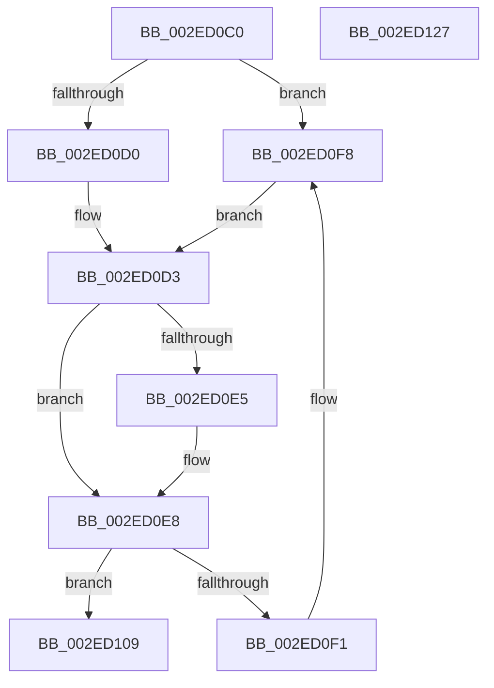

# RtlInitEnumerationHashTable

- RVA: `0x002ED0C0`–`0x002ED128` (길이 `104` bytes)
- VA: `0x00000001402ED0C0`
- 실행 섹션: `.text`
- PDB 이름 있음: `예`; PDB Function 태그: `아니요`
- unwind 정보 RVA: `0x000DB714`
- 디코드: `32`개 명령, `104/104` bytes 표시
- 미해석 바이트: `0` (있으면 어셈블리에 `.byte`로 보존)

> 이 문서는 커널 이미지의 기계어와 PDB 기호를 분석해 생성했습니다. 4번과 5번은 함수 원형과 자료형을 바이너리 사용 방식에서 추정한 C 해석이며 원본 소스 복구 결과는 아닙니다.

## 1. Dependencies

- 직접 호출 지점: **0**; 고유 호출 대상: **0**
- 직접 호출자로 확인된 함수: **4**
- RIP 상대 이미지 참조: **0**

### Outgoing calls
- 직접 디코드된 call 명령이 없습니다.

### Direct callers
- [SepCleanupMarkedForDeletionEntries](SepCleanupMarkedForDeletionEntries_function_002EEC84.md) at `0x002EECC2`
- [SepFindMatchingLowBoxNumberEntries](../../page/7A/SepFindMatchingLowBoxNumberEntries_function_007A3058.md) at `0x007A30AB`
- [SepRmDestroyCapTable](../../page/7A/SepRmDestroyCapTable_function_007A4894.md) at `0x007A48BA`
- [SepDeleteCachedHandlesTable](../../page/AC/SepDeleteCachedHandlesTable_function_00ACCE28.md) at `0x00ACCEAC`

### Static image references
- 디코드된 RIP-relative 메모리 참조가 없습니다.

## 2. Other-region calls and transfers

- 다른 실행 섹션으로 향하는 call: **0**
- 별도 외부 분기/꼬리 이동을 확인하지 못했습니다.

## 3. Assembly (complete function range)

```asm
002ED0C0  4C 8B 51 20                     mov r10, qword ptr [rcx + 0x20]
002ED0C4  41 B9 80 00 00 00               mov r9d, 0x80
002ED0CA  44 39 49 08                     cmp dword ptr [rcx + 8], r9d
002ED0CE  77 28                           ja 0x1402ed0f8
002ED0D0  45 33 C9                        xor r9d, r9d
002ED0D3  FF 41 1C                        inc dword ptr [rcx + 0x1c]
002ED0D6  41 8B C1                        mov eax, r9d
002ED0D9  48 C1 E0 04                     shl rax, 4
002ED0DD  49 03 C2                        add rax, r10
002ED0E0  48 39 00                        cmp qword ptr [rax], rax
002ED0E3  75 03                           jne 0x1402ed0e8
002ED0E5  FF 41 18                        inc dword ptr [rcx + 0x18]
002ED0E8  48 8B 08                        mov rcx, qword ptr [rax]
002ED0EB  48 39 41 08                     cmp qword ptr [rcx + 8], rax
002ED0EF  74 18                           je 0x1402ed109
002ED0F1  B9 03 00 00 00                  mov ecx, 3
002ED0F6  CD 29                           int 0x29
002ED0F8  41 0F BD C1                     bsr eax, r9d
002ED0FC  41 0F BB C1                     btc r9d, eax
002ED100  83 C0 F9                        add eax, -7
002ED103  4D 8B 14 C2                     mov r10, qword ptr [r10 + rax*8]
002ED107  EB CA                           jmp 0x1402ed0d3
002ED109  48 89 42 08                     mov qword ptr [rdx + 8], rax
002ED10D  48 89 0A                        mov qword ptr [rdx], rcx
002ED110  48 89 51 08                     mov qword ptr [rcx + 8], rdx
002ED114  48 89 10                        mov qword ptr [rax], rdx
002ED117  83 62 20 00                     and dword ptr [rdx + 0x20], 0
002ED11B  48 83 62 10 00                  and qword ptr [rdx + 0x10], 0
002ED120  48 89 42 18                     mov qword ptr [rdx + 0x18], rax
002ED124  B0 01                           mov al, 1
002ED126  C3                              ret
002ED127  CC                              int3
```

## 4. C-style interpretation (structured pseudocode)

```c
__int64 __fastcall RtlInitEnumerationHashTable(__int64 a1, __int64 a2)
{
    __int64 result;

    if ((*(unsigned int *)(a1 + 8)) > 128) goto loc_002ED0F8;
    a4 = 0;
loc_002ED0D3:
    result = (0) << (4);
    result = (result) + (*(unsigned __int64 *)(a1 + 32));
    if ((*(unsigned __int64 *)(result)) == result) {
    }
    if ((*(unsigned __int64 *)(*(unsigned __int64 *)(result) + 8)) == result) goto loc_002ED109;
loc_002ED0F8:
    result = (unsigned int)((result) + (-7));
    goto loc_002ED0D3;
loc_002ED109:
    *(unsigned __int64 *)(a2 + 8) = result;
    *(unsigned __int64 *)(a2) = 3;
    *(unsigned __int64 *)(3 + 8) = a2;
    *(unsigned __int64 *)(result) = a2;
    *(unsigned __int64 *)(a2 + 24) = result;
    return 1;
}
```

## 5. (Beta) C Style

```c
int64_t RtlInitEnumerationHashTable(void *Arg1, void *Arg2)
{
    uint8_t *arg1 = (uint8_t *)Arg1;
    uint8_t *arg2 = (uint8_t *)Arg2;

    int64_t result;

    if ((*(uint32_t *)(arg1 + 0x8)) > 128) goto loc_002ED0F8;
    a4 = 0;
loc_002ED0D3:
    result = (0) << (4);
    result = (result) + (*(uint64_t *)(arg1 + 0x20));
    if ((*(uint64_t *)(result)) == result) {
    }
    if ((*(uint64_t *)(*(uint64_t *)(result) + 0x8)) == result) goto loc_002ED109;
loc_002ED0F8:
    result = (uint32_t)((result) + (-7));
    goto loc_002ED0D3;
loc_002ED109:
    *(uint64_t *)(arg2 + 0x8) = result;
    *(uint64_t *)(arg2) = 3;
    *(void **)(3 + 0x8) = Arg2;
    *(void **)(result) = Arg2;
    *(uint64_t *)(arg2 + 0x18) = result;
    return 1;
}
```

### 관측된 메모리 오프셋

구조체 형식이 확인되지 않은 접근은 인자 기준의 오프셋으로만 기록했습니다.

| 기준 인자 | 오프셋 표현 | 폭 (bit) | 접근 |
|---|---:|---:|---|
| `Arg1` | `+ 0x8` | `32` | `R` |
| `Arg1` | `+ 0x20` | `64` | `R` |
| `Arg2` | `+ 0x0` | `64` | `W` |
| `Arg2` | `+ 0x8` | `64` | `W` |
| `Arg2` | `+ 0x10` | `64` | `R/W` |
| `Arg2` | `+ 0x18` | `64` | `W` |
| `Arg2` | `+ 0x20` | `32` | `R/W` |

## 6. Execution-region graph

[열기: 2D/3D 그래프와 함수 탐색 컨트롤 패널](../../../control-panel.html?section=text&rva=0x002ED0C0&view=graph)

- 2D 그래프는 위에서 아래로 흐르고, 3D 그래프는 빈 공간을 드래그해 회전합니다. Shift+드래그는 이동, 휠은 확대·축소, 함수 노드 선택은 대상 보고서 이동입니다.

### Static fallback


