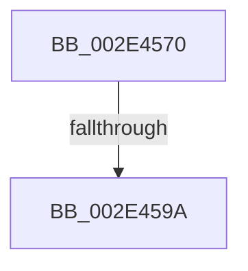

# RtlRbInsertNodeEx

- RVA: `0x002E4570`–`0x002E459D` (길이 `45` bytes)
- VA: `0x00000001402E4570`
- 실행 섹션: `.text`
- PDB 이름 있음: `예`; PDB Function 태그: `아니요`
- unwind 정보 RVA: `0x00070F48`
- 디코드: `14`개 명령, `45/45` bytes 표시
- 미해석 바이트: `0` (있으면 어셈블리에 `.byte`로 보존)

> 이 문서는 커널 이미지의 기계어와 PDB 기호를 분석해 생성했습니다. 4번과 5번은 함수 원형과 자료형을 바이너리 사용 방식에서 추정한 C 해석이며 원본 소스 복구 결과는 아닙니다.

## 1. Dependencies

- 직접 호출 지점: **0**; 고유 호출 대상: **0**
- 직접 호출자로 확인된 함수: **46**
- RIP 상대 이미지 참조: **0**

### Outgoing calls
- 직접 디코드된 call 명령이 없습니다.

### Direct callers
- [KiInsertSchedulingGroupQueue](../20/KiInsertSchedulingGroupQueue_function_002013D4.md) at `0x002014AE`
- [KiAbConvertWaiterToOwnerEntry](../21/KiAbConvertWaiterToOwnerEntry_function_00219430.md) at `0x002198F9`
- [sub_002216AB](../22/Unknown_function_002216AB.md) at `0x002216CA`
- [sub_0022178C](../22/Unknown_function_0022178C.md) at `0x002218A1`
- [sub_00221FB6](../22/Unknown_function_00221FB6.md) at `0x00222292`
- [sub_00221FB6](../22/Unknown_function_00221FB6.md) at `0x00222310`
- [sub_00221FB6](../22/Unknown_function_00221FB6.md) at `0x00222572`
- [sub_00221FB6](../22/Unknown_function_00221FB6.md) at `0x00222754`
- [sub_00221FB6](../22/Unknown_function_00221FB6.md) at `0x002229C3`
- [sub_00221FB6](../22/Unknown_function_00221FB6.md) at `0x002229F0`
- [sub_00221FB6](../22/Unknown_function_00221FB6.md) at `0x00222DAF`
- [ExpUpdateTimerConfigurationWorker](../23/ExpUpdateTimerConfigurationWorker_function_00235410.md) at `0x002354F1`
- [RtlpHpSegPageRangeShrink](RtlpHpSegPageRangeShrink_function_002E2FA0.md) at `0x002E3172`
- [RtlpHpVsChunkFree](RtlpHpVsChunkFree_function_002E3980.md) at `0x002E3E65`
- [RtlpHpVsChunkFree](RtlpHpVsChunkFree_function_002E3980.md) at `0x002E3F81`
- [sub_002E444F](Unknown_function_002E444F.md) at `0x002E44B5`
- [sub_002E59C5](Unknown_function_002E59C5.md) at `0x002E5A3A`
- [sub_002E5B19](Unknown_function_002E5B19.md) at `0x002E5B8A`
- [RtlpHpVsChunkSplit](RtlpHpVsChunkSplit_function_002E5C80.md) at `0x002E6466`
- [RtlpHpVsChunkSplit](RtlpHpVsChunkSplit_function_002E5C80.md) at `0x002E6580`
- [RtlpHpVsFreeChunkInsert](RtlpHpVsFreeChunkInsert_function_002EAF90.md) at `0x002EB0AA`
- [RtlpHpLargeAlloc](RtlpHpLargeAlloc_function_002EBD5C.md) at `0x002EC145`
- [RtlpHpVaMgrFree](RtlpHpVaMgrFree_function_002EDF44.md) at `0x002EDFA3`
- [KiAbDeferredProcessingWorker](../30/KiAbDeferredProcessingWorker_function_0030DEB0.md) at `0x0030E3D2`
- [KiAbDeferredProcessingWorker](../30/KiAbDeferredProcessingWorker_function_0030DEB0.md) at `0x0030E4B4`
- [PfSnGetFileInformation](../34/PfSnGetFileInformation_function_00343210.md) at `0x00343519`
- [MiInsertSlabEntry](../37/MiInsertSlabEntry_function_00378AF4.md) at `0x00378BD4`
- [KeSetTimer2](../3A/KeSetTimer2_function_003A08E0.md) at `0x003A0C45`
- [KeSetTimer2](../3A/KeSetTimer2_function_003A08E0.md) at `0x003A0E51`
- [sub_003A2CBE](../3A/Unknown_function_003A2CBE.md) at `0x003A2D9B`
- [sub_003A2CBE](../3A/Unknown_function_003A2CBE.md) at `0x003A2E6C`
- [MiInvalidatePageFileBitmapsCache](../3E/MiInvalidatePageFileBitmapsCache_function_003E3240.md) at `0x003E3407`
- [MiInvalidatePageFileBitmapsCache](../3E/MiInvalidatePageFileBitmapsCache_function_003E3240.md) at `0x003E344F`
- [MiBitmapsCachedEntryLengthChanged](../3E/MiBitmapsCachedEntryLengthChanged_function_003E3508.md) at `0x003E35E0`
- [sub_003E47AF](../3E/Unknown_function_003E47AF.md) at `0x003E4807`
- [MiRescanPageFileBitmapPortion](../3E/MiRescanPageFileBitmapPortion_function_003E4D08.md) at `0x003E4E9E`
- [MiRescanPageFileBitmapPortion](../3E/MiRescanPageFileBitmapPortion_function_003E4D08.md) at `0x003E4EED`
- [MiInitializePagefileBitmapsCache](../3E/MiInitializePagefileBitmapsCache_function_003E5348.md) at `0x003E541F`
- [MiInitializePagefileBitmapsCache](../3E/MiInitializePagefileBitmapsCache_function_003E5348.md) at `0x003E548F`
- [HalpAllocateCommonBufferEntry](../3E/HalpAllocateCommonBufferEntry_function_003E99F4.md) at `0x003E9A9E`
- [VmpFaultEntryInsert](../42/VmpFaultEntryInsert_function_00429558.md) at `0x0042961B`
- [VmpSplitMemoryRange](../42/VmpSplitMemoryRange_function_00429754.md) at `0x004298F4`
- [VmpSplitMemoryRange](../42/VmpSplitMemoryRange_function_00429754.md) at `0x00429985`
- [IoStartDiskIoAttributionForContext](../46/IoStartDiskIoAttributionForContext_function_0046B434.md) at `0x0046B4D2`
- [KiSetClockInterval](../47/KiSetClockInterval_function_00475064.md) at `0x004750F8`
- [KasanDriverLoadImageInternal](../4C/KasanDriverLoadImageInternal_function_004C2840.md) at `0x004C2D6D`
- [PspJobIoRateVolumeEntryInsert](../5E/PspJobIoRateVolumeEntryInsert_function_005E39C8.md) at `0x005E3A56`
- [RtlCompareExchangePointerMapping](../5E/RtlCompareExchangePointerMapping_function_005E7E20.md) at `0x005E7F07`
- [VmpInsertMemoryRange](../64/VmpInsertMemoryRange_function_0064C9F0.md) at `0x0064CC09`
- [VmpInsertMemoryRange](../64/VmpInsertMemoryRange_function_0064C9F0.md) at `0x0064CC82`
- [VmpUpdatePinRangesForFirstPin](../64/VmpUpdatePinRangesForFirstPin_function_0064D7AC.md) at `0x0064D845`
- [MiInsertPageFileMemoryExtents](../69/MiInsertPageFileMemoryExtents_function_006950C8.md) at `0x006951D9`
- [KiGetSystemServiceTraceTable](../../page/74/KiGetSystemServiceTraceTable_function_00747BE4.md) at `0x00747CC4`
- [PfSnSetAltPrefetchParam](../../page/75/PfSnSetAltPrefetchParam_function_00752424.md) at `0x0075276F`
- [PfSnSetAltPrefetchParam](../../page/75/PfSnSetAltPrefetchParam_function_00752424.md) at `0x007527F7`
- [EtwpRegisterPrivateSession](../../page/7B/EtwpRegisterPrivateSession_function_007BC92C.md) at `0x007BCA83`
- [MiCreatePagefileMemoryExtents](../../page/80/MiCreatePagefileMemoryExtents_function_0080F1BC.md) at `0x0080F359`
- [HvpViewMapCreateViewsForRegion](../../page/9B/HvpViewMapCreateViewsForRegion_function_009B6094.md) at `0x009B61F4`
- [HvpViewMapPromoteRangeToMapping](../../page/9B/HvpViewMapPromoteRangeToMapping_function_009B94C8.md) at `0x009B9690`
- [EtwpSetProviderTraitsCommon](../../page/9F/EtwpSetProviderTraitsCommon_function_009F36EC.md) at `0x009F3801`
- [MiConstructLoaderMemoryTree](../../init/C5/MiConstructLoaderMemoryTree_function_00C5F868.md) at `0x00C5F8FC`
- [MiRemoveLargeFreeLoaderDescriptors](../../init/C6/MiRemoveLargeFreeLoaderDescriptors_function_00C6283C.md) at `0x00C62C48`
- [KeInitializeClock](../../init/C7/KeInitializeClock_function_00C70C30.md) at `0x00C70F8F`

### Static image references
- 디코드된 RIP-relative 메모리 참조가 없습니다.

## 2. Other-region calls and transfers

- 다른 실행 섹션으로 향하는 call: **0**
- call이 아닌 외부 분기/꼬리 이동: **1**
  - `0x002E4594` → [sub_002E46D4](Unknown_function_002E46D4.md) (`tail-transfer`)

## 3. Assembly (complete function range)

```asm
002E4570  40 57                           push rdi
002E4572  41 56                           push r14
002E4574  41 57                           push r15
002E4576  48 83 EC 40                     sub rsp, 0x40
002E457A  45 33 FF                        xor r15d, r15d
002E457D  45 0F B6 F0                     movzx r14d, r8b
002E4581  4D 89 39                        mov qword ptr [r9], r15
002E4584  48 8B F9                        mov rdi, rcx
002E4587  4D 89 79 08                     mov qword ptr [r9 + 8], r15
002E458B  0F B6 41 08                     movzx eax, byte ptr [rcx + 8]
002E458F  24 01                           and al, 1
002E4591  48 85 D2                        test rdx, rdx
002E4594  0F 84 3A 01 00 00               je 0x1402e46d4
002E459A  4D 8B C1                        mov r8, r9
```

## 4. C-style interpretation (structured pseudocode)

```c
__int64 __fastcall RtlRbInsertNodeEx(__int64 a1, __int64 a2, unsigned __int8 a3, __int64 a4)
{
    __int64 result;
    __int64 v_r15;
    __int64 v_rsp;

    v_rsp = (v_rsp) - (64);
    v_r15 = 0;
    *(unsigned __int64 *)(a4) = 0;
    *(unsigned __int64 *)(a4 + 8) = 0;
    result = (unsigned __int8)((*(unsigned __int8 *)(a1 + 8)) & (1));
    return result;
}
```

## 5. (Beta) C Style

```c
int64_t RtlRbInsertNodeEx(void *Arg1, int64_t Arg2, uint8_t Arg3, void *Arg4)
{
    uint8_t *arg1 = (uint8_t *)Arg1;
    uint8_t *arg4 = (uint8_t *)Arg4;

    int64_t result;
    int64_t local_r15;
    int64_t local_rsp;

    local_rsp = (local_rsp) - (64);
    local_r15 = 0;
    *(uint64_t *)(arg4) = 0;
    *(uint64_t *)(arg4 + 0x8) = 0;
    result = (uint8_t)((*(uint8_t *)(arg1 + 0x8)) & (1));
    return result;
}
```

### 관측된 메모리 오프셋

구조체 형식이 확인되지 않은 접근은 인자 기준의 오프셋으로만 기록했습니다.

| 기준 인자 | 오프셋 표현 | 폭 (bit) | 접근 |
|---|---:|---:|---|
| `Arg1` | `+ 0x8` | `8` | `R` |
| `Arg4` | `+ 0x0` | `64` | `W` |
| `Arg4` | `+ 0x8` | `64` | `W` |

## 6. Execution-region graph

[열기: 2D/3D 그래프와 함수 탐색 컨트롤 패널](../../../control-panel.html?section=text&rva=0x002E4570&view=graph)

- 2D 그래프는 위에서 아래로 흐르고, 3D 그래프는 빈 공간을 드래그해 회전합니다. Shift+드래그는 이동, 휠은 확대·축소, 함수 노드 선택은 대상 보고서 이동입니다.

### Static fallback


