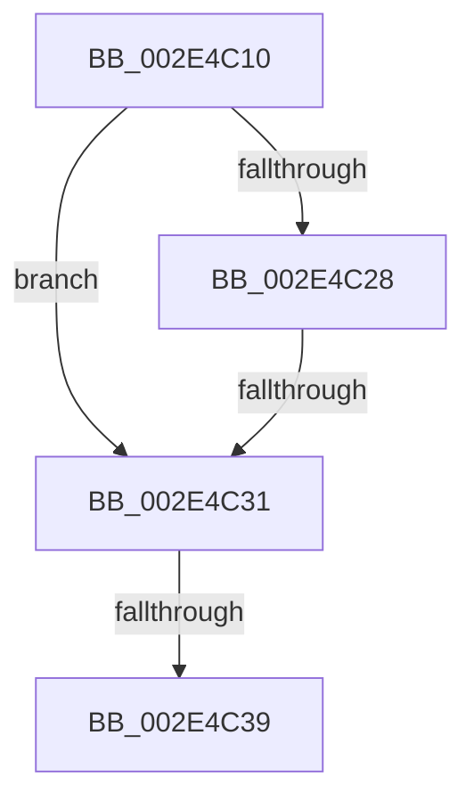

# RtlRbRemoveNode

- RVA: `0x002E4C10`–`0x002E4C42` (길이 `50` bytes)
- VA: `0x00000001402E4C10`
- 실행 섹션: `.text`
- PDB 이름 있음: `예`; PDB Function 태그: `아니요`
- unwind 정보 RVA: `0x000710FC`
- 디코드: `15`개 명령, `50/50` bytes 표시
- 미해석 바이트: `0` (있으면 어셈블리에 `.byte`로 보존)

> 이 문서는 커널 이미지의 기계어와 PDB 기호를 분석해 생성했습니다. 4번과 5번은 함수 원형과 자료형을 바이너리 사용 방식에서 추정한 C 해석이며 원본 소스 복구 결과는 아닙니다.

## 1. Dependencies

- 직접 호출 지점: **0**; 고유 호출 대상: **0**
- 직접 호출자로 확인된 함수: **51**
- RIP 상대 이미지 참조: **0**

### Outgoing calls
- 직접 디코드된 call 명령이 없습니다.

### Direct callers
- [KiRemoveSchedulingGroupQueue](../20/KiRemoveSchedulingGroupQueue_function_00202638.md) at `0x002026A2`
- [KiAbConvertWaiterToOwnerEntry](../21/KiAbConvertWaiterToOwnerEntry_function_00219430.md) at `0x0021986E`
- [sub_00221FB6](../22/Unknown_function_00221FB6.md) at `0x002220C2`
- [sub_00221FB6](../22/Unknown_function_00221FB6.md) at `0x00222219`
- [sub_00221FB6](../22/Unknown_function_00221FB6.md) at `0x00222508`
- [sub_00221FB6](../22/Unknown_function_00221FB6.md) at `0x002226E4`
- [sub_00221FB6](../22/Unknown_function_00221FB6.md) at `0x0022281B`
- [sub_00221FB6](../22/Unknown_function_00221FB6.md) at `0x002228D4`
- [ExpUpdateTimerConfigurationWorker](../23/ExpUpdateTimerConfigurationWorker_function_00235410.md) at `0x0023547D`
- [sub_00248832](../24/Unknown_function_00248832.md) at `0x002489AE`
- [sub_00248B10](../24/Unknown_function_00248B10.md) at `0x00248BA9`
- [sub_00248B10](../24/Unknown_function_00248B10.md) at `0x00248BB9`
- [KiAbEntryRemoveFromTree](../26/KiAbEntryRemoveFromTree_function_00262410.md) at `0x002625A2`
- [KiAbEntryRemoveFromTree](../26/KiAbEntryRemoveFromTree_function_00262410.md) at `0x00262749`
- [KiAbEntryRemoveFromTree](../26/KiAbEntryRemoveFromTree_function_00262410.md) at `0x00262792`
- [IoStopDiskIoAttributionForContext](../2A/IoStopDiskIoAttributionForContext_function_002A5614.md) at `0x002A5639`
- [RtlpHpVsChunkFree](RtlpHpVsChunkFree_function_002E3980.md) at `0x002E3A2B`
- [RtlpHpVsChunkFree](RtlpHpVsChunkFree_function_002E3980.md) at `0x002E3B24`
- [RtlpHpVsChunkFree](RtlpHpVsChunkFree_function_002E3980.md) at `0x002E3C23`
- [sub_002E59C5](Unknown_function_002E59C5.md) at `0x002E59D9`
- [RtlpHpSegFreeRangeRemove](RtlpHpSegFreeRangeRemove_function_002E5A80.md) at `0x002E5A94`
- [sub_002E5B19](Unknown_function_002E5B19.md) at `0x002E5B2C`
- [RtlpHpVsChunkSplit](RtlpHpVsChunkSplit_function_002E5C80.md) at `0x002E5CC0`
- [RtlpHpVsChunkSplit](RtlpHpVsChunkSplit_function_002E5C80.md) at `0x002E5FF3`
- [RtlpHpVsChunkSplit](RtlpHpVsChunkSplit_function_002E5C80.md) at `0x002E60F7`
- [RtlpHpVsChunkSplit](RtlpHpVsChunkSplit_function_002E5C80.md) at `0x002E6201`
- [RtlpHpVsFreeChunkRemove](RtlpHpVsFreeChunkRemove_function_002E6BA0.md) at `0x002E6BC3`
- [RtlpHpLargeFree](RtlpHpLargeFree_function_002EC89C.md) at `0x002EC915`
- [RtlpHpVaMgrAlloc](RtlpHpVaMgrAlloc_function_002EDB1C.md) at `0x002EDB96`
- [RtlpHpVaMgrRangeCoalesce](RtlpHpVaMgrRangeCoalesce_function_002EDFE0.md) at `0x002EE03F`
- [RtlpHpVaMgrRangeCoalesce](RtlpHpVaMgrRangeCoalesce_function_002EDFE0.md) at `0x002EE0B4`
- [KiAbDeferredProcessingWorker](../30/KiAbDeferredProcessingWorker_function_0030DEB0.md) at `0x0030E25F`
- [KiAbDeferredProcessingWorker](../30/KiAbDeferredProcessingWorker_function_0030DEB0.md) at `0x0030E353`
- [RtlpHpSegPageRangeCoalesce](../32/RtlpHpSegPageRangeCoalesce_function_00325860.md) at `0x00325A6E`
- [RtlpHpSegPageRangeCoalesce](../32/RtlpHpSegPageRangeCoalesce_function_00325860.md) at `0x00325B24`
- [sub_003267E9](../32/Unknown_function_003267E9.md) at `0x00326832`
- [RtlpHpSegContextCompact](../32/RtlpHpSegContextCompact_function_00326F90.md) at `0x0032707E`
- [sub_003A1D69](../3A/Unknown_function_003A1D69.md) at `0x003A1DE5`
- [sub_003A1E3F](../3A/Unknown_function_003A1E3F.md) at `0x003A1E3F`
- [MiInvalidatePageFileBitmapsCache](../3E/MiInvalidatePageFileBitmapsCache_function_003E3240.md) at `0x003E3311`
- [MiInvalidatePageFileBitmapsCache](../3E/MiInvalidatePageFileBitmapsCache_function_003E3240.md) at `0x003E3321`
- [MiBitmapsCachedEntryLengthChanged](../3E/MiBitmapsCachedEntryLengthChanged_function_003E3508.md) at `0x003E357D`
- [sub_003E455D](../3E/Unknown_function_003E455D.md) at `0x003E46C9`
- [sub_003E47AF](../3E/Unknown_function_003E47AF.md) at `0x003E4A25`
- [sub_003E47AF](../3E/Unknown_function_003E47AF.md) at `0x003E4A34`
- [MiRescanPageFileBitmapPortion](../3E/MiRescanPageFileBitmapPortion_function_003E4D08.md) at `0x003E4E18`
- [MiRescanPageFileBitmapPortion](../3E/MiRescanPageFileBitmapPortion_function_003E4D08.md) at `0x003E4E28`
- [HalpPopCommonBufferEntry](../3F/HalpPopCommonBufferEntry_function_003F68D4.md) at `0x003F694B`
- [VmpFaultEntryRemove](../42/VmpFaultEntryRemove_function_0042969C.md) at `0x004296F1`
- [PfSnNameRemove](../43/PfSnNameRemove_function_0043E3C0.md) at `0x0043E4B8`
- [MiRemoveSlabEntry](../44/MiRemoveSlabEntry_function_0044CF08.md) at `0x0044CF43`
- [KiSetClockInterval](../47/KiSetClockInterval_function_00475064.md) at `0x0047508B`
- [VmpRemoveMemoryRange](../48/VmpRemoveMemoryRange_function_00489018.md) at `0x004891AF`
- [VmpRemoveMemoryRange](../48/VmpRemoveMemoryRange_function_00489018.md) at `0x004892CB`
- [VmpMergeMemoryRanges](../4D/VmpMergeMemoryRanges_function_004D9EDC.md) at `0x004DA107`
- [VmpMergeMemoryRanges](../4D/VmpMergeMemoryRanges_function_004D9EDC.md) at `0x004DA13B`
- [sub_005AAA71](../5A/Unknown_function_005AAA71.md) at `0x005AAA86`
- [KiResetClockInterval](../5B/KiResetClockInterval_function_005BB8BC.md) at `0x005BB8D3`
- [PspJobIoRateVolumeEntryRemove](../5E/PspJobIoRateVolumeEntryRemove_function_005E3B6C.md) at `0x005E3BFC`
- [RtlRemovePointerMapping](../5E/RtlRemovePointerMapping_function_005E8300.md) at `0x005E838D`
- [VmpRefDerefPinnedPages](../64/VmpRefDerefPinnedPages_function_0064D1C0.md) at `0x0064D30E`
- [sub_006EB8E8](../6E/Unknown_function_006EB8E8.md) at `0x006EB944`
- [EtwpDeleteSessionDemuxObject](../../page/7B/EtwpDeleteSessionDemuxObject_function_007BC480.md) at `0x007BC536`
- [EtwpRegisterPrivateSession](../../page/7B/EtwpRegisterPrivateSession_function_007BC92C.md) at `0x007BCACB`
- [HvpViewMapShrinkStorage](../../page/7E/HvpViewMapShrinkStorage_function_007EEE1C.md) at `0x007EEE93`
- [EtwpReleaseProviderTraitsReference](../../page/8C/EtwpReleaseProviderTraitsReference_function_008C11EC.md) at `0x008C1274`
- [PfProcessExitNotification](../../page/90/PfProcessExitNotification_function_00903CA4.md) at `0x00903D16`
- [PfProcessExitNotification](../../page/90/PfProcessExitNotification_function_00903CA4.md) at `0x00903D26`
- [HvpViewMapPromoteRangeToMapping](../../page/9B/HvpViewMapPromoteRangeToMapping_function_009B94C8.md) at `0x009B95D6`
- [HvpViewMapPromoteRangeToMapping](../../page/9B/HvpViewMapPromoteRangeToMapping_function_009B94C8.md) at `0x009B960F`
- [HvpViewMapPromoteRangeToMapping](../../page/9B/HvpViewMapPromoteRangeToMapping_function_009B94C8.md) at `0x009B9794`
- [sub_00B312F2](../../page/B3/Unknown_function_00B312F2.md) at `0x00B312F8`
- [MiRemoveLargeFreeLoaderDescriptors](../../init/C6/MiRemoveLargeFreeLoaderDescriptors_function_00C6283C.md) at `0x00C62B7F`
- [MiLimitLoaderBlockHighMemory](../../init/C6/MiLimitLoaderBlockHighMemory_function_00C66AA8.md) at `0x00C66BE7`
- [MiLimitLoaderBlockTotalMemory](../../init/C6/MiLimitLoaderBlockTotalMemory_function_00C66C54.md) at `0x00C66DEB`

### Static image references
- 디코드된 RIP-relative 메모리 참조가 없습니다.

## 2. Other-region calls and transfers

- 다른 실행 섹션으로 향하는 call: **0**
- call이 아닌 외부 분기/꼬리 이동: **3**
  - `0x002E4C2B` → [sub_002E54EE](Unknown_function_002E54EE.md) (`tail-transfer`)
  - `0x002E4C37` → [sub_002E4C42](Unknown_function_002E4C42.md) (`tail-transfer`)
  - `0x002E4C3C` → [sub_002E54EE + 0xC](Unknown_function_002E54EE.md) (`tail-transfer`)

## 3. Assembly (complete function range)

```asm
002E4C10  48 83 EC 28                     sub rsp, 0x28
002E4C14  4C 8B D2                        mov r10, rdx
002E4C17  4C 8B D9                        mov r11, rcx
002E4C1A  0F B6 51 08                     movzx edx, byte ptr [rcx + 8]
002E4C1E  8B CA                           mov ecx, edx
002E4C20  49 8B 02                        mov rax, qword ptr [r10]
002E4C23  83 E1 01                        and ecx, 1
002E4C26  74 09                           je 0x1402e4c31
002E4C28  48 85 C0                        test rax, rax
002E4C2B  0F 85 BD 08 00 00               jne 0x1402e54ee
002E4C31  4D 8B 42 08                     mov r8, qword ptr [r10 + 8]
002E4C35  85 C9                           test ecx, ecx
002E4C37  74 09                           je 0x1402e4c42
002E4C39  4D 85 C0                        test r8, r8
002E4C3C  0F 85 B8 08 00 00               jne 0x1402e54fa
```

## 4. C-style interpretation (structured pseudocode)

```c
__int64 __fastcall RtlRbRemoveNode(__int64 a1, __int64 a2)
{
    __int64 v_rsp;

    v_rsp = (v_rsp) - (40);
    a1 = (unsigned int)(((unsigned int)((unsigned int)(*(unsigned __int8 *)(a1 + 8)))) & (1));
    if (condition_is_equal) goto loc_002E4C31;
loc_002E4C31:
}
```

## 5. (Beta) C Style

```c
int64_t RtlRbRemoveNode(void *Arg1, void *Arg2)
{
    uint8_t *arg1 = (uint8_t *)Arg1;
    uint8_t *arg2 = (uint8_t *)Arg2;

    int64_t local_rsp;

    local_rsp = (local_rsp) - (40);
    Arg1 = (uint32_t)(((uint32_t)((uint32_t)(*(uint8_t *)(arg1 + 0x8)))) & (1));
    if (condition_is_equal) goto loc_002E4C31;
loc_002E4C31:
}
```

### 관측된 메모리 오프셋

구조체 형식이 확인되지 않은 접근은 인자 기준의 오프셋으로만 기록했습니다.

| 기준 인자 | 오프셋 표현 | 폭 (bit) | 접근 |
|---|---:|---:|---|
| `Arg1` | `+ 0x8` | `8` | `R` |
| `Arg2` | `+ 0x0` | `64` | `R` |
| `Arg2` | `+ 0x8` | `64` | `R` |

## 6. Execution-region graph

[열기: 2D/3D 그래프와 함수 탐색 컨트롤 패널](../../../control-panel.html?section=text&rva=0x002E4C10&view=graph)

- 2D 그래프는 위에서 아래로 흐르고, 3D 그래프는 빈 공간을 드래그해 회전합니다. Shift+드래그는 이동, 휠은 확대·축소, 함수 노드 선택은 대상 보고서 이동입니다.

### Static fallback


