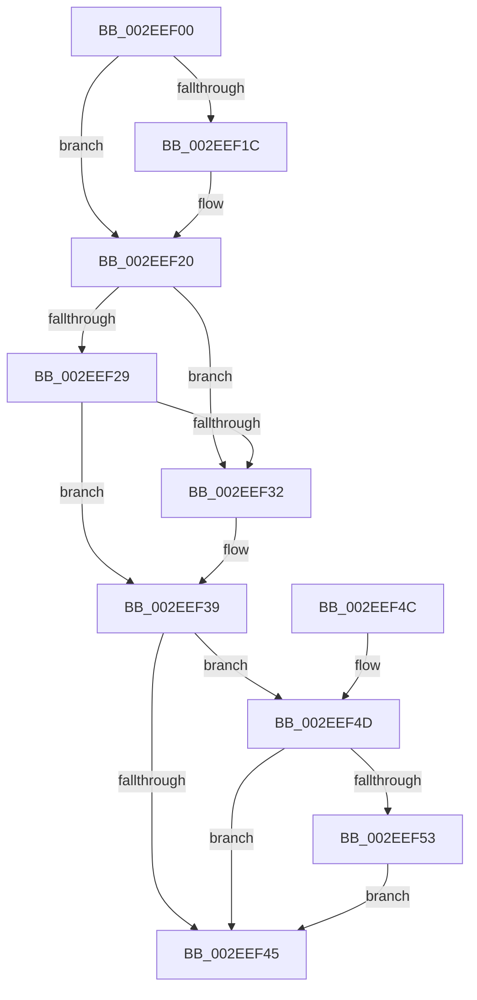

# RtlRemoveEntryHashTable

- RVA: `0x002EEF00`–`0x002EEF5D` (길이 `93` bytes)
- VA: `0x00000001402EEF00`
- 실행 섹션: `.text`
- PDB 이름 있음: `예`; PDB Function 태그: `아니요`
- unwind 정보 RVA: `0x000704D0`
- 디코드: `30`개 명령, `93/93` bytes 표시
- 미해석 바이트: `0` (있으면 어셈블리에 `.byte`로 보존)

> 이 문서는 커널 이미지의 기계어와 PDB 기호를 분석해 생성했습니다. 4번과 5번은 함수 원형과 자료형을 바이너리 사용 방식에서 추정한 C 해석이며 원본 소스 복구 결과는 아닙니다.

## 1. Dependencies

- 직접 호출 지점: **1**; 고유 호출 대상: **1**
- 직접 호출자로 확인된 함수: **7**
- RIP 상대 이미지 참조: **0**

### Outgoing calls
- `0x002EEF56` → [RtlpPopulateContext](../3F/RtlpPopulateContext_function_003FCFD0.md) (function, `0x003FCFD0`)

### Direct callers
- [SepCleanupMarkedForDeletionEntries](SepCleanupMarkedForDeletionEntries_function_002EEC84.md) at `0x002EECD2`
- [SepDeReferenceSharedSidEntries](../../page/7A/SepDeReferenceSharedSidEntries_function_007A2D40.md) at `0x007A2DDF`
- [SepDereferenceAntiTamperEntry](../../page/7A/SepDereferenceAntiTamperEntry_function_007A2E50.md) at `0x007A2FD6`
- [SepInsertOrReferenceSharedSidEntries](../../page/7A/SepInsertOrReferenceSharedSidEntries_function_007A32A8.md) at `0x007A3447`
- [SepRmDestroyCapTable](../../page/7A/SepRmDestroyCapTable_function_007A4894.md) at `0x007A48C7`
- [SepDereferenceCachedHandlesEntryInternal](../../page/A1/SepDereferenceCachedHandlesEntryInternal_function_00A19424.md) at `0x00A1951D`
- [SepDereferenceLowBoxNumberEntry](../../page/A5/SepDereferenceLowBoxNumberEntry_function_00A55DBC.md) at `0x00A55F58`

### Static image references
- 디코드된 RIP-relative 메모리 참조가 없습니다.

## 2. Other-region calls and transfers

- 다른 실행 섹션으로 향하는 call: **0**
- 별도 외부 분기/꼬리 이동을 확인하지 못했습니다.

## 3. Assembly (complete function range)

```asm
002EEF00  48 83 EC 28                     sub rsp, 0x28
002EEF04  41 83 C9 FF                     or r9d, 0xffffffff
002EEF08  4D 8B D0                        mov r10, r8
002EEF0B  4C 8B 42 10                     mov r8, qword ptr [rdx + 0x10]
002EEF0F  44 01 49 14                     add dword ptr [rcx + 0x14], r9d
002EEF13  48 8B 42 08                     mov rax, qword ptr [rdx + 8]
002EEF17  48 39 02                        cmp qword ptr [rdx], rax
002EEF1A  75 04                           jne 0x1402eef20
002EEF1C  44 01 49 18                     add dword ptr [rcx + 0x18], r9d
002EEF20  4C 8B 0A                        mov r9, qword ptr [rdx]
002EEF23  49 39 51 08                     cmp qword ptr [r9 + 8], rdx
002EEF27  75 09                           jne 0x1402eef32
002EEF29  48 8B 42 08                     mov rax, qword ptr [rdx + 8]
002EEF2D  48 39 10                        cmp qword ptr [rax], rdx
002EEF30  74 07                           je 0x1402eef39
002EEF32  B9 03 00 00 00                  mov ecx, 3
002EEF37  CD 29                           int 0x29
002EEF39  4C 89 08                        mov qword ptr [rax], r9
002EEF3C  49 89 41 08                     mov qword ptr [r9 + 8], rax
002EEF40  4D 85 D2                        test r10, r10
002EEF43  75 08                           jne 0x1402eef4d
002EEF45  B0 01                           mov al, 1
002EEF47  48 83 C4 28                     add rsp, 0x28
002EEF4B  C3                              ret
002EEF4C  CC                              int3
002EEF4D  49 83 3A 00                     cmp qword ptr [r10], 0
002EEF51  75 F2                           jne 0x1402eef45
002EEF53  49 8B D2                        mov rdx, r10
002EEF56  E8 75 E0 10 00                  call 0x1403fcfd0
002EEF5B  EB E8                           jmp 0x1402eef45
```

## 4. C-style interpretation (structured pseudocode)

```c
__int64 __fastcall RtlRemoveEntryHashTable(__int64 a1, __int64 a2, __int64 a3, int a4)
{
    __int64 result;
    __int64 v_rsp;

    v_rsp = (v_rsp) - (40);
    a4 = (unsigned int)((a4) | (0xFFFFFFFFULL));
    if ((*(unsigned __int64 *)(a2)) == (*(unsigned __int64 *)(a2 + 8))) {
    }
    if ((*(unsigned __int64 *)(*(unsigned __int64 *)(a2) + 8)) != a2) goto loc_002EEF32;
    if ((*(unsigned __int64 *)(*(unsigned __int64 *)(a2 + 8))) != a2) {
        a1 = 3;
    }
    *(unsigned __int64 *)(*(unsigned __int64 *)(a2 + 8)) = *(unsigned __int64 *)(a2);
    *(unsigned __int64 *)(*(unsigned __int64 *)(a2) + 8) = *(unsigned __int64 *)(a2 + 8);
    if (a3 != 0) goto loc_002EEF4D;
loc_002EEF45:
    v_rsp = (v_rsp) + (40);
    return 1;
loc_002EEF4D:
    if ((*(unsigned __int64 *)(a3)) != 0) goto loc_002EEF45;
    result = RtlpPopulateContext(a1, a3, *(unsigned __int64 *)(a2 + 16), *(unsigned __int64 *)(a2));
    goto loc_002EEF45;
}
```

## 5. (Beta) C Style

```c
int64_t RtlRemoveEntryHashTable(void *Arg1, void *Arg2, int64_t Arg3, int32_t Arg4)
{
    uint8_t *arg1 = (uint8_t *)Arg1;
    uint8_t *arg2 = (uint8_t *)Arg2;

    int64_t result;
    int64_t local_rsp;

    local_rsp = (local_rsp) - (40);
    Arg4 = (uint32_t)((Arg4) | (0xFFFFFFFFULL));
    if ((*(uint64_t *)(arg2)) == (*(uint64_t *)(arg2 + 0x8))) {
    }
    if ((*(uint64_t *)(*(uint64_t *)(arg2) + 0x8)) != Arg2) goto loc_002EEF32;
    if ((*(uint64_t *)(*(uint64_t *)(arg2 + 0x8))) != Arg2) {
        Arg1 = 3;
    }
    *(uint64_t *)(*(uint64_t *)(arg2 + 0x8)) = *(uint64_t *)(arg2);
    *(uint64_t *)(*(uint64_t *)(arg2) + 0x8) = *(uint64_t *)(arg2 + 0x8);
    if (Arg3 != 0) goto loc_002EEF4D;
loc_002EEF45:
    local_rsp = (local_rsp) + (40);
    return 1;
loc_002EEF4D:
    if ((*(uint64_t *)(Arg3)) != 0) goto loc_002EEF45;
    result = RtlpPopulateContext(Arg1, Arg3, *(uint64_t *)(arg2 + 0x10), *(uint64_t *)(arg2));
    goto loc_002EEF45;
}
```

### 관측된 메모리 오프셋

구조체 형식이 확인되지 않은 접근은 인자 기준의 오프셋으로만 기록했습니다.

| 기준 인자 | 오프셋 표현 | 폭 (bit) | 접근 |
|---|---:|---:|---|
| `Arg1` | `+ 0x14` | `32` | `R/W` |
| `Arg1` | `+ 0x18` | `32` | `R/W` |
| `Arg2` | `+ 0x0` | `64` | `R` |
| `Arg2` | `+ 0x8` | `64` | `R` |
| `Arg2` | `+ 0x10` | `64` | `R` |

## 6. Execution-region graph

[열기: 2D/3D 그래프와 함수 탐색 컨트롤 패널](../../../control-panel.html?section=text&rva=0x002EEF00&view=graph)

- 2D 그래프는 위에서 아래로 흐르고, 3D 그래프는 빈 공간을 드래그해 회전합니다. Shift+드래그는 이동, 휠은 확대·축소, 함수 노드 선택은 대상 보고서 이동입니다.

### Static fallback


