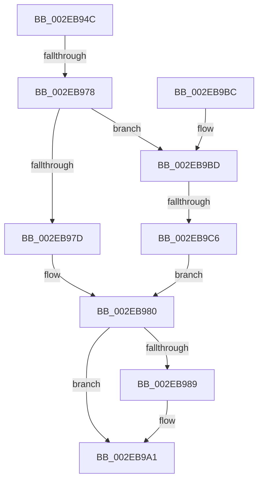

# RtlpAllocateNTHeapInternal

- RVA: `0x002EB94C`–`0x002EB9CC` (길이 `128` bytes)
- VA: `0x00000001402EB94C`
- 실행 섹션: `.text`
- PDB 이름 있음: `예`; PDB Function 태그: `예`
- unwind 정보 RVA: `0x000716F0`
- 디코드: `43`개 명령, `128/128` bytes 표시
- 미해석 바이트: `0` (있으면 어셈블리에 `.byte`로 보존)

> 이 문서는 커널 이미지의 기계어와 PDB 기호를 분석해 생성했습니다. 4번과 5번은 함수 원형과 자료형을 바이너리 사용 방식에서 추정한 C 해석이며 원본 소스 복구 결과는 아닙니다.

## 1. Dependencies

- 직접 호출 지점: **1**; 고유 호출 대상: **1**
- 직접 호출자로 확인된 함수: **1**
- RIP 상대 이미지 참조: **0**

### Outgoing calls
- `0x002EB999` → [RtlpHpVsContextAllocate](RtlpHpVsContextAllocate_function_002EA944.md) (function, `0x002EA944`)

### Direct callers
- [RtlAllocateHeap](RtlAllocateHeap_function_002EB8C0.md) at `0x002EB8F7`

### Static image references
- 디코드된 RIP-relative 메모리 참조가 없습니다.

## 2. Other-region calls and transfers

- 다른 실행 섹션으로 향하는 call: **0**
- call이 아닌 외부 분기/꼬리 이동: **2**
  - `0x002EB972` → [sub_006DE680 + 0x4D](../6D/Unknown_function_006DE680.md) (`tail-transfer`)
  - `0x002EB9C0` → [sub_006DE680](../6D/Unknown_function_006DE680.md) (`tail-transfer`)

## 3. Assembly (complete function range)

```asm
002EB94C  48 89 5C 24 10                  mov qword ptr [rsp + 0x10], rbx
002EB951  55                              push rbp
002EB952  56                              push rsi
002EB953  57                              push rdi
002EB954  41 54                           push r12
002EB956  41 55                           push r13
002EB958  41 56                           push r14
002EB95A  41 57                           push r15
002EB95C  48 83 EC 40                     sub rsp, 0x40
002EB960  33 FF                           xor edi, edi
002EB962  41 8B E8                        mov ebp, r8d
002EB965  81 79 10 DD CC DD CC            cmp dword ptr [rcx + 0x10], 0xccddccdd
002EB96C  48 8B F2                        mov rsi, rdx
002EB96F  4C 8B F1                        mov r14, rcx
002EB972  0F 85 55 2D 3F 00               jne 0x1406de6cd
002EB978  45 85 C0                        test r8d, r8d
002EB97B  75 40                           jne 0x1402eb9bd
002EB97D  44 8B E7                        mov r12d, edi
002EB980  48 81 FE 00 00 02 00            cmp rsi, 0x20000
002EB987  77 18                           ja 0x1402eb9a1
002EB989  45 0B 66 14                     or r12d, dword ptr [r14 + 0x14]
002EB98D  49 8D 4E 40                     lea rcx, [r14 + 0x40]
002EB991  45 8B CC                        mov r9d, r12d
002EB994  44 8B C6                        mov r8d, esi
002EB997  8B D6                           mov edx, esi
002EB999  E8 A6 EF FF FF                  call 0x1402ea944
002EB99E  48 8B F8                        mov rdi, rax
002EB9A1  48 8B C7                        mov rax, rdi
002EB9A4  48 8B 9C 24 88 00 00 00         mov rbx, qword ptr [rsp + 0x88]
002EB9AC  48 83 C4 40                     add rsp, 0x40
002EB9B0  41 5F                           pop r15
002EB9B2  41 5E                           pop r14
002EB9B4  41 5D                           pop r13
002EB9B6  41 5C                           pop r12
002EB9B8  5F                              pop rdi
002EB9B9  5E                              pop rsi
002EB9BA  5D                              pop rbp
002EB9BB  C3                              ret
002EB9BC  CC                              int3
002EB9BD  83 FD 08                        cmp ebp, 8
002EB9C0  0F 85 BA 2C 3F 00               jne 0x1406de680
002EB9C6  44 8D 65 FA                     lea r12d, [rbp - 6]
002EB9CA  EB B4                           jmp 0x1402eb980
```

## 4. C-style interpretation (structured pseudocode)

```c
__int64 __fastcall RtlpAllocateNTHeapInternal(__int64 a1, __int64 a2, int a3)
{
    __int64 result;
    __int64 v_r12;
    __int64 v_rdi;
    __int64 v_rsp;
    unsigned __int64 v_stack_p10;

    v_stack_p10 = v_rbx;
    v_rsp = (v_rsp) - (64);
    v_rdi = 0;
    if (a3 != 0) goto loc_002EB9BD;
loc_002EB980:
    v_r12 = 0;
    if (a2 <= 0x20000ULL) {
        v_r12 = (unsigned int)((0) | (*(unsigned int *)(a1 + 20)));
        a1 = a1 + 64;
        a4 = (unsigned int)(v_r12);
        a3 = (unsigned int)(a2);
        a2 = (unsigned int)(a2);
        result = RtlpHpVsContextAllocate(a1, a2, a3, a4);
        v_rdi = result;
    }
    v_rsp = (v_rsp) + (64);
    return v_rdi;
loc_002EB9BD:
    goto loc_002EB980;
}
```

## 5. (Beta) C Style

```c
int64_t RtlpAllocateNTHeapInternal(void *Arg1, int64_t Arg2, int32_t Arg3)
{
    uint8_t *arg1 = (uint8_t *)Arg1;

    int64_t result;
    int64_t local_r12;
    int64_t local_rdi;
    int64_t local_rsp;
    uint64_t v_stack_p10;

    v_stack_p10 = local_rbx;
    local_rsp = (local_rsp) - (64);
    local_rdi = 0;
    if (Arg3 != 0) goto loc_002EB9BD;
loc_002EB980:
    local_r12 = 0;
    if (Arg2 <= 0x20000ULL) {
        local_r12 = (uint32_t)((0) | (*(uint32_t *)(arg1 + 0x14)));
        Arg1 = Arg1 + 64;
        a4 = (uint32_t)(local_r12);
        Arg3 = (uint32_t)(Arg2);
        Arg2 = (uint32_t)(Arg2);
        result = RtlpHpVsContextAllocate(Arg1, Arg2, Arg3, a4);
        local_rdi = result;
    }
    local_rsp = (local_rsp) + (64);
    return local_rdi;
loc_002EB9BD:
    goto loc_002EB980;
}
```

### 관측된 메모리 오프셋

구조체 형식이 확인되지 않은 접근은 인자 기준의 오프셋으로만 기록했습니다.

| 기준 인자 | 오프셋 표현 | 폭 (bit) | 접근 |
|---|---:|---:|---|
| `Arg1` | `+ 0x10` | `32` | `R` |
| `Arg1` | `+ 0x14` | `32` | `R` |
| `Arg1` | `+ 0x40` | `64` | `R` |

## 6. Execution-region graph

[열기: 2D/3D 그래프와 함수 탐색 컨트롤 패널](../../../control-panel.html?section=text&rva=0x002EB94C&view=graph)

- 2D 그래프는 위에서 아래로 흐르고, 3D 그래프는 빈 공간을 드래그해 회전합니다. Shift+드래그는 이동, 휠은 확대·축소, 함수 노드 선택은 대상 보고서 이동입니다.

### Static fallback


