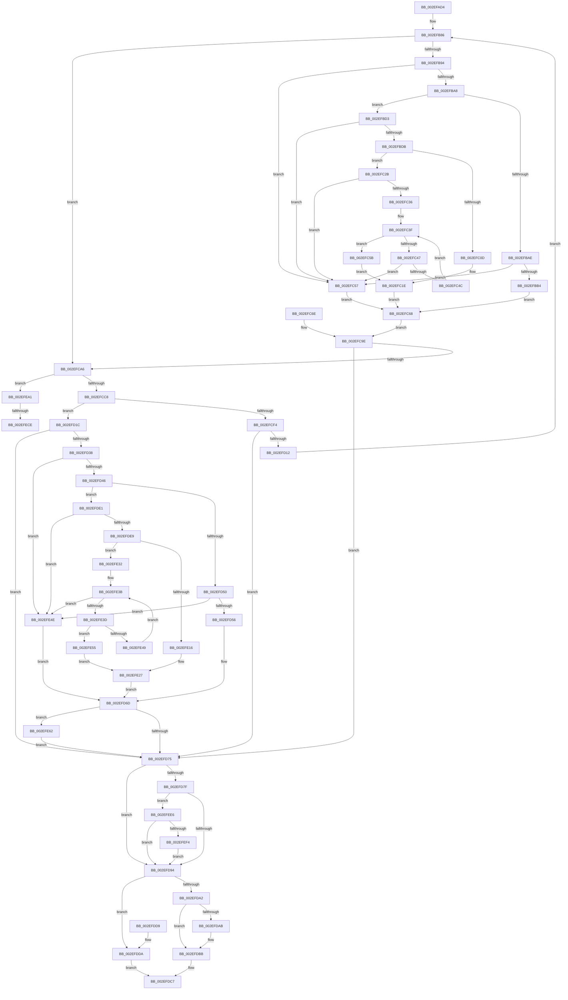

# RtlpCSparseBitmapPageDecommit

- RVA: `0x002EFAD4`–`0x002EFF03` (길이 `1,071` bytes)
- VA: `0x00000001402EFAD4`
- 실행 섹션: `.text`
- PDB 이름 있음: `예`; PDB Function 태그: `예`
- unwind 정보 RVA: `0x00071B18`
- 디코드: `267`개 명령, `1,071/1,071` bytes 표시
- 미해석 바이트: `0` (있으면 어셈블리에 `.byte`로 보존)

> 이 문서는 커널 이미지의 기계어와 PDB 기호를 분석해 생성했습니다. 4번과 5번은 함수 원형과 자료형을 바이너리 사용 방식에서 추정한 C 해석이며 원본 소스 복구 결과는 아닙니다.

## 1. Dependencies

- 직접 호출 지점: **11**; 고유 호출 대상: **10**
- 직접 호출자로 확인된 함수: **1**
- RIP 상대 이미지 참조: **1**

### Outgoing calls
- `0x002EFB71` → [RtlCSparseBitmapEnterLockingRegion](RtlCSparseBitmapEnterLockingRegion_function_002EFFD0.md) (function, `0x002EFFD0`)
- `0x002EFCC8` → [ExAcquireSpinLockExclusive](../24/ExAcquireSpinLockExclusive_function_00248690.md) (function, `0x00248690`)
- `0x002EFCF4` → [RtlpCSparseBitmapUnlock](../2F/RtlpCSparseBitmapUnlock_function_002F0DD0.md) (function, `0x002F0DD0`)
- `0x002EFD04` → [RtlpCSparseBitmapWaitOnAddress](RtlpCSparseBitmapWaitOnAddress_function_002EFF0C.md) (function, `0x002EFF0C`)
- `0x002EFD1F` → [RtlpCSparseBitmapUnlock](../2F/RtlpCSparseBitmapUnlock_function_002F0DD0.md) (function, `0x002F0DD0`)
- `0x002EFDB6` → [KiLowerIrqlProcessIrqlFlags](../4F/KiLowerIrqlProcessIrqlFlags_function_004F5698.md) (function, `0x004F5698`)
- `0x002EFDDA` → [KeLeaveGuardedRegion](KeLeaveGuardedRegion_function_002E2C40.md) (function, `0x002E2C40`)
- `0x002EFE97` → [MmFreePoolMemory](../2C/MmFreePoolMemory_function_002C1578.md) (function, `0x002C1578`)
- `0x002EFEB8` → [KeAbPreAcquire](../21/KeAbPreAcquire_function_00210230.md) (function, `0x00210230`)
- `0x002EFED7` → [ExfAcquirePushLockExclusiveEx](../20/ExfAcquirePushLockExclusiveEx_function_0020FC90.md) (function, `0x0020FC90`)
- `0x002EFEF9` → [ExpUnblockPushLock](../2A/ExpUnblockPushLock_function_002A40FC.md) (function, `0x002A40FC`)

### Direct callers
- [RtlCSparseBitmapBitsClear](RtlCSparseBitmapBitsClear_function_002E34C4.md) at `0x002E3798`

### Static image references
- `0x002EFDA2` → RVA `0x00FC6D20` (`ALMOSTRO`; read)

## 2. Other-region calls and transfers

- 다른 실행 섹션으로 향하는 call: **0**
- call이 아닌 외부 분기/꼬리 이동: **2**
  - `0x002EFEC8` → [sub_006DEE56](../6D/Unknown_function_006DEE56.md) (`tail-transfer`)
  - `0x002EFEE1` → [sub_006DEE56](../6D/Unknown_function_006DEE56.md) (`tail-transfer`)

## 3. Assembly (complete function range)

```asm
002EFAD4  4C 8B DC                        mov r11, rsp
002EFAD7  45 89 43 18                     mov dword ptr [r11 + 0x18], r8d
002EFADB  49 89 53 10                     mov qword ptr [r11 + 0x10], rdx
002EFADF  49 89 4B 08                     mov qword ptr [r11 + 8], rcx
002EFAE3  56                              push rsi
002EFAE4  57                              push rdi
002EFAE5  41 54                           push r12
002EFAE7  41 55                           push r13
002EFAE9  41 56                           push r14
002EFAEB  41 57                           push r15
002EFAED  48 81 EC C8 00 00 00            sub rsp, 0xc8
002EFAF4  4C 8B EA                        mov r13, rdx
002EFAF7  4C 8B F1                        mov r14, rcx
002EFAFA  48 89 8C 24 88 00 00 00         mov qword ptr [rsp + 0x88], rcx
002EFB02  48 83 64 24 20 00               and qword ptr [rsp + 0x20], 0
002EFB08  48 83 64 24 68 00               and qword ptr [rsp + 0x68], 0
002EFB0E  48 83 64 24 60 00               and qword ptr [rsp + 0x60], 0
002EFB14  0F 57 C0                        xorps xmm0, xmm0
002EFB17  0F 11 44 24 50                  movups xmmword ptr [rsp + 0x50], xmm0
002EFB1C  33 C0                           xor eax, eax
002EFB1E  89 84 24 18 01 00 00            mov dword ptr [rsp + 0x118], eax
002EFB25  48 8B 51 10                     mov rdx, qword ptr [rcx + 0x10]
002EFB29  48 8D 41 08                     lea rax, [rcx + 8]
002EFB2D  48 89 84 24 90 00 00 00         mov qword ptr [rsp + 0x90], rax
002EFB35  48 8B 00                        mov rax, qword ptr [rax]
002EFB38  48 89 54 24 40                  mov qword ptr [rsp + 0x40], rdx
002EFB3D  48 89 44 24 48                  mov qword ptr [rsp + 0x48], rax
002EFB42  49 8B FD                        mov rdi, r13
002EFB45  48 C1 E7 0F                     shl rdi, 0xf
002EFB49  48 89 7C 24 70                  mov qword ptr [rsp + 0x70], rdi
002EFB4E  4C 8B FF                        mov r15, rdi
002EFB51  48 89 7C 24 38                  mov qword ptr [rsp + 0x38], rdi
002EFB56  BE 00 80 00 00                  mov esi, 0x8000
002EFB5B  48 2B D7                        sub rdx, rdi
002EFB5E  48 3B D6                        cmp rdx, rsi
002EFB61  48 0F 46 F2                     cmovbe rsi, rdx
002EFB65  48 89 74 24 78                  mov qword ptr [rsp + 0x78], rsi
002EFB6A  48 8B D1                        mov rdx, rcx
002EFB6D  49 8D 4B B0                     lea rcx, [r11 - 0x50]
002EFB71  E8 5A 04 00 00                  call 0x1402effd0
002EFB76  0F 10 00                        movups xmm0, xmmword ptr [rax]
002EFB79  F3 0F 7F 84 24 98 00 00 00      movdqu xmmword ptr [rsp + 0x98], xmm0
002EFB82  49 83 CC FF                     or r12, 0xffffffffffffffff
002EFB86  83 BC 24 10 01 00 00 00         cmp dword ptr [rsp + 0x110], 0
002EFB8E  0F 85 12 01 00 00               jne 0x1402efca6
002EFB94  48 83 64 24 30 00               and qword ptr [rsp + 0x30], 0
002EFB9A  48 8B 44 24 40                  mov rax, qword ptr [rsp + 0x40]
002EFB9F  48 3B F8                        cmp rdi, rax
002EFBA2  0F 83 AF 00 00 00               jae 0x1402efc57
002EFBA8  48 83 FE 01                     cmp rsi, 1
002EFBAC  77 25                           ja 0x1402efbd3
002EFBAE  0F 85 A3 00 00 00               jne 0x1402efc57
002EFBB4  49 8B CF                        mov rcx, r15
002EFBB7  48 C1 E9 06                     shr rcx, 6
002EFBBB  48 8B 44 24 48                  mov rax, qword ptr [rsp + 0x48]
002EFBC0  48 0F BA 24 C8 00               bt qword ptr [rax + rcx*8], 0
002EFBC6  B8 00 00 00 00                  mov eax, 0
002EFBCB  0F 93 C0                        setae al
002EFBCE  E9 95 00 00 00                  jmp 0x1402efc68
002EFBD3  48 2B C7                        sub rax, rdi
002EFBD6  48 3B C6                        cmp rax, rsi
002EFBD9  72 7C                           jb 0x1402efc57
002EFBDB  4C 8D 57 FF                     lea r10, [rdi - 1]
002EFBDF  4C 03 D6                        add r10, rsi
002EFBE2  48 8B C7                        mov rax, rdi
002EFBE5  48 C1 E8 06                     shr rax, 6
002EFBE9  48 8B 4C 24 48                  mov rcx, qword ptr [rsp + 0x48]
002EFBEE  48 8D 14 C1                     lea rdx, [rcx + rax*8]
002EFBF2  48 89 54 24 30                  mov qword ptr [rsp + 0x30], rdx
002EFBF7  49 8B C2                        mov rax, r10
002EFBFA  48 C1 E8 06                     shr rax, 6
002EFBFE  4C 8D 0C C1                     lea r9, [rcx + rax*8]
002EFC02  4C 8B 02                        mov r8, qword ptr [rdx]
002EFC05  49 8B C4                        mov rax, r12
002EFC08  49 3B D1                        cmp rdx, r9
002EFC0B  75 1E                           jne 0x1402efc2b
002EFC0D  B9 40 00 00 00                  mov ecx, 0x40
002EFC12  40 2A CE                        sub cl, sil
002EFC15  48 D3 E8                        shr rax, cl
002EFC18  48 8B CF                        mov rcx, rdi
002EFC1B  48 D3 E0                        shl rax, cl
002EFC1E  4C 85 C0                        test rax, r8
002EFC21  B8 00 00 00 00                  mov eax, 0
002EFC26  0F 94 C0                        sete al
002EFC29  EB 3D                           jmp 0x1402efc68
002EFC2B  48 8B CF                        mov rcx, rdi
002EFC2E  48 D3 E0                        shl rax, cl
002EFC31  4C 85 C0                        test rax, r8
002EFC34  75 21                           jne 0x1402efc57
002EFC36  48 83 C2 08                     add rdx, 8
002EFC3A  48 89 54 24 30                  mov qword ptr [rsp + 0x30], rdx
002EFC3F  4C 8B 02                        mov r8, qword ptr [rdx]
002EFC42  49 3B D1                        cmp rdx, r9
002EFC45  74 14                           je 0x1402efc5b
002EFC47  4D 85 C0                        test r8, r8
002EFC4A  75 0B                           jne 0x1402efc57
002EFC4C  48 83 C2 08                     add rdx, 8
002EFC50  48 89 54 24 30                  mov qword ptr [rsp + 0x30], rdx
002EFC55  EB E8                           jmp 0x1402efc3f
002EFC57  33 C0                           xor eax, eax
002EFC59  EB 0D                           jmp 0x1402efc68
002EFC5B  41 8A CA                        mov cl, r10b
002EFC5E  F6 D1                           not cl
002EFC60  49 8B C4                        mov rax, r12
002EFC63  48 D3 E8                        shr rax, cl
002EFC66  EB B6                           jmp 0x1402efc1e
002EFC68  89 44 24 28                     mov dword ptr [rsp + 0x28], eax
002EFC6C  EB 30                           jmp 0x1402efc9e
002EFC6E  33 C0                           xor eax, eax
002EFC70  89 44 24 28                     mov dword ptr [rsp + 0x28], eax
002EFC74  49 83 CC FF                     or r12, 0xffffffffffffffff
002EFC78  4C 8B AC 24 08 01 00 00         mov r13, qword ptr [rsp + 0x108]
002EFC80  4C 8B B4 24 00 01 00 00         mov r14, qword ptr [rsp + 0x100]
002EFC88  89 84 24 18 01 00 00            mov dword ptr [rsp + 0x118], eax
002EFC8F  48 8B 7C 24 70                  mov rdi, qword ptr [rsp + 0x70]
002EFC94  48 8B 74 24 78                  mov rsi, qword ptr [rsp + 0x78]
002EFC99  48 89 7C 24 38                  mov qword ptr [rsp + 0x38], rdi
002EFC9E  85 C0                           test eax, eax
002EFCA0  0F 84 CF 00 00 00               je 0x1402efd75
002EFCA6  83 A4 24 10 01 00 00 00         and dword ptr [rsp + 0x110], 0
002EFCAE  4C 8B BC 24 88 00 00 00         mov r15, qword ptr [rsp + 0x88]
002EFCB6  49 83 C7 18                     add r15, 0x18
002EFCBA  49 8B CF                        mov rcx, r15
002EFCBD  41 80 7E 30 00                  cmp byte ptr [r14 + 0x30], 0
002EFCC2  0F 84 D9 01 00 00               je 0x1402efea1
002EFCC8  E8 C3 89 F5 FF                  call 0x140248690
002EFCCD  88 44 24 54                     mov byte ptr [rsp + 0x54], al
002EFCD1  C7 44 24 50 01 00 00 00         mov dword ptr [rsp + 0x50], 1
002EFCD9  4C 89 74 24 58                  mov qword ptr [rsp + 0x58], r14
002EFCDE  4D 8D 7E 20                     lea r15, [r14 + 0x20]
002EFCE2  49 8B 07                        mov rax, qword ptr [r15]
002EFCE5  48 89 44 24 20                  mov qword ptr [rsp + 0x20], rax
002EFCEA  48 8D 4C 24 50                  lea rcx, [rsp + 0x50]
002EFCEF  49 3B C4                        cmp rax, r12
002EFCF2  74 28                           je 0x1402efd1c
002EFCF4  E8 D7 10 00 00                  call 0x1402f0dd0
002EFCF9  4D 8B CE                        mov r9, r14
002EFCFC  48 8D 54 24 20                  lea rdx, [rsp + 0x20]
002EFD01  49 8B CF                        mov rcx, r15
002EFD04  E8 03 02 00 00                  call 0x1402eff0c
002EFD09  49 8B 06                        mov rax, qword ptr [r14]
002EFD0C  4C 0F A3 28                     bt qword ptr [rax], r13
002EFD10  73 63                           jae 0x1402efd75
002EFD12  4C 8B 7C 24 38                  mov r15, qword ptr [rsp + 0x38]
002EFD17  E9 6A FE FF FF                  jmp 0x1402efb86
002EFD1C  4D 89 2F                        mov qword ptr [r15], r13
002EFD1F  E8 AC 10 00 00                  call 0x1402f0dd0
002EFD24  C7 84 24 18 01 00 00 01 00 00 00  mov dword ptr [rsp + 0x118], 1
002EFD2F  49 8B 06                        mov rax, qword ptr [r14]
002EFD32  4C 0F A3 28                     bt qword ptr [rax], r13
002EFD36  73 3D                           jae 0x1402efd75
002EFD38  48 8B 44 24 40                  mov rax, qword ptr [rsp + 0x40]
002EFD3D  48 3B F8                        cmp rdi, rax
002EFD40  0F 83 08 01 00 00               jae 0x1402efe4e
002EFD46  48 83 FE 01                     cmp rsi, 1
002EFD4A  0F 87 91 00 00 00               ja 0x1402efde1
002EFD50  0F 85 F8 00 00 00               jne 0x1402efe4e
002EFD56  48 8B 4C 24 38                  mov rcx, qword ptr [rsp + 0x38]
002EFD5B  48 C1 E9 06                     shr rcx, 6
002EFD5F  48 8B 44 24 48                  mov rax, qword ptr [rsp + 0x48]
002EFD64  48 0F BA 24 C8 00               bt qword ptr [rax + rcx*8], 0
002EFD6A  0F 93 C0                        setae al
002EFD6D  84 C0                           test al, al
002EFD6F  0F 85 ED 00 00 00               jne 0x1402efe62
002EFD75  83 BC 24 18 01 00 00 00         cmp dword ptr [rsp + 0x118], 0
002EFD7D  74 15                           je 0x1402efd94
002EFD7F  4D 89 66 20                     mov qword ptr [r14 + 0x20], r12
002EFD83  41 8A 46 30                     mov al, byte ptr [r14 + 0x30]
002EFD87  F0 83 0C 24 00                  lock or dword ptr [rsp], 0
002EFD8C  84 C0                           test al, al
002EFD8E  0F 84 52 01 00 00               je 0x1402efee6
002EFD94  48 8B 84 24 A0 00 00 00         mov rax, qword ptr [rsp + 0xa0]
002EFD9C  80 78 30 00                     cmp byte ptr [rax + 0x30], 0
002EFDA0  74 38                           je 0x1402efdda
002EFDA2  83 3D 77 6F CD 00 00            cmp dword ptr [rip + 0xcd6f77], 0
002EFDA9  74 10                           je 0x1402efdbb
002EFDAB  44 0F 20 C1                     mov rcx, cr8
002EFDAF  8A 94 24 98 00 00 00            mov dl, byte ptr [rsp + 0x98]
002EFDB6  E8 DD 58 20 00                  call 0x1404f5698
002EFDBB  0F B6 84 24 98 00 00 00         movzx eax, byte ptr [rsp + 0x98]
002EFDC3  44 0F 22 C0                     mov cr8, rax
002EFDC7  48 81 C4 C8 00 00 00            add rsp, 0xc8
002EFDCE  41 5F                           pop r15
002EFDD0  41 5E                           pop r14
002EFDD2  41 5D                           pop r13
002EFDD4  41 5C                           pop r12
002EFDD6  5F                              pop rdi
002EFDD7  5E                              pop rsi
002EFDD8  C3                              ret
002EFDD9  CC                              int3
002EFDDA  E8 61 2E FF FF                  call 0x1402e2c40
002EFDDF  EB E6                           jmp 0x1402efdc7
002EFDE1  48 2B C7                        sub rax, rdi
002EFDE4  48 3B C6                        cmp rax, rsi
002EFDE7  72 65                           jb 0x1402efe4e
002EFDE9  4C 8D 57 FF                     lea r10, [rdi - 1]
002EFDED  4C 03 D6                        add r10, rsi
002EFDF0  48 8B C7                        mov rax, rdi
002EFDF3  48 C1 E8 06                     shr rax, 6
002EFDF7  48 8B 54 24 48                  mov rdx, qword ptr [rsp + 0x48]
002EFDFC  4C 8D 04 C2                     lea r8, [rdx + rax*8]
002EFE00  49 8B C2                        mov rax, r10
002EFE03  48 C1 E8 06                     shr rax, 6
002EFE07  4C 8D 0C C2                     lea r9, [rdx + rax*8]
002EFE0B  49 8B 10                        mov rdx, qword ptr [r8]
002EFE0E  49 8B C4                        mov rax, r12
002EFE11  4D 3B C1                        cmp r8, r9
002EFE14  75 1C                           jne 0x1402efe32
002EFE16  B9 40 00 00 00                  mov ecx, 0x40
002EFE1B  40 2A CE                        sub cl, sil
002EFE1E  48 D3 E8                        shr rax, cl
002EFE21  48 8B CF                        mov rcx, rdi
002EFE24  48 D3 E0                        shl rax, cl
002EFE27  48 85 D0                        test rax, rdx
002EFE2A  0F 94 C0                        sete al
002EFE2D  E9 3B FF FF FF                  jmp 0x1402efd6d
002EFE32  48 8B CF                        mov rcx, rdi
002EFE35  48 D3 E0                        shl rax, cl
002EFE38  48 85 D0                        test rax, rdx
002EFE3B  75 11                           jne 0x1402efe4e
002EFE3D  49 83 C0 08                     add r8, 8
002EFE41  49 8B 10                        mov rdx, qword ptr [r8]
002EFE44  4D 3B C1                        cmp r8, r9
002EFE47  74 0C                           je 0x1402efe55
002EFE49  48 85 D2                        test rdx, rdx
002EFE4C  EB ED                           jmp 0x1402efe3b
002EFE4E  32 C0                           xor al, al
002EFE50  E9 18 FF FF FF                  jmp 0x1402efd6d
002EFE55  41 8A CA                        mov cl, r10b
002EFE58  F6 D1                           not cl
002EFE5A  49 8B C4                        mov rax, r12
002EFE5D  48 D3 E8                        shr rax, cl
002EFE60  EB C5                           jmp 0x1402efe27
002EFE62  49 8B 06                        mov rax, qword ptr [r14]
002EFE65  F0 4C 0F B3 28                  lock btr qword ptr [rax], r13
002EFE6A  49 C1 E5 0C                     shl r13, 0xc
002EFE6E  48 8B 84 24 90 00 00 00         mov rax, qword ptr [rsp + 0x90]
002EFE76  4C 03 28                        add r13, qword ptr [rax]
002EFE79  4C 89 6C 24 68                  mov qword ptr [rsp + 0x68], r13
002EFE7E  48 C7 44 24 60 00 10 00 00      mov qword ptr [rsp + 0x60], 0x1000
002EFE87  41 B8 00 40 00 40               mov r8d, 0x40004000
002EFE8D  48 8D 54 24 60                  lea rdx, [rsp + 0x60]
002EFE92  48 8D 4C 24 68                  lea rcx, [rsp + 0x68]
002EFE97  E8 DC 16 FD FF                  call 0x1402c1578
002EFE9C  E9 D4 FE FF FF                  jmp 0x1402efd75
002EFEA1  65 48 8B 04 25 88 01 00 00      mov rax, qword ptr gs:[0x188]
002EFEAA  66 44 01 A0 E6 01 00 00         add word ptr [rax + 0x1e6], r12w
002EFEB2  90                              nop
002EFEB3  45 33 C0                        xor r8d, r8d
002EFEB6  33 D2                           xor edx, edx
002EFEB8  E8 73 03 F2 FF                  call 0x140210230
002EFEBD  48 89 44 24 20                  mov qword ptr [rsp + 0x20], rax
002EFEC2  F0 49 0F BA 2F 00               lock bts qword ptr [r15], 0
002EFEC8  0F 83 88 EF 3E 00               jae 0x1406dee56
002EFECE  4D 8B C7                        mov r8, r15
002EFED1  48 8B D0                        mov rdx, rax
002EFED4  49 8B CF                        mov rcx, r15
002EFED7  E8 B4 FD F1 FF                  call 0x14020fc90
002EFEDC  48 8B 44 24 20                  mov rax, qword ptr [rsp + 0x20]
002EFEE1  E9 70 EF 3E 00                  jmp 0x1406dee56
002EFEE6  49 8D 4E 28                     lea rcx, [r14 + 0x28]
002EFEEA  48 83 39 00                     cmp qword ptr [rcx], 0
002EFEEE  0F 84 A0 FE FF FF               je 0x1402efd94
002EFEF4  45 33 C0                        xor r8d, r8d
002EFEF7  33 D2                           xor edx, edx
002EFEF9  E8 FE 41 FB FF                  call 0x1402a40fc
002EFEFE  E9 91 FE FF FF                  jmp 0x1402efd94
```

## 4. C-style interpretation (structured pseudocode)

```c
__int64 __fastcall RtlpCSparseBitmapPageDecommit(__int64 a1, __int64 a2, int a3)
{
    __int64 result;
    __int64 v_r10;
    __int64 v_r12;
    __int64 v_r13;
    __int64 v_r15;
    __int64 v_rdi;
    __int64 v_rsi;
    __int64 v_rsp;
    unsigned __int64 v_stack_m58;
    unsigned __int64 v_stack_m60;
    unsigned __int64 v_stack_m68;
    unsigned __int64 v_stack_m70;
    unsigned __int64 v_stack_m80;
    unsigned __int64 v_stack_m88;
    unsigned __int64 v_stack_m90;
    unsigned __int64 v_stack_m98;
    unsigned __int64 v_stack_mA0;
    unsigned __int8 v_stack_mA4;
    unsigned __int64 v_stack_mA8;
    unsigned __int64 v_stack_mB0;
    unsigned __int64 v_stack_mB8;
    unsigned __int64 v_stack_mC0;
    unsigned __int64 v_stack_mC8;
    unsigned int v_stack_mD0;
    unsigned __int64 v_stack_mD8;
    unsigned int v_stack_mF8;
    unsigned __int64 v_stack_p10;
    unsigned int v_stack_p18;
    unsigned int v_stack_p20;
    unsigned __int64 v_stack_p48;
    unsigned __int64 v_stack_p60;
    unsigned __int64 v_stack_p68;
    unsigned __int64 v_stack_p8;
    unsigned __int64 v_stack_p90;

    *(unsigned int *)(v_rsp + 24) = a3;
    *(unsigned __int64 *)(v_rsp + 16) = a2;
    *(unsigned __int64 *)(v_rsp + 8) = a1;
    v_rsp = (v_rsp) - (200);
    v_stack_m70 = a1;
    v_stack_mA8 = v_xmm0;
    result = 0;
    v_stack_p20 = 0;
    v_stack_m68 = a1 + 8;
    v_stack_mB8 = *(unsigned __int64 *)(a1 + 16);
    v_stack_mB0 = *(unsigned __int64 *)(a1 + 8);
    v_rdi = (a2) << (15);
    v_stack_m88 = v_rdi;
    v_stack_mC0 = v_rdi;
    a2 = (*(unsigned __int64 *)(a1 + 16)) - (v_rdi);
    v_rsi = (unsigned int)(0x8000ULL);
    if (a2 <= ((unsigned int)(0x8000ULL))) { v_rsi = a2; }
    v_stack_m80 = v_rsi;
    result = RtlCSparseBitmapEnterLockingRegion(v_rsp - 80, a1, a3, a4);
    v_stack_m60 = v_xmm0;
    v_r12 = (v_r12) | (-1);
loc_002EFB86:
    if (v_stack_p18 != 0) goto loc_002EFCA6;
    if (v_rdi >= v_stack_mB8) goto loc_002EFC57;
    if (v_rsi > 1) goto loc_002EFBD3;
    if (v_rsi != 1) goto loc_002EFC57;
    a1 = (v_rdi) >> (6);
    result = (condition_is_above_or_equal) ? 1 : 0;
    goto loc_002EFC68;
loc_002EFBD3:
    result = (result) - (v_rdi);
    if (result < v_rsi) goto loc_002EFC57;
    v_r10 = (v_rdi - 1) + (v_rsi);
    result = (v_rdi) >> (6);
    v_stack_mC8 = v_stack_mB0 + result * 8;
    result = (v_r10) >> (6);
    if ((v_stack_mB0 + result * 8) != (v_stack_mB0 + result * 8)) goto loc_002EFC2B;
    a1 = (unsigned __int8)((64) - ((unsigned __int8)(v_rsi)));
    result = (v_r12) >> ((unsigned __int8)(a1));
    result = (result) << ((unsigned __int8)(v_rdi));
loc_002EFC1E:
    result = (((result) & (*(unsigned __int64 *)(v_stack_mB0 + result * 8))) == 0) ? 1 : 0;
    goto loc_002EFC68;
loc_002EFC2B:
    result = (result) << ((unsigned __int8)(v_rdi));
    if (((result) & (*(unsigned __int64 *)(v_stack_mB0 + result * 8))) != 0) goto loc_002EFC57;
    a2 = (v_stack_mB0 + result * 8) + (8);
    v_stack_mC8 = a2;
loc_002EFC3F:
    if (a2 == (v_stack_mB0 + result * 8)) goto loc_002EFC5B;
    if (*(unsigned __int64 *)(a2) != 0) goto loc_002EFC57;
    a2 = (a2) + (8);
    v_stack_mC8 = a2;
    goto loc_002EFC3F;
loc_002EFC57:
    result = 0;
    goto loc_002EFC68;
loc_002EFC5B:
    a1 = (unsigned __int8)(~((unsigned __int8)(v_r10)));
    result = (v_r12) >> ((unsigned __int8)(a1));
    goto loc_002EFC1E;
loc_002EFC68:
    v_stack_mD0 = (unsigned int)(result);
    goto loc_002EFC9E;
loc_002EFC9E:
    if ((unsigned int)(result) == 0) goto loc_002EFD75;
loc_002EFCA6:
    v_r15 = (v_stack_m70) + (24);
    if ((*(unsigned __int8 *)(a1 + 48)) == 0) goto loc_002EFEA1;
    result = ExAcquireSpinLockExclusive(v_r15, a2, *(unsigned __int64 *)(a2), v_stack_mB0 + result * 8);
    v_stack_mA4 = (unsigned __int8)(result);
    v_stack_mA8 = 1;
    v_stack_mA0 = a1;
    v_stack_mD8 = *(unsigned __int64 *)(a1 + 32);
    if ((*(unsigned __int64 *)(a1 + 32)) == v_r12) goto loc_002EFD1C;
    result = RtlpCSparseBitmapUnlock(v_stack_mA8, a2, *(unsigned __int64 *)(a2), v_stack_mB0 + result * 8);
    result = RtlpCSparseBitmapWaitOnAddress(a1 + 32, v_stack_mD8, *(unsigned __int64 *)(a2), a1);
    if ((*(unsigned __int64 *)(a1 + 32)) >= v_r12) goto loc_002EFD75;
    goto loc_002EFB86;
loc_002EFD1C:
    *(unsigned __int64 *)(v_stack_mC0) = a2;
    result = RtlpCSparseBitmapUnlock(a1 + 32, v_stack_mD8, *(unsigned __int64 *)(a2), a1);
    v_stack_p20 = 1;
    if ((*(unsigned __int64 *)(a1 + 32)) >= v_r12) goto loc_002EFD75;
    if (v_rdi >= v_stack_mB8) goto loc_002EFE4E;
    if (v_rsi > 1) goto loc_002EFDE1;
    if (v_rsi != 1) goto loc_002EFE4E;
    a1 = (v_stack_mC0) >> (6);
    result = (condition_is_above_or_equal) ? 1 : 0;
loc_002EFD6D:
    if ((unsigned __int8)(result) != 0) goto loc_002EFE62;
loc_002EFD75:
    if (v_stack_p20 == 0) goto loc_002EFD94;
    *(unsigned __int64 *)(a1 + 32) = v_r12;
    if ((unsigned __int8)(*(unsigned __int8 *)(a1 + 48)) == 0) goto loc_002EFEE6;
loc_002EFD94:
    if ((*(unsigned __int8 *)(v_stack_m58 + 48)) == 0) goto loc_002EFDDA;
    result = v_stack_m58;
    if ((*(unsigned int *)(v_rip + 13463415)) != 0) {
        a1 = v_cr8;
        a2 = v_stack_m60;
        result = KiLowerIrqlProcessIrqlFlags(a1, a2, *(unsigned __int64 *)(a2), a1);
    }
loc_002EFDC7:
    v_rsp = (v_rsp) + (200);
    return v_stack_m60;
loc_002EFDDA:
    result = KeLeaveGuardedRegion(a1, a2, *(unsigned __int64 *)(a2), a1);
    goto loc_002EFDC7;
loc_002EFDE1:
    result = (result) - (v_rdi);
    if (result < v_rsi) goto loc_002EFE4E;
    v_r10 = (v_rdi - 1) + (v_rsi);
    result = (v_rdi) >> (6);
    result = (v_r10) >> (6);
    if ((v_stack_p48 + result * 8) != (v_stack_p48 + result * 8)) goto loc_002EFE32;
    a1 = (unsigned __int8)((64) - ((unsigned __int8)(v_rsi)));
    result = (v_r12) >> ((unsigned __int8)(a1));
    result = (result) << ((unsigned __int8)(v_rdi));
loc_002EFE27:
    result = (((result) & (*(unsigned __int64 *)(v_stack_p48 + result * 8))) == 0) ? 1 : 0;
    goto loc_002EFD6D;
loc_002EFE32:
    result = (result) << ((unsigned __int8)(v_rdi));
loc_002EFE3B:
    if (((result) & (*(unsigned __int64 *)(v_stack_p48 + result * 8))) != 0) goto loc_002EFE4E;
    a3 = (v_stack_p48 + result * 8) + (8);
    if (a3 == (v_stack_p48 + result * 8)) goto loc_002EFE55;
    goto loc_002EFE3B;
loc_002EFE4E:
    result = 0;
    goto loc_002EFD6D;
loc_002EFE55:
    a1 = (unsigned __int8)(~((unsigned __int8)(v_r10)));
    result = (v_r12) >> ((unsigned __int8)(a1));
    goto loc_002EFE27;
loc_002EFE62:
    v_r13 = (a2) << (12);
    v_r13 = (v_r13) + (*(unsigned __int64 *)(v_stack_p90));
    v_stack_p68 = v_r13;
    v_stack_p60 = 0x1000ULL;
    result = MmFreePoolMemory(v_stack_p68, v_stack_p60, (unsigned int)(0x40004000ULL), v_stack_p48 + result * 8);
    goto loc_002EFD75;
loc_002EFEA1:
    a3 = 0;
    a2 = 0;
    result = KeAbPreAcquire(v_stack_p68, a2, a3, v_stack_p48 + result * 8);
    v_stack_p20 = result;
    result = ExfAcquirePushLockExclusiveEx(v_stack_mC0, result, v_stack_mC0, v_stack_p48 + result * 8);
loc_002EFEE6:
    if ((*(unsigned __int64 *)(a1 + 40)) == 0) goto loc_002EFD94;
    a3 = 0;
    a2 = 0;
    result = ExpUnblockPushLock(a1 + 40, a2, a3, v_stack_p48 + result * 8);
    goto loc_002EFD94;
}
```

## 5. (Beta) C Style

```c
int64_t RtlpCSparseBitmapPageDecommit(void *Arg1, int64_t Arg2, int32_t Arg3)
{
    uint8_t *arg1 = (uint8_t *)Arg1;

    int64_t result;
    int64_t local_r10;
    int64_t local_r12;
    int64_t local_r13;
    int64_t local_r15;
    int64_t local_rdi;
    int64_t local_rsi;
    int64_t local_rsp;
    uint64_t v_stack_m58;
    uint64_t v_stack_m60;
    uint64_t v_stack_m68;
    uint64_t v_stack_m70;
    uint64_t v_stack_m80;
    uint64_t v_stack_m88;
    uint64_t v_stack_m90;
    uint64_t v_stack_m98;
    uint64_t v_stack_mA0;
    uint8_t v_stack_mA4;
    uint64_t v_stack_mA8;
    uint64_t v_stack_mB0;
    uint64_t v_stack_mB8;
    uint64_t v_stack_mC0;
    uint64_t v_stack_mC8;
    uint32_t v_stack_mD0;
    uint64_t v_stack_mD8;
    uint32_t v_stack_mF8;
    uint64_t v_stack_p10;
    uint32_t v_stack_p18;
    uint32_t v_stack_p20;
    uint64_t v_stack_p48;
    uint64_t v_stack_p60;
    uint64_t v_stack_p68;
    uint64_t v_stack_p8;
    uint64_t v_stack_p90;

    *(uint32_t *)(local_rsp + 0x18) = Arg3;
    *(uint64_t *)(local_rsp + 0x10) = Arg2;
    *(void **)(local_rsp + 0x8) = Arg1;
    local_rsp = (local_rsp) - (200);
    v_stack_m70 = Arg1;
    v_stack_mA8 = v_xmm0;
    result = 0;
    v_stack_p20 = 0;
    v_stack_m68 = Arg1 + 8;
    v_stack_mB8 = *(uint64_t *)(arg1 + 0x10);
    v_stack_mB0 = *(uint64_t *)(arg1 + 0x8);
    local_rdi = (Arg2) << (15);
    v_stack_m88 = local_rdi;
    v_stack_mC0 = local_rdi;
    Arg2 = (*(uint64_t *)(arg1 + 0x10)) - (local_rdi);
    local_rsi = (uint32_t)(0x8000ULL);
    if (Arg2 <= ((uint32_t)(0x8000ULL))) { local_rsi = Arg2; }
    v_stack_m80 = local_rsi;
    result = RtlCSparseBitmapEnterLockingRegion(local_rsp - 80, Arg1, Arg3, a4);
    v_stack_m60 = v_xmm0;
    local_r12 = (local_r12) | (-1);
loc_002EFB86:
    if (v_stack_p18 != 0) goto loc_002EFCA6;
    if (local_rdi >= v_stack_mB8) goto loc_002EFC57;
    if (local_rsi > 1) goto loc_002EFBD3;
    if (local_rsi != 1) goto loc_002EFC57;
    Arg1 = (local_rdi) >> (6);
    result = (condition_is_above_or_equal) ? 1 : 0;
    goto loc_002EFC68;
loc_002EFBD3:
    result = (result) - (local_rdi);
    if (result < local_rsi) goto loc_002EFC57;
    local_r10 = (local_rdi - 1) + (local_rsi);
    result = (local_rdi) >> (6);
    v_stack_mC8 = v_stack_mB0 + result * 8;
    result = (local_r10) >> (6);
    if ((v_stack_mB0 + result * 8) != (v_stack_mB0 + result * 8)) goto loc_002EFC2B;
    Arg1 = (uint8_t)((64) - ((uint8_t)(local_rsi)));
    result = (local_r12) >> ((uint8_t)(Arg1));
    result = (result) << ((uint8_t)(local_rdi));
loc_002EFC1E:
    result = (((result) & (*(uint64_t *)(v_stack_mB0 + result * 8))) == 0) ? 1 : 0;
    goto loc_002EFC68;
loc_002EFC2B:
    result = (result) << ((uint8_t)(local_rdi));
    if (((result) & (*(uint64_t *)(v_stack_mB0 + result * 8))) != 0) goto loc_002EFC57;
    Arg2 = (v_stack_mB0 + result * 8) + (8);
    v_stack_mC8 = Arg2;
loc_002EFC3F:
    if (Arg2 == (v_stack_mB0 + result * 8)) goto loc_002EFC5B;
    if (*(uint64_t *)(Arg2) != 0) goto loc_002EFC57;
    Arg2 = (Arg2) + (8);
    v_stack_mC8 = Arg2;
    goto loc_002EFC3F;
loc_002EFC57:
    result = 0;
    goto loc_002EFC68;
loc_002EFC5B:
    Arg1 = (uint8_t)(~((uint8_t)(local_r10)));
    result = (local_r12) >> ((uint8_t)(Arg1));
    goto loc_002EFC1E;
loc_002EFC68:
    v_stack_mD0 = (uint32_t)(result);
    goto loc_002EFC9E;
loc_002EFC9E:
    if ((uint32_t)(result) == 0) goto loc_002EFD75;
loc_002EFCA6:
    local_r15 = (v_stack_m70) + (24);
    if ((*(uint8_t *)(arg1 + 0x30)) == 0) goto loc_002EFEA1;
    result = ExAcquireSpinLockExclusive(local_r15, Arg2, *(uint64_t *)(Arg2), v_stack_mB0 + result * 8);
    v_stack_mA4 = (uint8_t)(result);
    v_stack_mA8 = 1;
    v_stack_mA0 = Arg1;
    v_stack_mD8 = *(uint64_t *)(arg1 + 0x20);
    if ((*(uint64_t *)(arg1 + 0x20)) == local_r12) goto loc_002EFD1C;
    result = RtlpCSparseBitmapUnlock(v_stack_mA8, Arg2, *(uint64_t *)(Arg2), v_stack_mB0 + result * 8);
    result = RtlpCSparseBitmapWaitOnAddress(Arg1 + 32, v_stack_mD8, *(uint64_t *)(Arg2), Arg1);
    if ((*(uint64_t *)(arg1 + 0x20)) >= local_r12) goto loc_002EFD75;
    goto loc_002EFB86;
loc_002EFD1C:
    *(uint64_t *)(v_stack_mC0) = Arg2;
    result = RtlpCSparseBitmapUnlock(Arg1 + 32, v_stack_mD8, *(uint64_t *)(Arg2), Arg1);
    v_stack_p20 = 1;
    if ((*(uint64_t *)(arg1 + 0x20)) >= local_r12) goto loc_002EFD75;
    if (local_rdi >= v_stack_mB8) goto loc_002EFE4E;
    if (local_rsi > 1) goto loc_002EFDE1;
    if (local_rsi != 1) goto loc_002EFE4E;
    Arg1 = (v_stack_mC0) >> (6);
    result = (condition_is_above_or_equal) ? 1 : 0;
loc_002EFD6D:
    if ((uint8_t)(result) != 0) goto loc_002EFE62;
loc_002EFD75:
    if (v_stack_p20 == 0) goto loc_002EFD94;
    *(uint64_t *)(arg1 + 0x20) = local_r12;
    if ((uint8_t)(*(uint8_t *)(arg1 + 0x30)) == 0) goto loc_002EFEE6;
loc_002EFD94:
    if ((*(uint8_t *)(v_stack_m58 + 0x30)) == 0) goto loc_002EFDDA;
    result = v_stack_m58;
    if ((*(uint32_t *)(v_rip + 0xCD6F77)) != 0) {
        Arg1 = v_cr8;
        Arg2 = v_stack_m60;
        result = KiLowerIrqlProcessIrqlFlags(Arg1, Arg2, *(uint64_t *)(Arg2), Arg1);
    }
loc_002EFDC7:
    local_rsp = (local_rsp) + (200);
    return v_stack_m60;
loc_002EFDDA:
    result = KeLeaveGuardedRegion(Arg1, Arg2, *(uint64_t *)(Arg2), Arg1);
    goto loc_002EFDC7;
loc_002EFDE1:
    result = (result) - (local_rdi);
    if (result < local_rsi) goto loc_002EFE4E;
    local_r10 = (local_rdi - 1) + (local_rsi);
    result = (local_rdi) >> (6);
    result = (local_r10) >> (6);
    if ((v_stack_p48 + result * 8) != (v_stack_p48 + result * 8)) goto loc_002EFE32;
    Arg1 = (uint8_t)((64) - ((uint8_t)(local_rsi)));
    result = (local_r12) >> ((uint8_t)(Arg1));
    result = (result) << ((uint8_t)(local_rdi));
loc_002EFE27:
    result = (((result) & (*(uint64_t *)(v_stack_p48 + result * 8))) == 0) ? 1 : 0;
    goto loc_002EFD6D;
loc_002EFE32:
    result = (result) << ((uint8_t)(local_rdi));
loc_002EFE3B:
    if (((result) & (*(uint64_t *)(v_stack_p48 + result * 8))) != 0) goto loc_002EFE4E;
    Arg3 = (v_stack_p48 + result * 8) + (8);
    if (Arg3 == (v_stack_p48 + result * 8)) goto loc_002EFE55;
    goto loc_002EFE3B;
loc_002EFE4E:
    result = 0;
    goto loc_002EFD6D;
loc_002EFE55:
    Arg1 = (uint8_t)(~((uint8_t)(local_r10)));
    result = (local_r12) >> ((uint8_t)(Arg1));
    goto loc_002EFE27;
loc_002EFE62:
    local_r13 = (Arg2) << (12);
    local_r13 = (local_r13) + (*(uint64_t *)(v_stack_p90));
    v_stack_p68 = local_r13;
    v_stack_p60 = 0x1000ULL;
    result = MmFreePoolMemory(v_stack_p68, v_stack_p60, (uint32_t)(0x40004000ULL), v_stack_p48 + result * 8);
    goto loc_002EFD75;
loc_002EFEA1:
    Arg3 = 0;
    Arg2 = 0;
    result = KeAbPreAcquire(v_stack_p68, Arg2, Arg3, v_stack_p48 + result * 8);
    v_stack_p20 = result;
    result = ExfAcquirePushLockExclusiveEx(v_stack_mC0, result, v_stack_mC0, v_stack_p48 + result * 8);
loc_002EFEE6:
    if ((*(uint64_t *)(arg1 + 0x28)) == 0) goto loc_002EFD94;
    Arg3 = 0;
    Arg2 = 0;
    result = ExpUnblockPushLock(Arg1 + 40, Arg2, Arg3, v_stack_p48 + result * 8);
    goto loc_002EFD94;
}
```

### 관측된 메모리 오프셋

구조체 형식이 확인되지 않은 접근은 인자 기준의 오프셋으로만 기록했습니다.

| 기준 인자 | 오프셋 표현 | 폭 (bit) | 접근 |
|---|---:|---:|---|
| `Arg1` | `+ 0x0` | `64` | `R` |
| `Arg1` | `+ 0x0` | `64` | `W` |
| `Arg1` | `+ 0x8` | `64` | `R` |
| `Arg1` | `+ 0x10` | `64` | `R` |
| `Arg1` | `+ 0x20` | `64` | `R` |
| `Arg1` | `+ 0x20` | `64` | `W` |
| `Arg1` | `+ 0x28` | `64` | `R` |
| `Arg1` | `+ 0x30` | `8` | `R` |

## 6. Execution-region graph

[열기: 2D/3D 그래프와 함수 탐색 컨트롤 패널](../../../control-panel.html?section=text&rva=0x002EFAD4&view=graph)

- 2D 그래프는 위에서 아래로 흐르고, 3D 그래프는 빈 공간을 드래그해 회전합니다. Shift+드래그는 이동, 휠은 확대·축소, 함수 노드 선택은 대상 보고서 이동입니다.

### Static fallback


