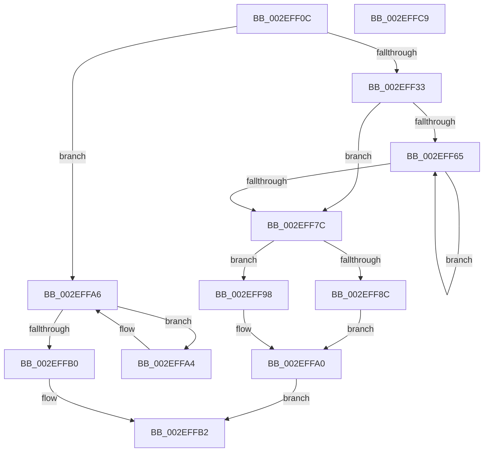

# RtlpCSparseBitmapWaitOnAddress

- RVA: `0x002EFF0C`–`0x002EFFCA` (길이 `190` bytes)
- VA: `0x00000001402EFF0C`
- 실행 섹션: `.text`
- PDB 이름 있음: `예`; PDB Function 태그: `아니요`
- unwind 정보 RVA: `0x00071B58`
- 디코드: `56`개 명령, `190/190` bytes 표시
- 미해석 바이트: `0` (있으면 어셈블리에 `.byte`로 보존)

> 이 문서는 커널 이미지의 기계어와 PDB 기호를 분석해 생성했습니다. 4번과 5번은 함수 원형과 자료형을 바이너리 사용 방식에서 추정한 C 해석이며 원본 소스 복구 결과는 아닙니다.

## 1. Dependencies

- 직접 호출 지점: **3**; 고유 호출 대상: **3**
- 직접 호출자로 확인된 함수: **2**
- RIP 상대 이미지 참조: **0**

### Outgoing calls
- `0x002EFF41` → [memset](../6C/memset_function_006C6C40.md) (function, `0x006C6C40`)
- `0x002EFF8F` → [ExTimedWaitForUnblockPushLock](../2A/ExTimedWaitForUnblockPushLock_function_002A44B0.md) (function, `0x002A44B0`)
- `0x002EFF9B` → [ExpUnblockPushLock](../2A/ExpUnblockPushLock_function_002A40FC.md) (function, `0x002A40FC`)

### Direct callers
- [RtlpCSparseBitmapPageDecommit](RtlpCSparseBitmapPageDecommit_function_002EFAD4.md) at `0x002EFD04`
- [RtlpCSparseBitmapPageCommit](../2F/RtlpCSparseBitmapPageCommit_function_002F0B98.md) at `0x002F0DB3`

### Static image references
- 디코드된 RIP-relative 메모리 참조가 없습니다.

## 2. Other-region calls and transfers

- 다른 실행 섹션으로 향하는 call: **0**
- 별도 외부 분기/꼬리 이동을 확인하지 못했습니다.

## 3. Assembly (complete function range)

```asm
002EFF0C  48 8B C4                        mov rax, rsp
002EFF0F  48 89 58 10                     mov qword ptr [rax + 0x10], rbx
002EFF13  48 89 70 18                     mov qword ptr [rax + 0x18], rsi
002EFF17  48 89 78 20                     mov qword ptr [rax + 0x20], rdi
002EFF1B  48 89 48 08                     mov qword ptr [rax + 8], rcx
002EFF1F  41 56                           push r14
002EFF21  48 83 EC 60                     sub rsp, 0x60
002EFF25  33 F6                           xor esi, esi
002EFF27  48 8B FA                        mov rdi, rdx
002EFF2A  4C 8B F1                        mov r14, rcx
002EFF2D  41 38 71 30                     cmp byte ptr [r9 + 0x30], sil
002EFF31  75 73                           jne 0x1402effa6
002EFF33  33 D2                           xor edx, edx
002EFF35  44 8D 46 40                     lea r8d, [rsi + 0x40]
002EFF39  48 8D 48 B8                     lea rcx, [rax - 0x48]
002EFF3D  49 8D 59 28                     lea rbx, [r9 + 0x28]
002EFF41  E8 FA 6C 3D 00                  call 0x1406c6c40
002EFF46  C7 44 24 54 02 00 00 00         mov dword ptr [rsp + 0x54], 2
002EFF4E  0F 0D 0B                        prefetchw byte ptr [rbx]
002EFF51  48 8B 03                        mov rax, qword ptr [rbx]
002EFF54  48 8D 4C 24 20                  lea rcx, [rsp + 0x20]
002EFF59  48 89 44 24 38                  mov qword ptr [rsp + 0x38], rax
002EFF5E  F0 48 0F B1 0B                  lock cmpxchg qword ptr [rbx], rcx
002EFF63  74 17                           je 0x1402eff7c
002EFF65  48 8B D0                        mov rdx, rax
002EFF68  48 89 44 24 38                  mov qword ptr [rsp + 0x38], rax
002EFF6D  48 8D 4C 24 20                  lea rcx, [rsp + 0x20]
002EFF72  F0 48 0F B1 0B                  lock cmpxchg qword ptr [rbx], rcx
002EFF77  48 3B C2                        cmp rax, rdx
002EFF7A  75 E9                           jne 0x1402eff65
002EFF7C  49 8B 06                        mov rax, qword ptr [r14]
002EFF7F  48 8D 54 24 20                  lea rdx, [rsp + 0x20]
002EFF84  48 8B CB                        mov rcx, rbx
002EFF87  48 3B 07                        cmp rax, qword ptr [rdi]
002EFF8A  75 0C                           jne 0x1402eff98
002EFF8C  45 33 C0                        xor r8d, r8d
002EFF8F  E8 1C 45 FB FF                  call 0x1402a44b0
002EFF94  8B F0                           mov esi, eax
002EFF96  EB 08                           jmp 0x1402effa0
002EFF98  45 33 C0                        xor r8d, r8d
002EFF9B  E8 5C 41 FB FF                  call 0x1402a40fc
002EFFA0  8B C6                           mov eax, esi
002EFFA2  EB 0E                           jmp 0x1402effb2
002EFFA4  F3 90                           pause
002EFFA6  48 8B 44 24 70                  mov rax, qword ptr [rsp + 0x70]
002EFFAB  48 3B 02                        cmp rax, qword ptr [rdx]
002EFFAE  74 F4                           je 0x1402effa4
002EFFB0  33 C0                           xor eax, eax
002EFFB2  4C 8D 5C 24 60                  lea r11, [rsp + 0x60]
002EFFB7  49 8B 5B 18                     mov rbx, qword ptr [r11 + 0x18]
002EFFBB  49 8B 73 20                     mov rsi, qword ptr [r11 + 0x20]
002EFFBF  49 8B 7B 28                     mov rdi, qword ptr [r11 + 0x28]
002EFFC3  49 8B E3                        mov rsp, r11
002EFFC6  41 5E                           pop r14
002EFFC8  C3                              ret
002EFFC9  CC                              int3
```

## 4. C-style interpretation (structured pseudocode)

```c
__int64 __fastcall RtlpCSparseBitmapWaitOnAddress(__int64 a1, __int64 a2, __int64 a3, __int64 a4)
{
    __int64 result;
    __int64 v_rsi;
    __int64 v_rsp;
    unsigned int v_stack_m14;
    unsigned __int64 v_stack_m30;
    unsigned __int64 v_stack_m48;
    unsigned __int64 v_stack_m8;
    unsigned __int64 v_stack_p8;

    *(unsigned __int64 *)(v_rsp + 16) = v_rbx;
    *(unsigned __int64 *)(v_rsp + 24) = v_rsi;
    *(unsigned __int64 *)(v_rsp + 32) = v_rdi;
    *(unsigned __int64 *)(v_rsp + 8) = a1;
    v_rsp = (v_rsp) - (96);
    v_rsi = 0;
    if ((*(unsigned __int8 *)(a4 + 48)) != 0) goto loc_002EFFA6;
    a2 = 0;
    result = memset(v_rsp - 72, a2, v_rsi + 64, a4);
    v_stack_m14 = 2;
    v_stack_m30 = *(unsigned __int64 *)(a4 + 40);
    if (condition_is_equal) goto loc_002EFF7C;
loc_002EFF65:
    v_stack_m30 = *(unsigned __int64 *)(a4 + 40);
    if ((*(unsigned __int64 *)(a4 + 40)) != (*(unsigned __int64 *)(a4 + 40))) goto loc_002EFF65;
loc_002EFF7C:
    if ((*(unsigned __int64 *)(a1)) != (*(unsigned __int64 *)(a2))) goto loc_002EFF98;
    a3 = 0;
    result = ExTimedWaitForUnblockPushLock(a4 + 40, v_stack_m48, a3, a4);
    goto loc_002EFFA0;
loc_002EFF98:
    a3 = 0;
    result = ExpUnblockPushLock(a4 + 40, v_stack_m48, a3, a4);
loc_002EFFA0:
    goto loc_002EFFB2;
loc_002EFFA4:
loc_002EFFA6:
    if (v_stack_p8 == (*(unsigned __int64 *)(v_stack_m48))) goto loc_002EFFA4;
    result = 0;
loc_002EFFB2:
    return result;
}
```

## 5. (Beta) C Style

```c
int64_t RtlpCSparseBitmapWaitOnAddress(void *Arg1, void *Arg2, int64_t Arg3, void *Arg4)
{
    uint8_t *arg1 = (uint8_t *)Arg1;
    uint8_t *arg2 = (uint8_t *)Arg2;
    uint8_t *arg4 = (uint8_t *)Arg4;

    int64_t result;
    int64_t local_rsi;
    int64_t local_rsp;
    uint32_t v_stack_m14;
    uint64_t v_stack_m30;
    uint64_t v_stack_m48;
    uint64_t v_stack_m8;
    uint64_t v_stack_p8;

    *(uint64_t *)(local_rsp + 0x10) = local_rbx;
    *(uint64_t *)(local_rsp + 0x18) = local_rsi;
    *(uint64_t *)(local_rsp + 0x20) = local_rdi;
    *(void **)(local_rsp + 0x8) = Arg1;
    local_rsp = (local_rsp) - (96);
    local_rsi = 0;
    if ((*(uint8_t *)(arg4 + 0x30)) != 0) goto loc_002EFFA6;
    Arg2 = 0;
    result = memset(local_rsp - 72, Arg2, local_rsi + 64, Arg4);
    v_stack_m14 = 2;
    v_stack_m30 = *(uint64_t *)(arg4 + 0x28);
    if (condition_is_equal) goto loc_002EFF7C;
loc_002EFF65:
    v_stack_m30 = *(uint64_t *)(arg4 + 0x28);
    if ((*(uint64_t *)(arg4 + 0x28)) != (*(uint64_t *)(arg4 + 0x28))) goto loc_002EFF65;
loc_002EFF7C:
    if ((*(uint64_t *)(arg1)) != (*(uint64_t *)(arg2))) goto loc_002EFF98;
    Arg3 = 0;
    result = ExTimedWaitForUnblockPushLock(Arg4 + 40, v_stack_m48, Arg3, Arg4);
    goto loc_002EFFA0;
loc_002EFF98:
    Arg3 = 0;
    result = ExpUnblockPushLock(Arg4 + 40, v_stack_m48, Arg3, Arg4);
loc_002EFFA0:
    goto loc_002EFFB2;
loc_002EFFA4:
loc_002EFFA6:
    if (v_stack_p8 == (*(uint64_t *)(v_stack_m48))) goto loc_002EFFA4;
    result = 0;
loc_002EFFB2:
    return result;
}
```

### 관측된 메모리 오프셋

구조체 형식이 확인되지 않은 접근은 인자 기준의 오프셋으로만 기록했습니다.

| 기준 인자 | 오프셋 표현 | 폭 (bit) | 접근 |
|---|---:|---:|---|
| `Arg1` | `+ 0x0` | `64` | `R` |
| `Arg2` | `+ 0x0` | `64` | `R` |
| `Arg4` | `+ 0x0` | `8` | `R` |
| `Arg4` | `+ 0x0` | `64` | `R` |
| `Arg4` | `+ 0x28` | `64` | `R` |
| `Arg4` | `+ 0x30` | `8` | `R` |

## 6. Execution-region graph

[열기: 2D/3D 그래프와 함수 탐색 컨트롤 패널](../../../control-panel.html?section=text&rva=0x002EFF0C&view=graph)

- 2D 그래프는 위에서 아래로 흐르고, 3D 그래프는 빈 공간을 드래그해 회전합니다. Shift+드래그는 이동, 휠은 확대·축소, 함수 노드 선택은 대상 보고서 이동입니다.

### Static fallback


