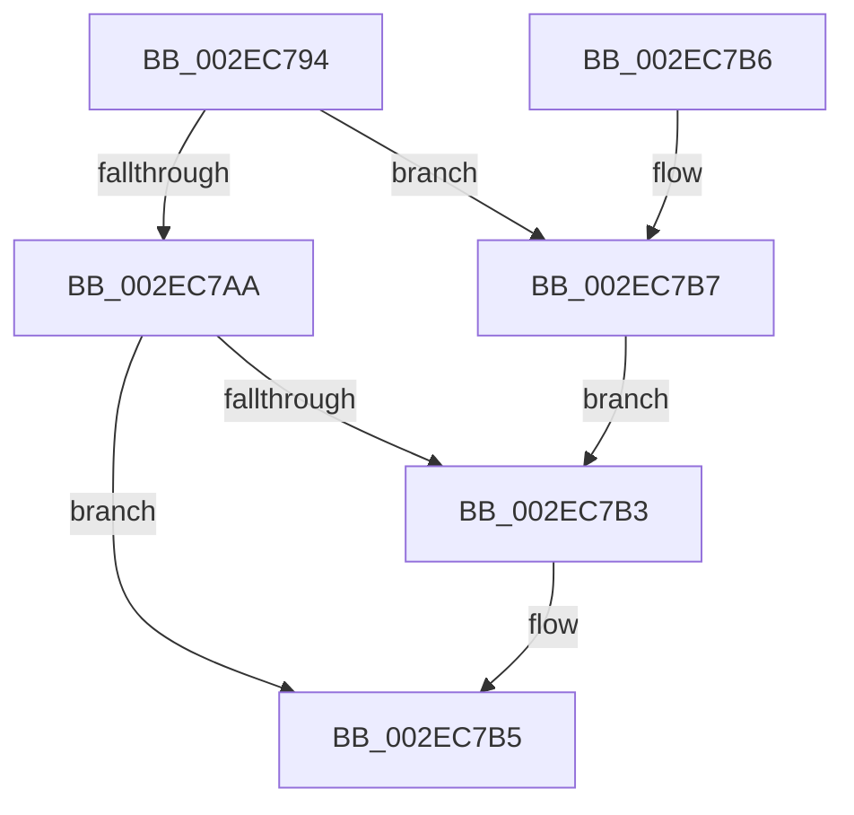

# RtlpCalculateSubsegmentSizeIndex

- RVA: `0x002EC794`–`0x002EC7BE` (길이 `42` bytes)
- VA: `0x00000001402EC794`
- 실행 섹션: `.text`
- PDB 이름 있음: `예`; PDB Function 태그: `아니요`
- unwind 정보 RVA: `0x000DB714`
- 디코드: `16`개 명령, `42/42` bytes 표시
- 미해석 바이트: `0` (있으면 어셈블리에 `.byte`로 보존)

> 이 문서는 커널 이미지의 기계어와 PDB 기호를 분석해 생성했습니다. 4번과 5번은 함수 원형과 자료형을 바이너리 사용 방식에서 추정한 C 해석이며 원본 소스 복구 결과는 아닙니다.

## 1. Dependencies

- 직접 호출 지점: **0**; 고유 호출 대상: **0**
- 직접 호출자로 확인된 함수: **1**
- RIP 상대 이미지 참조: **0**

### Outgoing calls
- 직접 디코드된 call 명령이 없습니다.

### Direct callers
- [RtlpHpLfhSubsegmentCreate](RtlpHpLfhSubsegmentCreate_function_002EC5A0.md) at `0x002EC618`
- [RtlpHpLfhSubsegmentCreate](RtlpHpLfhSubsegmentCreate_function_002EC5A0.md) at `0x002EC63C`

### Static image references
- 디코드된 RIP-relative 메모리 참조가 없습니다.

## 2. Other-region calls and transfers

- 다른 실행 섹션으로 향하는 call: **0**
- 별도 외부 분기/꼬리 이동을 확인하지 못했습니다.

## 3. Assembly (complete function range)

```asm
002EC794  B8 00 00 0F 00                  mov eax, 0xf0000
002EC799  3B C8                           cmp ecx, eax
002EC79B  0F 43 C8                        cmovae ecx, eax
002EC79E  FF C9                           dec ecx
002EC7A0  0F BD C9                        bsr ecx, ecx
002EC7A3  FF C1                           inc ecx
002EC7A5  83 F9 07                        cmp ecx, 7
002EC7A8  76 0D                           jbe 0x1402ec7b7
002EC7AA  B8 12 00 00 00                  mov eax, 0x12
002EC7AF  3B C8                           cmp ecx, eax
002EC7B1  73 02                           jae 0x1402ec7b5
002EC7B3  8B C1                           mov eax, ecx
002EC7B5  C3                              ret
002EC7B6  CC                              int3
002EC7B7  B9 07 00 00 00                  mov ecx, 7
002EC7BC  EB F5                           jmp 0x1402ec7b3
```

## 4. C-style interpretation (structured pseudocode)

```c
__int64 __fastcall RtlpCalculateSubsegmentSizeIndex(int a1)
{
    __int64 result;

    if (a1 >= ((unsigned int)((unsigned int)(0xF0000ULL)))) { a1 = (unsigned int)((unsigned int)(0xF0000ULL)); }
    a1 = (unsigned int)((a1) - 1);
    a1 = (unsigned int)((a1) + 1);
    if (a1 <= 7) goto loc_002EC7B7;
    result = 18;
    if (a1 < 18) {
        result = a1;
    }
    return result;
loc_002EC7B7:
    goto loc_002EC7B3;
}
```

## 5. (Beta) C Style

```c
int64_t RtlpCalculateSubsegmentSizeIndex(int32_t Arg1)
{
    int64_t result;

    if (Arg1 >= ((uint32_t)((uint32_t)(0xF0000ULL)))) { Arg1 = (uint32_t)((uint32_t)(0xF0000ULL)); }
    Arg1 = (uint32_t)((Arg1) - 1);
    Arg1 = (uint32_t)((Arg1) + 1);
    if (Arg1 <= 7) goto loc_002EC7B7;
    result = 18;
    if (Arg1 < 18) {
        result = Arg1;
    }
    return result;
loc_002EC7B7:
    goto loc_002EC7B3;
}
```

## 6. Execution-region graph

[열기: 2D/3D 그래프와 함수 탐색 컨트롤 패널](../../../control-panel.html?section=text&rva=0x002EC794&view=graph)

- 2D 그래프는 위에서 아래로 흐르고, 3D 그래프는 빈 공간을 드래그해 회전합니다. Shift+드래그는 이동, 휠은 확대·축소, 함수 노드 선택은 대상 보고서 이동입니다.

### Static fallback


