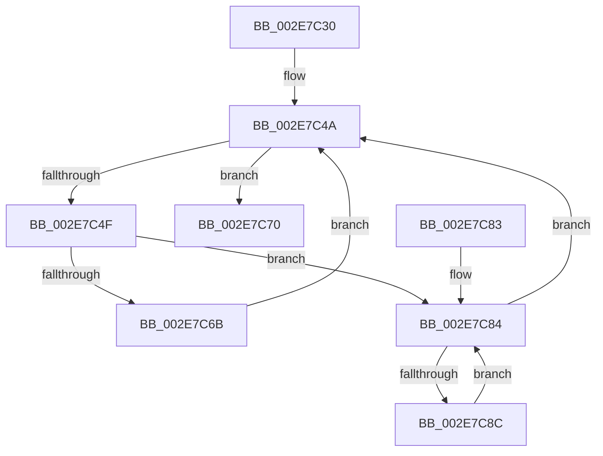

# RtlpDynamicLookasideFlush

- RVA: `0x002E7C30`–`0x002E7C97` (길이 `103` bytes)
- VA: `0x00000001402E7C30`
- 실행 섹션: `.text`
- PDB 이름 있음: `예`; PDB Function 태그: `아니요`
- unwind 정보 RVA: `0x000713A0`
- 디코드: `34`개 명령, `103/103` bytes 표시
- 미해석 바이트: `0` (있으면 어셈블리에 `.byte`로 보존)

> 이 문서는 커널 이미지의 기계어와 PDB 기호를 분석해 생성했습니다. 4번과 5번은 함수 원형과 자료형을 바이너리 사용 방식에서 추정한 C 해석이며 원본 소스 복구 결과는 아닙니다.

## 1. Dependencies

- 직접 호출 지점: **1**; 고유 호출 대상: **1**
- 직접 호출자로 확인된 함수: **1**
- RIP 상대 이미지 참조: **0**

### Outgoing calls
- `0x002E7C61` → [ExpInterlockedFlushSList](../6B/ExpInterlockedFlushSList_function_006BA5F0.md) (function, `0x006BA5F0`)

### Direct callers
- [ExpHpCompactHeapCallback](ExpHpCompactHeapCallback_function_002E75F0.md) at `0x002E7626`

### Static image references
- 디코드된 RIP-relative 메모리 참조가 없습니다.

## 2. Other-region calls and transfers

- 다른 실행 섹션으로 향하는 call: **0**
- 별도 외부 분기/꼬리 이동을 확인하지 못했습니다.

## 3. Assembly (complete function range)

```asm
002E7C30  48 89 5C 24 08                  mov qword ptr [rsp + 8], rbx
002E7C35  48 89 74 24 18                  mov qword ptr [rsp + 0x18], rsi
002E7C3A  57                              push rdi
002E7C3B  48 83 EC 20                     sub rsp, 0x20
002E7C3F  48 8B 39                        mov rdi, qword ptr [rcx]
002E7C42  48 8B F1                        mov rsi, rcx
002E7C45  48 F7 D7                        not rdi
002E7C48  33 DB                           xor ebx, ebx
002E7C4A  48 85 FF                        test rdi, rdi
002E7C4D  74 21                           je 0x1402e7c70
002E7C4F  48 0F BC CF                     bsf rcx, rdi
002E7C53  48 0F BB CF                     btc rdi, rcx
002E7C57  48 FF C1                        inc rcx
002E7C5A  48 C1 E1 06                     shl rcx, 6
002E7C5E  48 03 CE                        add rcx, rsi
002E7C61  E8 8A 29 3D 00                  call 0x1406ba5f0
002E7C66  48 85 DB                        test rbx, rbx
002E7C69  75 19                           jne 0x1402e7c84
002E7C6B  48 8B D8                        mov rbx, rax
002E7C6E  EB DA                           jmp 0x1402e7c4a
002E7C70  48 8B 74 24 40                  mov rsi, qword ptr [rsp + 0x40]
002E7C75  48 8B C3                        mov rax, rbx
002E7C78  48 8B 5C 24 30                  mov rbx, qword ptr [rsp + 0x30]
002E7C7D  48 83 C4 20                     add rsp, 0x20
002E7C81  5F                              pop rdi
002E7C82  C3                              ret
002E7C83  CC                              int3
002E7C84  48 8B C8                        mov rcx, rax
002E7C87  48 85 C0                        test rax, rax
002E7C8A  74 BE                           je 0x1402e7c4a
002E7C8C  48 8B 00                        mov rax, qword ptr [rax]
002E7C8F  48 89 19                        mov qword ptr [rcx], rbx
002E7C92  48 8B D9                        mov rbx, rcx
002E7C95  EB ED                           jmp 0x1402e7c84
```

## 4. C-style interpretation (structured pseudocode)

```c
__int64 __fastcall RtlpDynamicLookasideFlush(__int64 a1)
{
    __int64 result;
    __int64 v_rbx;
    __int64 v_rdi;
    __int64 v_rsp;
    unsigned __int64 v_stack_p18;
    unsigned __int64 v_stack_p8;

    v_stack_p8 = v_rbx;
    v_stack_p18 = v_rsi;
    v_rsp = (v_rsp) - (32);
    v_rdi = ~(*(unsigned __int64 *)(a1));
    v_rbx = 0;
loc_002E7C4A:
    if (v_rdi == 0) goto loc_002E7C70;
    a1 = (a1) + 1;
    a1 = (a1) << (6);
    a1 = (a1) + (a1);
    result = ExpInterlockedFlushSList(a1, a2, a3, a4);
    if (0 != 0) goto loc_002E7C84;
    goto loc_002E7C4A;
loc_002E7C70:
    v_rsp = (v_rsp) + (32);
    return result;
loc_002E7C84:
    if (result == 0) goto loc_002E7C4A;
    *(unsigned __int64 *)(result) = v_stack_p8;
    goto loc_002E7C84;
}
```

## 5. (Beta) C Style

```c
int64_t RtlpDynamicLookasideFlush(void *Arg1)
{
    uint8_t *arg1 = (uint8_t *)Arg1;

    int64_t result;
    int64_t local_rbx;
    int64_t local_rdi;
    int64_t local_rsp;
    uint64_t v_stack_p18;
    uint64_t v_stack_p8;

    v_stack_p8 = local_rbx;
    v_stack_p18 = local_rsi;
    local_rsp = (local_rsp) - (32);
    local_rdi = ~(*(uint64_t *)(arg1));
    local_rbx = 0;
loc_002E7C4A:
    if (local_rdi == 0) goto loc_002E7C70;
    Arg1 = (Arg1) + 1;
    Arg1 = (Arg1) << (6);
    Arg1 = (Arg1) + (Arg1);
    result = ExpInterlockedFlushSList(Arg1, a2, a3, a4);
    if (0 != 0) goto loc_002E7C84;
    goto loc_002E7C4A;
loc_002E7C70:
    local_rsp = (local_rsp) + (32);
    return result;
loc_002E7C84:
    if (result == 0) goto loc_002E7C4A;
    *(uint64_t *)(result) = v_stack_p8;
    goto loc_002E7C84;
}
```

### 관측된 메모리 오프셋

구조체 형식이 확인되지 않은 접근은 인자 기준의 오프셋으로만 기록했습니다.

| 기준 인자 | 오프셋 표현 | 폭 (bit) | 접근 |
|---|---:|---:|---|
| `Arg1` | `+ 0x0` | `64` | `R` |

## 6. Execution-region graph

[열기: 2D/3D 그래프와 함수 탐색 컨트롤 패널](../../../control-panel.html?section=text&rva=0x002E7C30&view=graph)

- 2D 그래프는 위에서 아래로 흐르고, 3D 그래프는 빈 공간을 드래그해 회전합니다. Shift+드래그는 이동, 휠은 확대·축소, 함수 노드 선택은 대상 보고서 이동입니다.

### Static fallback


