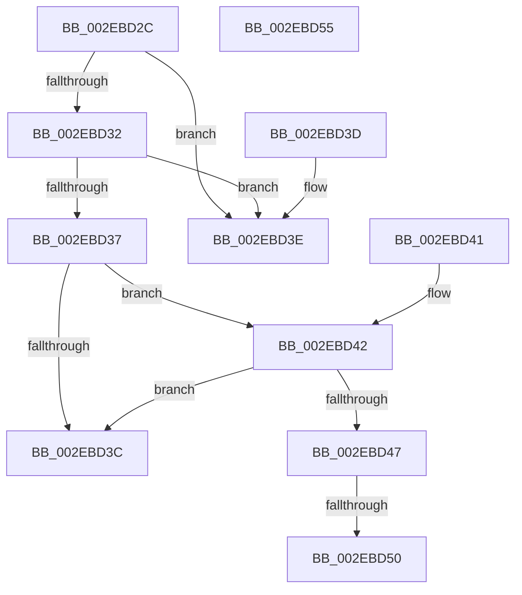

# RtlpHpAffinityMgrUpdateComplete

- RVA: `0x002EBD2C`–`0x002EBD56` (길이 `42` bytes)
- VA: `0x00000001402EBD2C`
- 실행 섹션: `.text`
- PDB 이름 있음: `예`; PDB Function 태그: `예`
- unwind 정보 RVA: `0x000DB714`
- 디코드: `19`개 명령, `42/42` bytes 표시
- 미해석 바이트: `0` (있으면 어셈블리에 `.byte`로 보존)

> 이 문서는 커널 이미지의 기계어와 PDB 기호를 분석해 생성했습니다. 4번과 5번은 함수 원형과 자료형을 바이너리 사용 방식에서 추정한 C 해석이며 원본 소스 복구 결과는 아닙니다.

## 1. Dependencies

- 직접 호출 지점: **0**; 고유 호출 대상: **0**
- 직접 호출자로 확인된 함수: **2**
- RIP 상대 이미지 참조: **0**

### Outgoing calls
- 직접 디코드된 call 명령이 없습니다.

### Direct callers
- [RtlpHpVsContextHandleContention](RtlpHpVsContextHandleContention_function_002EB9D4.md) at `0x002EBAC4`
- [RtlpHpLfhBucketUpdateAffinityMapping](../4D/RtlpHpLfhBucketUpdateAffinityMapping_function_004D0008.md) at `0x004D026A`

### Static image references
- 디코드된 RIP-relative 메모리 참조가 없습니다.

## 2. Other-region calls and transfers

- 다른 실행 섹션으로 향하는 call: **0**
- call이 아닌 외부 분기/꼬리 이동: **1**
  - `0x002EBD4A` → `0x006DE82C` (`tail-transfer`)

## 3. Assembly (complete function range)

```asm
002EBD2C  33 C0                           xor eax, eax
002EBD2E  85 D2                           test edx, edx
002EBD30  74 0C                           je 0x1402ebd3e
002EBD32  83 EA 01                        sub edx, 1
002EBD35  74 07                           je 0x1402ebd3e
002EBD37  83 EA 01                        sub edx, 1
002EBD3A  75 06                           jne 0x1402ebd42
002EBD3C  C3                              ret
002EBD3D  CC                              int3
002EBD3E  88 01                           mov byte ptr [rcx], al
002EBD40  C3                              ret
002EBD41  CC                              int3
002EBD42  83 FA 01                        cmp edx, 1
002EBD45  75 F5                           jne 0x1402ebd3c
002EBD47  45 85 C0                        test r8d, r8d
002EBD4A  0F 85 DC 2A 3F 00               jne 0x1406de82c
002EBD50  F0 FE 49 01                     lock dec byte ptr [rcx + 1]
002EBD54  C3                              ret
002EBD55  CC                              int3
```

## 4. C-style interpretation (structured pseudocode)

```c
__int64 __fastcall RtlpHpAffinityMgrUpdateComplete(__int64 a1, int a2, int a3)
{
    __int64 result;

    result = 0;
    if (a2 == 0) goto loc_002EBD3E;
    a2 = (unsigned int)((a2) - (1));
    if (condition_is_equal) goto loc_002EBD3E;
    a2 = (unsigned int)((a2) - (1));
    if (condition_is_not_equal) goto loc_002EBD42;
loc_002EBD3C:
    return result;
loc_002EBD3E:
    *(unsigned __int8 *)(a1) = 0;
    return result;
loc_002EBD42:
    if (a2 != 1) goto loc_002EBD3C;
    return result;
}
```

## 5. (Beta) C Style

```c
int64_t RtlpHpAffinityMgrUpdateComplete(void *Arg1, int32_t Arg2, int32_t Arg3)
{
    uint8_t *arg1 = (uint8_t *)Arg1;

    int64_t result;

    result = 0;
    if (Arg2 == 0) goto loc_002EBD3E;
    Arg2 = (uint32_t)((Arg2) - (1));
    if (condition_is_equal) goto loc_002EBD3E;
    Arg2 = (uint32_t)((Arg2) - (1));
    if (condition_is_not_equal) goto loc_002EBD42;
loc_002EBD3C:
    return result;
loc_002EBD3E:
    *(uint8_t *)(arg1) = 0;
    return result;
loc_002EBD42:
    if (Arg2 != 1) goto loc_002EBD3C;
    return result;
}
```

### 관측된 메모리 오프셋

구조체 형식이 확인되지 않은 접근은 인자 기준의 오프셋으로만 기록했습니다.

| 기준 인자 | 오프셋 표현 | 폭 (bit) | 접근 |
|---|---:|---:|---|
| `Arg1` | `+ 0x0` | `8` | `W` |
| `Arg1` | `+ 0x1` | `8` | `R/W` |

## 6. Execution-region graph

[열기: 2D/3D 그래프와 함수 탐색 컨트롤 패널](../../../control-panel.html?section=text&rva=0x002EBD2C&view=graph)

- 2D 그래프는 위에서 아래로 흐르고, 3D 그래프는 빈 공간을 드래그해 회전합니다. Shift+드래그는 이동, 휠은 확대·축소, 함수 노드 선택은 대상 보고서 이동입니다.

### Static fallback


