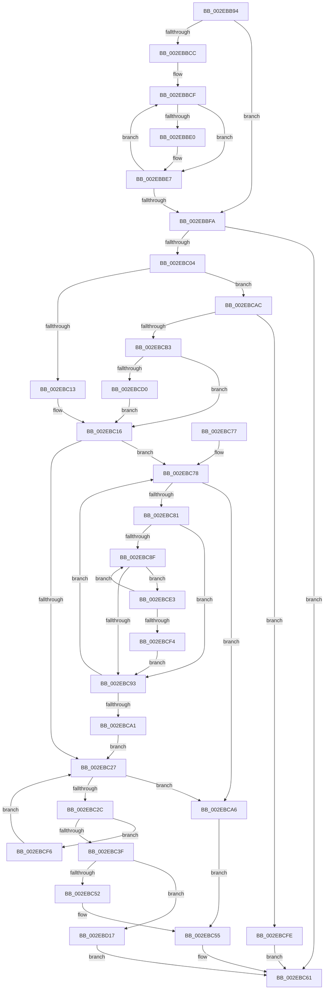

# RtlpHpAffinityMgrUpdateProcess

- RVA: `0x002EBB94`–`0x002EBD24` (길이 `400` bytes)
- VA: `0x00000001402EBB94`
- 실행 섹션: `.text`
- PDB 이름 있음: `예`; PDB Function 태그: `아니요`
- unwind 정보 RVA: `0x0007175C`
- 디코드: `118`개 명령, `400/400` bytes 표시
- 미해석 바이트: `0` (있으면 어셈블리에 `.byte`로 보존)

> 이 문서는 커널 이미지의 기계어와 PDB 기호를 분석해 생성했습니다. 4번과 5번은 함수 원형과 자료형을 바이너리 사용 방식에서 추정한 C 해석이며 원본 소스 복구 결과는 아닙니다.

## 1. Dependencies

- 직접 호출 지점: **0**; 고유 호출 대상: **0**
- 직접 호출자로 확인된 함수: **2**
- RIP 상대 이미지 참조: **0**

### Outgoing calls
- 직접 디코드된 call 명령이 없습니다.

### Direct callers
- [RtlpHpVsContextHandleContention](RtlpHpVsContextHandleContention_function_002EB9D4.md) at `0x002EBAA6`
- [RtlpHpLfhBucketUpdateAffinityMapping](../4D/RtlpHpLfhBucketUpdateAffinityMapping_function_004D0008.md) at `0x004D01AC`

### Static image references
- 디코드된 RIP-relative 메모리 참조가 없습니다.

## 2. Other-region calls and transfers

- 다른 실행 섹션으로 향하는 call: **0**
- 별도 외부 분기/꼬리 이동을 확인하지 못했습니다.

## 3. Assembly (complete function range)

```asm
002EBB94  48 89 5C 24 08                  mov qword ptr [rsp + 8], rbx
002EBB99  48 89 6C 24 20                  mov qword ptr [rsp + 0x20], rbp
002EBB9E  56                              push rsi
002EBB9F  57                              push rdi
002EBBA0  41 54                           push r12
002EBBA2  41 56                           push r14
002EBBA4  48 83 64 24 38 00               and qword ptr [rsp + 0x38], 0
002EBBAA  33 ED                           xor ebp, ebp
002EBBAC  4C 8B D1                        mov r10, rcx
002EBBAF  41 8B F1                        mov esi, r9d
002EBBB2  8B FA                           mov edi, edx
002EBBB4  41 8B D9                        mov ebx, r9d
002EBBB7  8B CA                           mov ecx, edx
002EBBB9  41 BB FF FF 00 00               mov r11d, 0xffff
002EBBBF  44 8D 75 01                     lea r14d, [rbp + 1]
002EBBC3  44 8D 65 04                     lea r12d, [rbp + 4]
002EBBC7  45 85 C9                        test r9d, r9d
002EBBCA  74 2E                           je 0x1402ebbfa
002EBBCC  4D 8B C8                        mov r9, r8
002EBBCF  41 0F B7 11                     movzx edx, word ptr [r9]
002EBBD3  3B D1                           cmp edx, ecx
002EBBD5  8B C2                           mov eax, edx
002EBBD7  0F 43 C1                        cmovae eax, ecx
002EBBDA  8B C8                           mov ecx, eax
002EBBDC  3B D7                           cmp edx, edi
002EBBDE  76 07                           jbe 0x1402ebbe7
002EBBE0  41 3B D3                        cmp edx, r11d
002EBBE3  44 0F 42 DA                     cmovb r11d, edx
002EBBE7  3B D7                           cmp edx, edi
002EBBE9  8B C5                           mov eax, ebp
002EBBEB  0F 45 C3                        cmovne eax, ebx
002EBBEE  41 03 EE                        add ebp, r14d
002EBBF1  4D 03 CC                        add r9, r12
002EBBF4  8B D8                           mov ebx, eax
002EBBF6  3B EE                           cmp ebp, esi
002EBBF8  72 D5                           jb 0x1402ebbcf
002EBBFA  8B C3                           mov eax, ebx
002EBBFC  66 45 39 74 80 02               cmp word ptr [r8 + rax*4 + 2], r14w
002EBC02  74 5D                           je 0x1402ebc61
002EBC04  BA 00 00 10 00                  mov edx, 0x100000
002EBC09  45 84 72 03                     test byte ptr [r10 + 3], r14b
002EBC0D  0F 85 99 00 00 00               jne 0x1402ebcac
002EBC13  45 33 C9                        xor r9d, r9d
002EBC16  41 C6 02 00                     mov byte ptr [r10], 0
002EBC1A  4D 8D 5A 02                     lea r11, [r10 + 2]
002EBC1E  45 8A 42 01                     mov r8b, byte ptr [r10 + 1]
002EBC22  4C 3B CA                        cmp r9, rdx
002EBC25  73 51                           jae 0x1402ebc78
002EBC27  45 3A 03                        cmp r8b, byte ptr [r11]
002EBC2A  73 7A                           jae 0x1402ebca6
002EBC2C  43 8D 0C 06                     lea ecx, [r14 + r8]
002EBC30  41 8A C0                        mov al, r8b
002EBC33  F0 41 0F B0 4A 01               lock cmpxchg byte ptr [r10 + 1], cl
002EBC39  0F 85 B7 00 00 00               jne 0x1402ebcf6
002EBC3F  41 0F B6 03                     movzx eax, byte ptr [r11]
002EBC43  41 2B C6                        sub eax, r14d
002EBC46  41 0F B6 C8                     movzx ecx, r8b
002EBC4A  3B C8                           cmp ecx, eax
002EBC4C  0F 8D C5 00 00 00               jge 0x1402ebd17
002EBC52  8D 41 01                        lea eax, [rcx + 1]
002EBC55  89 44 24 3C                     mov dword ptr [rsp + 0x3c], eax
002EBC59  C7 44 24 38 02 00 00 00         mov dword ptr [rsp + 0x38], 2
002EBC61  48 8B 44 24 38                  mov rax, qword ptr [rsp + 0x38]
002EBC66  48 8B 5C 24 28                  mov rbx, qword ptr [rsp + 0x28]
002EBC6B  48 8B 6C 24 40                  mov rbp, qword ptr [rsp + 0x40]
002EBC70  41 5E                           pop r14
002EBC72  41 5C                           pop r12
002EBC74  5F                              pop rdi
002EBC75  5E                              pop rsi
002EBC76  C3                              ret
002EBC77  CC                              int3
002EBC78  4D 8D 5A 02                     lea r11, [r10 + 2]
002EBC7C  45 3A 03                        cmp r8b, byte ptr [r11]
002EBC7F  73 25                           jae 0x1402ebca6
002EBC81  49 8B D9                        mov rbx, r9
002EBC84  41 8A C8                        mov cl, r8b
002EBC87  48 C1 EB 14                     shr rbx, 0x14
002EBC8B  85 DB                           test ebx, ebx
002EBC8D  74 04                           je 0x1402ebc93
002EBC8F  84 C9                           test cl, cl
002EBC91  75 50                           jne 0x1402ebce3
002EBC93  41 8A C0                        mov al, r8b
002EBC96  F0 41 0F B0 4A 01               lock cmpxchg byte ptr [r10 + 1], cl
002EBC9C  44 8A C0                        mov r8b, al
002EBC9F  75 D7                           jne 0x1402ebc78
002EBCA1  44 8A C1                        mov r8b, cl
002EBCA4  EB 81                           jmp 0x1402ebc27
002EBCA6  41 0F B6 C0                     movzx eax, r8b
002EBCAA  EB A9                           jmp 0x1402ebc55
002EBCAC  44 84 74 24 48                  test byte ptr [rsp + 0x48], r14b
002EBCB1  74 4B                           je 0x1402ebcfe
002EBCB3  49 B9 08 00 00 00 80 F7 FF FF   movabs r9, 0xfffff78000000008
002EBCBD  4D 8B 09                        mov r9, qword ptr [r9]
002EBCC0  49 8B 42 08                     mov rax, qword ptr [r10 + 8]
002EBCC4  4C 2B C8                        sub r9, rax
002EBCC7  4C 3B CA                        cmp r9, rdx
002EBCCA  0F 82 46 FF FF FF               jb 0x1402ebc16
002EBCD0  49 81 E1 00 00 F0 FF            and r9, 0xfffffffffff00000
002EBCD7  49 03 C1                        add rax, r9
002EBCDA  49 89 42 08                     mov qword ptr [r10 + 8], rax
002EBCDE  E9 33 FF FF FF                  jmp 0x1402ebc16
002EBCE3  0F B6 C9                        movzx ecx, cl
002EBCE6  8D 04 49                        lea eax, [rcx + rcx*2]
002EBCE9  99                              cdq
002EBCEA  41 F7 FC                        idiv r12d
002EBCED  8B C8                           mov ecx, eax
002EBCEF  83 C3 FF                        add ebx, -1
002EBCF2  75 9B                           jne 0x1402ebc8f
002EBCF4  EB 9D                           jmp 0x1402ebc93
002EBCF6  44 8A C0                        mov r8b, al
002EBCF9  E9 29 FF FF FF                  jmp 0x1402ebc27
002EBCFE  41 81 FB FF FF 00 00            cmp r11d, 0xffff
002EBD05  44 89 74 24 38                  mov dword ptr [rsp + 0x38], r14d
002EBD0A  41 0F 45 CB                     cmovne ecx, r11d
002EBD0E  89 4C 24 3C                     mov dword ptr [rsp + 0x3c], ecx
002EBD12  E9 4A FF FF FF                  jmp 0x1402ebc61
002EBD17  C7 44 24 38 03 00 00 00         mov dword ptr [rsp + 0x38], 3
002EBD1F  E9 3D FF FF FF                  jmp 0x1402ebc61
```

## 4. C-style interpretation (structured pseudocode)

```c
__int64 __fastcall RtlpHpAffinityMgrUpdateProcess(__int64 a1, int a2, __int64 a3, int a4)
{
    __int64 result;
    __int64 v_r11;
    __int64 v_rbp;
    __int64 v_rbx;
    unsigned __int64 v_stack_p18;
    unsigned int v_stack_p1C;
    unsigned __int64 v_stack_p20;
    unsigned int v_stack_p38;
    unsigned int v_stack_p3C;
    unsigned __int8 v_stack_p48;
    unsigned __int64 v_stack_p8;

    v_stack_p8 = v_rbx;
    v_stack_p20 = v_rbp;
    v_rbp = 0;
    if (a4 == 0) goto loc_002EBBFA;
loc_002EBBCF:
    result = (unsigned int)((unsigned int)(*(unsigned __int16 *)(a3)));
    if (((unsigned int)(*(unsigned __int16 *)(a3))) >= ((unsigned int)((unsigned int)(a2)))) { result = (unsigned int)((unsigned int)(a2)); }
    v_r11 = (unsigned int)(0xFFFFULL);
    if (((unsigned int)(*(unsigned __int16 *)(a3))) >= = ((unsigned int)((unsigned int)(a2)))) {
        v_r11 = (unsigned int)(0xFFFFULL);
        if (((unsigned int)(*(unsigned __int16 *)(a3))) < ((unsigned int)((unsigned int)(0xFFFFULL)))) { v_r11 = (unsigned int)(*(unsigned __int16 *)(a3)); }
    }
    result = 0;
    if (((unsigned int)(*(unsigned __int16 *)(a3))) != ((unsigned int)((unsigned int)(a2)))) { result = (unsigned int)((unsigned int)(a4)); }
    v_rbp = (unsigned int)((v_rbp) + ((unsigned int)(v_rbp + 1)));
    a4 = (a3) + (v_rbp + 4);
    if (((unsigned int)(v_rbp)) < ((unsigned int)((unsigned int)(a4)))) goto loc_002EBBCF;
loc_002EBBFA:
    if ((*(unsigned __int16 *)(a3 + (unsigned int)((unsigned int)((unsigned int)((unsigned int)(result)))) * 4 + 2)) == ((unsigned __int16)(v_rbp + 1))) goto loc_002EBC61;
    if (((*(unsigned __int8 *)(a1 + 3)) & ((unsigned __int8)(v_rbp + 1))) != 0) goto loc_002EBCAC;
    a4 = 0;
loc_002EBC16:
    *(unsigned __int8 *)(a1) = 0;
    if (0 >= ((unsigned int)(0x100000ULL))) goto loc_002EBC78;
loc_002EBC27:
    if (((unsigned __int8)(*(unsigned __int8 *)(a1 + 1))) >= (*(unsigned __int8 *)(a1 + 2))) goto loc_002EBCA6;
    if (((unsigned __int8)(*(unsigned __int8 *)(a1 + 1))) != (*(unsigned __int8 *)(a1 + 2))) goto loc_002EBCF6;
    result = (unsigned int)((*(unsigned __int8 *)(a1 + 2)) - ((unsigned int)(v_rbp + 1)));
    if (((unsigned int)((unsigned __int8)(*(unsigned __int8 *)(a1 + 1)))) >= ((unsigned int)(result))) goto loc_002EBD17;
loc_002EBC55:
    v_stack_p1C = (unsigned int)((unsigned __int8)(*(unsigned __int8 *)(a1 + 1)) + 1);
    v_stack_p18 = 2;
loc_002EBC61:
    return v_stack_p18;
loc_002EBC78:
    if (((unsigned __int8)(*(unsigned __int8 *)(a1 + 1))) >= (*(unsigned __int8 *)(a1 + 2))) goto loc_002EBCA6;
    v_rbx = (0) >> (20);
    if ((unsigned int)(v_rbx) == 0) goto loc_002EBC93;
loc_002EBC8F:
    if ((unsigned __int8)((unsigned __int8)(*(unsigned __int8 *)(a1 + 1))) != 0) goto loc_002EBCE3;
loc_002EBC93:
    if ((unsigned __int8)((unsigned __int8)(*(unsigned __int8 *)(a1 + 1))) != 0) goto loc_002EBC78;
    goto loc_002EBC27;
loc_002EBCA6:
    goto loc_002EBC55;
loc_002EBCAC:
    if (((v_stack_p48) & ((unsigned __int8)(v_rbp + 1))) == 0) goto loc_002EBCFE;
    a4 = (*(unsigned __int64 *)(a4)) - (*(unsigned __int64 *)(a1 + 8));
    if (a4 < ((unsigned int)(0x100000ULL))) goto loc_002EBC16;
    a4 = (a4) & (0xFFFFFFFFFFF00000ULL);
    result = (*(unsigned __int64 *)(a1 + 8)) + (a4);
    *(unsigned __int64 *)(a1 + 8) = result;
    goto loc_002EBC16;
loc_002EBCE3:
    v_rbx = (unsigned int)((v_rbx) + (-1));
    if (condition_is_not_equal) goto loc_002EBC8F;
    goto loc_002EBC93;
loc_002EBCF6:
    goto loc_002EBC27;
loc_002EBCFE:
    v_stack_p38 = (unsigned int)(v_rbp + 1);
    a1 = (unsigned int)((unsigned int)((unsigned __int8)((unsigned __int8)(*(unsigned __int8 *)(a1 + 1))) + (unsigned __int8)((unsigned __int8)(*(unsigned __int8 *)(a1 + 1))) * 2));
    if (((unsigned int)(a1 + 2)) != 0xFFFFULL) { a1 = (unsigned int)(a1 + 2); }
    v_stack_p3C = (unsigned int)(a1);
    goto loc_002EBC61;
loc_002EBD17:
    v_stack_p38 = 3;
    goto loc_002EBC61;
}
```

## 5. (Beta) C Style

```c
int64_t RtlpHpAffinityMgrUpdateProcess(void *Arg1, int32_t Arg2, void *Arg3, int32_t Arg4)
{
    uint8_t *arg1 = (uint8_t *)Arg1;
    uint8_t *arg3 = (uint8_t *)Arg3;

    int64_t result;
    int64_t local_r11;
    int64_t local_rbp;
    int64_t local_rbx;
    uint64_t v_stack_p18;
    uint32_t v_stack_p1C;
    uint64_t v_stack_p20;
    uint32_t v_stack_p38;
    uint32_t v_stack_p3C;
    uint8_t v_stack_p48;
    uint64_t v_stack_p8;

    v_stack_p8 = local_rbx;
    v_stack_p20 = local_rbp;
    local_rbp = 0;
    if (Arg4 == 0) goto loc_002EBBFA;
loc_002EBBCF:
    result = (uint32_t)((uint32_t)(*(uint16_t *)(arg3)));
    if (((uint32_t)(*(uint16_t *)(arg3))) >= ((uint32_t)((uint32_t)(Arg2)))) { result = (uint32_t)((uint32_t)(Arg2)); }
    local_r11 = (uint32_t)(0xFFFFULL);
    if (((uint32_t)(*(uint16_t *)(arg3))) >= = ((uint32_t)((uint32_t)(Arg2)))) {
        local_r11 = (uint32_t)(0xFFFFULL);
        if (((uint32_t)(*(uint16_t *)(arg3))) < ((uint32_t)((uint32_t)(0xFFFFULL)))) { local_r11 = (uint32_t)(*(uint16_t *)(arg3)); }
    }
    result = 0;
    if (((uint32_t)(*(uint16_t *)(arg3))) != ((uint32_t)((uint32_t)(Arg2)))) { result = (uint32_t)((uint32_t)(Arg4)); }
    local_rbp = (uint32_t)((local_rbp) + ((uint32_t)(local_rbp + 1)));
    Arg4 = (Arg3) + (local_rbp + 4);
    if (((uint32_t)(local_rbp)) < ((uint32_t)((uint32_t)(Arg4)))) goto loc_002EBBCF;
loc_002EBBFA:
    if ((*(uint16_t *)(arg3 + (uint32_t)((uint32_t)((uint32_t)((uint32_t)(result)))) * 4 + 0x2)) == ((uint16_t)(local_rbp + 1))) goto loc_002EBC61;
    if (((*(uint8_t *)(arg1 + 0x3)) & ((uint8_t)(local_rbp + 1))) != 0) goto loc_002EBCAC;
    Arg4 = 0;
loc_002EBC16:
    *(uint8_t *)(arg1) = 0;
    if (0 >= ((uint32_t)(0x100000ULL))) goto loc_002EBC78;
loc_002EBC27:
    if (((uint8_t)(*(uint8_t *)(arg1 + 0x1))) >= (*(uint8_t *)(arg1 + 0x2))) goto loc_002EBCA6;
    if (((uint8_t)(*(uint8_t *)(arg1 + 0x1))) != (*(uint8_t *)(arg1 + 0x2))) goto loc_002EBCF6;
    result = (uint32_t)((*(uint8_t *)(arg1 + 0x2)) - ((uint32_t)(local_rbp + 1)));
    if (((uint32_t)((uint8_t)(*(uint8_t *)(arg1 + 0x1)))) >= ((uint32_t)(result))) goto loc_002EBD17;
loc_002EBC55:
    v_stack_p1C = (uint32_t)((uint8_t)(*(uint8_t *)(arg1 + 0x1)) + 1);
    v_stack_p18 = 2;
loc_002EBC61:
    return v_stack_p18;
loc_002EBC78:
    if (((uint8_t)(*(uint8_t *)(arg1 + 0x1))) >= (*(uint8_t *)(arg1 + 0x2))) goto loc_002EBCA6;
    local_rbx = (0) >> (20);
    if ((uint32_t)(local_rbx) == 0) goto loc_002EBC93;
loc_002EBC8F:
    if ((uint8_t)((uint8_t)(*(uint8_t *)(arg1 + 0x1))) != 0) goto loc_002EBCE3;
loc_002EBC93:
    if ((uint8_t)((uint8_t)(*(uint8_t *)(arg1 + 0x1))) != 0) goto loc_002EBC78;
    goto loc_002EBC27;
loc_002EBCA6:
    goto loc_002EBC55;
loc_002EBCAC:
    if (((v_stack_p48) & ((uint8_t)(local_rbp + 1))) == 0) goto loc_002EBCFE;
    Arg4 = (*(uint64_t *)(Arg4)) - (*(uint64_t *)(arg1 + 0x8));
    if (Arg4 < ((uint32_t)(0x100000ULL))) goto loc_002EBC16;
    Arg4 = (Arg4) & (0xFFFFFFFFFFF00000ULL);
    result = (*(uint64_t *)(arg1 + 0x8)) + (Arg4);
    *(uint64_t *)(arg1 + 0x8) = result;
    goto loc_002EBC16;
loc_002EBCE3:
    local_rbx = (uint32_t)((local_rbx) + (-1));
    if (condition_is_not_equal) goto loc_002EBC8F;
    goto loc_002EBC93;
loc_002EBCF6:
    goto loc_002EBC27;
loc_002EBCFE:
    v_stack_p38 = (uint32_t)(local_rbp + 1);
    Arg1 = (uint32_t)((uint32_t)((uint8_t)((uint8_t)(*(uint8_t *)(arg1 + 0x1))) + (uint8_t)((uint8_t)(*(uint8_t *)(arg1 + 0x1))) * 2));
    if (((uint32_t)(Arg1 + 2)) != 0xFFFFULL) { Arg1 = (uint32_t)(Arg1 + 2); }
    v_stack_p3C = (uint32_t)(Arg1);
    goto loc_002EBC61;
loc_002EBD17:
    v_stack_p38 = 3;
    goto loc_002EBC61;
}
```

### 관측된 메모리 오프셋

구조체 형식이 확인되지 않은 접근은 인자 기준의 오프셋으로만 기록했습니다.

| 기준 인자 | 오프셋 표현 | 폭 (bit) | 접근 |
|---|---:|---:|---|
| `Arg1` | `+ 0x0` | `8` | `R` |
| `Arg1` | `+ 0x0` | `8` | `W` |
| `Arg1` | `+ 0x1` | `8` | `R` |
| `Arg1` | `+ 0x2` | `64` | `R` |
| `Arg1` | `+ 0x3` | `8` | `R` |
| `Arg1` | `+ 0x8` | `64` | `R` |
| `Arg1` | `+ 0x8` | `64` | `W` |
| `Arg3` | `+ 0x0` | `16` | `R` |
| `Arg3` | `+ 0x2 + rax*4` | `16` | `R` |

## 6. Execution-region graph

[열기: 2D/3D 그래프와 함수 탐색 컨트롤 패널](../../../control-panel.html?section=text&rva=0x002EBB94&view=graph)

- 2D 그래프는 위에서 아래로 흐르고, 3D 그래프는 빈 공간을 드래그해 회전합니다. Shift+드래그는 이동, 휠은 확대·축소, 함수 노드 선택은 대상 보고서 이동입니다.

### Static fallback


