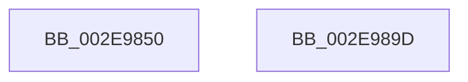

# RtlpHpEnvTlsGetValue

- RVA: `0x002E9850`–`0x002E989E` (길이 `78` bytes)
- VA: `0x00000001402E9850`
- 실행 섹션: `.text`
- PDB 이름 있음: `예`; PDB Function 태그: `아니요`
- unwind 정보 RVA: `0x000DB714`
- 디코드: `19`개 명령, `78/78` bytes 표시
- 미해석 바이트: `0` (있으면 어셈블리에 `.byte`로 보존)

> 이 문서는 커널 이미지의 기계어와 PDB 기호를 분석해 생성했습니다. 4번과 5번은 함수 원형과 자료형을 바이너리 사용 방식에서 추정한 C 해석이며 원본 소스 복구 결과는 아닙니다.

## 1. Dependencies

- 직접 호출 지점: **0**; 고유 호출 대상: **0**
- 직접 호출자로 확인된 함수: **5**
- RIP 상대 이미지 참조: **0**

### Outgoing calls
- 직접 디코드된 call 명령이 없습니다.

### Direct callers
- [RtlpHpLfhSlotAllocateSlow](RtlpHpLfhSlotAllocateSlow_function_002E8FBC.md) at `0x002E9012`
- [RtlpHpAllocateHeapSlow](RtlpHpAllocateHeapSlow_function_002E9DEC.md) at `0x002E9EC1`
- [RtlpHpMetadataAlloc](RtlpHpMetadataAlloc_function_002EC180.md) at `0x002EC284`
- [RtlpHpLfhBucketUpdateAffinityMapping](../4D/RtlpHpLfhBucketUpdateAffinityMapping_function_004D0008.md) at `0x004D007B`
- [RtlpHpLfhPrivateSlotListCompact](../60/RtlpHpLfhPrivateSlotListCompact_function_00604F1C.md) at `0x00604F44`

### Static image references
- 디코드된 RIP-relative 메모리 참조가 없습니다.

## 2. Other-region calls and transfers

- 다른 실행 섹션으로 향하는 call: **0**
- 별도 외부 분기/꼬리 이동을 확인하지 못했습니다.

## 3. Assembly (complete function range)

```asm
002E9850  65 4C 8B 04 25 20 00 00 00      mov r8, qword ptr gs:[0x20]
002E9859  8B C1                           mov eax, ecx
002E985B  C1 E8 0D                        shr eax, 0xd
002E985E  44 8B C9                        mov r9d, ecx
002E9861  25 FF FF 03 00                  and eax, 0x3ffff
002E9866  49 C1 E9 04                     shr r9, 4
002E986A  0F BD C8                        bsr ecx, eax
002E986D  BA 01 00 00 00                  mov edx, 1
002E9872  C7 44 24 08 00 00 00 00         mov dword ptr [rsp + 8], 0
002E987A  D3 E2                           shl edx, cl
002E987C  41 81 E1 FF 01 00 00            and r9d, 0x1ff
002E9883  33 D0                           xor edx, eax
002E9885  83 C1 FE                        add ecx, -2
002E9888  49 8B 80 B0 8B 00 00            mov rax, qword ptr [r8 + 0x8bb0]
002E988F  48 8B 04 C8                     mov rax, qword ptr [rax + rcx*8]
002E9893  48 8B 44 D0 08                  mov rax, qword ptr [rax + rdx*8 + 8]
002E9898  4A 8B 04 C8                     mov rax, qword ptr [rax + r9*8]
002E989C  C3                              ret
002E989D  CC                              int3
```

## 4. C-style interpretation (structured pseudocode)

```c
__int64 __fastcall RtlpHpEnvTlsGetValue(int a1)
{
    __int64 result;
    unsigned int v_stack_p8;

    result = (unsigned int)(((unsigned int)(a1)) >> (13));
    result = (unsigned int)((result) & (0x3FFFFULL));
    a4 = ((unsigned int)(a1)) >> (4);
    v_stack_p8 = 0;
    a2 = (unsigned int)((1) << ((unsigned __int8)(a1)));
    a4 = (unsigned int)((a4) & (511));
    a2 = (unsigned int)((a2) ^ ((unsigned int)(result)));
    a1 = (unsigned int)((a1) + (-2));
    return *(unsigned __int64 *)(*(unsigned __int64 *)(*(unsigned __int64 *)(*(unsigned __int64 *)(*(unsigned __int64 *)(gs_base + (0 + 32)) + 35760) + a1 * 8) + a2 * 8 + 8) + a4 * 8);
}
```

## 5. (Beta) C Style

```c
int64_t RtlpHpEnvTlsGetValue(int32_t Arg1)
{
    int64_t result;
    uint32_t v_stack_p8;

    result = (uint32_t)(((uint32_t)(Arg1)) >> (13));
    result = (uint32_t)((result) & (0x3FFFFULL));
    a4 = ((uint32_t)(Arg1)) >> (4);
    v_stack_p8 = 0;
    a2 = (uint32_t)((1) << ((uint8_t)(Arg1)));
    a4 = (uint32_t)((a4) & (511));
    a2 = (uint32_t)((a2) ^ ((uint32_t)(result)));
    Arg1 = (uint32_t)((Arg1) + (-2));
    return *(uint64_t *)(*(uint64_t *)(*(uint64_t *)(*(uint64_t *)(*(uint64_t *)(gs_base + (0 + 0x20)) + 0x8BB0) + Arg1 * 8) + a2 * 8 + 0x8) + a4 * 8);
}
```

## 6. Execution-region graph

[열기: 2D/3D 그래프와 함수 탐색 컨트롤 패널](../../../control-panel.html?section=text&rva=0x002E9850&view=graph)

- 2D 그래프는 위에서 아래로 흐르고, 3D 그래프는 빈 공간을 드래그해 회전합니다. Shift+드래그는 이동, 휠은 확대·축소, 함수 노드 선택은 대상 보고서 이동입니다.

### Static fallback


