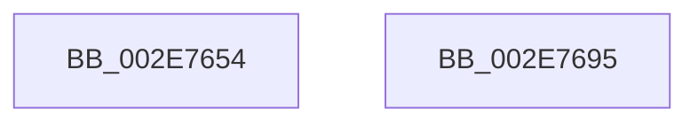

# RtlpHpHeapCompact

- RVA: `0x002E7654`–`0x002E7696` (길이 `66` bytes)
- VA: `0x00000001402E7654`
- 실행 섹션: `.text`
- PDB 이름 있음: `예`; PDB Function 태그: `아니요`
- unwind 정보 RVA: `0x0005CF00`
- 디코드: `16`개 명령, `66/66` bytes 표시
- 미해석 바이트: `0` (있으면 어셈블리에 `.byte`로 보존)

> 이 문서는 커널 이미지의 기계어와 PDB 기호를 분석해 생성했습니다. 4번과 5번은 함수 원형과 자료형을 바이너리 사용 방식에서 추정한 C 해석이며 원본 소스 복구 결과는 아닙니다.

## 1. Dependencies

- 직접 호출 지점: **4**; 고유 호출 대상: **3**
- 직접 호출자로 확인된 함수: **2**
- RIP 상대 이미지 참조: **0**

### Outgoing calls
- `0x002E7664` → [RtlpHpVsContextCompact](RtlpHpVsContextCompact_function_002E7524.md) (function, `0x002E7524`)
- `0x002E7670` → [RtlpHpLfhContextCompact](RtlpHpLfhContextCompact_function_002E769C.md) (function, `0x002E769C`)
- `0x002E767C` → [RtlpHpSegContextCompact](../32/RtlpHpSegContextCompact_function_00326F90.md) (function, `0x00326F90`)
- `0x002E7688` → [RtlpHpSegContextCompact](../32/RtlpHpSegContextCompact_function_00326F90.md) (function, `0x00326F90`)

### Direct callers
- [ExpHpCompactHeapCallback](ExpHpCompactHeapCallback_function_002E75F0.md) at `0x002E760E`
- [ExpCompactPrivatePools](../../page/A5/ExpCompactPrivatePools_function_00A5FD08.md) at `0x00A5FD4C`

### Static image references
- 디코드된 RIP-relative 메모리 참조가 없습니다.

## 2. Other-region calls and transfers

- 다른 실행 섹션으로 향하는 call: **0**
- 별도 외부 분기/꼬리 이동을 확인하지 못했습니다.

## 3. Assembly (complete function range)

```asm
002E7654  40 53                           push rbx
002E7656  48 83 EC 20                     sub rsp, 0x20
002E765A  48 8B D9                        mov rbx, rcx
002E765D  48 81 C1 C0 02 00 00            add rcx, 0x2c0
002E7664  E8 BB FE FF FF                  call 0x1402e7524
002E7669  48 8D 8B 40 03 00 00            lea rcx, [rbx + 0x340]
002E7670  E8 27 00 00 00                  call 0x1402e769c
002E7675  48 8D 8B 40 01 00 00            lea rcx, [rbx + 0x140]
002E767C  E8 0F F9 03 00                  call 0x140326f90
002E7681  48 8D 8B 00 02 00 00            lea rcx, [rbx + 0x200]
002E7688  E8 03 F9 03 00                  call 0x140326f90
002E768D  33 C0                           xor eax, eax
002E768F  48 83 C4 20                     add rsp, 0x20
002E7693  5B                              pop rbx
002E7694  C3                              ret
002E7695  CC                              int3
```

## 4. C-style interpretation (structured pseudocode)

```c
__int64 __fastcall RtlpHpHeapCompact(__int64 a1)
{
    __int64 result;
    __int64 v_rsp;

    v_rsp = (v_rsp) - (32);
    a1 = (a1) + (704);
    result = RtlpHpVsContextCompact(a1, a2, a3, a4);
    result = RtlpHpLfhContextCompact(a1 + 832, a2, a3, a4);
    result = RtlpHpSegContextCompact(a1 + 320, a2, a3, a4);
    result = RtlpHpSegContextCompact(a1 + 512, a2, a3, a4);
    result = 0;
    v_rsp = (v_rsp) + (32);
    return result;
}
```

## 5. (Beta) C Style

```c
int64_t RtlpHpHeapCompact(void *Arg1)
{
    uint8_t *arg1 = (uint8_t *)Arg1;

    int64_t result;
    int64_t local_rsp;

    local_rsp = (local_rsp) - (32);
    Arg1 = (Arg1) + (704);
    result = RtlpHpVsContextCompact(Arg1, a2, a3, a4);
    result = RtlpHpLfhContextCompact(Arg1 + 832, a2, a3, a4);
    result = RtlpHpSegContextCompact(Arg1 + 320, a2, a3, a4);
    result = RtlpHpSegContextCompact(Arg1 + 512, a2, a3, a4);
    result = 0;
    local_rsp = (local_rsp) + (32);
    return result;
}
```

### 관측된 메모리 오프셋

구조체 형식이 확인되지 않은 접근은 인자 기준의 오프셋으로만 기록했습니다.

| 기준 인자 | 오프셋 표현 | 폭 (bit) | 접근 |
|---|---:|---:|---|
| `Arg1` | `+ 0x140` | `64` | `R` |
| `Arg1` | `+ 0x200` | `64` | `R` |
| `Arg1` | `+ 0x340` | `64` | `R` |

## 6. Execution-region graph

[열기: 2D/3D 그래프와 함수 탐색 컨트롤 패널](../../../control-panel.html?section=text&rva=0x002E7654&view=graph)

- 2D 그래프는 위에서 아래로 흐르고, 3D 그래프는 빈 공간을 드래그해 회전합니다. Shift+드래그는 이동, 휠은 확대·축소, 함수 노드 선택은 대상 보고서 이동입니다.

### Static fallback


