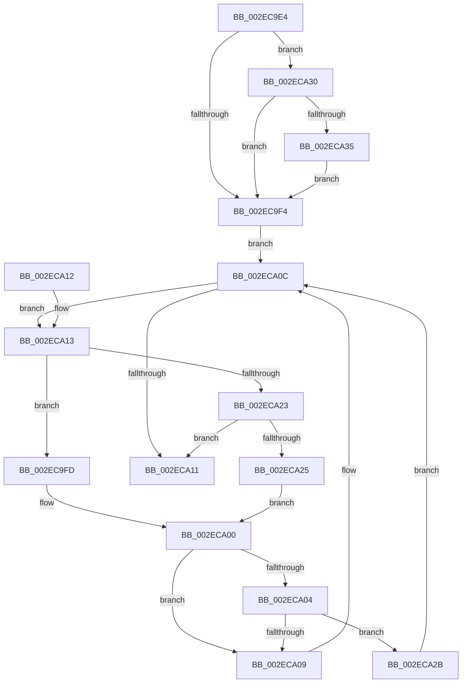

# RtlpHpLargeAllocGetMetadata

- RVA: `0x002EC9E4`–`0x002ECA3A` (길이 `86` bytes)
- VA: `0x00000001402EC9E4`
- 실행 섹션: `.text`
- PDB 이름 있음: `예`; PDB Function 태그: `아니요`
- unwind 정보 RVA: `0x000DB714`
- 디코드: `31`개 명령, `86/86` bytes 표시
- 미해석 바이트: `0` (있으면 어셈블리에 `.byte`로 보존)

> 이 문서는 커널 이미지의 기계어와 PDB 기호를 분석해 생성했습니다. 4번과 5번은 함수 원형과 자료형을 바이너리 사용 방식에서 추정한 C 해석이며 원본 소스 복구 결과는 아닙니다.

## 1. Dependencies

- 직접 호출 지점: **0**; 고유 호출 대상: **0**
- 직접 호출자로 확인된 함수: **2**
- RIP 상대 이미지 참조: **0**

### Outgoing calls
- 직접 디코드된 call 명령이 없습니다.

### Direct callers
- [RtlpHpLargeFree](RtlpHpLargeFree_function_002EC89C.md) at `0x002EC8C2`
- [RtlpHpExtrasSetPresent](../60/RtlpHpExtrasSetPresent_function_00602CF4.md) at `0x00602D48`

### Static image references
- 디코드된 RIP-relative 메모리 참조가 없습니다.

## 2. Other-region calls and transfers

- 다른 실행 섹션으로 향하는 call: **0**
- 별도 외부 분기/꼬리 이동을 확인하지 못했습니다.

## 3. Assembly (complete function range)

```asm
002EC9E4  48 83 C1 48                     add rcx, 0x48
002EC9E8  4C 8B C2                        mov r8, rdx
002EC9EB  F6 41 08 01                     test byte ptr [rcx + 8], 1
002EC9EF  48 8B 01                        mov rax, qword ptr [rcx]
002EC9F2  75 3C                           jne 0x1402eca30
002EC9F4  0F B6 51 08                     movzx edx, byte ptr [rcx + 8]
002EC9F8  83 E2 01                        and edx, 1
002EC9FB  EB 0F                           jmp 0x1402eca0c
002EC9FD  48 8B 08                        mov rcx, qword ptr [rax]
002ECA00  85 D2                           test edx, edx
002ECA02  74 05                           je 0x1402eca09
002ECA04  48 85 C9                        test rcx, rcx
002ECA07  75 22                           jne 0x1402eca2b
002ECA09  48 8B C1                        mov rax, rcx
002ECA0C  48 85 C0                        test rax, rax
002ECA0F  75 02                           jne 0x1402eca13
002ECA11  C3                              ret
002ECA12  CC                              int3
002ECA13  48 8B 48 18                     mov rcx, qword ptr [rax + 0x18]
002ECA17  48 81 E1 00 00 FF FF            and rcx, 0xffffffffffff0000
002ECA1E  4C 3B C1                        cmp r8, rcx
002ECA21  72 DA                           jb 0x1402ec9fd
002ECA23  76 EC                           jbe 0x1402eca11
002ECA25  48 8B 48 08                     mov rcx, qword ptr [rax + 8]
002ECA29  EB D5                           jmp 0x1402eca00
002ECA2B  48 33 C1                        xor rax, rcx
002ECA2E  EB DC                           jmp 0x1402eca0c
002ECA30  48 85 C0                        test rax, rax
002ECA33  74 BF                           je 0x1402ec9f4
002ECA35  48 33 C1                        xor rax, rcx
002ECA38  EB BA                           jmp 0x1402ec9f4
```

## 4. C-style interpretation (structured pseudocode)

```c
__int64 __fastcall RtlpHpLargeAllocGetMetadata(__int64 a1, __int64 a2)
{
    __int64 result;

    a1 = (a1) + (72);
    if (((*(unsigned __int8 *)(a1 + 8)) & (1)) != 0) goto loc_002ECA30;
loc_002EC9F4:
    a2 = (unsigned int)((*(unsigned __int8 *)(a1 + 8)) & (1));
    goto loc_002ECA0C;
loc_002EC9FD:
loc_002ECA00:
    if ((unsigned int)(a2) == 0) goto loc_002ECA09;
    if (*(unsigned __int64 *)(*(unsigned __int64 *)(a1)) != 0) goto loc_002ECA2B;
loc_002ECA09:
loc_002ECA0C:
    if (*(unsigned __int64 *)(*(unsigned __int64 *)(a1)) != 0) goto loc_002ECA13;
loc_002ECA11:
    return *(unsigned __int64 *)(*(unsigned __int64 *)(a1));
loc_002ECA13:
    a1 = (*(unsigned __int64 *)(*(unsigned __int64 *)(*(unsigned __int64 *)(a1)) + 24)) & (0xFFFFFFFFFFFF0000ULL);
    if (a2 < a1) goto loc_002EC9FD;
    if (a2 <= a1) goto loc_002ECA11;
    goto loc_002ECA00;
loc_002ECA2B:
    result = (*(unsigned __int64 *)(*(unsigned __int64 *)(a1))) ^ (*(unsigned __int64 *)(*(unsigned __int64 *)(*(unsigned __int64 *)(a1)) + 8));
    goto loc_002ECA0C;
loc_002ECA30:
    if (result == 0) goto loc_002EC9F4;
    result = (result) ^ (*(unsigned __int64 *)(*(unsigned __int64 *)(*(unsigned __int64 *)(a1)) + 8));
    goto loc_002EC9F4;
}
```

## 5. (Beta) C Style

```c
int64_t RtlpHpLargeAllocGetMetadata(void *Arg1, int64_t Arg2)
{
    uint8_t *arg1 = (uint8_t *)Arg1;

    int64_t result;

    Arg1 = (Arg1) + (72);
    if (((*(uint8_t *)(arg1 + 0x8)) & (1)) != 0) goto loc_002ECA30;
loc_002EC9F4:
    Arg2 = (uint32_t)((*(uint8_t *)(arg1 + 0x8)) & (1));
    goto loc_002ECA0C;
loc_002EC9FD:
loc_002ECA00:
    if ((uint32_t)(Arg2) == 0) goto loc_002ECA09;
    if (*(uint64_t *)(*(uint64_t *)(arg1)) != 0) goto loc_002ECA2B;
loc_002ECA09:
loc_002ECA0C:
    if (*(uint64_t *)(*(uint64_t *)(arg1)) != 0) goto loc_002ECA13;
loc_002ECA11:
    return *(uint64_t *)(*(uint64_t *)(arg1));
loc_002ECA13:
    Arg1 = (*(uint64_t *)(*(uint64_t *)(*(uint64_t *)(arg1)) + 0x18)) & (0xFFFFFFFFFFFF0000ULL);
    if (Arg2 < Arg1) goto loc_002EC9FD;
    if (Arg2 <= Arg1) goto loc_002ECA11;
    goto loc_002ECA00;
loc_002ECA2B:
    result = (*(uint64_t *)(*(uint64_t *)(arg1))) ^ (*(uint64_t *)(*(uint64_t *)(*(uint64_t *)(arg1)) + 0x8));
    goto loc_002ECA0C;
loc_002ECA30:
    if (result == 0) goto loc_002EC9F4;
    result = (result) ^ (*(uint64_t *)(*(uint64_t *)(*(uint64_t *)(arg1)) + 0x8));
    goto loc_002EC9F4;
}
```

### 관측된 메모리 오프셋

구조체 형식이 확인되지 않은 접근은 인자 기준의 오프셋으로만 기록했습니다.

| 기준 인자 | 오프셋 표현 | 폭 (bit) | 접근 |
|---|---:|---:|---|
| `Arg1` | `+ 0x0` | `64` | `R` |
| `Arg1` | `+ 0x8` | `8` | `R` |

## 6. Execution-region graph

[열기: 2D/3D 그래프와 함수 탐색 컨트롤 패널](../../../control-panel.html?section=text&rva=0x002EC9E4&view=graph)

- 2D 그래프는 위에서 아래로 흐르고, 3D 그래프는 빈 공간을 드래그해 회전합니다. Shift+드래그는 이동, 휠은 확대·축소, 함수 노드 선택은 대상 보고서 이동입니다.

### Static fallback


