# RtlpHpLargeAlloc

- RVA: `0x002EBD5C`–`0x002EC178` (길이 `1,052` bytes)
- VA: `0x00000001402EBD5C`
- 실행 섹션: `.text`
- PDB 이름 있음: `예`; PDB Function 태그: `아니요`
- unwind 정보 RVA: `0x00071774`
- 디코드: `299`개 명령, `1,052/1,052` bytes 표시
- 미해석 바이트: `0` (있으면 어셈블리에 `.byte`로 보존)

> 이 문서는 커널 이미지의 기계어와 PDB 기호를 분석해 생성했습니다. 4번과 5번은 함수 원형과 자료형을 바이너리 사용 방식에서 추정한 C 해석이며 원본 소스 복구 결과는 아닙니다.

## 1. Dependencies

- 직접 호출 지점: **12**; 고유 호출 대상: **11**
- 직접 호출자로 확인된 함수: **4**
- RIP 상대 이미지 참조: **1**

### Outgoing calls
- `0x002EBDBE` → [RtlpHpMetadataAlloc](RtlpHpMetadataAlloc_function_002EC180.md) (function, `0x002EC180`)
- `0x002EBECF` → [RtlpHpVaMgrCtxAlloc](RtlpHpVaMgrCtxAlloc_function_002EDA80.md) (function, `0x002EDA80`)
- `0x002EBF06` → [RtlpHpVaMgrCtxQuery](../32/RtlpHpVaMgrCtxQuery_function_003273C0.md) (function, `0x003273C0`)
- `0x002EBF32` → [RtlpHpSegHeapCheckCommitLimit](../32/RtlpHpSegHeapCheckCommitLimit_function_00327164.md) (function, `0x00327164`)
- `0x002EBFAB` → [RtlpHpAllocVA](../32/RtlpHpAllocVA_function_003276A0.md) (function, `0x003276A0`)
- `0x002EBFD9` → [RtlpHpFreeVA](../2C/RtlpHpFreeVA_function_002C0FD4.md) (function, `0x002C0FD4`)
- `0x002EC007` → [RtlpHpMetadataFree](RtlpHpMetadataFree_function_002ECA64.md) (function, `0x002ECA64`)
- `0x002EC02C` → [RtlpHpFreeVA](../2C/RtlpHpFreeVA_function_002C0FD4.md) (function, `0x002C0FD4`)
- `0x002EC068` → [RtlHeapZero](../6B/RtlHeapZero_function_006BBC10.md) (function, `0x006BBC10`)
- `0x002EC0CF` → [RtlpHpLargeLockAcquire](RtlpHpLargeLockAcquire_function_002ECA40.md) (function, `0x002ECA40`)
- `0x002EC145` → [RtlRbInsertNodeEx](RtlRbInsertNodeEx_function_002E4570.md) (function, `0x002E4570`)
- `0x002EC150` → [RtlpHpLargeLockRelease](RtlpHpLargeLockRelease_function_002ECBCC.md) (function, `0x002ECBCC`)

### Direct callers
- [sub_002E9C01](Unknown_function_002E9C01.md) at `0x002E9DB6`
- [RtlpHpAllocateHeapSlow](RtlpHpAllocateHeapSlow_function_002E9DEC.md) at `0x002EA44C`
- [RtlpHpMetadataAlloc](RtlpHpMetadataAlloc_function_002EC180.md) at `0x002EC42B`
- [ExAllocateHeapPool](../35/ExAllocateHeapPool_function_0035BA30.md) at `0x0035E9BA`
- [ExAllocateHeapPool](../35/ExAllocateHeapPool_function_0035BA30.md) at `0x0035E9C4`

### Static image references
- `0x002EBEC8` → RVA `0x00E68658` (`.data`; read)

## 2. Other-region calls and transfers

- 다른 실행 섹션으로 향하는 call: **0**
- 별도 외부 분기/꼬리 이동을 확인하지 못했습니다.

## 3. Assembly (complete function range)

```asm
002EBD5C  48 8B C4                        mov rax, rsp
002EBD5F  48 89 58 08                     mov qword ptr [rax + 8], rbx
002EBD63  44 89 48 20                     mov dword ptr [rax + 0x20], r9d
002EBD67  48 89 50 10                     mov qword ptr [rax + 0x10], rdx
002EBD6B  55                              push rbp
002EBD6C  56                              push rsi
002EBD6D  57                              push rdi
002EBD6E  41 54                           push r12
002EBD70  41 55                           push r13
002EBD72  41 56                           push r14
002EBD74  41 57                           push r15
002EBD76  48 8D 68 A1                     lea rbp, [rax - 0x5f]
002EBD7A  48 81 EC E0 00 00 00            sub rsp, 0xe0
002EBD81  83 64 24 38 00                  and dword ptr [rsp + 0x38], 0
002EBD86  33 F6                           xor esi, esi
002EBD88  48 8B F9                        mov rdi, rcx
002EBD8B  48 89 74 24 30                  mov qword ptr [rsp + 0x30], rsi
002EBD90  48 B9 FF FF FF FF FF FF FF 7F   movabs rcx, 0x7fffffffffffffff
002EBD9A  4D 8B F8                        mov r15, r8
002EBD9D  48 3B D1                        cmp rdx, rcx
002EBDA0  76 07                           jbe 0x1402ebda9
002EBDA2  33 DB                           xor ebx, ebx
002EBDA4  E9 88 02 00 00                  jmp 0x1402ec031
002EBDA9  0F 10 07                        movups xmm0, xmmword ptr [rdi]
002EBDAC  45 33 C0                        xor r8d, r8d
002EBDAF  4C 8D 4D E7                     lea r9, [rbp - 0x19]
002EBDB3  F3 0F 7F 45 E7                  movdqu xmmword ptr [rbp - 0x19], xmm0
002EBDB8  41 8D 48 28                     lea ecx, [r8 + 0x28]
002EBDBC  8B D1                           mov edx, ecx
002EBDBE  E8 BD 03 00 00                  call 0x1402ec180
002EBDC3  4C 8B E8                        mov r13, rax
002EBDC6  48 85 C0                        test rax, rax
002EBDC9  74 D7                           je 0x1402ebda2
002EBDCB  33 C0                           xor eax, eax
002EBDCD  0F 57 C0                        xorps xmm0, xmm0
002EBDD0  41 0F 11 45 00                  movups xmmword ptr [r13], xmm0
002EBDD5  33 DB                           xor ebx, ebx
002EBDD7  BA FF FF 1F 00                  mov edx, 0x1fffff
002EBDDC  41 0F 11 45 10                  movups xmmword ptr [r13 + 0x10], xmm0
002EBDE1  49 89 45 20                     mov qword ptr [r13 + 0x20], rax
002EBDE5  44 8D 48 01                     lea r9d, [rax + 1]
002EBDE9  F7 47 14 00 00 00 04            test dword ptr [rdi + 0x14], 0x4000000
002EBDF0  74 1A                           je 0x1402ebe0c
002EBDF2  49 8D 47 FF                     lea rax, [r15 - 1]
002EBDF6  8B CA                           mov ecx, edx
002EBDF8  48 23 C2                        and rax, rdx
002EBDFB  48 2B C8                        sub rcx, rax
002EBDFE  49 8B C7                        mov rax, r15
002EBE01  48 C1 E8 02                     shr rax, 2
002EBE05  48 3B C8                        cmp rcx, rax
002EBE08  41 0F 42 D9                     cmovb ebx, r9d
002EBE0C  45 33 E4                        xor r12d, r12d
002EBE0F  85 DB                           test ebx, ebx
002EBE11  74 18                           je 0x1402ebe2b
002EBE13  49 8D 47 FF                     lea rax, [r15 - 1]
002EBE17  49 8B CF                        mov rcx, r15
002EBE1A  48 23 C2                        and rax, rdx
002EBE1D  41 BA 00 00 20 00               mov r10d, 0x200000
002EBE23  48 2B C8                        sub rcx, rax
002EBE26  48 03 CA                        add rcx, rdx
002EBE29  EB 1E                           jmp 0x1402ebe49
002EBE2B  48 8B 07                        mov rax, qword ptr [rdi]
002EBE2E  48 C1 E8 08                     shr rax, 8
002EBE32  3C 02                           cmp al, 2
002EBE34  72 04                           jb 0x1402ebe3a
002EBE36  3C 05                           cmp al, 5
002EBE38  72 03                           jb 0x1402ebe3d
002EBE3A  45 8B E1                        mov r12d, r9d
002EBE3D  41 8B CC                        mov ecx, r12d
002EBE40  45 33 D2                        xor r10d, r10d
002EBE43  C1 E1 0C                        shl ecx, 0xc
002EBE46  49 03 CF                        add rcx, r15
002EBE49  0F 10 07                        movups xmm0, xmmword ptr [rdi]
002EBE4C  48 89 4D 8F                     mov qword ptr [rbp - 0x71], rcx
002EBE50  0F 29 45 D7                     movaps xmmword ptr [rbp - 0x29], xmm0
002EBE54  33 D2                           xor edx, edx
002EBE56  66 49 0F 7E C0                  movq r8, xmm0
002EBE5B  49 8B C0                        mov rax, r8
002EBE5E  89 55 C3                        mov dword ptr [rbp - 0x3d], edx
002EBE61  48 C1 E8 18                     shr rax, 0x18
002EBE65  84 C0                           test al, al
002EBE67  74 0B                           je 0x1402ebe74
002EBE69  0F B6 C0                        movzx eax, al
002EBE6C  41 2B C1                        sub eax, r9d
002EBE6F  89 45 B7                        mov dword ptr [rbp - 0x49], eax
002EBE72  EB 04                           jmp 0x1402ebe78
002EBE74  83 4D B7 FF                     or dword ptr [rbp - 0x49], 0xffffffff
002EBE78  49 8B C0                        mov rax, r8
002EBE7B  48 C1 E8 08                     shr rax, 8
002EBE7F  0F B6 C0                        movzx eax, al
002EBE82  89 45 BB                        mov dword ptr [rbp - 0x45], eax
002EBE85  49 8B C0                        mov rax, r8
002EBE88  48 C1 E8 10                     shr rax, 0x10
002EBE8C  0F B6 C0                        movzx eax, al
002EBE8F  89 45 BF                        mov dword ptr [rbp - 0x41], eax
002EBE92  41 F6 C0 08                     test r8b, 8
002EBE96  74 06                           je 0x1402ebe9e
002EBE98  41 0B D1                        or edx, r9d
002EBE9B  89 55 C3                        mov dword ptr [rbp - 0x3d], edx
002EBE9E  48 8B 45 DF                     mov rax, qword ptr [rbp - 0x21]
002EBEA2  4C 8D 4D B7                     lea r9, [rbp - 0x49]
002EBEA6  48 89 45 C7                     mov qword ptr [rbp - 0x39], rax
002EBEAA  48 8D 55 87                     lea rdx, [rbp - 0x79]
002EBEAE  48 8D 41 FF                     lea rax, [rcx - 1]
002EBEB2  4D 8B C2                        mov r8, r10
002EBEB5  25 FF FF 0F 00                  and eax, 0xfffff
002EBEBA  48 2B C8                        sub rcx, rax
002EBEBD  48 81 C1 FF FF 0F 00            add rcx, 0xfffff
002EBEC4  48 89 4D 87                     mov qword ptr [rbp - 0x79], rcx
002EBEC8  48 8D 0D 89 C7 B7 00            lea rcx, [rip + 0xb7c789]
002EBECF  E8 AC 1B 00 00                  call 0x1402eda80
002EBED4  48 85 C0                        test rax, rax
002EBED7  0F 84 19 01 00 00               je 0x1402ebff6
002EBEDD  48 8B 4D 87                     mov rcx, qword ptr [rbp - 0x79]
002EBEE1  48 8B F0                        mov rsi, rax
002EBEE4  48 89 4D 8F                     mov qword ptr [rbp - 0x71], rcx
002EBEE8  48 89 44 24 30                  mov qword ptr [rsp + 0x30], rax
002EBEED  0F 57 C0                        xorps xmm0, xmm0
002EBEF0  4C 8D 45 07                     lea r8, [rbp + 7]
002EBEF4  48 8B D0                        mov rdx, rax
002EBEF7  48 8D 0D 5A C7 B7 00            lea rcx, [rip + 0xb7c75a]
002EBEFE  0F 11 45 07                     movups xmmword ptr [rbp + 7], xmm0
002EBF02  0F 11 45 17                     movups xmmword ptr [rbp + 0x17], xmm0
002EBF06  E8 B5 B4 03 00                  call 0x1403273c0
002EBF0B  48 8B 45 17                     mov rax, qword ptr [rbp + 0x17]
002EBF0F  48 8B D7                        mov rdx, rdi
002EBF12  48 89 38                        mov qword ptr [rax], rdi
002EBF15  49 8D 87 FF 0F 00 00            lea rax, [r15 + 0xfff]
002EBF1C  48 C1 E8 0C                     shr rax, 0xc
002EBF20  4C 8B F0                        mov r14, rax
002EBF23  48 89 45 D7                     mov qword ptr [rbp - 0x29], rax
002EBF27  49 C1 E6 0C                     shl r14, 0xc
002EBF2B  49 8B CE                        mov rcx, r14
002EBF2E  4C 89 75 97                     mov qword ptr [rbp - 0x69], r14
002EBF32  E8 2D B2 03 00                  call 0x140327164
002EBF37  85 C0                           test eax, eax
002EBF39  0F 84 B7 00 00 00               je 0x1402ebff6
002EBF3F  8B 75 7F                        mov esi, dword ptr [rbp + 0x7f]
002EBF42  41 B9 00 10 00 00               mov r9d, 0x1000
002EBF48  85 DB                           test ebx, ebx
002EBF4A  74 21                           je 0x1402ebf6d
002EBF4C  49 8D 46 FF                     lea rax, [r14 - 1]
002EBF50  B9 FF FF 1F 00                  mov ecx, 0x1fffff
002EBF55  48 23 C1                        and rax, rcx
002EBF58  41 B9 00 10 00 20               mov r9d, 0x20001000
002EBF5E  4C 2B F0                        sub r14, rax
002EBF61  4C 03 F1                        add r14, rcx
002EBF64  4C 89 75 97                     mov qword ptr [rbp - 0x69], r14
002EBF68  83 E6 02                        and esi, 2
002EBF6B  EB 0B                           jmp 0x1402ebf78
002EBF6D  83 E6 02                        and esi, 2
002EBF70  74 06                           je 0x1402ebf78
002EBF72  41 B9 00 10 00 40               mov r9d, 0x40001000
002EBF78  8B 47 14                        mov eax, dword ptr [rdi + 0x14]
002EBF7B  0F 10 07                        movups xmm0, xmmword ptr [rdi]
002EBF7E  25 00 00 00 40                  and eax, 0x40000000
002EBF83  F7 D8                           neg eax
002EBF85  F3 0F 7F 45 F7                  movdqu xmmword ptr [rbp - 9], xmm0
002EBF8A  1B C9                           sbb ecx, ecx
002EBF8C  83 E1 3C                        and ecx, 0x3c
002EBF8F  83 C1 04                        add ecx, 4
002EBF92  48 8D 45 F7                     lea rax, [rbp - 9]
002EBF96  45 33 C0                        xor r8d, r8d
002EBF99  48 89 44 24 28                  mov qword ptr [rsp + 0x28], rax
002EBF9E  48 8D 55 97                     lea rdx, [rbp - 0x69]
002EBFA2  89 4C 24 20                     mov dword ptr [rsp + 0x20], ecx
002EBFA6  48 8D 4C 24 30                  lea rcx, [rsp + 0x30]
002EBFAB  E8 F0 B6 03 00                  call 0x1403276a0
002EBFB0  85 C0                           test eax, eax
002EBFB2  0F 89 98 00 00 00               jns 0x1402ec050
002EBFB8  85 DB                           test ebx, ebx
002EBFBA  74 35                           je 0x1402ebff1
002EBFBC  0F 10 07                        movups xmm0, xmmword ptr [rdi]
002EBFBF  4C 8D 4D A7                     lea r9, [rbp - 0x59]
002EBFC3  41 B8 00 80 00 00               mov r8d, 0x8000
002EBFC9  48 8D 55 8F                     lea rdx, [rbp - 0x71]
002EBFCD  33 DB                           xor ebx, ebx
002EBFCF  48 8D 4C 24 30                  lea rcx, [rsp + 0x30]
002EBFD4  F3 0F 7F 45 A7                  movdqu xmmword ptr [rbp - 0x59], xmm0
002EBFD9  E8 F6 4F FD FF                  call 0x1402c0fd4
002EBFDE  33 F6                           xor esi, esi
002EBFE0  44 8D 4B 01                     lea r9d, [rbx + 1]
002EBFE4  48 89 74 24 30                  mov qword ptr [rsp + 0x30], rsi
002EBFE9  45 33 E4                        xor r12d, r12d
002EBFEC  E9 3A FE FF FF                  jmp 0x1402ebe2b
002EBFF1  48 8B 74 24 30                  mov rsi, qword ptr [rsp + 0x30]
002EBFF6  0F 10 07                        movups xmm0, xmmword ptr [rdi]
002EBFF9  33 DB                           xor ebx, ebx
002EBFFB  48 8D 55 A7                     lea rdx, [rbp - 0x59]
002EBFFF  49 8B CD                        mov rcx, r13
002EC002  F3 0F 7F 45 A7                  movdqu xmmword ptr [rbp - 0x59], xmm0
002EC007  E8 58 0A 00 00                  call 0x1402eca64
002EC00C  48 85 F6                        test rsi, rsi
002EC00F  74 20                           je 0x1402ec031
002EC011  0F 10 07                        movups xmm0, xmmword ptr [rdi]
002EC014  4C 8D 4D A7                     lea r9, [rbp - 0x59]
002EC018  41 B8 00 80 00 00               mov r8d, 0x8000
002EC01E  48 8D 55 8F                     lea rdx, [rbp - 0x71]
002EC022  48 8D 4C 24 30                  lea rcx, [rsp + 0x30]
002EC027  F3 0F 7F 45 A7                  movdqu xmmword ptr [rbp - 0x59], xmm0
002EC02C  E8 A3 4F FD FF                  call 0x1402c0fd4
002EC031  48 8B C3                        mov rax, rbx
002EC034  48 8B 9C 24 20 01 00 00         mov rbx, qword ptr [rsp + 0x120]
002EC03C  48 81 C4 E0 00 00 00            add rsp, 0xe0
002EC043  41 5F                           pop r15
002EC045  41 5E                           pop r14
002EC047  41 5D                           pop r13
002EC049  41 5C                           pop r12
002EC04B  5F                              pop rdi
002EC04C  5E                              pop rsi
002EC04D  5D                              pop rbp
002EC04E  C3                              ret
002EC04F  CC                              int3
002EC050  4C 8B 74 24 30                  mov r14, qword ptr [rsp + 0x30]
002EC055  85 DB                           test ebx, ebx
002EC057  74 14                           je 0x1402ec06d
002EC059  85 F6                           test esi, esi
002EC05B  74 10                           je 0x1402ec06d
002EC05D  49 8D 57 0F                     lea rdx, [r15 + 0xf]
002EC061  49 8B CE                        mov rcx, r14
002EC064  48 83 E2 F0                     and rdx, 0xfffffffffffffff0
002EC068  E8 A3 FB 3C 00                  call 0x1406bbc10
002EC06D  48 8B 5D D7                     mov rbx, qword ptr [rbp - 0x29]
002EC071  4C 8B 7D 87                     mov r15, qword ptr [rbp - 0x79]
002EC075  49 0F BC C7                     bsf rax, r15
002EC079  41 8B D4                        mov edx, r12d
002EC07C  41 BC 00 10 00 00               mov r12d, 0x1000
002EC082  48 83 E2 81                     and rdx, 0xffffffffffffff81
002EC086  89 44 24 38                     mov dword ptr [rsp + 0x38], eax
002EC08A  4D 89 75 18                     mov qword ptr [r13 + 0x18], r14
002EC08E  48 8D 0C 85 00 00 00 00         lea rcx, [rax*4]
002EC096  48 8B C3                        mov rax, rbx
002EC099  48 C1 E0 0B                     shl rax, 0xb
002EC09D  81 E1 FC 00 00 00               and ecx, 0xfc
002EC0A3  48 0B D0                        or rdx, rax
002EC0A6  41 8B 45 20                     mov eax, dword ptr [r13 + 0x20]
002EC0AA  48 03 D2                        add rdx, rdx
002EC0AD  25 01 0F 00 00                  and eax, 0xf01
002EC0B2  48 0B D0                        or rdx, rax
002EC0B5  48 33 D1                        xor rdx, rcx
002EC0B8  0F B7 CB                        movzx ecx, bx
002EC0BB  41 0F AF CC                     imul ecx, r12d
002EC0BF  49 89 55 20                     mov qword ptr [r13 + 0x20], rdx
002EC0C3  66 2B 4D 6F                     sub cx, word ptr [rbp + 0x6f]
002EC0C7  66 41 89 4D 18                  mov word ptr [r13 + 0x18], cx
002EC0CC  48 8B CF                        mov rcx, rdi
002EC0CF  E8 6C 09 00 00                  call 0x1402eca40
002EC0D4  4C 8D 57 48                     lea r10, [rdi + 0x48]
002EC0D8  40 8A F0                        mov sil, al
002EC0DB  41 F6 42 08 01                  test byte ptr [r10 + 8], 1
002EC0E0  49 8B 12                        mov rdx, qword ptr [r10]
002EC0E3  74 08                           je 0x1402ec0ed
002EC0E5  48 85 D2                        test rdx, rdx
002EC0E8  74 03                           je 0x1402ec0ed
002EC0EA  49 33 D2                        xor rdx, r10
002EC0ED  41 0F B6 4A 08                  movzx ecx, byte ptr [r10 + 8]
002EC0F2  45 32 C0                        xor r8b, r8b
002EC0F5  83 E1 01                        and ecx, 1
002EC0F8  48 85 D2                        test rdx, rdx
002EC0FB  74 42                           je 0x1402ec13f
002EC0FD  48 8B 42 18                     mov rax, qword ptr [rdx + 0x18]
002EC101  48 25 00 00 FF FF               and rax, 0xffffffffffff0000
002EC107  4C 3B F0                        cmp r14, rax
002EC10A  73 16                           jae 0x1402ec122
002EC10C  48 8B 02                        mov rax, qword ptr [rdx]
002EC10F  85 C9                           test ecx, ecx
002EC111  74 08                           je 0x1402ec11b
002EC113  48 85 C0                        test rax, rax
002EC116  74 27                           je 0x1402ec13f
002EC118  48 33 C2                        xor rax, rdx
002EC11B  48 85 C0                        test rax, rax
002EC11E  74 1F                           je 0x1402ec13f
002EC120  EB 15                           jmp 0x1402ec137
002EC122  48 8B 42 08                     mov rax, qword ptr [rdx + 8]
002EC126  85 C9                           test ecx, ecx
002EC128  74 08                           je 0x1402ec132
002EC12A  48 85 C0                        test rax, rax
002EC12D  74 0D                           je 0x1402ec13c
002EC12F  48 33 C2                        xor rax, rdx
002EC132  48 85 C0                        test rax, rax
002EC135  74 05                           je 0x1402ec13c
002EC137  48 8B D0                        mov rdx, rax
002EC13A  EB C1                           jmp 0x1402ec0fd
002EC13C  41 B0 01                        mov r8b, 1
002EC13F  4D 8B CD                        mov r9, r13
002EC142  49 8B CA                        mov rcx, r10
002EC145  E8 26 84 FF FF                  call 0x1402e4570
002EC14A  40 8A D6                        mov dl, sil
002EC14D  48 8B CF                        mov rcx, rdi
002EC150  E8 77 0A 00 00                  call 0x1402ecbcc
002EC155  49 8B C7                        mov rax, r15
002EC158  48 99                           cqo
002EC15A  49 F7 FC                        idiv r12
002EC15D  F0 48 01 47 58                  lock add qword ptr [rdi + 0x58], rax
002EC162  F0 48 01 5F 60                  lock add qword ptr [rdi + 0x60], rbx
002EC167  48 8B 5C 24 30                  mov rbx, qword ptr [rsp + 0x30]
002EC16C  33 F6                           xor esi, esi
002EC16E  48 89 74 24 30                  mov qword ptr [rsp + 0x30], rsi
002EC173  E9 94 FE FF FF                  jmp 0x1402ec00c
```

## 4. C-style interpretation (structured pseudocode)

```c
__int64 __fastcall RtlpHpLargeAlloc(__int64 a1, __int64 a2, __int64 a3, int a4)
{
    __int64 result;
    __int64 v_r10;
    __int64 v_r12;
    __int64 v_r14;
    __int64 v_rbx;
    __int64 v_rsi;
    __int64 v_rsp;
    unsigned int v_stack_mE0;
    unsigned __int64 v_stack_mE8;
    unsigned __int64 v_stack_mF0;
    unsigned int v_stack_mF8;
    unsigned __int64 v_stack_p30;
    unsigned int v_stack_p38;
    unsigned __int64 v_stack_p8;

    *(unsigned __int64 *)(v_rsp + 8) = v_rbx;
    *(unsigned int *)(v_rsp + 32) = a4;
    *(unsigned __int64 *)(v_rsp + 16) = a2;
    v_rsp = (v_rsp) - (224);
    v_rsi = 0;
    v_stack_mE8 = 0;
    if (a2 <= a1) goto loc_002EBDA9;
loc_002EBDA2:
    v_rbx = 0;
    goto loc_002EC031;
loc_002EBDA9:
    a3 = 0;
    *(unsigned __int64 *)(v_rsp - 95 - 25) = v_xmm0;
    result = RtlpHpMetadataAlloc(a3 + 40, (unsigned int)((unsigned int)(a3 + 40)), a3, v_rsp - 95 - 25);
    if (result == 0) goto loc_002EBDA2;
    result = 0;
    *(unsigned __int64 *)(result) = v_xmm0;
    v_rbx = 0;
    *(unsigned __int64 *)(result + 16) = v_xmm0;
    *(unsigned __int64 *)(result + 32) = 0;
    if (((*(unsigned int *)(a1 + 20)) & (0x4000000ULL)) != 0) {
        result = a3 - 1;
        a1 = (unsigned int)((unsigned int)(0x1FFFFFULL));
        result = (result) & ((unsigned int)(0x1FFFFFULL));
        a1 = (a1) - (result);
        result = 0;
        result = (result) >> (2);
        if (a1 < result) { v_rbx = (unsigned int)(result + 1); }
    }
    v_r12 = 0;
    if ((unsigned int)(v_rbx) == 0) goto loc_002EBE2B;
    result = (a3 - 1) & ((unsigned int)(0x1FFFFFULL));
    a1 = (0) - (result);
    a1 = (a1) + ((unsigned int)(0x1FFFFFULL));
    goto loc_002EBE49;
loc_002EBE2B:
    result = (*(unsigned __int64 *)(a1)) >> (8);
    if (((unsigned __int8)(result)) < 2) goto loc_002EBE3A;
    if (((unsigned __int8)(result)) >= 5) {
        v_r12 = (unsigned int)(result + 1);
    }
    v_r10 = 0;
    a1 = (unsigned int)(((unsigned int)((unsigned int)(v_r12))) << (12));
    a1 = (a1) + (0);
loc_002EBE49:
    *(unsigned __int64 *)(v_rsp - 95 - 113) = a1;
    *(unsigned __int64 *)(v_rsp - 95 - 41) = v_xmm0;
    a2 = 0;
    *(unsigned int *)(v_rsp - 95 - 61) = 0;
    result = (0) >> (24);
    if ((unsigned __int8)(result) == 0) goto loc_002EBE74;
    result = (unsigned int)(((unsigned __int8)(result)) - ((unsigned int)(result + 1)));
    *(unsigned int *)(v_rsp - 95 - 73) = (unsigned int)(result);
    goto loc_002EBE78;
loc_002EBE74:
loc_002EBE78:
    result = (0) >> (8);
    *(unsigned int *)(v_rsp - 95 - 69) = (unsigned int)((unsigned __int8)(result));
    result = (0) >> (16);
    *(unsigned int *)(v_rsp - 95 - 65) = (unsigned int)((unsigned __int8)(result));
    if (((0) & (8)) != 0) {
        a2 = (unsigned int)((a2) | ((unsigned int)(result + 1)));
        *(unsigned int *)(v_rsp - 95 - 61) = (unsigned int)(a2);
    }
    *(unsigned __int64 *)(v_rsp - 95 - 57) = *(unsigned __int64 *)(v_rsp - 95 - 33);
    result = (unsigned int)((a1 - 1) & (0xFFFFFULL));
    a1 = (a1) - (result);
    a1 = (a1) + (0xFFFFFULL);
    *(unsigned __int64 *)(v_rsp - 95 - 121) = a1;
    result = RtlpHpVaMgrCtxAlloc(v_rip + 12044169, v_rsp - 95 - 121, 0, v_rsp - 95 - 73);
    if (result == 0) goto loc_002EBFF6;
    *(unsigned __int64 *)(v_rsp - 95 - 113) = *(unsigned __int64 *)(v_rsp - 95 - 121);
    v_stack_mE8 = result;
    *(unsigned __int64 *)(v_rsp - 95 + 7) = v_xmm0;
    *(unsigned __int64 *)(v_rsp - 95 + 23) = v_xmm0;
    result = RtlpHpVaMgrCtxQuery(v_rip + 12044122, result, v_rsp - 95 + 7, v_rsp - 95 - 73);
    *(unsigned __int64 *)(*(unsigned __int64 *)(v_rsp - 95 + 23)) = a1;
    result = (a3 + 4095) >> (12);
    *(unsigned __int64 *)(v_rsp - 95 - 41) = result;
    v_r14 = (result) << (12);
    *(unsigned __int64 *)(v_rsp - 95 - 105) = v_r14;
    result = RtlpHpSegHeapCheckCommitLimit(v_r14, a1, v_rsp - 95 + 7, v_rsp - 95 - 73);
    if ((unsigned int)(result) == 0) goto loc_002EBFF6;
    if ((unsigned int)(v_rbx) == 0) goto loc_002EBF6D;
    result = (v_r14 - 1) & ((unsigned int)(0x1FFFFFULL));
    v_r14 = (v_r14) - (result);
    v_r14 = (v_r14) + ((unsigned int)(0x1FFFFFULL));
    *(unsigned __int64 *)(v_rsp - 95 - 105) = v_r14;
    v_rsi = (unsigned int)(((unsigned int)(*(unsigned int *)(v_rsp - 95 + 127))) & (2));
    goto loc_002EBF78;
loc_002EBF6D:
    v_rsi = (unsigned int)((v_rsi) & (2));
    if (!(condition_is_equal)) {
        a4 = 0x40001000ULL;
    }
    result = (unsigned int)(((unsigned int)(*(unsigned int *)(a1 + 20))) & (0x40000000ULL));
    result = (unsigned int)(-(result));
    *(unsigned __int64 *)(v_rsp - 95 - 9) = v_xmm0;
    a1 = (unsigned int)(((unsigned int)(0x1FFFFFULL)) & (60));
    a1 = (unsigned int)((a1) + (4));
    a3 = 0;
    v_stack_mF0 = v_rsp - 95 - 9;
    v_stack_mF8 = (unsigned int)(a1);
    result = RtlpHpAllocVA(v_stack_mE8, v_rsp - 95 - 105, a3, a4);
    if (!sign_flag) goto loc_002EC050;
    if ((unsigned int)(v_rbx) == 0) goto loc_002EBFF1;
    v_rbx = 0;
    *(unsigned __int64 *)(v_rsp - 95 - 89) = v_xmm0;
    result = RtlpHpFreeVA(v_stack_mE8, v_rsp - 95 - 113, (unsigned int)(0x8000ULL), v_rsp - 95 - 89);
    v_rsi = 0;
    v_stack_mE8 = 0;
    v_r12 = 0;
    goto loc_002EBE2B;
loc_002EBFF1:
loc_002EBFF6:
    v_rbx = 0;
    *(unsigned __int64 *)(v_rsp - 95 - 89) = v_xmm0;
    result = RtlpHpMetadataFree(result, v_rsp - 95 - 89, (unsigned int)(0x8000ULL), v_rbx + 1);
loc_002EC00C:
    if (v_stack_mE8 != 0) {
        a4 = v_rsp - 95 - 89;
        a3 = 0x8000ULL;
        a2 = v_rsp - 95 - 113;
        a1 = v_stack_mE8;
        *(unsigned __int64 *)(v_rsp - 95 - 89) = v_xmm0;
        result = RtlpHpFreeVA(a1, a2, a3, a4);
    }
    v_rsp = (v_rsp) + (224);
    return 0;
loc_002EC050:
    if ((unsigned int)(v_stack_p8) == 0) goto loc_002EC06D;
    result = 0;
    if ((unsigned int)(v_stack_mE8) != 0) {
        a2 = a3 + 15;
        a1 = v_stack_p30;
        a2 = (a2) & (-16);
        result = RtlHeapZero(a1, a2, a3, a4);
    }
    a2 = (0) & (-127);
    v_stack_p38 = (unsigned int)(result);
    *(unsigned __int64 *)(result + 24) = v_stack_p30;
    result = (*(unsigned __int64 *)(v_rsp - 95 - 41)) << (11);
    a1 = (unsigned int)((result * 4) & (252));
    a2 = (a2) | (result);
    a2 = (a2) + (a2);
    result = (unsigned int)(((unsigned int)(*(unsigned int *)(result + 32))) & (0xF01ULL));
    a2 = (a2) | (result);
    a2 = (a2) ^ (a1);
    a1 = (unsigned int)(((unsigned __int16)(*(unsigned __int64 *)(v_rsp - 95 - 41))) * ((unsigned int)((unsigned int)(0x1000ULL))));
    *(unsigned __int64 *)(result + 32) = a2;
    a1 = (unsigned __int16)((a1) - (*(unsigned __int16 *)(v_rsp - 95 + 111)));
    *(unsigned __int16 *)(result + 24) = (unsigned __int16)(a1);
    result = RtlpHpLargeLockAcquire(a1, a2, a3, a4);
    if (((*(unsigned __int8 *)(a1 + 72 + 8)) & (1)) == 0) goto loc_002EC0ED;
    if (*(unsigned __int64 *)(a1 + 72) != 0) {
        a2 = (*(unsigned __int64 *)(a1 + 72)) ^ (a1 + 72);
    }
    a3 = 0;
    a1 = (unsigned int)((*(unsigned __int8 *)(a1 + 72 + 8)) & (1));
    if (a2 == 0) goto loc_002EC13F;
loc_002EC0FD:
    result = (*(unsigned __int64 *)(a2 + 24)) & (0xFFFFFFFFFFFF0000ULL);
    if (v_stack_p30 >= result) goto loc_002EC122;
    if ((unsigned int)(a1) == 0) goto loc_002EC11B;
    if (*(unsigned __int64 *)(a2) == 0) goto loc_002EC13F;
    result = (*(unsigned __int64 *)(a2)) ^ (a2);
loc_002EC11B:
    if (result == 0) goto loc_002EC13F;
    goto loc_002EC137;
loc_002EC122:
    if ((unsigned int)(a1) == 0) goto loc_002EC132;
    if (*(unsigned __int64 *)(a2 + 8) == 0) goto loc_002EC13C;
    result = (*(unsigned __int64 *)(a2 + 8)) ^ (a2);
loc_002EC132:
    if (result == 0) goto loc_002EC13C;
loc_002EC137:
    goto loc_002EC0FD;
loc_002EC13C:
loc_002EC13F:
    result = RtlRbInsertNodeEx(a1 + 72, result, 1, result);
    result = RtlpHpLargeLockRelease(a1, (unsigned __int8)((unsigned __int8)(result)), 1, result);
    v_rsi = 0;
    v_stack_p30 = 0;
    goto loc_002EC00C;
}
```

## 5. (Beta) C Style

```c
int64_t RtlpHpLargeAlloc(void *Arg1, int64_t Arg2, void *Arg3, int32_t Arg4)
{
    uint8_t *arg1 = (uint8_t *)Arg1;
    uint8_t *arg3 = (uint8_t *)Arg3;

    int64_t result;
    int64_t local_r10;
    int64_t local_r12;
    int64_t local_r14;
    int64_t local_rbx;
    int64_t local_rsi;
    int64_t local_rsp;
    uint32_t v_stack_mE0;
    uint64_t v_stack_mE8;
    uint64_t v_stack_mF0;
    uint32_t v_stack_mF8;
    uint64_t v_stack_p30;
    uint32_t v_stack_p38;
    uint64_t v_stack_p8;

    *(uint64_t *)(local_rsp + 0x8) = local_rbx;
    *(uint32_t *)(local_rsp + 0x20) = Arg4;
    *(uint64_t *)(local_rsp + 0x10) = Arg2;
    local_rsp = (local_rsp) - (224);
    local_rsi = 0;
    v_stack_mE8 = 0;
    if (Arg2 <= Arg1) goto loc_002EBDA9;
loc_002EBDA2:
    local_rbx = 0;
    goto loc_002EC031;
loc_002EBDA9:
    Arg3 = 0;
    *(uint64_t *)(local_rsp - 0x5F - 0x19) = v_xmm0;
    result = RtlpHpMetadataAlloc(Arg3 + 40, (uint32_t)((uint32_t)(Arg3 + 40)), Arg3, local_rsp - 95 - 25);
    if (result == 0) goto loc_002EBDA2;
    result = 0;
    *(uint64_t *)(result) = v_xmm0;
    local_rbx = 0;
    *(uint64_t *)(result + 0x10) = v_xmm0;
    *(uint64_t *)(result + 0x20) = 0;
    if (((*(uint32_t *)(arg1 + 0x14)) & (0x4000000ULL)) != 0) {
        result = Arg3 - 1;
        Arg1 = (uint32_t)((uint32_t)(0x1FFFFFULL));
        result = (result) & ((uint32_t)(0x1FFFFFULL));
        Arg1 = (Arg1) - (result);
        result = 0;
        result = (result) >> (2);
        if (Arg1 < result) { local_rbx = (uint32_t)(result + 1); }
    }
    local_r12 = 0;
    if ((uint32_t)(local_rbx) == 0) goto loc_002EBE2B;
    result = (Arg3 - 1) & ((uint32_t)(0x1FFFFFULL));
    Arg1 = (0) - (result);
    Arg1 = (Arg1) + ((uint32_t)(0x1FFFFFULL));
    goto loc_002EBE49;
loc_002EBE2B:
    result = (*(uint64_t *)(arg1)) >> (8);
    if (((uint8_t)(result)) < 2) goto loc_002EBE3A;
    if (((uint8_t)(result)) >= 5) {
        local_r12 = (uint32_t)(result + 1);
    }
    local_r10 = 0;
    Arg1 = (uint32_t)(((uint32_t)((uint32_t)(local_r12))) << (12));
    Arg1 = (Arg1) + (0);
loc_002EBE49:
    *(void **)(local_rsp - 0x5F - 0x71) = Arg1;
    *(uint64_t *)(local_rsp - 0x5F - 0x29) = v_xmm0;
    Arg2 = 0;
    *(uint32_t *)(local_rsp - 0x5F - 0x3D) = 0;
    result = (0) >> (24);
    if ((uint8_t)(result) == 0) goto loc_002EBE74;
    result = (uint32_t)(((uint8_t)(result)) - ((uint32_t)(result + 1)));
    *(uint32_t *)(local_rsp - 0x5F - 0x49) = (uint32_t)(result);
    goto loc_002EBE78;
loc_002EBE74:
loc_002EBE78:
    result = (0) >> (8);
    *(uint32_t *)(local_rsp - 0x5F - 0x45) = (uint32_t)((uint8_t)(result));
    result = (0) >> (16);
    *(uint32_t *)(local_rsp - 0x5F - 0x41) = (uint32_t)((uint8_t)(result));
    if (((0) & (8)) != 0) {
        Arg2 = (uint32_t)((Arg2) | ((uint32_t)(result + 1)));
        *(uint32_t *)(local_rsp - 0x5F - 0x3D) = (uint32_t)(Arg2);
    }
    *(uint64_t *)(local_rsp - 0x5F - 0x39) = *(uint64_t *)(local_rsp - 0x5F - 0x21);
    result = (uint32_t)((Arg1 - 1) & (0xFFFFFULL));
    Arg1 = (Arg1) - (result);
    Arg1 = (Arg1) + (0xFFFFFULL);
    *(void **)(local_rsp - 0x5F - 0x79) = Arg1;
    result = RtlpHpVaMgrCtxAlloc(v_rip + 12044169, local_rsp - 95 - 121, 0, local_rsp - 95 - 73);
    if (result == 0) goto loc_002EBFF6;
    *(uint64_t *)(local_rsp - 0x5F - 0x71) = *(uint64_t *)(local_rsp - 0x5F - 0x79);
    v_stack_mE8 = result;
    *(uint64_t *)(local_rsp - 0x5F + 0x7) = v_xmm0;
    *(uint64_t *)(local_rsp - 0x5F + 0x17) = v_xmm0;
    result = RtlpHpVaMgrCtxQuery(v_rip + 12044122, result, local_rsp - 95 + 7, local_rsp - 95 - 73);
    *(void **)(*(uint64_t *)(local_rsp - 0x5F + 0x17)) = Arg1;
    result = (Arg3 + 4095) >> (12);
    *(uint64_t *)(local_rsp - 0x5F - 0x29) = result;
    local_r14 = (result) << (12);
    *(uint64_t *)(local_rsp - 0x5F - 0x69) = local_r14;
    result = RtlpHpSegHeapCheckCommitLimit(local_r14, Arg1, local_rsp - 95 + 7, local_rsp - 95 - 73);
    if ((uint32_t)(result) == 0) goto loc_002EBFF6;
    if ((uint32_t)(local_rbx) == 0) goto loc_002EBF6D;
    result = (local_r14 - 1) & ((uint32_t)(0x1FFFFFULL));
    local_r14 = (local_r14) - (result);
    local_r14 = (local_r14) + ((uint32_t)(0x1FFFFFULL));
    *(uint64_t *)(local_rsp - 0x5F - 0x69) = local_r14;
    local_rsi = (uint32_t)(((uint32_t)(*(uint32_t *)(local_rsp - 0x5F + 0x7F))) & (2));
    goto loc_002EBF78;
loc_002EBF6D:
    local_rsi = (uint32_t)((local_rsi) & (2));
    if (!(condition_is_equal)) {
        Arg4 = 0x40001000ULL;
    }
    result = (uint32_t)(((uint32_t)(*(uint32_t *)(arg1 + 0x14))) & (0x40000000ULL));
    result = (uint32_t)(-(result));
    *(uint64_t *)(local_rsp - 0x5F - 0x9) = v_xmm0;
    Arg1 = (uint32_t)(((uint32_t)(0x1FFFFFULL)) & (60));
    Arg1 = (uint32_t)((Arg1) + (4));
    Arg3 = 0;
    v_stack_mF0 = local_rsp - 95 - 9;
    v_stack_mF8 = (uint32_t)(Arg1);
    result = RtlpHpAllocVA(v_stack_mE8, local_rsp - 95 - 105, Arg3, Arg4);
    if (!sign_flag) goto loc_002EC050;
    if ((uint32_t)(local_rbx) == 0) goto loc_002EBFF1;
    local_rbx = 0;
    *(uint64_t *)(local_rsp - 0x5F - 0x59) = v_xmm0;
    result = RtlpHpFreeVA(v_stack_mE8, local_rsp - 95 - 113, (uint32_t)(0x8000ULL), local_rsp - 95 - 89);
    local_rsi = 0;
    v_stack_mE8 = 0;
    local_r12 = 0;
    goto loc_002EBE2B;
loc_002EBFF1:
loc_002EBFF6:
    local_rbx = 0;
    *(uint64_t *)(local_rsp - 0x5F - 0x59) = v_xmm0;
    result = RtlpHpMetadataFree(result, local_rsp - 95 - 89, (uint32_t)(0x8000ULL), local_rbx + 1);
loc_002EC00C:
    if (v_stack_mE8 != 0) {
        Arg4 = local_rsp - 95 - 89;
        Arg3 = 0x8000ULL;
        Arg2 = local_rsp - 95 - 113;
        Arg1 = v_stack_mE8;
        *(uint64_t *)(local_rsp - 0x5F - 0x59) = v_xmm0;
        result = RtlpHpFreeVA(Arg1, Arg2, Arg3, Arg4);
    }
    local_rsp = (local_rsp) + (224);
    return 0;
loc_002EC050:
    if ((uint32_t)(v_stack_p8) == 0) goto loc_002EC06D;
    result = 0;
    if ((uint32_t)(v_stack_mE8) != 0) {
        Arg2 = Arg3 + 15;
        Arg1 = v_stack_p30;
        Arg2 = (Arg2) & (-16);
        result = RtlHeapZero(Arg1, Arg2, Arg3, Arg4);
    }
    Arg2 = (0) & (-127);
    v_stack_p38 = (uint32_t)(result);
    *(uint64_t *)(result + 0x18) = v_stack_p30;
    result = (*(uint64_t *)(local_rsp - 0x5F - 0x29)) << (11);
    Arg1 = (uint32_t)((result * 4) & (252));
    Arg2 = (Arg2) | (result);
    Arg2 = (Arg2) + (Arg2);
    result = (uint32_t)(((uint32_t)(*(uint32_t *)(result + 0x20))) & (0xF01ULL));
    Arg2 = (Arg2) | (result);
    Arg2 = (Arg2) ^ (Arg1);
    Arg1 = (uint32_t)(((uint16_t)(*(uint64_t *)(local_rsp - 0x5F - 0x29))) * ((uint32_t)((uint32_t)(0x1000ULL))));
    *(uint64_t *)(result + 0x20) = Arg2;
    Arg1 = (uint16_t)((Arg1) - (*(uint16_t *)(local_rsp - 0x5F + 0x6F)));
    *(uint16_t *)(result + 0x18) = (uint16_t)(Arg1);
    result = RtlpHpLargeLockAcquire(Arg1, Arg2, Arg3, Arg4);
    if (((*(uint8_t *)(arg1 + 0x48 + 0x8)) & (1)) == 0) goto loc_002EC0ED;
    if (*(uint64_t *)(arg1 + 0x48) != 0) {
        Arg2 = (*(uint64_t *)(arg1 + 0x48)) ^ (Arg1 + 72);
    }
    Arg3 = 0;
    Arg1 = (uint32_t)((*(uint8_t *)(arg1 + 0x48 + 0x8)) & (1));
    if (Arg2 == 0) goto loc_002EC13F;
loc_002EC0FD:
    result = (*(uint64_t *)(Arg2 + 0x18)) & (0xFFFFFFFFFFFF0000ULL);
    if (v_stack_p30 >= result) goto loc_002EC122;
    if ((uint32_t)(Arg1) == 0) goto loc_002EC11B;
    if (*(uint64_t *)(Arg2) == 0) goto loc_002EC13F;
    result = (*(uint64_t *)(Arg2)) ^ (Arg2);
loc_002EC11B:
    if (result == 0) goto loc_002EC13F;
    goto loc_002EC137;
loc_002EC122:
    if ((uint32_t)(Arg1) == 0) goto loc_002EC132;
    if (*(uint64_t *)(Arg2 + 0x8) == 0) goto loc_002EC13C;
    result = (*(uint64_t *)(Arg2 + 0x8)) ^ (Arg2);
loc_002EC132:
    if (result == 0) goto loc_002EC13C;
loc_002EC137:
    goto loc_002EC0FD;
loc_002EC13C:
loc_002EC13F:
    result = RtlRbInsertNodeEx(Arg1 + 72, result, 1, result);
    result = RtlpHpLargeLockRelease(Arg1, (uint8_t)((uint8_t)(result)), 1, result);
    local_rsi = 0;
    v_stack_p30 = 0;
    goto loc_002EC00C;
}
```

### 관측된 메모리 오프셋

구조체 형식이 확인되지 않은 접근은 인자 기준의 오프셋으로만 기록했습니다.

| 기준 인자 | 오프셋 표현 | 폭 (bit) | 접근 |
|---|---:|---:|---|
| `Arg1` | `+ 0x0` | `64` | `R` |
| `Arg1` | `+ 0x0` | `128` | `R` |
| `Arg1` | `+ 0x8` | `8` | `R` |
| `Arg1` | `+ 0x14` | `32` | `R` |
| `Arg1` | `+ 0x48` | `64` | `R` |
| `Arg1` | `+ 0x58` | `64` | `R/W` |
| `Arg1` | `+ 0x60` | `64` | `R/W` |
| `Arg3` | `- 0x1` | `64` | `R` |
| `Arg3` | `+ 0xF` | `64` | `R` |
| `Arg3` | `+ 0xFFF` | `64` | `R` |

## 6. Execution-region graph

[열기: 2D/3D 그래프와 함수 탐색 컨트롤 패널](../../../control-panel.html?section=text&rva=0x002EBD5C&view=graph)

- 2D 그래프는 위에서 아래로 흐르고, 3D 그래프는 빈 공간을 드래그해 회전합니다. Shift+드래그는 이동, 휠은 확대·축소, 함수 노드 선택은 대상 보고서 이동입니다.

### Static fallback

```mermaid
flowchart TD
  bb_002EBD5C[BB_002EBD5C]
  bb_002EBDA2[BB_002EBDA2]
  bb_002EBDA9[BB_002EBDA9]
  bb_002EBDCB[BB_002EBDCB]
  bb_002EBDF2[BB_002EBDF2]
  bb_002EBE0C[BB_002EBE0C]
  bb_002EBE13[BB_002EBE13]
  bb_002EBE2B[BB_002EBE2B]
  bb_002EBE36[BB_002EBE36]
  bb_002EBE3A[BB_002EBE3A]
  bb_002EBE3D[BB_002EBE3D]
  bb_002EBE49[BB_002EBE49]
  bb_002EBE69[BB_002EBE69]
  bb_002EBE74[BB_002EBE74]
  bb_002EBE78[BB_002EBE78]
  bb_002EBE98[BB_002EBE98]
  bb_002EBE9E[BB_002EBE9E]
  bb_002EBEDD[BB_002EBEDD]
  bb_002EBF3F[BB_002EBF3F]
  bb_002EBF4C[BB_002EBF4C]
  bb_002EBF6D[BB_002EBF6D]
  bb_002EBF72[BB_002EBF72]
  bb_002EBF78[BB_002EBF78]
  bb_002EBFB8[BB_002EBFB8]
  bb_002EBFBC[BB_002EBFBC]
  bb_002EBFF1[BB_002EBFF1]
  bb_002EBFF6[BB_002EBFF6]
  bb_002EC00C[BB_002EC00C]
  bb_002EC011[BB_002EC011]
  bb_002EC031[BB_002EC031]
  bb_002EC04F[BB_002EC04F]
  bb_002EC050[BB_002EC050]
  bb_002EC059[BB_002EC059]
  bb_002EC05D[BB_002EC05D]
  bb_002EC06D[BB_002EC06D]
  bb_002EC0E5[BB_002EC0E5]
  bb_002EC0EA[BB_002EC0EA]
  bb_002EC0ED[BB_002EC0ED]
  bb_002EC0FD[BB_002EC0FD]
  bb_002EC10C[BB_002EC10C]
  bb_002EC113[BB_002EC113]
  bb_002EC118[BB_002EC118]
  bb_002EC11B[BB_002EC11B]
  bb_002EC120[BB_002EC120]
  bb_002EC122[BB_002EC122]
  bb_002EC12A[BB_002EC12A]
  bb_002EC12F[BB_002EC12F]
  bb_002EC132[BB_002EC132]
  bb_002EC137[BB_002EC137]
  bb_002EC13C[BB_002EC13C]
  bb_002EC13F[BB_002EC13F]
  bb_002EBD5C -->|branch| bb_002EBDA9
  bb_002EBD5C -->|fallthrough| bb_002EBDA2
  bb_002EBDA2 -->|branch| bb_002EC031
  bb_002EBDA9 -->|branch| bb_002EBDA2
  bb_002EBDA9 -->|fallthrough| bb_002EBDCB
  bb_002EBDCB -->|branch| bb_002EBE0C
  bb_002EBDCB -->|fallthrough| bb_002EBDF2
  bb_002EBDF2 -->|flow| bb_002EBE0C
  bb_002EBE0C -->|branch| bb_002EBE2B
  bb_002EBE0C -->|fallthrough| bb_002EBE13
  bb_002EBE13 -->|branch| bb_002EBE49
  bb_002EBE2B -->|branch| bb_002EBE3A
  bb_002EBE2B -->|fallthrough| bb_002EBE36
  bb_002EBE36 -->|branch| bb_002EBE3D
  bb_002EBE36 -->|fallthrough| bb_002EBE3A
  bb_002EBE3A -->|flow| bb_002EBE3D
  bb_002EBE3D -->|flow| bb_002EBE49
  bb_002EBE49 -->|branch| bb_002EBE74
  bb_002EBE49 -->|fallthrough| bb_002EBE69
  bb_002EBE69 -->|branch| bb_002EBE78
  bb_002EBE74 -->|flow| bb_002EBE78
  bb_002EBE78 -->|branch| bb_002EBE9E
  bb_002EBE78 -->|fallthrough| bb_002EBE98
  bb_002EBE98 -->|flow| bb_002EBE9E
  bb_002EBE9E -->|branch| bb_002EBFF6
  bb_002EBE9E -->|fallthrough| bb_002EBEDD
  bb_002EBEDD -->|branch| bb_002EBFF6
  bb_002EBEDD -->|fallthrough| bb_002EBF3F
  bb_002EBF3F -->|branch| bb_002EBF6D
  bb_002EBF3F -->|fallthrough| bb_002EBF4C
  bb_002EBF4C -->|branch| bb_002EBF78
  bb_002EBF6D -->|branch| bb_002EBF78
  bb_002EBF6D -->|fallthrough| bb_002EBF72
  bb_002EBF72 -->|flow| bb_002EBF78
  bb_002EBF78 -->|branch| bb_002EC050
  bb_002EBF78 -->|fallthrough| bb_002EBFB8
  bb_002EBFB8 -->|branch| bb_002EBFF1
  bb_002EBFB8 -->|fallthrough| bb_002EBFBC
  bb_002EBFBC -->|branch| bb_002EBE2B
  bb_002EBFF1 -->|flow| bb_002EBFF6
  bb_002EBFF6 -->|flow| bb_002EC00C
  bb_002EC00C -->|branch| bb_002EC031
  bb_002EC00C -->|fallthrough| bb_002EC011
  bb_002EC011 -->|flow| bb_002EC031
  bb_002EC04F -->|flow| bb_002EC050
  bb_002EC050 -->|branch| bb_002EC06D
  bb_002EC050 -->|fallthrough| bb_002EC059
  bb_002EC059 -->|branch| bb_002EC06D
  bb_002EC059 -->|fallthrough| bb_002EC05D
  bb_002EC05D -->|flow| bb_002EC06D
  bb_002EC06D -->|branch| bb_002EC0ED
  bb_002EC06D -->|fallthrough| bb_002EC0E5
  bb_002EC0E5 -->|branch| bb_002EC0ED
  bb_002EC0E5 -->|fallthrough| bb_002EC0EA
  bb_002EC0EA -->|flow| bb_002EC0ED
  bb_002EC0ED -->|branch| bb_002EC13F
  bb_002EC0ED -->|fallthrough| bb_002EC0FD
  bb_002EC0FD -->|branch| bb_002EC122
  bb_002EC0FD -->|fallthrough| bb_002EC10C
  bb_002EC10C -->|branch| bb_002EC11B
  bb_002EC10C -->|fallthrough| bb_002EC113
  bb_002EC113 -->|branch| bb_002EC13F
  bb_002EC113 -->|fallthrough| bb_002EC118
  bb_002EC118 -->|flow| bb_002EC11B
  bb_002EC11B -->|branch| bb_002EC13F
  bb_002EC11B -->|fallthrough| bb_002EC120
  bb_002EC120 -->|branch| bb_002EC137
  bb_002EC122 -->|branch| bb_002EC132
  bb_002EC122 -->|fallthrough| bb_002EC12A
  bb_002EC12A -->|branch| bb_002EC13C
  bb_002EC12A -->|fallthrough| bb_002EC12F
  bb_002EC12F -->|flow| bb_002EC132
  bb_002EC132 -->|branch| bb_002EC13C
  bb_002EC132 -->|fallthrough| bb_002EC137
  bb_002EC137 -->|branch| bb_002EC0FD
  bb_002EC13C -->|flow| bb_002EC13F
  bb_002EC13F -->|branch| bb_002EC00C
```


