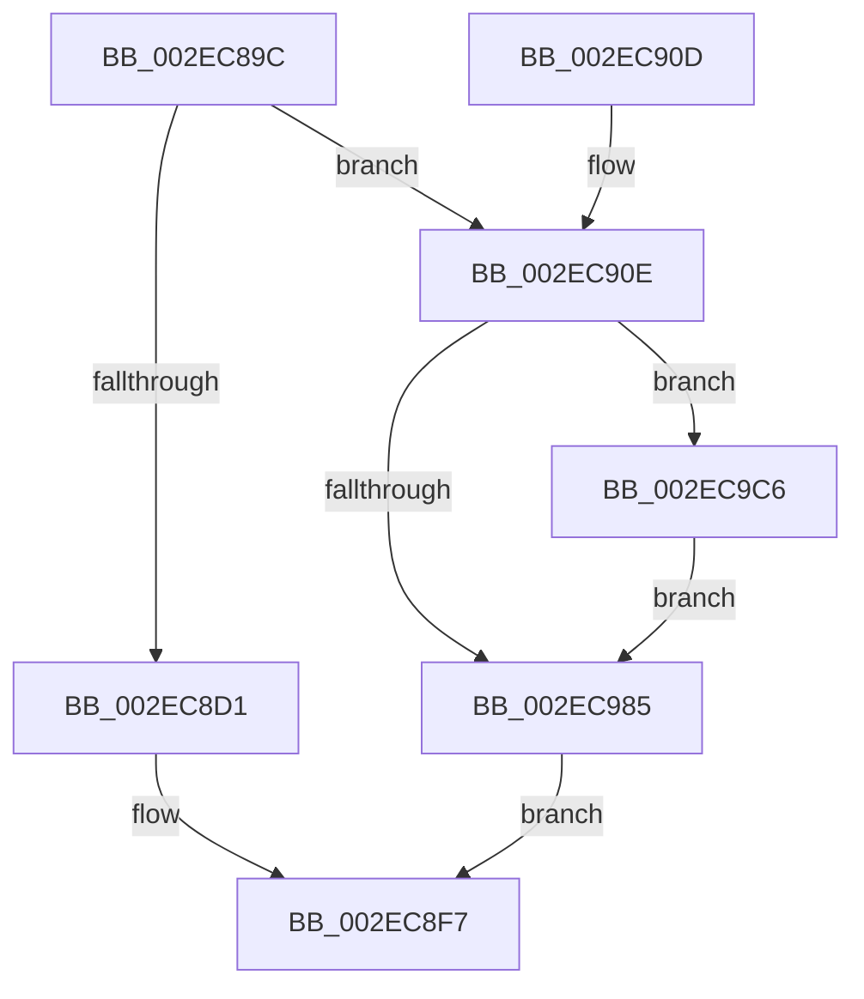

# RtlpHpLargeFree

- RVA: `0x002EC89C`–`0x002EC9DE` (길이 `322` bytes)
- VA: `0x00000001402EC89C`
- 실행 섹션: `.text`
- PDB 이름 있음: `예`; PDB Function 태그: `아니요`
- unwind 정보 RVA: `0x000717E0`
- 디코드: `88`개 명령, `322/322` bytes 표시
- 미해석 바이트: `0` (있으면 어셈블리에 `.byte`로 보존)

> 이 문서는 커널 이미지의 기계어와 PDB 기호를 분석해 생성했습니다. 4번과 5번은 함수 원형과 자료형을 바이너리 사용 방식에서 추정한 C 해석이며 원본 소스 복구 결과는 아닙니다.

## 1. Dependencies

- 직접 호출 지점: **8**; 고유 호출 대상: **7**
- 직접 호출자로 확인된 함수: **6**
- RIP 상대 이미지 참조: **1**

### Outgoing calls
- `0x002EC8B4` → [RtlpHpLargeLockAcquire](RtlpHpLargeLockAcquire_function_002ECA40.md) (function, `0x002ECA40`)
- `0x002EC8C2` → [RtlpHpLargeAllocGetMetadata](RtlpHpLargeAllocGetMetadata_function_002EC9E4.md) (function, `0x002EC9E4`)
- `0x002EC8D7` → [RtlpHpLargeLockRelease](RtlpHpLargeLockRelease_function_002ECBCC.md) (function, `0x002ECBCC`)
- `0x002EC8F2` → [RtlpLogHeapFailure](../35/RtlpLogHeapFailure_function_0035B7BC.md) (function, `0x0035B7BC`)
- `0x002EC915` → [RtlRbRemoveNode](RtlRbRemoveNode_function_002E4C10.md) (function, `0x002E4C10`)
- `0x002EC920` → [RtlpHpLargeLockRelease](RtlpHpLargeLockRelease_function_002ECBCC.md) (function, `0x002ECBCC`)
- `0x002EC9B7` → [RtlpHpMetadataFree](RtlpHpMetadataFree_function_002ECA64.md) (function, `0x002ECA64`)
- `0x002EC9D7` → [RtlpHpVaMgrCtxFree](RtlpHpVaMgrCtxFree_function_002ED734.md) (function, `0x002ED734`)

### Direct callers
- [RtlpHpAllocateHeapSlow](RtlpHpAllocateHeapSlow_function_002E9DEC.md) at `0x002EA537`
- [RtlpHpMetadataFree](RtlpHpMetadataFree_function_002ECA64.md) at `0x002ECAD4`
- [ExAllocateHeapPool](../35/ExAllocateHeapPool_function_0035BA30.md) at `0x0035C07A`
- [ExAllocateHeapPool](../35/ExAllocateHeapPool_function_0035BA30.md) at `0x0035E7AE`
- [sub_0035FA50](../35/Unknown_function_0035FA50.md) at `0x0035FA62`
- [sub_00360968](../36/Unknown_function_00360968.md) at `0x00360F0C`
- [sub_00B8371E](../../poolcode/B8/Unknown_function_00B8371E.md) at `0x00B83CC6`

### Static image references
- `0x002EC9D0` → RVA `0x00E68658` (`.data`; read)

## 2. Other-region calls and transfers

- 다른 실행 섹션으로 향하는 call: **0**
- 별도 외부 분기/꼬리 이동을 확인하지 못했습니다.

## 3. Assembly (complete function range)

```asm
002EC89C  48 89 5C 24 08                  mov qword ptr [rsp + 8], rbx
002EC8A1  48 89 6C 24 18                  mov qword ptr [rsp + 0x18], rbp
002EC8A6  56                              push rsi
002EC8A7  57                              push rdi
002EC8A8  41 56                           push r14
002EC8AA  48 83 EC 40                     sub rsp, 0x40
002EC8AE  48 8B EA                        mov rbp, rdx
002EC8B1  48 8B D9                        mov rbx, rcx
002EC8B4  E8 87 01 00 00                  call 0x1402eca40
002EC8B9  48 8B D5                        mov rdx, rbp
002EC8BC  48 8B CB                        mov rcx, rbx
002EC8BF  44 8A F0                        mov r14b, al
002EC8C2  E8 1D 01 00 00                  call 0x1402ec9e4
002EC8C7  33 FF                           xor edi, edi
002EC8C9  48 8B F0                        mov rsi, rax
002EC8CC  48 85 C0                        test rax, rax
002EC8CF  75 3D                           jne 0x1402ec90e
002EC8D1  41 8A D6                        mov dl, r14b
002EC8D4  48 8B CB                        mov rcx, rbx
002EC8D7  E8 F0 02 00 00                  call 0x1402ecbcc
002EC8DC  45 33 C9                        xor r9d, r9d
002EC8DF  48 89 7C 24 28                  mov qword ptr [rsp + 0x28], rdi
002EC8E4  4C 8B C5                        mov r8, rbp
002EC8E7  48 89 7C 24 20                  mov qword ptr [rsp + 0x20], rdi
002EC8EC  48 8B D3                        mov rdx, rbx
002EC8EF  8D 4E 08                        lea ecx, [rsi + 8]
002EC8F2  E8 C5 EE 06 00                  call 0x14035b7bc
002EC8F7  48 8B 5C 24 60                  mov rbx, qword ptr [rsp + 0x60]
002EC8FC  48 8B C7                        mov rax, rdi
002EC8FF  48 8B 6C 24 70                  mov rbp, qword ptr [rsp + 0x70]
002EC904  48 83 C4 40                     add rsp, 0x40
002EC908  41 5E                           pop r14
002EC90A  5F                              pop rdi
002EC90B  5E                              pop rsi
002EC90C  C3                              ret
002EC90D  CC                              int3
002EC90E  48 8D 4B 48                     lea rcx, [rbx + 0x48]
002EC912  48 8B D6                        mov rdx, rsi
002EC915  E8 F6 82 FF FF                  call 0x1402e4c10
002EC91A  41 8A D6                        mov dl, r14b
002EC91D  48 8B CB                        mov rcx, rbx
002EC920  E8 A7 02 00 00                  call 0x1402ecbcc
002EC925  48 8B 4E 20                     mov rcx, qword ptr [rsi + 0x20]
002EC929  BA 01 00 00 00                  mov edx, 1
002EC92E  4C 8B C1                        mov r8, rcx
002EC931  48 8B C1                        mov rax, rcx
002EC934  C0 E9 02                        shr cl, 2
002EC937  80 E1 3F                        and cl, 0x3f
002EC93A  48 C1 E8 0C                     shr rax, 0xc
002EC93E  49 D1 E8                        shr r8, 1
002EC941  4C 23 C2                        and r8, rdx
002EC944  48 D3 E2                        shl rdx, cl
002EC947  4C 03 C0                        add r8, rax
002EC94A  49 C1 E0 0C                     shl r8, 0xc
002EC94E  48 8D 42 FF                     lea rax, [rdx - 1]
002EC952  49 8D 48 FF                     lea rcx, [r8 - 1]
002EC956  48 03 CA                        add rcx, rdx
002EC959  48 23 C8                        and rcx, rax
002EC95C  48 8D 85 FF FF 0F 00            lea rax, [rbp + 0xfffff]
002EC963  48 2B D1                        sub rdx, rcx
002EC966  48 25 00 00 F0 FF               and rax, 0xfffffffffff00000
002EC96C  48 89 44 24 68                  mov qword ptr [rsp + 0x68], rax
002EC971  48 8D 4A FF                     lea rcx, [rdx - 1]
002EC975  49 03 C8                        add rcx, r8
002EC978  48 03 CD                        add rcx, rbp
002EC97B  48 2B C8                        sub rcx, rax
002EC97E  48 89 4C 24 78                  mov qword ptr [rsp + 0x78], rcx
002EC983  75 41                           jne 0x1402ec9c6
002EC985  48 8B 46 20                     mov rax, qword ptr [rsi + 0x20]
002EC989  48 C1 E8 0C                     shr rax, 0xc
002EC98D  48 F7 D8                        neg rax
002EC990  F0 48 01 43 60                  lock add qword ptr [rbx + 0x60], rax
002EC995  48 8B 44 24 78                  mov rax, qword ptr [rsp + 0x78]
002EC99A  48 C1 E8 0C                     shr rax, 0xc
002EC99E  48 F7 D8                        neg rax
002EC9A1  F0 48 01 43 58                  lock add qword ptr [rbx + 0x58], rax
002EC9A6  0F 10 03                        movups xmm0, xmmword ptr [rbx]
002EC9A9  48 8D 54 24 30                  lea rdx, [rsp + 0x30]
002EC9AE  48 8B CE                        mov rcx, rsi
002EC9B1  F3 0F 7F 44 24 30               movdqu xmmword ptr [rsp + 0x30], xmm0
002EC9B7  E8 A8 00 00 00                  call 0x1402eca64
002EC9BC  48 8B 7C 24 78                  mov rdi, qword ptr [rsp + 0x78]
002EC9C1  E9 31 FF FF FF                  jmp 0x1402ec8f7
002EC9C6  4C 8D 44 24 78                  lea r8, [rsp + 0x78]
002EC9CB  48 8D 54 24 68                  lea rdx, [rsp + 0x68]
002EC9D0  48 8D 0D 81 BC B7 00            lea rcx, [rip + 0xb7bc81]
002EC9D7  E8 58 0D 00 00                  call 0x1402ed734
002EC9DC  EB A7                           jmp 0x1402ec985
```

## 4. C-style interpretation (structured pseudocode)

```c
__int64 __fastcall RtlpHpLargeFree(__int64 a1, __int64 a2, __int64 a3, int a4)
{
    __int64 result;
    __int64 v_rdi;
    __int64 v_rsp;
    unsigned __int64 v_stack_m30;
    unsigned __int64 v_stack_m38;
    unsigned __int64 v_stack_p18;
    unsigned __int64 v_stack_p30;
    unsigned __int64 v_stack_p68;
    unsigned __int64 v_stack_p78;
    unsigned __int64 v_stack_p8;

    v_stack_p8 = v_rbx;
    v_stack_p18 = v_rbp;
    v_rsp = (v_rsp) - (64);
    result = RtlpHpLargeLockAcquire(a1, a2, a3, a4);
    result = RtlpHpLargeAllocGetMetadata(a1, a2, a3, a4);
    v_rdi = 0;
    if (result != 0) goto loc_002EC90E;
    result = RtlpHpLargeLockRelease(a1, (unsigned __int8)((unsigned __int8)(result)), a3, a4);
    a4 = 0;
    v_stack_m30 = 0;
    v_stack_m38 = 0;
    result = RtlpLogHeapFailure(result + 8, a1, a2, a4);
loc_002EC8F7:
    v_rsp = (v_rsp) + (64);
    return 0;
loc_002EC90E:
    result = RtlRbRemoveNode(v_stack_p8 + 72, result, a2, a4);
    result = RtlpHpLargeLockRelease(v_stack_p8, (unsigned __int8)((unsigned __int8)(result)), a2, a4);
    a1 = (unsigned __int8)((*(unsigned __int64 *)(result + 32)) >> (2));
    a1 = (unsigned __int8)((a1) & (63));
    result = (*(unsigned __int64 *)(result + 32)) >> (12);
    a3 = (*(unsigned __int64 *)(result + 32)) >> (1);
    a3 = (a3) & (1);
    a2 = (1) << ((unsigned __int8)(a1));
    a3 = (a3) + (result);
    a3 = (a3) << (12);
    a1 = (a3 - 1) + (a2);
    a1 = (a1) & (a2 - 1);
    a2 = (a2) - (a1);
    result = (v_stack_p18 + 1048575) & (0xFFFFFFFFFFF00000ULL);
    v_stack_p68 = result;
    a1 = (a2 - 1) + (a3);
    a1 = (a1) + (v_stack_p18);
    a1 = (a1) - (result);
    v_stack_p78 = a1;
    if (condition_is_not_equal) goto loc_002EC9C6;
loc_002EC985:
    result = (*(unsigned __int64 *)(result + 32)) >> (12);
    result = -(result);
    result = (v_stack_p78) >> (12);
    result = -(result);
    v_stack_p30 = v_xmm0;
    result = RtlpHpMetadataFree(result, v_stack_p30, a3, a4);
    goto loc_002EC8F7;
loc_002EC9C6:
    result = RtlpHpVaMgrCtxFree(v_rip + 12041345, v_stack_p68, v_stack_p78, a4);
    goto loc_002EC985;
}
```

## 5. (Beta) C Style

```c
int64_t RtlpHpLargeFree(void *Arg1, void *Arg2, int64_t Arg3, int32_t Arg4)
{
    uint8_t *arg1 = (uint8_t *)Arg1;
    uint8_t *arg2 = (uint8_t *)Arg2;

    int64_t result;
    int64_t local_rdi;
    int64_t local_rsp;
    uint64_t v_stack_m30;
    uint64_t v_stack_m38;
    uint64_t v_stack_p18;
    uint64_t v_stack_p30;
    uint64_t v_stack_p68;
    uint64_t v_stack_p78;
    uint64_t v_stack_p8;

    v_stack_p8 = local_rbx;
    v_stack_p18 = local_rbp;
    local_rsp = (local_rsp) - (64);
    result = RtlpHpLargeLockAcquire(Arg1, Arg2, Arg3, Arg4);
    result = RtlpHpLargeAllocGetMetadata(Arg1, Arg2, Arg3, Arg4);
    local_rdi = 0;
    if (result != 0) goto loc_002EC90E;
    result = RtlpHpLargeLockRelease(Arg1, (uint8_t)((uint8_t)(result)), Arg3, Arg4);
    Arg4 = 0;
    v_stack_m30 = 0;
    v_stack_m38 = 0;
    result = RtlpLogHeapFailure(result + 8, Arg1, Arg2, Arg4);
loc_002EC8F7:
    local_rsp = (local_rsp) + (64);
    return 0;
loc_002EC90E:
    result = RtlRbRemoveNode(v_stack_p8 + 72, result, Arg2, Arg4);
    result = RtlpHpLargeLockRelease(v_stack_p8, (uint8_t)((uint8_t)(result)), Arg2, Arg4);
    Arg1 = (uint8_t)((*(uint64_t *)(result + 0x20)) >> (2));
    Arg1 = (uint8_t)((Arg1) & (63));
    result = (*(uint64_t *)(result + 0x20)) >> (12);
    Arg3 = (*(uint64_t *)(result + 0x20)) >> (1);
    Arg3 = (Arg3) & (1);
    Arg2 = (1) << ((uint8_t)(Arg1));
    Arg3 = (Arg3) + (result);
    Arg3 = (Arg3) << (12);
    Arg1 = (Arg3 - 1) + (Arg2);
    Arg1 = (Arg1) & (Arg2 - 1);
    Arg2 = (Arg2) - (Arg1);
    result = (v_stack_p18 + 1048575) & (0xFFFFFFFFFFF00000ULL);
    v_stack_p68 = result;
    Arg1 = (Arg2 - 1) + (Arg3);
    Arg1 = (Arg1) + (v_stack_p18);
    Arg1 = (Arg1) - (result);
    v_stack_p78 = Arg1;
    if (condition_is_not_equal) goto loc_002EC9C6;
loc_002EC985:
    result = (*(uint64_t *)(result + 0x20)) >> (12);
    result = -(result);
    result = (v_stack_p78) >> (12);
    result = -(result);
    v_stack_p30 = v_xmm0;
    result = RtlpHpMetadataFree(result, v_stack_p30, Arg3, Arg4);
    goto loc_002EC8F7;
loc_002EC9C6:
    result = RtlpHpVaMgrCtxFree(v_rip + 12041345, v_stack_p68, v_stack_p78, Arg4);
    goto loc_002EC985;
}
```

### 관측된 메모리 오프셋

구조체 형식이 확인되지 않은 접근은 인자 기준의 오프셋으로만 기록했습니다.

| 기준 인자 | 오프셋 표현 | 폭 (bit) | 접근 |
|---|---:|---:|---|
| `Arg1` | `+ 0x0` | `128` | `R` |
| `Arg1` | `+ 0x48` | `64` | `R` |
| `Arg1` | `+ 0x58` | `64` | `R/W` |
| `Arg1` | `+ 0x60` | `64` | `R/W` |
| `Arg2` | `+ 0xFFFFF` | `64` | `R` |

## 6. Execution-region graph

[열기: 2D/3D 그래프와 함수 탐색 컨트롤 패널](../../../control-panel.html?section=text&rva=0x002EC89C&view=graph)

- 2D 그래프는 위에서 아래로 흐르고, 3D 그래프는 빈 공간을 드래그해 회전합니다. Shift+드래그는 이동, 휠은 확대·축소, 함수 노드 선택은 대상 보고서 이동입니다.

### Static fallback


