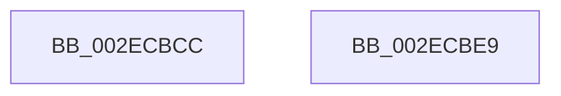

# RtlpHpLargeLockRelease

- RVA: `0x002ECBCC`–`0x002ECBEA` (길이 `30` bytes)
- VA: `0x00000001402ECBCC`
- 실행 섹션: `.text`
- PDB 이름 있음: `예`; PDB Function 태그: `아니요`
- unwind 정보 RVA: `0x0005C788`
- 디코드: `10`개 명령, `30/30` bytes 표시
- 미해석 바이트: `0` (있으면 어셈블리에 `.byte`로 보존)

> 이 문서는 커널 이미지의 기계어와 PDB 기호를 분석해 생성했습니다. 4번과 5번은 함수 원형과 자료형을 바이너리 사용 방식에서 추정한 C 해석이며 원본 소스 복구 결과는 아닙니다.

## 1. Dependencies

- 직접 호출 지점: **1**; 고유 호출 대상: **1**
- 직접 호출자로 확인된 함수: **2**
- RIP 상대 이미지 참조: **0**

### Outgoing calls
- `0x002ECBDF` → [RtlpHpReleaseLockExclusive](../32/RtlpHpReleaseLockExclusive_function_00324230.md) (function, `0x00324230`)

### Direct callers
- [RtlpHpLargeAlloc](RtlpHpLargeAlloc_function_002EBD5C.md) at `0x002EC150`
- [RtlpHpLargeFree](RtlpHpLargeFree_function_002EC89C.md) at `0x002EC8D7`
- [RtlpHpLargeFree](RtlpHpLargeFree_function_002EC89C.md) at `0x002EC920`

### Static image references
- 디코드된 RIP-relative 메모리 참조가 없습니다.

## 2. Other-region calls and transfers

- 다른 실행 섹션으로 향하는 call: **0**
- 별도 외부 분기/꼬리 이동을 확인하지 못했습니다.

## 3. Assembly (complete function range)

```asm
002ECBCC  48 83 EC 28                     sub rsp, 0x28
002ECBD0  8B 01                           mov eax, dword ptr [rcx]
002ECBD2  44 8A C2                        mov r8b, dl
002ECBD5  0F B6 D0                        movzx edx, al
002ECBD8  48 83 C1 40                     add rcx, 0x40
002ECBDC  83 E2 01                        and edx, 1
002ECBDF  E8 4C 76 03 00                  call 0x140324230
002ECBE4  48 83 C4 28                     add rsp, 0x28
002ECBE8  C3                              ret
002ECBE9  CC                              int3
```

## 4. C-style interpretation (structured pseudocode)

```c
__int64 __fastcall RtlpHpLargeLockRelease(__int64 a1, unsigned __int8 a2)
{
    __int64 result;
    __int64 v_rsp;

    v_rsp = (v_rsp) - (40);
    a1 = (a1) + (64);
    a2 = (unsigned int)(((unsigned __int8)((unsigned int)(*(unsigned int *)(a1)))) & (1));
    result = RtlpHpReleaseLockExclusive(a1, a2, a2, a4);
    v_rsp = (v_rsp) + (40);
    return result;
}
```

## 5. (Beta) C Style

```c
int64_t RtlpHpLargeLockRelease(void *Arg1, uint8_t Arg2)
{
    uint8_t *arg1 = (uint8_t *)Arg1;

    int64_t result;
    int64_t local_rsp;

    local_rsp = (local_rsp) - (40);
    Arg1 = (Arg1) + (64);
    Arg2 = (uint32_t)(((uint8_t)((uint32_t)(*(uint32_t *)(arg1)))) & (1));
    result = RtlpHpReleaseLockExclusive(Arg1, Arg2, Arg2, a4);
    local_rsp = (local_rsp) + (40);
    return result;
}
```

### 관측된 메모리 오프셋

구조체 형식이 확인되지 않은 접근은 인자 기준의 오프셋으로만 기록했습니다.

| 기준 인자 | 오프셋 표현 | 폭 (bit) | 접근 |
|---|---:|---:|---|
| `Arg1` | `+ 0x0` | `32` | `R` |

## 6. Execution-region graph

[열기: 2D/3D 그래프와 함수 탐색 컨트롤 패널](../../../control-panel.html?section=text&rva=0x002ECBCC&view=graph)

- 2D 그래프는 위에서 아래로 흐르고, 3D 그래프는 빈 공간을 드래그해 회전합니다. Shift+드래그는 이동, 휠은 확대·축소, 함수 노드 선택은 대상 보고서 이동입니다.

### Static fallback


