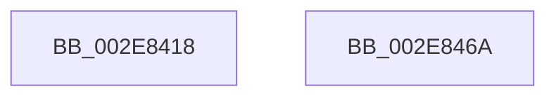

# RtlpHpLfhBlockBitmapInitialize

- RVA: `0x002E8418`–`0x002E846B` (길이 `83` bytes)
- VA: `0x00000001402E8418`
- 실행 섹션: `.text`
- PDB 이름 있음: `예`; PDB Function 태그: `아니요`
- unwind 정보 RVA: `0x00060BC4`
- 디코드: `26`개 명령, `83/83` bytes 표시
- 미해석 바이트: `0` (있으면 어셈블리에 `.byte`로 보존)

> 이 문서는 커널 이미지의 기계어와 PDB 기호를 분석해 생성했습니다. 4번과 5번은 함수 원형과 자료형을 바이너리 사용 방식에서 추정한 C 해석이며 원본 소스 복구 결과는 아닙니다.

## 1. Dependencies

- 직접 호출 지점: **1**; 고유 호출 대상: **1**
- 직접 호출자로 확인된 함수: **2**
- RIP 상대 이미지 참조: **0**

### Outgoing calls
- `0x002E843D` → [memset](../6C/memset_function_006C6C40.md) (function, `0x006C6C40`)

### Direct callers
- [RtlpHpLfhSubsegmentInitialize](RtlpHpLfhSubsegmentInitialize_function_002E806C.md) at `0x002E8288`
- [RtlpHpLfhSubsegmentDelayFreeListProcess](../32/RtlpHpLfhSubsegmentDelayFreeListProcess_function_00323CE0.md) at `0x00324167`

### Static image references
- 디코드된 RIP-relative 메모리 참조가 없습니다.

## 2. Other-region calls and transfers

- 다른 실행 섹션으로 향하는 call: **0**
- 별도 외부 분기/꼬리 이동을 확인하지 못했습니다.

## 3. Assembly (complete function range)

```asm
002E8418  48 89 5C 24 08                  mov qword ptr [rsp + 8], rbx
002E841D  48 89 74 24 10                  mov qword ptr [rsp + 0x10], rsi
002E8422  57                              push rdi
002E8423  48 83 EC 20                     sub rsp, 0x20
002E8427  8B DA                           mov ebx, edx
002E8429  48 8B F1                        mov rsi, rcx
002E842C  33 D2                           xor edx, edx
002E842E  48 8D 7B 3F                     lea rdi, [rbx + 0x3f]
002E8432  48 C1 EF 06                     shr rdi, 6
002E8436  44 8B C7                        mov r8d, edi
002E8439  49 C1 E0 03                     shl r8, 3
002E843D  E8 FE E7 3D 00                  call 0x1406c6c40
002E8442  F7 DB                           neg ebx
002E8444  8D 47 FF                        lea eax, [rdi - 1]
002E8447  8A CB                           mov cl, bl
002E8449  48 83 CA FF                     or rdx, 0xffffffffffffffff
002E844D  48 8B 5C 24 30                  mov rbx, qword ptr [rsp + 0x30]
002E8452  80 E1 3F                        and cl, 0x3f
002E8455  48 D3 EA                        shr rdx, cl
002E8458  48 F7 D2                        not rdx
002E845B  48 89 14 C6                     mov qword ptr [rsi + rax*8], rdx
002E845F  48 8B 74 24 38                  mov rsi, qword ptr [rsp + 0x38]
002E8464  48 83 C4 20                     add rsp, 0x20
002E8468  5F                              pop rdi
002E8469  C3                              ret
002E846A  CC                              int3
```

## 4. C-style interpretation (structured pseudocode)

```c
__int64 __fastcall RtlpHpLfhBlockBitmapInitialize(__int64 a1, int a2)
{
    __int64 result;
    __int64 v_rbx;
    __int64 v_rdi;
    __int64 v_rsp;
    unsigned __int64 v_stack_p10;
    unsigned __int64 v_stack_p8;

    v_stack_p8 = v_rbx;
    v_stack_p10 = v_rsi;
    v_rsp = (v_rsp) - (32);
    a2 = 0;
    v_rdi = ((unsigned int)(a2) + 63) >> (6);
    a3 = ((unsigned int)((unsigned int)(v_rdi))) << (3);
    result = memset(a1, a2, a3, a4);
    v_rbx = (unsigned int)(-((unsigned int)(a2)));
    a2 = (a2) | (-1);
    a1 = (unsigned __int8)(((unsigned __int8)(v_rbx)) & (63));
    a2 = (a2) >> ((unsigned __int8)(a1));
    a2 = ~(a2);
    *(unsigned __int64 *)(a1 + v_rdi - 1 * 8) = a2;
    v_rsp = (v_rsp) + (32);
    return v_rdi - 1;
}
```

## 5. (Beta) C Style

```c
int64_t RtlpHpLfhBlockBitmapInitialize(void *Arg1, void *Arg2)
{
    uint8_t *arg1 = (uint8_t *)Arg1;
    uint8_t *arg2 = (uint8_t *)Arg2;

    int64_t result;
    int64_t local_rbx;
    int64_t local_rdi;
    int64_t local_rsp;
    uint64_t v_stack_p10;
    uint64_t v_stack_p8;

    v_stack_p8 = local_rbx;
    v_stack_p10 = local_rsi;
    local_rsp = (local_rsp) - (32);
    Arg2 = 0;
    local_rdi = ((uint32_t)(Arg2) + 63) >> (6);
    a3 = ((uint32_t)((uint32_t)(local_rdi))) << (3);
    result = memset(Arg1, Arg2, a3, a4);
    local_rbx = (uint32_t)(-((uint32_t)(Arg2)));
    Arg2 = (Arg2) | (-1);
    Arg1 = (uint8_t)(((uint8_t)(local_rbx)) & (63));
    Arg2 = (Arg2) >> ((uint8_t)(Arg1));
    Arg2 = ~(Arg2);
    *(void **)(arg1 + local_rdi - 0x1 * 8) = Arg2;
    local_rsp = (local_rsp) + (32);
    return local_rdi - 1;
}
```

### 관측된 메모리 오프셋

구조체 형식이 확인되지 않은 접근은 인자 기준의 오프셋으로만 기록했습니다.

| 기준 인자 | 오프셋 표현 | 폭 (bit) | 접근 |
|---|---:|---:|---|
| `Arg1` | `+ 0x0 + rax*8` | `64` | `W` |
| `Arg2` | `+ 0x3F` | `64` | `R` |

## 6. Execution-region graph

[열기: 2D/3D 그래프와 함수 탐색 컨트롤 패널](../../../control-panel.html?section=text&rva=0x002E8418&view=graph)

- 2D 그래프는 위에서 아래로 흐르고, 3D 그래프는 빈 공간을 드래그해 회전합니다. Shift+드래그는 이동, 휠은 확대·축소, 함수 노드 선택은 대상 보고서 이동입니다.

### Static fallback


