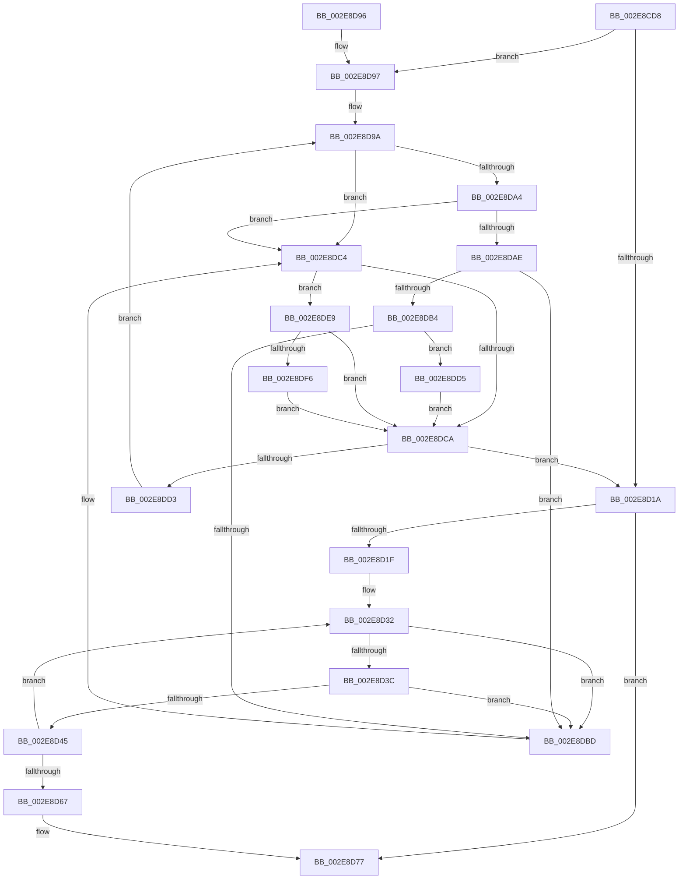

# RtlpHpLfhBucketAddSubsegment

- RVA: `0x002E8CD8`–`0x002E8E06` (길이 `302` bytes)
- VA: `0x00000001402E8CD8`
- 실행 섹션: `.text`
- PDB 이름 있음: `예`; PDB Function 태그: `아니요`
- unwind 정보 RVA: `0x00071488`
- 디코드: `91`개 명령, `302/302` bytes 표시
- 미해석 바이트: `0` (있으면 어셈블리에 `.byte`로 보존)

> 이 문서는 커널 이미지의 기계어와 PDB 기호를 분석해 생성했습니다. 4번과 5번은 함수 원형과 자료형을 바이너리 사용 방식에서 추정한 C 해석이며 원본 소스 복구 결과는 아닙니다.

## 1. Dependencies

- 직접 호출 지점: **5**; 고유 호출 대상: **5**
- 직접 호출자로 확인된 함수: **6**
- RIP 상대 이미지 참조: **0**

### Outgoing calls
- `0x002E8D27` → [RtlpHpAcquireLockExclusive](../32/RtlpHpAcquireLockExclusive_function_003246B0.md) (function, `0x003246B0`)
- `0x002E8D5A` → [RtlpHpLfhOwnerMoveSubsegment](RtlpHpLfhOwnerMoveSubsegment_function_002E85CC.md) (function, `0x002E85CC`)
- `0x002E8D72` → [RtlpHpReleaseLockExclusive](../32/RtlpHpReleaseLockExclusive_function_00324230.md) (function, `0x00324230`)
- `0x002E8DE2` → [RtlpHpLfhSubsegmentFree](RtlpHpLfhSubsegmentFree_function_002E7CA0.md) (function, `0x002E7CA0`)
- `0x002E8DFF` → [RtlpHpLfhSubsegmentReformatAsMulti](RtlpHpLfhSubsegmentReformatAsMulti_function_002E8814.md) (function, `0x002E8814`)

### Direct callers
- [RtlpHpLfhBucketGetSubsegment](RtlpHpLfhBucketGetSubsegment_function_002E8474.md) at `0x002E8548`
- [RtlpHpLfhSlotAllocateSlow](RtlpHpLfhSlotAllocateSlow_function_002E8FBC.md) at `0x002E93F6`
- [RtlpHpLfhContextSlotAllocate](../4C/RtlpHpLfhContextSlotAllocate_function_004C45BC.md) at `0x004C4677`
- [RtlpHpLfhPrivateSlotShutdown](../60/RtlpHpLfhPrivateSlotShutdown_function_0060502C.md) at `0x00605179`
- [sub_006DE040](../6D/Unknown_function_006DE040.md) at `0x006DE1B0`
- [sub_006F9A96](../6F/Unknown_function_006F9A96.md) at `0x006F9B1B`

### Static image references
- 디코드된 RIP-relative 메모리 참조가 없습니다.

## 2. Other-region calls and transfers

- 다른 실행 섹션으로 향하는 call: **0**
- 별도 외부 분기/꼬리 이동을 확인하지 못했습니다.

## 3. Assembly (complete function range)

```asm
002E8CD8  48 8B C4                        mov rax, rsp
002E8CDB  48 89 58 08                     mov qword ptr [rax + 8], rbx
002E8CDF  48 89 68 10                     mov qword ptr [rax + 0x10], rbp
002E8CE3  48 89 70 18                     mov qword ptr [rax + 0x18], rsi
002E8CE7  48 89 78 20                     mov qword ptr [rax + 0x20], rdi
002E8CEB  41 54                           push r12
002E8CED  41 56                           push r14
002E8CEF  41 57                           push r15
002E8CF1  48 83 EC 30                     sub rsp, 0x30
002E8CF5  49 8B 38                        mov rdi, qword ptr [r8]
002E8CF8  45 8B F9                        mov r15d, r9d
002E8CFB  41 83 E7 0C                     and r15d, 0xc
002E8CFF  41 BC 08 00 00 00               mov r12d, 8
002E8D05  41 8B E9                        mov ebp, r9d
002E8D08  49 8B D8                        mov rbx, r8
002E8D0B  45 0F 44 FC                     cmove r15d, r12d
002E8D0F  4C 8B F2                        mov r14, rdx
002E8D12  48 8B F1                        mov rsi, rcx
002E8D15  49 3B F8                        cmp rdi, r8
002E8D18  75 7D                           jne 0x1402e8d97
002E8D1A  48 39 1B                        cmp qword ptr [rbx], rbx
002E8D1D  74 58                           je 0x1402e8d77
002E8D1F  0F B6 56 41                     movzx edx, byte ptr [rsi + 0x41]
002E8D23  49 8D 4E 10                     lea rcx, [r14 + 0x10]
002E8D27  E8 84 B9 03 00                  call 0x1403246b0
002E8D2C  4C 8B 03                        mov r8, qword ptr [rbx]
002E8D2F  40 8A F8                        mov dil, al
002E8D32  49 39 58 08                     cmp qword ptr [r8 + 8], rbx
002E8D36  0F 85 81 00 00 00               jne 0x1402e8dbd
002E8D3C  49 8B 08                        mov rcx, qword ptr [r8]
002E8D3F  4C 39 41 08                     cmp qword ptr [rcx + 8], r8
002E8D43  75 78                           jne 0x1402e8dbd
002E8D45  83 64 24 20 00                  and dword ptr [rsp + 0x20], 0
002E8D4A  45 33 C9                        xor r9d, r9d
002E8D4D  48 89 0B                        mov qword ptr [rbx], rcx
002E8D50  49 8B D6                        mov rdx, r14
002E8D53  48 89 59 08                     mov qword ptr [rcx + 8], rbx
002E8D57  48 8B CE                        mov rcx, rsi
002E8D5A  E8 6D F8 FF FF                  call 0x1402e85cc
002E8D5F  4C 8B 03                        mov r8, qword ptr [rbx]
002E8D62  4C 3B C3                        cmp r8, rbx
002E8D65  75 CB                           jne 0x1402e8d32
002E8D67  0F B6 56 41                     movzx edx, byte ptr [rsi + 0x41]
002E8D6B  49 8D 4E 10                     lea rcx, [r14 + 0x10]
002E8D6F  44 8A C7                        mov r8b, dil
002E8D72  E8 B9 B4 03 00                  call 0x140324230
002E8D77  48 8B 5C 24 50                  mov rbx, qword ptr [rsp + 0x50]
002E8D7C  48 8B 6C 24 58                  mov rbp, qword ptr [rsp + 0x58]
002E8D81  48 8B 74 24 60                  mov rsi, qword ptr [rsp + 0x60]
002E8D86  48 8B 7C 24 68                  mov rdi, qword ptr [rsp + 0x68]
002E8D8B  48 83 C4 30                     add rsp, 0x30
002E8D8F  41 5F                           pop r15
002E8D91  41 5E                           pop r14
002E8D93  41 5C                           pop r12
002E8D95  C3                              ret
002E8D96  CC                              int3
002E8D97  83 E5 02                        and ebp, 2
002E8D9A  48 8B D7                        mov rdx, rdi
002E8D9D  48 8B 3F                        mov rdi, qword ptr [rdi]
002E8DA0  85 ED                           test ebp, ebp
002E8DA2  75 20                           jne 0x1402e8dc4
002E8DA4  0F B7 42 22                     movzx eax, word ptr [rdx + 0x22]
002E8DA8  66 39 42 20                     cmp word ptr [rdx + 0x20], ax
002E8DAC  75 16                           jne 0x1402e8dc4
002E8DAE  48 39 57 08                     cmp qword ptr [rdi + 8], rdx
002E8DB2  75 09                           jne 0x1402e8dbd
002E8DB4  48 8B 42 08                     mov rax, qword ptr [rdx + 8]
002E8DB8  48 39 10                        cmp qword ptr [rax], rdx
002E8DBB  74 18                           je 0x1402e8dd5
002E8DBD  B9 03 00 00 00                  mov ecx, 3
002E8DC2  CD 29                           int 0x29
002E8DC4  F6 42 33 01                     test byte ptr [rdx + 0x33], 1
002E8DC8  75 1F                           jne 0x1402e8de9
002E8DCA  48 3B FB                        cmp rdi, rbx
002E8DCD  0F 84 47 FF FF FF               je 0x1402e8d1a
002E8DD3  EB C5                           jmp 0x1402e8d9a
002E8DD5  48 89 38                        mov qword ptr [rax], rdi
002E8DD8  4D 8B C6                        mov r8, r14
002E8DDB  48 8B CE                        mov rcx, rsi
002E8DDE  48 89 47 08                     mov qword ptr [rdi + 8], rax
002E8DE2  E8 B9 EE FF FF                  call 0x1402e7ca0
002E8DE7  EB E1                           jmp 0x1402e8dca
002E8DE9  8A 42 33                        mov al, byte ptr [rdx + 0x33]
002E8DEC  24 FE                           and al, 0xfe
002E8DEE  88 42 33                        mov byte ptr [rdx + 0x33], al
002E8DF1  45 84 FC                        test r12b, r15b
002E8DF4  75 D4                           jne 0x1402e8dca
002E8DF6  41 B8 01 00 00 00               mov r8d, 1
002E8DFC  48 8B CE                        mov rcx, rsi
002E8DFF  E8 10 FA FF FF                  call 0x1402e8814
002E8E04  EB C4                           jmp 0x1402e8dca
```

## 4. C-style interpretation (structured pseudocode)

```c
__int64 __fastcall RtlpHpLfhBucketAddSubsegment(__int64 a1, __int64 a2, __int64 a3, int a4)
{
    __int64 result;
    __int64 v_r15;
    __int64 v_rbp;
    __int64 v_rsp;
    unsigned int v_stack_m28;
    unsigned __int64 v_stack_p10;
    unsigned __int64 v_stack_p18;
    unsigned __int64 v_stack_p20;
    unsigned __int64 v_stack_p8;

    *(unsigned __int64 *)(v_rsp + 8) = v_rbx;
    *(unsigned __int64 *)(v_rsp + 16) = v_rbp;
    *(unsigned __int64 *)(v_rsp + 24) = v_rsi;
    *(unsigned __int64 *)(v_rsp + 32) = v_rdi;
    v_rsp = (v_rsp) - (48);
    v_r15 = (unsigned int)(((unsigned int)(a4)) & (12));
    if (condition_is_equal) { v_r15 = 8; }
    if ((*(unsigned __int64 *)(a3)) != a3) goto loc_002E8D97;
loc_002E8D1A:
    if ((*(unsigned __int64 *)(a3)) == a3) goto loc_002E8D77;
    result = RtlpHpAcquireLockExclusive(a2 + 16, *(unsigned __int8 *)(a1 + 65), a3, a4);
loc_002E8D32:
    if ((*(unsigned __int64 *)(*(unsigned __int64 *)(a3) + 8)) != a3) goto loc_002E8DBD;
    if ((*(unsigned __int64 *)(*(unsigned __int64 *)(*(unsigned __int64 *)(a3)) + 8)) != (*(unsigned __int64 *)(a3))) goto loc_002E8DBD;
    a4 = 0;
    *(unsigned __int64 *)(a3) = *(unsigned __int64 *)(*(unsigned __int64 *)(a3));
    *(unsigned __int64 *)(*(unsigned __int64 *)(*(unsigned __int64 *)(a3)) + 8) = a3;
    result = RtlpHpLfhOwnerMoveSubsegment(a1, a2, *(unsigned __int64 *)(a3), a4);
    if ((*(unsigned __int64 *)(a3)) != a3) goto loc_002E8D32;
    result = RtlpHpReleaseLockExclusive(a2 + 16, *(unsigned __int8 *)(a1 + 65), (unsigned __int8)((unsigned __int8)(result)), a4);
loc_002E8D77:
    v_rsp = (v_rsp) + (48);
    return result;
loc_002E8D97:
    v_rbp = (unsigned int)((v_stack_p10) & (2));
loc_002E8D9A:
    if ((unsigned int)(v_rbp) != 0) goto loc_002E8DC4;
    if ((*(unsigned __int16 *)(v_stack_p20 + 32)) != ((unsigned __int16)(*(unsigned __int16 *)(v_stack_p20 + 34)))) goto loc_002E8DC4;
    if ((*(unsigned __int64 *)(*(unsigned __int64 *)(v_stack_p20) + 8)) != v_stack_p20) goto loc_002E8DBD;
    if ((*(unsigned __int64 *)(*(unsigned __int64 *)(v_stack_p20 + 8))) == v_stack_p20) goto loc_002E8DD5;
loc_002E8DBD:
loc_002E8DC4:
    if (((*(unsigned __int8 *)(v_stack_p20 + 51)) & (1)) != 0) goto loc_002E8DE9;
loc_002E8DCA:
    if ((*(unsigned __int64 *)(v_stack_p20)) == v_stack_p8) goto loc_002E8D1A;
    goto loc_002E8D9A;
loc_002E8DD5:
    *(unsigned __int64 *)(*(unsigned __int64 *)(v_stack_p20 + 8)) = *(unsigned __int64 *)(v_stack_p20);
    *(unsigned __int64 *)(*(unsigned __int64 *)(v_stack_p20) + 8) = *(unsigned __int64 *)(v_stack_p20 + 8);
    result = RtlpHpLfhSubsegmentFree(v_stack_p18, v_stack_p20, a2, a4);
    goto loc_002E8DCA;
loc_002E8DE9:
    result = (unsigned __int8)((*(unsigned __int8 *)(v_stack_p20 + 51)) & (254));
    *(unsigned __int8 *)(v_stack_p20 + 51) = (unsigned __int8)(result);
    if (((8) & ((unsigned __int8)(v_r15))) != 0) goto loc_002E8DCA;
    result = RtlpHpLfhSubsegmentReformatAsMulti(v_stack_p18, v_stack_p20, 1, a4);
    goto loc_002E8DCA;
}
```

## 5. (Beta) C Style

```c
int64_t RtlpHpLfhBucketAddSubsegment(void *Arg1, void *Arg2, void *Arg3, int32_t Arg4)
{
    uint8_t *arg1 = (uint8_t *)Arg1;
    uint8_t *arg2 = (uint8_t *)Arg2;
    uint8_t *arg3 = (uint8_t *)Arg3;

    int64_t result;
    int64_t local_r15;
    int64_t local_rbp;
    int64_t local_rsp;
    uint32_t v_stack_m28;
    uint64_t v_stack_p10;
    uint64_t v_stack_p18;
    uint64_t v_stack_p20;
    uint64_t v_stack_p8;

    *(uint64_t *)(local_rsp + 0x8) = local_rbx;
    *(uint64_t *)(local_rsp + 0x10) = local_rbp;
    *(uint64_t *)(local_rsp + 0x18) = local_rsi;
    *(uint64_t *)(local_rsp + 0x20) = local_rdi;
    local_rsp = (local_rsp) - (48);
    local_r15 = (uint32_t)(((uint32_t)(Arg4)) & (12));
    if (condition_is_equal) { local_r15 = 8; }
    if ((*(uint64_t *)(arg3)) != Arg3) goto loc_002E8D97;
loc_002E8D1A:
    if ((*(uint64_t *)(arg3)) == Arg3) goto loc_002E8D77;
    result = RtlpHpAcquireLockExclusive(Arg2 + 16, *(uint8_t *)(arg1 + 0x41), Arg3, Arg4);
loc_002E8D32:
    if ((*(uint64_t *)(*(uint64_t *)(arg3) + 0x8)) != Arg3) goto loc_002E8DBD;
    if ((*(uint64_t *)(*(uint64_t *)(*(uint64_t *)(arg3)) + 0x8)) != (*(uint64_t *)(arg3))) goto loc_002E8DBD;
    Arg4 = 0;
    *(uint64_t *)(arg3) = *(uint64_t *)(*(uint64_t *)(arg3));
    *(void **)(*(uint64_t *)(*(uint64_t *)(arg3)) + 0x8) = Arg3;
    result = RtlpHpLfhOwnerMoveSubsegment(Arg1, Arg2, *(uint64_t *)(arg3), Arg4);
    if ((*(uint64_t *)(arg3)) != Arg3) goto loc_002E8D32;
    result = RtlpHpReleaseLockExclusive(Arg2 + 16, *(uint8_t *)(arg1 + 0x41), (uint8_t)((uint8_t)(result)), Arg4);
loc_002E8D77:
    local_rsp = (local_rsp) + (48);
    return result;
loc_002E8D97:
    local_rbp = (uint32_t)((v_stack_p10) & (2));
loc_002E8D9A:
    if ((uint32_t)(local_rbp) != 0) goto loc_002E8DC4;
    if ((*(uint16_t *)(v_stack_p20 + 0x20)) != ((uint16_t)(*(uint16_t *)(v_stack_p20 + 0x22)))) goto loc_002E8DC4;
    if ((*(uint64_t *)(*(uint64_t *)(v_stack_p20) + 0x8)) != v_stack_p20) goto loc_002E8DBD;
    if ((*(uint64_t *)(*(uint64_t *)(v_stack_p20 + 0x8))) == v_stack_p20) goto loc_002E8DD5;
loc_002E8DBD:
loc_002E8DC4:
    if (((*(uint8_t *)(v_stack_p20 + 0x33)) & (1)) != 0) goto loc_002E8DE9;
loc_002E8DCA:
    if ((*(uint64_t *)(v_stack_p20)) == v_stack_p8) goto loc_002E8D1A;
    goto loc_002E8D9A;
loc_002E8DD5:
    *(uint64_t *)(*(uint64_t *)(v_stack_p20 + 0x8)) = *(uint64_t *)(v_stack_p20);
    *(uint64_t *)(*(uint64_t *)(v_stack_p20) + 0x8) = *(uint64_t *)(v_stack_p20 + 0x8);
    result = RtlpHpLfhSubsegmentFree(v_stack_p18, v_stack_p20, Arg2, Arg4);
    goto loc_002E8DCA;
loc_002E8DE9:
    result = (uint8_t)((*(uint8_t *)(v_stack_p20 + 0x33)) & (254));
    *(uint8_t *)(v_stack_p20 + 0x33) = (uint8_t)(result);
    if (((8) & ((uint8_t)(local_r15))) != 0) goto loc_002E8DCA;
    result = RtlpHpLfhSubsegmentReformatAsMulti(v_stack_p18, v_stack_p20, 1, Arg4);
    goto loc_002E8DCA;
}
```

### 관측된 메모리 오프셋

구조체 형식이 확인되지 않은 접근은 인자 기준의 오프셋으로만 기록했습니다.

| 기준 인자 | 오프셋 표현 | 폭 (bit) | 접근 |
|---|---:|---:|---|
| `Arg1` | `+ 0x41` | `8` | `R` |
| `Arg2` | `+ 0x10` | `64` | `R` |
| `Arg3` | `+ 0x0` | `64` | `R` |
| `Arg3` | `+ 0x0` | `64` | `W` |

## 6. Execution-region graph

[열기: 2D/3D 그래프와 함수 탐색 컨트롤 패널](../../../control-panel.html?section=text&rva=0x002E8CD8&view=graph)

- 2D 그래프는 위에서 아래로 흐르고, 3D 그래프는 빈 공간을 드래그해 회전합니다. Shift+드래그는 이동, 휠은 확대·축소, 함수 노드 선택은 대상 보고서 이동입니다.

### Static fallback


