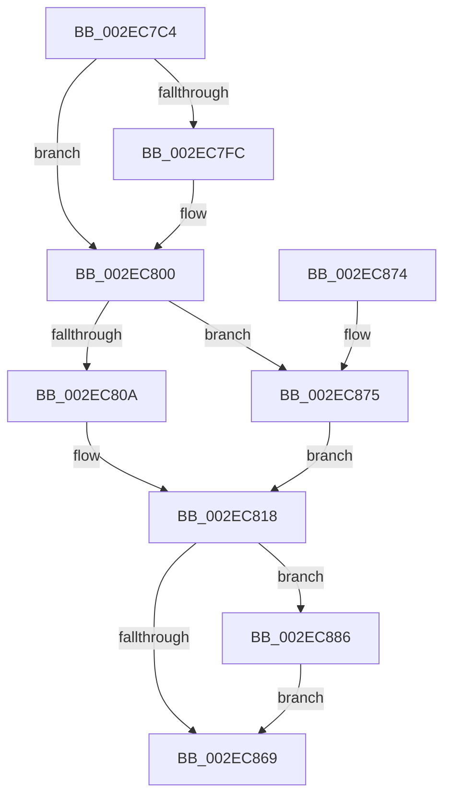

# RtlpHpLfhBucketComputeNewSubsegmentBlockCount

- RVA: `0x002EC7C4`–`0x002EC896` (길이 `210` bytes)
- VA: `0x00000001402EC7C4`
- 실행 섹션: `.text`
- PDB 이름 있음: `예`; PDB Function 태그: `아니요`
- unwind 정보 RVA: `0x0006F56C`
- 디코드: `59`개 명령, `210/210` bytes 표시
- 미해석 바이트: `0` (있으면 어셈블리에 `.byte`로 보존)

> 이 문서는 커널 이미지의 기계어와 PDB 기호를 분석해 생성했습니다. 4번과 5번은 함수 원형과 자료형을 바이너리 사용 방식에서 추정한 C 해석이며 원본 소스 복구 결과는 아닙니다.

## 1. Dependencies

- 직접 호출 지점: **0**; 고유 호출 대상: **0**
- 직접 호출자로 확인된 함수: **1**
- RIP 상대 이미지 참조: **2**

### Outgoing calls
- 직접 디코드된 call 명령이 없습니다.

### Direct callers
- [RtlpHpLfhSubsegmentCreate](RtlpHpLfhSubsegmentCreate_function_002EC5A0.md) at `0x002EC5E5`

### Static image references
- `0x002EC7D1` → RVA `0x0001C3C0` (`.rdata`; read)
- `0x002EC80A` → RVA `0x00F059A0` (`.data`; read)

## 2. Other-region calls and transfers

- 다른 실행 섹션으로 향하는 call: **0**
- 별도 외부 분기/꼬리 이동을 확인하지 못했습니다.

## 3. Assembly (complete function range)

```asm
002EC7C4  48 89 5C 24 08                  mov qword ptr [rsp + 8], rbx
002EC7C9  48 89 7C 24 10                  mov qword ptr [rsp + 0x10], rdi
002EC7CE  0F B6 01                        movzx eax, byte ptr [rcx]
002EC7D1  4C 8D 0D E8 FB D2 FF            lea r9, [rip - 0x2d0418]
002EC7D8  44 0F B6 41 01                  movzx r8d, byte ptr [rcx + 1]
002EC7DD  41 BB 01 00 00 00               mov r11d, 1
002EC7E3  D1 E8                           shr eax, 1
002EC7E5  41 BA FF FF FF FF               mov r10d, 0xffffffff
002EC7EB  41 03 C3                        add eax, r11d
002EC7EE  48 8B D9                        mov rbx, rcx
002EC7F1  45 0F B7 0C 41                  movzx r9d, word ptr [r9 + rax*2]
002EC7F6  4C 39 51 38                     cmp qword ptr [rcx + 0x38], r10
002EC7FA  73 04                           jae 0x1402ec800
002EC7FC  44 8B 51 38                     mov r10d, dword ptr [rcx + 0x38]
002EC800  BF 03 00 00 00                  mov edi, 3
002EC805  41 3B D3                        cmp edx, r11d
002EC808  7C 6B                           jl 0x1402ec875
002EC80A  8B 0D 90 91 C1 00               mov ecx, dword ptr [rip + 0xc19190]
002EC810  C1 E9 0C                        shr ecx, 0xc
002EC813  23 CF                           and ecx, edi
002EC815  41 D3 EA                        shr r10d, cl
002EC818  45 3B C3                        cmp r8d, r11d
002EC81B  B9 00 01 00 00                  mov ecx, 0x100
002EC820  41 0F 97 C0                     seta r8b
002EC824  41 8A C0                        mov al, r8b
002EC827  41 2A C3                        sub al, r11b
002EC82A  66 44 3B C9                     cmp r9w, cx
002EC82E  0F B6 D0                        movzx edx, al
002EC831  41 0F B6 C0                     movzx eax, r8b
002EC835  0F 43 D0                        cmovae edx, eax
002EC838  44 0F B6 CA                     movzx r9d, dl
002EC83C  41 8A C1                        mov al, r9b
002EC83F  41 2A C3                        sub al, r11b
002EC842  48 83 7B 40 00                  cmp qword ptr [rbx + 0x40], 0
002EC847  44 0F B6 C0                     movzx r8d, al
002EC84B  B8 04 00 00 00                  mov eax, 4
002EC850  45 0F 44 C1                     cmove r8d, r9d
002EC854  41 2B F8                        sub edi, r8d
002EC857  40 8A CF                        mov cl, dil
002EC85A  41 D3 E3                        shl r11d, cl
002EC85D  45 3B D3                        cmp r10d, r11d
002EC860  45 0F 43 DA                     cmovae r11d, r10d
002EC864  44 3B D8                        cmp r11d, eax
002EC867  73 1D                           jae 0x1402ec886
002EC869  48 8B 5C 24 08                  mov rbx, qword ptr [rsp + 8]
002EC86E  48 8B 7C 24 10                  mov rdi, qword ptr [rsp + 0x10]
002EC873  C3                              ret
002EC874  CC                              int3
002EC875  41 C1 EA 03                     shr r10d, 3
002EC879  33 D2                           xor edx, edx
002EC87B  41 8B C2                        mov eax, r10d
002EC87E  41 F7 F0                        div r8d
002EC881  44 8B D0                        mov r10d, eax
002EC884  EB 92                           jmp 0x1402ec818
002EC886  B9 00 04 00 00                  mov ecx, 0x400
002EC88B  41 8B C3                        mov eax, r11d
002EC88E  44 3B D9                        cmp r11d, ecx
002EC891  0F 47 C1                        cmova eax, ecx
002EC894  EB D3                           jmp 0x1402ec869
```

## 4. C-style interpretation (structured pseudocode)

```c
__int64 __fastcall RtlpHpLfhBucketComputeNewSubsegmentBlockCount(__int64 a1, int a2)
{
    __int64 result;
    __int64 v_r10;
    __int64 v_r11;
    __int64 v_rdi;
    unsigned __int64 v_stack_p10;
    unsigned __int64 v_stack_p8;

    v_stack_p8 = v_rbx;
    v_stack_p10 = v_rdi;
    result = (unsigned int)((*(unsigned __int8 *)(a1)) >> (1));
    result = (unsigned int)((result) + (1));
    v_r10 = (unsigned int)(0xFFFFFFFFULL);
    if ((*(unsigned __int64 *)(a1 + 56)) < ((unsigned int)(0xFFFFFFFFULL))) {
        v_r10 = *(unsigned int *)(a1 + 56);
    }
    if (a2 < 1) goto loc_002EC875;
    a1 = (unsigned int)(((unsigned int)(*(unsigned int *)(v_rip + 12685712))) >> (12));
    a1 = (unsigned int)((a1) & (3));
    v_r10 = (unsigned int)((v_r10) >> ((unsigned __int8)(a1)));
loc_002EC818:
    a3 = (((unsigned int)(*(unsigned __int8 *)(a1 + 1))) > 1) ? 1 : 0;
    result = (unsigned __int8)(((unsigned __int8)(a3)) - (1));
    a2 = (unsigned __int8)(result);
    if (((unsigned __int16)(*(unsigned __int16 *)(v_rip - 2950168 + result * 2))) >= 256) { a2 = (unsigned int)((unsigned __int8)(a3)); }
    result = (unsigned __int8)(((unsigned __int8)((unsigned __int8)(a2))) - (1));
    a3 = (unsigned __int8)(result);
    if ((*(unsigned __int64 *)(a1 + 64)) == 0) { a3 = (unsigned int)((unsigned __int8)(a2)); }
    v_rdi = (unsigned int)((3) - ((unsigned int)(a3)));
    v_r11 = (unsigned int)((1) << ((unsigned __int8)((unsigned __int8)(v_rdi))));
    if (((unsigned int)(v_r10)) >= ((unsigned int)(v_r11))) { v_r11 = (unsigned int)(v_r10); }
    if (((unsigned int)(v_r11)) >= 4) goto loc_002EC886;
loc_002EC869:
    return 4;
loc_002EC875:
    v_r10 = (unsigned int)((v_r10) >> (3));
    a2 = 0;
    goto loc_002EC818;
loc_002EC886:
    result = (unsigned int)((unsigned int)(v_r11));
    if (((unsigned int)(v_r11)) > ((unsigned int)((unsigned int)(0x400ULL)))) { result = (unsigned int)((unsigned int)(0x400ULL)); }
    goto loc_002EC869;
}
```

## 5. (Beta) C Style

```c
int64_t RtlpHpLfhBucketComputeNewSubsegmentBlockCount(void *Arg1, int32_t Arg2)
{
    uint8_t *arg1 = (uint8_t *)Arg1;

    int64_t result;
    int64_t local_r10;
    int64_t local_r11;
    int64_t local_rdi;
    uint64_t v_stack_p10;
    uint64_t v_stack_p8;

    v_stack_p8 = local_rbx;
    v_stack_p10 = local_rdi;
    result = (uint32_t)((*(uint8_t *)(arg1)) >> (1));
    result = (uint32_t)((result) + (1));
    local_r10 = (uint32_t)(0xFFFFFFFFULL);
    if ((*(uint64_t *)(arg1 + 0x38)) < ((uint32_t)(0xFFFFFFFFULL))) {
        local_r10 = *(uint32_t *)(arg1 + 0x38);
    }
    if (Arg2 < 1) goto loc_002EC875;
    Arg1 = (uint32_t)(((uint32_t)(*(uint32_t *)(v_rip + 0xC19190))) >> (12));
    Arg1 = (uint32_t)((Arg1) & (3));
    local_r10 = (uint32_t)((local_r10) >> ((uint8_t)(Arg1)));
loc_002EC818:
    a3 = (((uint32_t)(*(uint8_t *)(arg1 + 0x1))) > 1) ? 1 : 0;
    result = (uint8_t)(((uint8_t)(a3)) - (1));
    Arg2 = (uint8_t)(result);
    if (((uint16_t)(*(uint16_t *)(v_rip - 0x2D0418 + result * 2))) >= 256) { Arg2 = (uint32_t)((uint8_t)(a3)); }
    result = (uint8_t)(((uint8_t)((uint8_t)(Arg2))) - (1));
    a3 = (uint8_t)(result);
    if ((*(uint64_t *)(arg1 + 0x40)) == 0) { a3 = (uint32_t)((uint8_t)(Arg2)); }
    local_rdi = (uint32_t)((3) - ((uint32_t)(a3)));
    local_r11 = (uint32_t)((1) << ((uint8_t)((uint8_t)(local_rdi))));
    if (((uint32_t)(local_r10)) >= ((uint32_t)(local_r11))) { local_r11 = (uint32_t)(local_r10); }
    if (((uint32_t)(local_r11)) >= 4) goto loc_002EC886;
loc_002EC869:
    return 4;
loc_002EC875:
    local_r10 = (uint32_t)((local_r10) >> (3));
    Arg2 = 0;
    goto loc_002EC818;
loc_002EC886:
    result = (uint32_t)((uint32_t)(local_r11));
    if (((uint32_t)(local_r11)) > ((uint32_t)((uint32_t)(0x400ULL)))) { result = (uint32_t)((uint32_t)(0x400ULL)); }
    goto loc_002EC869;
}
```

### 관측된 메모리 오프셋

구조체 형식이 확인되지 않은 접근은 인자 기준의 오프셋으로만 기록했습니다.

| 기준 인자 | 오프셋 표현 | 폭 (bit) | 접근 |
|---|---:|---:|---|
| `Arg1` | `+ 0x0` | `8` | `R` |
| `Arg1` | `+ 0x1` | `8` | `R` |
| `Arg1` | `+ 0x38` | `32` | `R` |
| `Arg1` | `+ 0x38` | `64` | `R` |
| `Arg1` | `+ 0x40` | `64` | `R` |

## 6. Execution-region graph

[열기: 2D/3D 그래프와 함수 탐색 컨트롤 패널](../../../control-panel.html?section=text&rva=0x002EC7C4&view=graph)

- 2D 그래프는 위에서 아래로 흐르고, 3D 그래프는 빈 공간을 드래그해 회전합니다. Shift+드래그는 이동, 휠은 확대·축소, 함수 노드 선택은 대상 보고서 이동입니다.

### Static fallback


