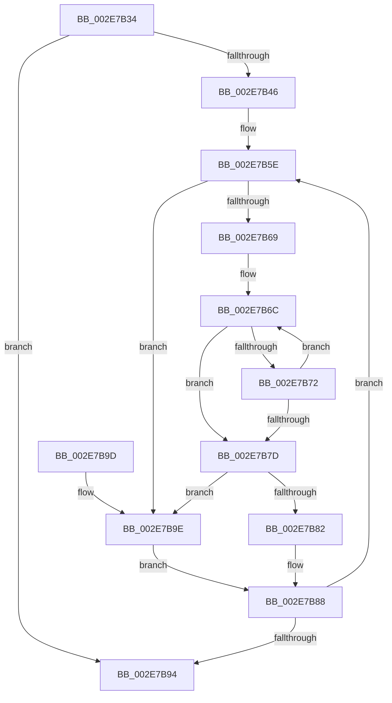

# RtlpHpLfhBucketGetSlotInfo

- RVA: `0x002E7B34`–`0x002E7BAE` (길이 `122` bytes)
- VA: `0x00000001402E7B34`
- 실행 섹션: `.text`
- PDB 이름 있음: `예`; PDB Function 태그: `아니요`
- unwind 정보 RVA: `0x00071394`
- 디코드: `36`개 명령, `122/122` bytes 표시
- 미해석 바이트: `0` (있으면 어셈블리에 `.byte`로 보존)

> 이 문서는 커널 이미지의 기계어와 PDB 기호를 분석해 생성했습니다. 4번과 5번은 함수 원형과 자료형을 바이너리 사용 방식에서 추정한 C 해석이며 원본 소스 복구 결과는 아닙니다.

## 1. Dependencies

- 직접 호출 지점: **0**; 고유 호출 대상: **0**
- 직접 호출자로 확인된 함수: **3**
- RIP 상대 이미지 참조: **0**

### Outgoing calls
- 직접 디코드된 call 명령이 없습니다.

### Direct callers
- [RtlpHpLfhOwnerCompact](RtlpHpLfhOwnerCompact_function_002E785C.md) at `0x002E7A88`
- [RtlpHpLfhBucketUpdateAffinityMapping](../4D/RtlpHpLfhBucketUpdateAffinityMapping_function_004D0008.md) at `0x004D016E`
- [RtlpHpLfhBucketCleanup](../60/RtlpHpLfhBucketCleanup_function_006046CC.md) at `0x006046F8`

### Static image references
- 디코드된 RIP-relative 메모리 참조가 없습니다.

## 2. Other-region calls and transfers

- 다른 실행 섹션으로 향하는 call: **0**
- 별도 외부 분기/꼬리 이동을 확인하지 못했습니다.

## 3. Assembly (complete function range)

```asm
002E7B34  48 89 5C 24 08                  mov qword ptr [rsp + 8], rbx
002E7B39  44 0F B6 51 40                  movzx r10d, byte ptr [rcx + 0x40]
002E7B3E  45 33 C9                        xor r9d, r9d
002E7B41  45 84 D2                        test r10b, r10b
002E7B44  74 4E                           je 0x1402e7b94
002E7B46  0F B6 12                        movzx edx, byte ptr [rdx]
002E7B49  41 8D 59 01                     lea ebx, [r9 + 1]
002E7B4D  48 D1 EA                        shr rdx, 1
002E7B50  45 8B DA                        mov r11d, r10d
002E7B53  48 81 C2 E0 02 00 00            add rdx, 0x2e0
002E7B5A  48 8D 14 51                     lea rdx, [rcx + rdx*2]
002E7B5E  44 0F B7 12                     movzx r10d, word ptr [rdx]
002E7B62  33 C0                           xor eax, eax
002E7B64  45 85 C9                        test r9d, r9d
002E7B67  74 35                           je 0x1402e7b9e
002E7B69  49 8B C8                        mov rcx, r8
002E7B6C  66 44 39 11                     cmp word ptr [rcx], r10w
002E7B70  74 0B                           je 0x1402e7b7d
002E7B72  03 C3                           add eax, ebx
002E7B74  48 83 C1 04                     add rcx, 4
002E7B78  41 3B C1                        cmp eax, r9d
002E7B7B  72 EF                           jb 0x1402e7b6c
002E7B7D  41 3B C1                        cmp eax, r9d
002E7B80  73 1C                           jae 0x1402e7b9e
002E7B82  66 41 01 5C 80 02               add word ptr [r8 + rax*4 + 2], bx
002E7B88  48 81 C2 00 01 00 00            add rdx, 0x100
002E7B8F  4C 2B DB                        sub r11, rbx
002E7B92  75 CA                           jne 0x1402e7b5e
002E7B94  48 8B 5C 24 08                  mov rbx, qword ptr [rsp + 8]
002E7B99  41 8B C1                        mov eax, r9d
002E7B9C  C3                              ret
002E7B9D  CC                              int3
002E7B9E  66 47 89 14 88                  mov word ptr [r8 + r9*4], r10w
002E7BA3  66 43 89 5C 88 02               mov word ptr [r8 + r9*4 + 2], bx
002E7BA9  44 03 CB                        add r9d, ebx
002E7BAC  EB DA                           jmp 0x1402e7b88
```

## 4. C-style interpretation (structured pseudocode)

```c
__int64 __fastcall RtlpHpLfhBucketGetSlotInfo(__int64 a1, __int64 a2, __int64 a3, int a4)
{
    __int64 result;
    __int64 v_r11;
    unsigned __int64 v_stack_p8;

    v_stack_p8 = v_rbx;
    a4 = 0;
    if ((unsigned __int8)(*(unsigned __int8 *)(a1 + 64)) == 0) goto loc_002E7B94;
    a2 = (*(unsigned __int8 *)(a2)) >> (1);
    a2 = (a2) + (736);
loc_002E7B5E:
    result = 0;
    if (0 == 0) goto loc_002E7B9E;
loc_002E7B6C:
    if ((*(unsigned __int16 *)(a3)) == ((unsigned __int16)(*(unsigned __int16 *)(a1 + a2 * 2)))) goto loc_002E7B7D;
    result = (unsigned int)((result) + ((unsigned int)(a4 + 1)));
    a1 = (a3) + (4);
    if (((unsigned int)(result)) < 0) goto loc_002E7B6C;
loc_002E7B7D:
    if (((unsigned int)(result)) >= 0) goto loc_002E7B9E;
loc_002E7B88:
    a2 = (a1 + a2 * 2) + (256);
    v_r11 = ((unsigned int)((unsigned int)(*(unsigned __int8 *)(a1 + 64)))) - (a4 + 1);
    if (condition_is_not_equal) goto loc_002E7B5E;
loc_002E7B94:
    return 0;
loc_002E7B9E:
    *(unsigned __int16 *)(a3 + a4 * 4) = (unsigned __int16)(*(unsigned __int16 *)(a1 + a2 * 2));
    *(unsigned __int16 *)(a3 + a4 * 4 + 2) = (unsigned __int16)(v_stack_p8);
    a4 = (unsigned int)((a4) + ((unsigned int)(v_stack_p8)));
    goto loc_002E7B88;
}
```

## 5. (Beta) C Style

```c
int64_t RtlpHpLfhBucketGetSlotInfo(void *Arg1, void *Arg2, void *Arg3, int32_t Arg4)
{
    uint8_t *arg1 = (uint8_t *)Arg1;
    uint8_t *arg2 = (uint8_t *)Arg2;
    uint8_t *arg3 = (uint8_t *)Arg3;

    int64_t result;
    int64_t local_r11;
    uint64_t v_stack_p8;

    v_stack_p8 = local_rbx;
    Arg4 = 0;
    if ((uint8_t)(*(uint8_t *)(arg1 + 0x40)) == 0) goto loc_002E7B94;
    Arg2 = (*(uint8_t *)(arg2)) >> (1);
    Arg2 = (Arg2) + (736);
loc_002E7B5E:
    result = 0;
    if (0 == 0) goto loc_002E7B9E;
loc_002E7B6C:
    if ((*(uint16_t *)(arg3)) == ((uint16_t)(*(uint16_t *)(arg1 + arg2 * 2)))) goto loc_002E7B7D;
    result = (uint32_t)((result) + ((uint32_t)(Arg4 + 1)));
    Arg1 = (Arg3) + (4);
    if (((uint32_t)(result)) < 0) goto loc_002E7B6C;
loc_002E7B7D:
    if (((uint32_t)(result)) >= 0) goto loc_002E7B9E;
loc_002E7B88:
    Arg2 = (Arg1 + Arg2 * 2) + (256);
    local_r11 = ((uint32_t)((uint32_t)(*(uint8_t *)(arg1 + 0x40)))) - (Arg4 + 1);
    if (condition_is_not_equal) goto loc_002E7B5E;
loc_002E7B94:
    return 0;
loc_002E7B9E:
    *(uint16_t *)(arg3 + Arg4 * 4) = (uint16_t)(*(uint16_t *)(arg1 + arg2 * 2));
    *(uint16_t *)(arg3 + Arg4 * 4 + 0x2) = (uint16_t)(v_stack_p8);
    Arg4 = (uint32_t)((Arg4) + ((uint32_t)(v_stack_p8)));
    goto loc_002E7B88;
}
```

### 관측된 메모리 오프셋

구조체 형식이 확인되지 않은 접근은 인자 기준의 오프셋으로만 기록했습니다.

| 기준 인자 | 오프셋 표현 | 폭 (bit) | 접근 |
|---|---:|---:|---|
| `Arg1` | `+ 0x0` | `16` | `R` |
| `Arg1` | `+ 0x0 + rdx*2` | `64` | `R` |
| `Arg1` | `+ 0x40` | `8` | `R` |
| `Arg2` | `+ 0x0` | `8` | `R` |
| `Arg3` | `+ 0x0` | `16` | `R` |
| `Arg3` | `+ 0x0 + r9*4` | `16` | `W` |
| `Arg3` | `+ 0x2 + r9*4` | `16` | `W` |
| `Arg3` | `+ 0x2 + rax*4` | `16` | `R/W` |

## 6. Execution-region graph

[열기: 2D/3D 그래프와 함수 탐색 컨트롤 패널](../../../control-panel.html?section=text&rva=0x002E7B34&view=graph)

- 2D 그래프는 위에서 아래로 흐르고, 3D 그래프는 빈 공간을 드래그해 회전합니다. Shift+드래그는 이동, 휠은 확대·축소, 함수 노드 선택은 대상 보고서 이동입니다.

### Static fallback


