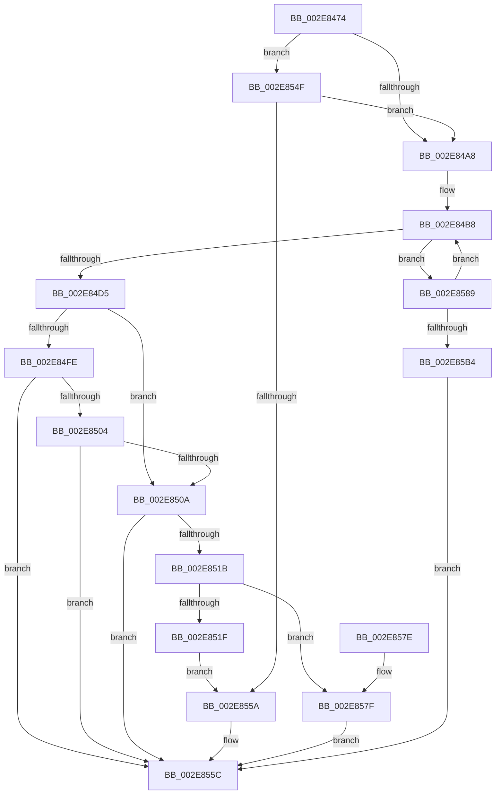

# RtlpHpLfhBucketGetSubsegment

- RVA: `0x002E8474`–`0x002E85C6` (길이 `338` bytes)
- VA: `0x00000001402E8474`
- 실행 섹션: `.text`
- PDB 이름 있음: `예`; PDB Function 태그: `아니요`
- unwind 정보 RVA: `0x000713F8`
- 디코드: `93`개 명령, `338/338` bytes 표시
- 미해석 바이트: `0` (있으면 어셈블리에 `.byte`로 보존)

> 이 문서는 커널 이미지의 기계어와 PDB 기호를 분석해 생성했습니다. 4번과 5번은 함수 원형과 자료형을 바이너리 사용 방식에서 추정한 C 해석이며 원본 소스 복구 결과는 아닙니다.

## 1. Dependencies

- 직접 호출 지점: **8**; 고유 호출 대상: **7**
- 직접 호출자로 확인된 함수: **1**
- RIP 상대 이미지 참조: **0**

### Outgoing calls
- `0x002E84B0` → [RtlpHpAcquireLockExclusive](../32/RtlpHpAcquireLockExclusive_function_003246B0.md) (function, `0x003246B0`)
- `0x002E84BE` → [RtlpHpLfhOwnerGetSubsegment](RtlpHpLfhOwnerGetSubsegment_function_002E8E0C.md) (function, `0x002E8E0C`)
- `0x002E84E3` → [RtlpHpLfhOwnerMoveSubsegment](RtlpHpLfhOwnerMoveSubsegment_function_002E85CC.md) (function, `0x002E85CC`)
- `0x002E84F3` → [RtlpHpReleaseLockExclusive](../32/RtlpHpReleaseLockExclusive_function_00324230.md) (function, `0x00324230`)
- `0x002E8510` → [RtlpHpLfhSubsegmentReformatAsSingle](../46/RtlpHpLfhSubsegmentReformatAsSingle_function_00461D88.md) (function, `0x00461D88`)
- `0x002E8548` → [RtlpHpLfhBucketAddSubsegment](RtlpHpLfhBucketAddSubsegment_function_002E8CD8.md) (function, `0x002E8CD8`)
- `0x002E85A5` → [RtlpHpLfhOwnerRunMaintenance](RtlpHpLfhOwnerRunMaintenance_function_002E8980.md) (function, `0x002E8980`)
- `0x002E85BF` → [RtlpHpReleaseLockExclusive](../32/RtlpHpReleaseLockExclusive_function_00324230.md) (function, `0x00324230`)

### Direct callers
- [RtlpHpLfhSlotAllocateSlow](RtlpHpLfhSlotAllocateSlow_function_002E8FBC.md) at `0x002E958D`

### Static image references
- 디코드된 RIP-relative 메모리 참조가 없습니다.

## 2. Other-region calls and transfers

- 다른 실행 섹션으로 향하는 call: **0**
- 별도 외부 분기/꼬리 이동을 확인하지 못했습니다.

## 3. Assembly (complete function range)

```asm
002E8474  48 8B C4                        mov rax, rsp
002E8477  48 89 58 08                     mov qword ptr [rax + 8], rbx
002E847B  48 89 68 10                     mov qword ptr [rax + 0x10], rbp
002E847F  48 89 70 18                     mov qword ptr [rax + 0x18], rsi
002E8483  48 89 78 20                     mov qword ptr [rax + 0x20], rdi
002E8487  41 54                           push r12
002E8489  41 56                           push r14
002E848B  41 57                           push r15
002E848D  48 83 EC 50                     sub rsp, 0x50
002E8491  48 8D 6A 18                     lea rbp, [rdx + 0x18]
002E8495  45 8B F0                        mov r14d, r8d
002E8498  48 8B FA                        mov rdi, rdx
002E849B  48 8B F1                        mov rsi, rcx
002E849E  48 39 6D 00                     cmp qword ptr [rbp], rbp
002E84A2  0F 84 A7 00 00 00               je 0x1402e854f
002E84A8  0F B6 51 41                     movzx edx, byte ptr [rcx + 0x41]
002E84AC  48 8D 4F 10                     lea rcx, [rdi + 0x10]
002E84B0  E8 FB C1 03 00                  call 0x1403246b0
002E84B5  44 8A F8                        mov r15b, al
002E84B8  48 8B D7                        mov rdx, rdi
002E84BB  48 8B CE                        mov rcx, rsi
002E84BE  E8 49 09 00 00                  call 0x1402e8e0c
002E84C3  48 8B D8                        mov rbx, rax
002E84C6  48 8B D7                        mov rdx, rdi
002E84C9  48 8B CE                        mov rcx, rsi
002E84CC  48 85 C0                        test rax, rax
002E84CF  0F 84 B4 00 00 00               je 0x1402e8589
002E84D5  83 64 24 20 00                  and dword ptr [rsp + 0x20], 0
002E84DA  41 B9 03 00 00 00               mov r9d, 3
002E84E0  4C 8B C0                        mov r8, rax
002E84E3  E8 E4 00 00 00                  call 0x1402e85cc
002E84E8  0F B6 56 41                     movzx edx, byte ptr [rsi + 0x41]
002E84EC  48 8D 4F 10                     lea rcx, [rdi + 0x10]
002E84F0  45 8A C7                        mov r8b, r15b
002E84F3  E8 38 BD 03 00                  call 0x140324230
002E84F8  41 83 FE 02                     cmp r14d, 2
002E84FC  74 0C                           je 0x1402e850a
002E84FE  41 83 FE 01                     cmp r14d, 1
002E8502  7C 58                           jl 0x1402e855c
002E8504  80 7B 27 01                     cmp byte ptr [rbx + 0x27], 1
002E8508  76 52                           jbe 0x1402e855c
002E850A  48 8B D3                        mov rdx, rbx
002E850D  48 8B CE                        mov rcx, rsi
002E8510  E8 73 98 17 00                  call 0x140461d88
002E8515  41 83 FE 02                     cmp r14d, 2
002E8519  75 41                           jne 0x1402e855c
002E851B  85 C0                           test eax, eax
002E851D  79 60                           jns 0x1402e857f
002E851F  48 8D 44 24 40                  lea rax, [rsp + 0x40]
002E8524  48 89 5C 24 48                  mov qword ptr [rsp + 0x48], rbx
002E8529  48 89 03                        mov qword ptr [rbx], rax
002E852C  4C 8D 44 24 40                  lea r8, [rsp + 0x40]
002E8531  48 8D 44 24 40                  lea rax, [rsp + 0x40]
002E8536  48 89 5C 24 40                  mov qword ptr [rsp + 0x40], rbx
002E853B  45 33 C9                        xor r9d, r9d
002E853E  48 89 43 08                     mov qword ptr [rbx + 8], rax
002E8542  48 8B D7                        mov rdx, rdi
002E8545  48 8B CE                        mov rcx, rsi
002E8548  E8 8B 07 00 00                  call 0x1402e8cd8
002E854D  EB 0B                           jmp 0x1402e855a
002E854F  48 83 7A 08 00                  cmp qword ptr [rdx + 8], 0
002E8554  0F 85 4E FF FF FF               jne 0x1402e84a8
002E855A  33 DB                           xor ebx, ebx
002E855C  4C 8D 5C 24 50                  lea r11, [rsp + 0x50]
002E8561  48 8B C3                        mov rax, rbx
002E8564  49 8B 5B 20                     mov rbx, qword ptr [r11 + 0x20]
002E8568  49 8B 6B 28                     mov rbp, qword ptr [r11 + 0x28]
002E856C  49 8B 73 30                     mov rsi, qword ptr [r11 + 0x30]
002E8570  49 8B 7B 38                     mov rdi, qword ptr [r11 + 0x38]
002E8574  49 8B E3                        mov rsp, r11
002E8577  41 5F                           pop r15
002E8579  41 5E                           pop r14
002E857B  41 5C                           pop r12
002E857D  C3                              ret
002E857E  CC                              int3
002E857F  8A 43 33                        mov al, byte ptr [rbx + 0x33]
002E8582  0C 01                           or al, 1
002E8584  88 43 33                        mov byte ptr [rbx + 0x33], al
002E8587  EB D3                           jmp 0x1402e855c
002E8589  48 8D 44 24 30                  lea rax, [rsp + 0x30]
002E858E  45 33 C9                        xor r9d, r9d
002E8591  48 89 44 24 38                  mov qword ptr [rsp + 0x38], rax
002E8596  4C 8D 44 24 30                  lea r8, [rsp + 0x30]
002E859B  48 8D 44 24 30                  lea rax, [rsp + 0x30]
002E85A0  48 89 44 24 30                  mov qword ptr [rsp + 0x30], rax
002E85A5  E8 D6 03 00 00                  call 0x1402e8980
002E85AA  48 39 6D 00                     cmp qword ptr [rbp], rbp
002E85AE  0F 85 04 FF FF FF               jne 0x1402e84b8
002E85B4  0F B6 56 41                     movzx edx, byte ptr [rsi + 0x41]
002E85B8  48 8D 4F 10                     lea rcx, [rdi + 0x10]
002E85BC  45 8A C7                        mov r8b, r15b
002E85BF  E8 6C BC 03 00                  call 0x140324230
002E85C4  EB 96                           jmp 0x1402e855c
```

## 4. C-style interpretation (structured pseudocode)

```c
__int64 __fastcall RtlpHpLfhBucketGetSubsegment(__int64 a1, __int64 a2, int a3)
{
    __int64 result;
    __int64 v_rbx;
    __int64 v_rsp;
    unsigned __int64 v_stack_m18;
    unsigned __int64 v_stack_m20;
    unsigned __int64 v_stack_m28;
    unsigned int v_stack_m48;

    *(unsigned __int64 *)(v_rsp + 8) = v_rbx;
    *(unsigned __int64 *)(v_rsp + 16) = v_rbp;
    *(unsigned __int64 *)(v_rsp + 24) = v_rsi;
    *(unsigned __int64 *)(v_rsp + 32) = v_rdi;
    v_rsp = (v_rsp) - (80);
    if ((*(unsigned __int64 *)(a2 + 24)) == (a2 + 24)) goto loc_002E854F;
loc_002E84A8:
    result = RtlpHpAcquireLockExclusive(a2 + 16, *(unsigned __int8 *)(a1 + 65), a3, a4);
loc_002E84B8:
    result = RtlpHpLfhOwnerGetSubsegment(a1, a2, a3, a4);
    if (result == 0) goto loc_002E8589;
    result = RtlpHpLfhOwnerMoveSubsegment(a1, a2, result, 3);
    result = RtlpHpReleaseLockExclusive(a2 + 16, *(unsigned __int8 *)(a1 + 65), (unsigned __int8)((unsigned __int8)(result)), 3);
    if (((unsigned int)((unsigned int)(a3))) == 2) goto loc_002E850A;
    if (((unsigned int)((unsigned int)(a3))) < 1) goto loc_002E855C;
    if ((*(unsigned __int8 *)(result + 39)) <= 1) goto loc_002E855C;
loc_002E850A:
    result = RtlpHpLfhSubsegmentReformatAsSingle(a1, result, (unsigned __int8)((unsigned __int8)(result)), 3);
    if (((unsigned int)((unsigned int)(a3))) != 2) goto loc_002E855C;
    if (!sign_flag) goto loc_002E857F;
    v_stack_m20 = result;
    *(unsigned __int64 *)(result) = v_stack_m28;
    v_stack_m28 = result;
    a4 = 0;
    *(unsigned __int64 *)(result + 8) = v_stack_m28;
    result = RtlpHpLfhBucketAddSubsegment(a1, a2, v_stack_m28, a4);
    goto loc_002E855A;
loc_002E854F:
    if ((*(unsigned __int64 *)(a2 + 8)) != 0) goto loc_002E84A8;
loc_002E855A:
    v_rbx = 0;
loc_002E855C:
    return 0;
loc_002E857F:
    result = (unsigned __int8)((*(unsigned __int8 *)(*(unsigned __int64 *)(v_stack_m18 + 32) + 51)) | (1));
    *(unsigned __int8 *)(*(unsigned __int64 *)(v_stack_m18 + 32) + 51) = (unsigned __int8)(result);
    goto loc_002E855C;
loc_002E8589:
    a4 = 0;
    v_stack_m18 = v_stack_m20;
    v_stack_m20 = v_stack_m20;
    result = RtlpHpLfhOwnerRunMaintenance(a1, a2, v_stack_m20, a4);
    if ((*(unsigned __int64 *)(*(unsigned __int64 *)(v_stack_m18 + 40))) != (*(unsigned __int64 *)(v_stack_m18 + 40))) goto loc_002E84B8;
    result = RtlpHpReleaseLockExclusive(*(unsigned __int64 *)(v_stack_m18 + 56) + 16, *(unsigned __int8 *)(*(unsigned __int64 *)(v_stack_m18 + 48) + 65), (unsigned __int8)((unsigned __int8)(result)), a4);
    goto loc_002E855C;
}
```

## 5. (Beta) C Style

```c
int64_t RtlpHpLfhBucketGetSubsegment(void *Arg1, void *Arg2, int32_t Arg3)
{
    uint8_t *arg1 = (uint8_t *)Arg1;
    uint8_t *arg2 = (uint8_t *)Arg2;

    int64_t result;
    int64_t local_rbx;
    int64_t local_rsp;
    uint64_t v_stack_m18;
    uint64_t v_stack_m20;
    uint64_t v_stack_m28;
    uint32_t v_stack_m48;

    *(uint64_t *)(local_rsp + 0x8) = local_rbx;
    *(uint64_t *)(local_rsp + 0x10) = local_rbp;
    *(uint64_t *)(local_rsp + 0x18) = local_rsi;
    *(uint64_t *)(local_rsp + 0x20) = local_rdi;
    local_rsp = (local_rsp) - (80);
    if ((*(uint64_t *)(arg2 + 0x18)) == (Arg2 + 24)) goto loc_002E854F;
loc_002E84A8:
    result = RtlpHpAcquireLockExclusive(Arg2 + 16, *(uint8_t *)(arg1 + 0x41), Arg3, a4);
loc_002E84B8:
    result = RtlpHpLfhOwnerGetSubsegment(Arg1, Arg2, Arg3, a4);
    if (result == 0) goto loc_002E8589;
    result = RtlpHpLfhOwnerMoveSubsegment(Arg1, Arg2, result, 3);
    result = RtlpHpReleaseLockExclusive(Arg2 + 16, *(uint8_t *)(arg1 + 0x41), (uint8_t)((uint8_t)(result)), 3);
    if (((uint32_t)((uint32_t)(Arg3))) == 2) goto loc_002E850A;
    if (((uint32_t)((uint32_t)(Arg3))) < 1) goto loc_002E855C;
    if ((*(uint8_t *)(result + 0x27)) <= 1) goto loc_002E855C;
loc_002E850A:
    result = RtlpHpLfhSubsegmentReformatAsSingle(Arg1, result, (uint8_t)((uint8_t)(result)), 3);
    if (((uint32_t)((uint32_t)(Arg3))) != 2) goto loc_002E855C;
    if (!sign_flag) goto loc_002E857F;
    v_stack_m20 = result;
    *(uint64_t *)(result) = v_stack_m28;
    v_stack_m28 = result;
    a4 = 0;
    *(uint64_t *)(result + 0x8) = v_stack_m28;
    result = RtlpHpLfhBucketAddSubsegment(Arg1, Arg2, v_stack_m28, a4);
    goto loc_002E855A;
loc_002E854F:
    if ((*(uint64_t *)(arg2 + 0x8)) != 0) goto loc_002E84A8;
loc_002E855A:
    local_rbx = 0;
loc_002E855C:
    return 0;
loc_002E857F:
    result = (uint8_t)((*(uint8_t *)(*(uint64_t *)(v_stack_m18 + 0x20) + 0x33)) | (1));
    *(uint8_t *)(*(uint64_t *)(v_stack_m18 + 0x20) + 0x33) = (uint8_t)(result);
    goto loc_002E855C;
loc_002E8589:
    a4 = 0;
    v_stack_m18 = v_stack_m20;
    v_stack_m20 = v_stack_m20;
    result = RtlpHpLfhOwnerRunMaintenance(Arg1, Arg2, v_stack_m20, a4);
    if ((*(uint64_t *)(*(uint64_t *)(v_stack_m18 + 0x28))) != (*(uint64_t *)(v_stack_m18 + 0x28))) goto loc_002E84B8;
    result = RtlpHpReleaseLockExclusive(*(uint64_t *)(v_stack_m18 + 0x38) + 16, *(uint8_t *)(*(uint64_t *)(v_stack_m18 + 0x30) + 0x41), (uint8_t)((uint8_t)(result)), a4);
    goto loc_002E855C;
}
```

### 관측된 메모리 오프셋

구조체 형식이 확인되지 않은 접근은 인자 기준의 오프셋으로만 기록했습니다.

| 기준 인자 | 오프셋 표현 | 폭 (bit) | 접근 |
|---|---:|---:|---|
| `Arg1` | `+ 0x41` | `8` | `R` |
| `Arg2` | `+ 0x0` | `64` | `R` |
| `Arg2` | `+ 0x8` | `64` | `R` |
| `Arg2` | `+ 0x10` | `64` | `R` |
| `Arg2` | `+ 0x18` | `64` | `R` |

## 6. Execution-region graph

[열기: 2D/3D 그래프와 함수 탐색 컨트롤 패널](../../../control-panel.html?section=text&rva=0x002E8474&view=graph)

- 2D 그래프는 위에서 아래로 흐르고, 3D 그래프는 빈 공간을 드래그해 회전합니다. Shift+드래그는 이동, 휠은 확대·축소, 함수 노드 선택은 대상 보고서 이동입니다.

### Static fallback


