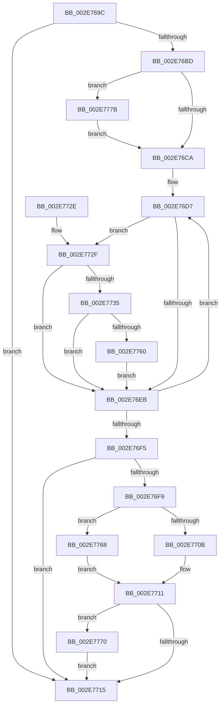

# RtlpHpLfhContextCompact

- RVA: `0x002E769C`–`0x002E7787` (길이 `235` bytes)
- VA: `0x00000001402E769C`
- 실행 섹션: `.text`
- PDB 이름 있음: `예`; PDB Function 태그: `아니요`
- unwind 정보 RVA: `0x00071340`
- 디코드: `70`개 명령, `235/235` bytes 표시
- 미해석 바이트: `0` (있으면 어셈블리에 `.byte`로 보존)

> 이 문서는 커널 이미지의 기계어와 PDB 기호를 분석해 생성했습니다. 4번과 5번은 함수 원형과 자료형을 바이너리 사용 방식에서 추정한 C 해석이며 원본 소스 복구 결과는 아닙니다.

## 1. Dependencies

- 직접 호출 지점: **4**; 고유 호출 대상: **4**
- 직접 호출자로 확인된 함수: **1**
- RIP 상대 이미지 참조: **2**

### Outgoing calls
- `0x002E7746` → [RtlpHpLfhHeatMapQuery](RtlpHpLfhHeatMapQuery_function_002E7790.md) (function, `0x002E7790`)
- `0x002E7756` → [RtlpHpLfhOwnerCompact](RtlpHpLfhOwnerCompact_function_002E785C.md) (function, `0x002E785C`)
- `0x002E7774` → [RtlpHpEnvCompactionSchedule](../32/RtlpHpEnvCompactionSchedule_function_003264A0.md) (function, `0x003264A0`)
- `0x002E777B` → [RtlpHpLfhPrivateSlotsCompact](../60/RtlpHpLfhPrivateSlotsCompact_function_00605264.md) (function, `0x00605264`)

### Direct callers
- [RtlpHpHeapCompact](RtlpHpHeapCompact_function_002E7654.md) at `0x002E7670`

### Static image references
- `0x002E770B` → RVA `0x00EFA7BC` (`.data`; read)
- `0x002E7768` → RVA `0x00EFA7C0` (`.data`; read)

## 2. Other-region calls and transfers

- 다른 실행 섹션으로 향하는 call: **0**
- 별도 외부 분기/꼬리 이동을 확인하지 못했습니다.

## 3. Assembly (complete function range)

```asm
002E769C  48 89 5C 24 08                  mov qword ptr [rsp + 8], rbx
002E76A1  48 89 6C 24 10                  mov qword ptr [rsp + 0x10], rbp
002E76A6  48 89 74 24 18                  mov qword ptr [rsp + 0x18], rsi
002E76AB  57                              push rdi
002E76AC  41 56                           push r14
002E76AE  41 57                           push r15
002E76B0  48 83 EC 20                     sub rsp, 0x20
002E76B4  83 79 4C 00                     cmp dword ptr [rcx + 0x4c], 0
002E76B8  48 8B F9                        mov rdi, rcx
002E76BB  74 58                           je 0x1402e7715
002E76BD  8B 41 48                        mov eax, dword ptr [rcx + 0x48]
002E76C0  33 ED                           xor ebp, ebp
002E76C2  A8 01                           test al, 1
002E76C4  0F 85 B1 00 00 00               jne 0x1402e777b
002E76CA  4C 8D B7 C0 01 00 00            lea r14, [rdi + 0x1c0]
002E76D1  41 BF 80 00 00 00               mov r15d, 0x80
002E76D7  49 8B 0E                        mov rcx, qword ptr [r14]
002E76DA  BE 00 00 00 00                  mov esi, 0
002E76DF  F6 C1 01                        test cl, 1
002E76E2  48 0F 44 F1                     cmove rsi, rcx
002E76E6  48 85 F6                        test rsi, rsi
002E76E9  75 44                           jne 0x1402e772f
002E76EB  49 83 C6 08                     add r14, 8
002E76EF  49 83 EF 01                     sub r15, 1
002E76F3  75 E2                           jne 0x1402e76d7
002E76F5  85 ED                           test ebp, ebp
002E76F7  74 1C                           je 0x1402e7715
002E76F9  48 8B 0F                        mov rcx, qword ptr [rdi]
002E76FC  48 8B 41 38                     mov rax, qword ptr [rcx + 0x38]
002E7700  48 8B 00                        mov rax, qword ptr [rax]
002E7703  48 C1 E8 08                     shr rax, 8
002E7707  3C 01                           cmp al, 1
002E7709  75 5D                           jne 0x1402e7768
002E770B  8B 05 AB 30 C1 00               mov eax, dword ptr [rip + 0xc130ab]
002E7711  85 C0                           test eax, eax
002E7713  74 5B                           je 0x1402e7770
002E7715  48 8B 5C 24 40                  mov rbx, qword ptr [rsp + 0x40]
002E771A  48 8B 6C 24 48                  mov rbp, qword ptr [rsp + 0x48]
002E771F  48 8B 74 24 50                  mov rsi, qword ptr [rsp + 0x50]
002E7724  48 83 C4 20                     add rsp, 0x20
002E7728  41 5F                           pop r15
002E772A  41 5E                           pop r14
002E772C  5F                              pop rdi
002E772D  C3                              ret
002E772E  CC                              int3
002E772F  80 7E 5C 00                     cmp byte ptr [rsi + 0x5c], 0
002E7733  74 B6                           je 0x1402e76eb
002E7735  48 8D 97 C0 00 00 00            lea rdx, [rdi + 0xc0]
002E773C  C6 46 5C 00                     mov byte ptr [rsi + 0x5c], 0
002E7740  4C 8B C6                        mov r8, rsi
002E7743  48 8B CF                        mov rcx, rdi
002E7746  E8 45 00 00 00                  call 0x1402e7790
002E774B  44 8B C0                        mov r8d, eax
002E774E  48 8B D6                        mov rdx, rsi
002E7751  48 8B CF                        mov rcx, rdi
002E7754  8B D8                           mov ebx, eax
002E7756  E8 01 01 00 00                  call 0x1402e785c
002E775B  83 FB 01                        cmp ebx, 1
002E775E  7C 8B                           jl 0x1402e76eb
002E7760  C6 46 5C 01                     mov byte ptr [rsi + 0x5c], 1
002E7764  FF C5                           inc ebp
002E7766  EB 83                           jmp 0x1402e76eb
002E7768  8B 05 52 30 C1 00               mov eax, dword ptr [rip + 0xc13052]
002E776E  EB A1                           jmp 0x1402e7711
002E7770  48 8B 49 38                     mov rcx, qword ptr [rcx + 0x38]
002E7774  E8 27 ED 03 00                  call 0x1403264a0
002E7779  EB 9A                           jmp 0x1402e7715
002E777B  E8 E4 DA 31 00                  call 0x140605264
002E7780  8B E8                           mov ebp, eax
002E7782  E9 43 FF FF FF                  jmp 0x1402e76ca
```

## 4. C-style interpretation (structured pseudocode)

```c
__int64 __fastcall RtlpHpLfhContextCompact(__int64 a1)
{
    __int64 result;
    __int64 v_r14;
    __int64 v_r15;
    __int64 v_rbp;
    __int64 v_rsi;
    __int64 v_rsp;
    unsigned __int64 v_stack_p10;
    unsigned __int64 v_stack_p18;
    unsigned __int64 v_stack_p8;

    v_stack_p8 = v_rbx;
    v_stack_p10 = v_rbp;
    v_stack_p18 = v_rsi;
    v_rsp = (v_rsp) - (32);
    if ((*(unsigned int *)(a1 + 76)) == 0) goto loc_002E7715;
    v_rbp = 0;
    if ((((unsigned __int8)((unsigned int)(*(unsigned int *)(a1 + 72)))) & (1)) != 0) goto loc_002E777B;
loc_002E76CA:
loc_002E76D7:
    v_rsi = 0;
    if ((((unsigned __int8)(*(unsigned __int64 *)(a1 + 448))) & (1)) == 0) { v_rsi = *(unsigned __int64 *)(a1 + 448); }
    if (v_rsi != 0) goto loc_002E772F;
loc_002E76EB:
    v_r14 = (a1 + 448) + (8);
    v_r15 = (128) - (1);
    if (condition_is_not_equal) goto loc_002E76D7;
    if (0 == 0) goto loc_002E7715;
    result = (*(unsigned __int64 *)(*(unsigned __int64 *)(*(unsigned __int64 *)(a1) + 56))) >> (8);
    if (((unsigned __int8)(result)) != 1) goto loc_002E7768;
loc_002E7711:
    if ((unsigned int)((unsigned int)(*(unsigned int *)(v_rip + 12660907))) == 0) goto loc_002E7770;
loc_002E7715:
    v_rsp = (v_rsp) + (32);
    return (unsigned int)(*(unsigned int *)(v_rip + 12660907));
loc_002E772F:
    if ((*(unsigned __int8 *)(v_stack_p18 + 92)) == 0) goto loc_002E76EB;
    *(unsigned __int8 *)(v_stack_p18 + 92) = 0;
    result = RtlpHpLfhHeatMapQuery(a1, a1 + 192, v_stack_p18, a4);
    result = RtlpHpLfhOwnerCompact(a1, v_stack_p18, (unsigned int)((unsigned int)(result)), a4);
    if (((unsigned int)((unsigned int)((unsigned int)(result)))) < 1) goto loc_002E76EB;
    *(unsigned __int8 *)(v_stack_p18 + 92) = 1;
    v_rbp = (unsigned int)((v_stack_p10) + 1);
    goto loc_002E76EB;
loc_002E7768:
    goto loc_002E7711;
loc_002E7770:
    result = RtlpHpEnvCompactionSchedule(*(unsigned __int64 *)(a1 + 56), v_stack_p18, (unsigned int)((unsigned int)(result)), a4);
    goto loc_002E7715;
loc_002E777B:
    result = RtlpHpLfhPrivateSlotsCompact(*(unsigned __int64 *)(a1 + 56), v_stack_p18, (unsigned int)((unsigned int)(result)), a4);
    goto loc_002E76CA;
}
```

## 5. (Beta) C Style

```c
int64_t RtlpHpLfhContextCompact(void *Arg1)
{
    uint8_t *arg1 = (uint8_t *)Arg1;

    int64_t result;
    int64_t local_r14;
    int64_t local_r15;
    int64_t local_rbp;
    int64_t local_rsi;
    int64_t local_rsp;
    uint64_t v_stack_p10;
    uint64_t v_stack_p18;
    uint64_t v_stack_p8;

    v_stack_p8 = local_rbx;
    v_stack_p10 = local_rbp;
    v_stack_p18 = local_rsi;
    local_rsp = (local_rsp) - (32);
    if ((*(uint32_t *)(arg1 + 0x4C)) == 0) goto loc_002E7715;
    local_rbp = 0;
    if ((((uint8_t)((uint32_t)(*(uint32_t *)(arg1 + 0x48)))) & (1)) != 0) goto loc_002E777B;
loc_002E76CA:
loc_002E76D7:
    local_rsi = 0;
    if ((((uint8_t)(*(uint64_t *)(arg1 + 0x1C0))) & (1)) == 0) { local_rsi = *(uint64_t *)(arg1 + 0x1C0); }
    if (local_rsi != 0) goto loc_002E772F;
loc_002E76EB:
    local_r14 = (Arg1 + 448) + (8);
    local_r15 = (128) - (1);
    if (condition_is_not_equal) goto loc_002E76D7;
    if (0 == 0) goto loc_002E7715;
    result = (*(uint64_t *)(*(uint64_t *)(*(uint64_t *)(arg1) + 0x38))) >> (8);
    if (((uint8_t)(result)) != 1) goto loc_002E7768;
loc_002E7711:
    if ((uint32_t)((uint32_t)(*(uint32_t *)(v_rip + 0xC130AB))) == 0) goto loc_002E7770;
loc_002E7715:
    local_rsp = (local_rsp) + (32);
    return (uint32_t)(*(uint32_t *)(v_rip + 0xC130AB));
loc_002E772F:
    if ((*(uint8_t *)(v_stack_p18 + 0x5C)) == 0) goto loc_002E76EB;
    *(uint8_t *)(v_stack_p18 + 0x5C) = 0;
    result = RtlpHpLfhHeatMapQuery(Arg1, Arg1 + 192, v_stack_p18, a4);
    result = RtlpHpLfhOwnerCompact(Arg1, v_stack_p18, (uint32_t)((uint32_t)(result)), a4);
    if (((uint32_t)((uint32_t)((uint32_t)(result)))) < 1) goto loc_002E76EB;
    *(uint8_t *)(v_stack_p18 + 0x5C) = 1;
    local_rbp = (uint32_t)((v_stack_p10) + 1);
    goto loc_002E76EB;
loc_002E7768:
    goto loc_002E7711;
loc_002E7770:
    result = RtlpHpEnvCompactionSchedule(*(uint64_t *)(arg1 + 0x38), v_stack_p18, (uint32_t)((uint32_t)(result)), a4);
    goto loc_002E7715;
loc_002E777B:
    result = RtlpHpLfhPrivateSlotsCompact(*(uint64_t *)(arg1 + 0x38), v_stack_p18, (uint32_t)((uint32_t)(result)), a4);
    goto loc_002E76CA;
}
```

### 관측된 메모리 오프셋

구조체 형식이 확인되지 않은 접근은 인자 기준의 오프셋으로만 기록했습니다.

| 기준 인자 | 오프셋 표현 | 폭 (bit) | 접근 |
|---|---:|---:|---|
| `Arg1` | `+ 0x0` | `64` | `R` |
| `Arg1` | `+ 0x48` | `32` | `R` |
| `Arg1` | `+ 0x4C` | `32` | `R` |
| `Arg1` | `+ 0xC0` | `64` | `R` |
| `Arg1` | `+ 0x1C0` | `64` | `R` |

## 6. Execution-region graph

[열기: 2D/3D 그래프와 함수 탐색 컨트롤 패널](../../../control-panel.html?section=text&rva=0x002E769C&view=graph)

- 2D 그래프는 위에서 아래로 흐르고, 3D 그래프는 빈 공간을 드래그해 회전합니다. Shift+드래그는 이동, 휠은 확대·축소, 함수 노드 선택은 대상 보고서 이동입니다.

### Static fallback


