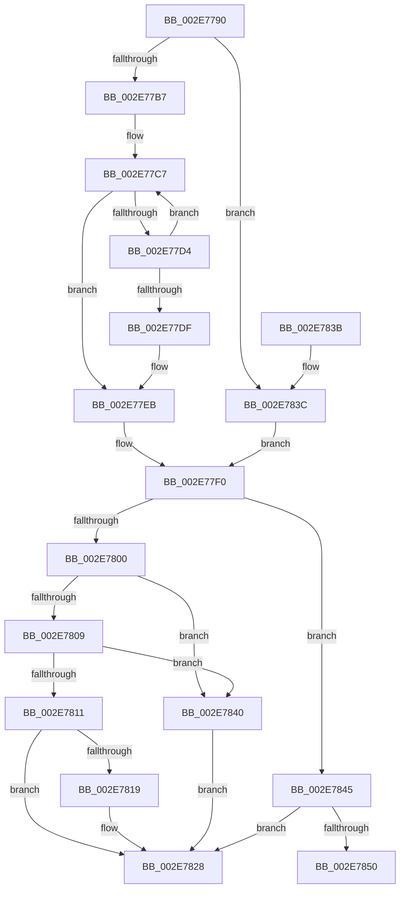

# RtlpHpLfhHeatMapQuery

- RVA: `0x002E7790`–`0x002E7855` (길이 `197` bytes)
- VA: `0x00000001402E7790`
- 실행 섹션: `.text`
- PDB 이름 있음: `예`; PDB Function 태그: `예`
- unwind 정보 RVA: `0x0005DCDC`
- 디코드: `59`개 명령, `197/197` bytes 표시
- 미해석 바이트: `0` (있으면 어셈블리에 `.byte`로 보존)

> 이 문서는 커널 이미지의 기계어와 PDB 기호를 분석해 생성했습니다. 4번과 5번은 함수 원형과 자료형을 바이너리 사용 방식에서 추정한 C 해석이며 원본 소스 복구 결과는 아닙니다.

## 1. Dependencies

- 직접 호출 지점: **1**; 고유 호출 대상: **1**
- 직접 호출자로 확인된 함수: **7**
- RIP 상대 이미지 참조: **1**

### Outgoing calls
- `0x002E77E6` → [RtlpHpLfhHeatMapDecayCounts](../46/RtlpHpLfhHeatMapDecayCounts_function_00468B9C.md) (function, `0x00468B9C`)

### Direct callers
- [RtlpHpLfhContextCompact](RtlpHpLfhContextCompact_function_002E769C.md) at `0x002E7746`
- [RtlpHpLfhSlotAllocateSlow](RtlpHpLfhSlotAllocateSlow_function_002E8FBC.md) at `0x002E97DB`
- [RtlpHpLfhContextSlotAllocate](../4C/RtlpHpLfhContextSlotAllocate_function_004C45BC.md) at `0x004C4657`
- [RtlpHpLfhPrivateSlotListCompact](../60/RtlpHpLfhPrivateSlotListCompact_function_00604F1C.md) at `0x00604FB7`
- [RtlpHpLfhPrivateSlotShutdown](../60/RtlpHpLfhPrivateSlotShutdown_function_0060502C.md) at `0x00605153`
- [sub_006DE040](../6D/Unknown_function_006DE040.md) at `0x006DE190`
- [sub_006F9A96](../6F/Unknown_function_006F9A96.md) at `0x006F9AFE`

### Static image references
- `0x002E77F0` → RVA `0x00F059A0` (`.data`; read)

## 2. Other-region calls and transfers

- 다른 실행 섹션으로 향하는 call: **0**
- call이 아닌 외부 분기/꼬리 이동: **1**
  - `0x002E7850` → [sub_006DDFD2](../6D/Unknown_function_006DDFD2.md) (`tail-transfer`)

## 3. Assembly (complete function range)

```asm
002E7790  48 89 5C 24 08                  mov qword ptr [rsp + 8], rbx
002E7795  48 89 74 24 10                  mov qword ptr [rsp + 0x10], rsi
002E779A  57                              push rdi
002E779B  48 83 EC 30                     sub rsp, 0x30
002E779F  41 0F B6 18                     movzx ebx, byte ptr [r8]
002E77A3  49 8B F8                        mov rdi, r8
002E77A6  D1 EB                           shr ebx, 1
002E77A8  4C 8B DA                        mov r11, rdx
002E77AB  48 8B F1                        mov rsi, rcx
002E77AE  83 FB 7E                        cmp ebx, 0x7e
002E77B1  0F 83 85 00 00 00               jae 0x1402e783c
002E77B7  8B 82 FC 00 00 00               mov eax, dword ptr [rdx + 0xfc]
002E77BD  49 B8 08 00 00 00 80 F7 FF FF   movabs r8, 0xfffff78000000008
002E77C7  49 8B 08                        mov rcx, qword ptr [r8]
002E77CA  48 C1 E9 14                     shr rcx, 0x14
002E77CE  8B D1                           mov edx, ecx
002E77D0  2B D0                           sub edx, eax
002E77D2  74 17                           je 0x1402e77eb
002E77D4  F0 41 0F B1 8B FC 00 00 00      lock cmpxchg dword ptr [r11 + 0xfc], ecx
002E77DD  75 E8                           jne 0x1402e77c7
002E77DF  4D 8B C3                        mov r8, r11
002E77E2  89 54 24 20                     mov dword ptr [rsp + 0x20], edx
002E77E6  E8 B1 13 18 00                  call 0x140468b9c
002E77EB  41 0F B7 14 5B                  movzx edx, word ptr [r11 + rbx*2]
002E77F0  8B 05 AA E1 C1 00               mov eax, dword ptr [rip + 0xc1e1aa]
002E77F6  8B C8                           mov ecx, eax
002E77F8  C1 E9 08                        shr ecx, 8
002E77FB  83 E1 03                        and ecx, 3
002E77FE  75 45                           jne 0x1402e7845
002E7800  44 8D 41 01                     lea r8d, [rcx + 1]
002E7804  41 84 C0                        test r8b, al
002E7807  74 37                           je 0x1402e7840
002E7809  0F B7 47 4C                     movzx eax, word ptr [rdi + 0x4c]
002E780D  3B D0                           cmp edx, eax
002E780F  72 2F                           jb 0x1402e7840
002E7811  0F B7 47 4E                     movzx eax, word ptr [rdi + 0x4e]
002E7815  3B D0                           cmp edx, eax
002E7817  72 0F                           jb 0x1402e7828
002E7819  8A 4E 48                        mov cl, byte ptr [rsi + 0x48]
002E781C  41 22 C8                        and cl, r8b
002E781F  F6 D9                           neg cl
002E7821  1B D2                           sbb edx, edx
002E7823  F7 DA                           neg edx
002E7825  44 03 C2                        add r8d, edx
002E7828  48 8B 5C 24 40                  mov rbx, qword ptr [rsp + 0x40]
002E782D  41 8B C0                        mov eax, r8d
002E7830  48 8B 74 24 48                  mov rsi, qword ptr [rsp + 0x48]
002E7835  48 83 C4 30                     add rsp, 0x30
002E7839  5F                              pop rdi
002E783A  C3                              ret
002E783B  CC                              int3
002E783C  33 D2                           xor edx, edx
002E783E  EB B0                           jmp 0x1402e77f0
002E7840  45 33 C0                        xor r8d, r8d
002E7843  EB E3                           jmp 0x1402e7828
002E7845  41 B8 02 00 00 00               mov r8d, 2
002E784B  41 3B C8                        cmp ecx, r8d
002E784E  74 D8                           je 0x1402e7828
002E7850  E9 7D 67 3F 00                  jmp 0x1406ddfd2
```

## 4. C-style interpretation (structured pseudocode)

```c
__int64 __fastcall RtlpHpLfhHeatMapQuery(__int64 a1, __int64 a2, __int64 a3)
{
    __int64 result;
    __int64 v_rbx;
    __int64 v_rsp;
    unsigned int v_stack_m18;
    unsigned __int64 v_stack_p10;
    unsigned __int64 v_stack_p8;

    v_stack_p8 = v_rbx;
    v_stack_p10 = v_rsi;
    v_rsp = (v_rsp) - (48);
    v_rbx = (unsigned int)((*(unsigned __int8 *)(a3)) >> (1));
    if (((unsigned int)(v_rbx)) >= 126) goto loc_002E783C;
loc_002E77C7:
    a1 = (*(unsigned __int64 *)(a3)) >> (20);
    a2 = (unsigned int)(((unsigned int)((unsigned int)(a1))) - ((unsigned int)((unsigned int)(*(unsigned int *)(a2 + 252)))));
    if (condition_is_equal) goto loc_002E77EB;
    if (condition_is_not_equal) goto loc_002E77C7;
    v_stack_m18 = (unsigned int)(a2);
    result = RtlpHpLfhHeatMapDecayCounts(a1, a2, a2, a4);
loc_002E77EB:
loc_002E77F0:
    a1 = (unsigned int)(((unsigned int)((unsigned int)((unsigned int)(*(unsigned int *)(v_rip + 12706218))))) >> (8));
    a1 = (unsigned int)((a1) & (3));
    if (condition_is_not_equal) goto loc_002E7845;
    if ((((unsigned __int8)(a1 + 1)) & ((unsigned __int8)((unsigned int)(*(unsigned int *)(v_rip + 12706218))))) == 0) goto loc_002E7840;
    if (((unsigned int)(*(unsigned __int16 *)(a2 + v_rbx * 2))) < ((unsigned int)(*(unsigned __int16 *)(a3 + 76)))) goto loc_002E7840;
    if (((unsigned int)(*(unsigned __int16 *)(a2 + v_rbx * 2))) >= ((unsigned int)(*(unsigned __int16 *)(a3 + 78)))) {
        a1 = *(unsigned __int8 *)(a1 + 72);
        a1 = (unsigned __int8)((a1) & ((unsigned __int8)(a1 + 1)));
        a1 = (unsigned __int8)(-(a1));
        a2 = (unsigned int)(-(*(unsigned __int16 *)(a2 + v_rbx * 2)));
        a3 = (unsigned int)((a1 + 1) + ((unsigned int)(a2)));
    }
    v_rsp = (v_rsp) + (48);
    return (unsigned int)((unsigned int)(a3));
loc_002E783C:
    a2 = 0;
    goto loc_002E77F0;
loc_002E7840:
    a3 = 0;
    goto loc_002E7828;
loc_002E7845:
    if (((unsigned int)(a1)) == 2) goto loc_002E7828;
}
```

## 5. (Beta) C Style

```c
int64_t RtlpHpLfhHeatMapQuery(void *Arg1, void *Arg2, void *Arg3)
{
    uint8_t *arg1 = (uint8_t *)Arg1;
    uint8_t *arg2 = (uint8_t *)Arg2;
    uint8_t *arg3 = (uint8_t *)Arg3;

    int64_t result;
    int64_t local_rbx;
    int64_t local_rsp;
    uint32_t v_stack_m18;
    uint64_t v_stack_p10;
    uint64_t v_stack_p8;

    v_stack_p8 = local_rbx;
    v_stack_p10 = local_rsi;
    local_rsp = (local_rsp) - (48);
    local_rbx = (uint32_t)((*(uint8_t *)(arg3)) >> (1));
    if (((uint32_t)(local_rbx)) >= 126) goto loc_002E783C;
loc_002E77C7:
    Arg1 = (*(uint64_t *)(arg3)) >> (20);
    Arg2 = (uint32_t)(((uint32_t)((uint32_t)(Arg1))) - ((uint32_t)((uint32_t)(*(uint32_t *)(arg2 + 0xFC)))));
    if (condition_is_equal) goto loc_002E77EB;
    if (condition_is_not_equal) goto loc_002E77C7;
    v_stack_m18 = (uint32_t)(Arg2);
    result = RtlpHpLfhHeatMapDecayCounts(Arg1, Arg2, Arg2, a4);
loc_002E77EB:
loc_002E77F0:
    Arg1 = (uint32_t)(((uint32_t)((uint32_t)((uint32_t)(*(uint32_t *)(v_rip + 0xC1E1AA))))) >> (8));
    Arg1 = (uint32_t)((Arg1) & (3));
    if (condition_is_not_equal) goto loc_002E7845;
    if ((((uint8_t)(Arg1 + 1)) & ((uint8_t)((uint32_t)(*(uint32_t *)(v_rip + 0xC1E1AA))))) == 0) goto loc_002E7840;
    if (((uint32_t)(*(uint16_t *)(arg2 + local_rbx * 2))) < ((uint32_t)(*(uint16_t *)(arg3 + 0x4C)))) goto loc_002E7840;
    if (((uint32_t)(*(uint16_t *)(arg2 + local_rbx * 2))) >= ((uint32_t)(*(uint16_t *)(arg3 + 0x4E)))) {
        Arg1 = *(uint8_t *)(arg1 + 0x48);
        Arg1 = (uint8_t)((Arg1) & ((uint8_t)(Arg1 + 1)));
        Arg1 = (uint8_t)(-(Arg1));
        Arg2 = (uint32_t)(-(*(uint16_t *)(arg2 + local_rbx * 2)));
        Arg3 = (uint32_t)((Arg1 + 1) + ((uint32_t)(Arg2)));
    }
    local_rsp = (local_rsp) + (48);
    return (uint32_t)((uint32_t)(Arg3));
loc_002E783C:
    Arg2 = 0;
    goto loc_002E77F0;
loc_002E7840:
    Arg3 = 0;
    goto loc_002E7828;
loc_002E7845:
    if (((uint32_t)(Arg1)) == 2) goto loc_002E7828;
}
```

### 관측된 메모리 오프셋

구조체 형식이 확인되지 않은 접근은 인자 기준의 오프셋으로만 기록했습니다.

| 기준 인자 | 오프셋 표현 | 폭 (bit) | 접근 |
|---|---:|---:|---|
| `Arg1` | `+ 0x48` | `8` | `R` |
| `Arg2` | `+ 0xFC` | `32` | `R` |
| `Arg3` | `+ 0x0` | `8` | `R` |
| `Arg3` | `+ 0x4C` | `16` | `R` |
| `Arg3` | `+ 0x4E` | `16` | `R` |

## 6. Execution-region graph

[열기: 2D/3D 그래프와 함수 탐색 컨트롤 패널](../../../control-panel.html?section=text&rva=0x002E7790&view=graph)

- 2D 그래프는 위에서 아래로 흐르고, 3D 그래프는 빈 공간을 드래그해 회전합니다. Shift+드래그는 이동, 휠은 확대·축소, 함수 노드 선택은 대상 보고서 이동입니다.

### Static fallback


