# RtlpHpLfhOwnerCompact

- RVA: `0x002E785C`–`0x002E7B2E` (길이 `722` bytes)
- VA: `0x00000001402E785C`
- 실행 섹션: `.text`
- PDB 이름 있음: `예`; PDB Function 태그: `아니요`
- unwind 정보 RVA: `0x0007136C`
- 디코드: `193`개 명령, `722/722` bytes 표시
- 미해석 바이트: `0` (있으면 어셈블리에 `.byte`로 보존)

> 이 문서는 커널 이미지의 기계어와 PDB 기호를 분석해 생성했습니다. 4번과 5번은 함수 원형과 자료형을 바이너리 사용 방식에서 추정한 C 해석이며 원본 소스 복구 결과는 아닙니다.

## 1. Dependencies

- 직접 호출 지점: **14**; 고유 호출 대상: **12**
- 직접 호출자로 확인된 함수: **3**
- RIP 상대 이미지 참조: **1**

### Outgoing calls
- `0x002E7903` → [RtlpHpLfhSlotActiveSubsegmentReset](../47/RtlpHpLfhSlotActiveSubsegmentReset_function_00471A1C.md) (function, `0x00471A1C`)
- `0x002E7916` → [RtlpHpLfhOwnerRunMaintenance](RtlpHpLfhOwnerRunMaintenance_function_002E8980.md) (function, `0x002E8980`)
- `0x002E796F` → [RtlpHpAcquireLockExclusive](../32/RtlpHpAcquireLockExclusive_function_003246B0.md) (function, `0x003246B0`)
- `0x002E79B3` → [RtlpHpLfhOwnerMoveSubsegment](RtlpHpLfhOwnerMoveSubsegment_function_002E85CC.md) (function, `0x002E85CC`)
- `0x002E79D3` → [RtlpHpReleaseLockExclusive](../32/RtlpHpReleaseLockExclusive_function_00324230.md) (function, `0x00324230`)
- `0x002E79EB` → [_security_check_cookie](../6A/_security_check_cookie_function_006AC640.md) (function, `0x006AC640`)
- `0x002E7A2B` → [RtlpHpAcquireLockExclusive](../32/RtlpHpAcquireLockExclusive_function_003246B0.md) (function, `0x003246B0`)
- `0x002E7A44` → [RtlpHpReleaseLockExclusive](../32/RtlpHpReleaseLockExclusive_function_00324230.md) (function, `0x00324230`)
- `0x002E7A57` → [RtlpHpAcquireLockShared](../46/RtlpHpAcquireLockShared_function_0046205C.md) (function, `0x0046205C`)
- `0x002E7A65` → [RtlpHpLfhOwnerListCompact](../32/RtlpHpLfhOwnerListCompact_function_00323BA8.md) (function, `0x00323BA8`)
- `0x002E7A76` → [RtlpHpReleaseLockShared](../32/RtlpHpReleaseLockShared_function_003245B0.md) (function, `0x003245B0`)
- `0x002E7A88` → [RtlpHpLfhBucketGetSlotInfo](RtlpHpLfhBucketGetSlotInfo_function_002E7B34.md) (function, `0x002E7B34`)
- `0x002E7AB4` → [RtlpHpLfhOwnerCompact](RtlpHpLfhOwnerCompact_function_002E785C.md) (function, `0x002E785C`)
- `0x002E7B1D` → [RtlpHpLfhSubsegmentFree](RtlpHpLfhSubsegmentFree_function_002E7CA0.md) (function, `0x002E7CA0`)

### Direct callers
- [RtlpHpLfhContextCompact](RtlpHpLfhContextCompact_function_002E769C.md) at `0x002E7756`
- [RtlpHpLfhOwnerCompact](RtlpHpLfhOwnerCompact_function_002E785C.md) at `0x002E7AB4`
- [RtlpHpLfhPrivateSlotListCompact](../60/RtlpHpLfhPrivateSlotListCompact_function_00604F1C.md) at `0x00604FDC`

### Static image references
- `0x002E7878` → RVA `0x00E0A740` (`.data`; read)

## 2. Other-region calls and transfers

- 다른 실행 섹션으로 향하는 call: **0**
- 별도 외부 분기/꼬리 이동을 확인하지 못했습니다.

## 3. Assembly (complete function range)

```asm
002E785C  48 89 5C 24 20                  mov qword ptr [rsp + 0x20], rbx
002E7861  55                              push rbp
002E7862  56                              push rsi
002E7863  57                              push rdi
002E7864  41 54                           push r12
002E7866  41 55                           push r13
002E7868  41 56                           push r14
002E786A  41 57                           push r15
002E786C  48 8D 6C 24 B0                  lea rbp, [rsp - 0x50]
002E7871  48 81 EC 50 01 00 00            sub rsp, 0x150
002E7878  48 8B 05 C1 2E B2 00            mov rax, qword ptr [rip + 0xb22ec1]
002E787F  48 33 C4                        xor rax, rsp
002E7882  48 89 45 40                     mov qword ptr [rbp + 0x40], rax
002E7886  F6 02 01                        test byte ptr [rdx], 1
002E7889  45 8B E8                        mov r13d, r8d
002E788C  48 8B F2                        mov rsi, rdx
002E788F  4C 8B F1                        mov r14, rcx
002E7892  0F 85 E8 01 00 00               jne 0x1402e7a80
002E7898  0F B7 7A 02                     movzx edi, word ptr [rdx + 2]
002E789C  4C 8B FA                        mov r15, rdx
002E789F  48 C1 E7 06                     shl rdi, 6
002E78A3  48 03 F9                        add rdi, rcx
002E78A6  48 8D 46 18                     lea rax, [rsi + 0x18]
002E78AA  48 39 00                        cmp qword ptr [rax], rax
002E78AD  0F 84 59 01 00 00               je 0x1402e7a0c
002E78B3  41 F7 DD                        neg r13d
002E78B6  48 8D 44 24 30                  lea rax, [rsp + 0x30]
002E78BB  48 89 44 24 30                  mov qword ptr [rsp + 0x30], rax
002E78C0  48 8D 44 24 30                  lea rax, [rsp + 0x30]
002E78C5  1B DB                           sbb ebx, ebx
002E78C7  48 89 44 24 38                  mov qword ptr [rsp + 0x38], rax
002E78CC  83 E3 FC                        and ebx, 0xfffffffc
002E78CF  45 33 ED                        xor r13d, r13d
002E78D2  83 C3 07                        add ebx, 7
002E78D5  45 8A E5                        mov r12b, r13b
002E78D8  F6 06 01                        test byte ptr [rsi], 1
002E78DB  0F 85 41 01 00 00               jne 0x1402e7a22
002E78E1  66 44 39 6E 04                  cmp word ptr [rsi + 4], r13w
002E78E6  0F 84 36 01 00 00               je 0x1402e7a22
002E78EC  8A 16                           mov dl, byte ptr [rsi]
002E78EE  F6 C3 04                        test bl, 4
002E78F1  F6 D2                           not dl
002E78F3  41 0F 95 C0                     setne r8b
002E78F7  44 22 C2                        and r8b, dl
002E78FA  41 F6 C0 01                     test r8b, 1
002E78FE  74 08                           je 0x1402e7908
002E7900  49 8B CF                        mov rcx, r15
002E7903  E8 14 A1 18 00                  call 0x140471a1c
002E7908  44 8B CB                        mov r9d, ebx
002E790B  4C 8D 44 24 30                  lea r8, [rsp + 0x30]
002E7910  48 8B D6                        mov rdx, rsi
002E7913  49 8B CE                        mov rcx, r14
002E7916  E8 65 10 00 00                  call 0x1402e8980
002E791B  F6 06 01                        test byte ptr [rsi], 1
002E791E  0F 85 14 01 00 00               jne 0x1402e7a38
002E7924  66 44 39 6E 04                  cmp word ptr [rsi + 4], r13w
002E7929  0F 84 09 01 00 00               je 0x1402e7a38
002E792F  F6 06 01                        test byte ptr [rsi], 1
002E7932  0F 85 E2 00 00 00               jne 0x1402e7a1a
002E7938  41 BF 02 00 00 00               mov r15d, 2
002E793E  66 44 39 6E 04                  cmp word ptr [rsi + 4], r13w
002E7943  0F 84 D1 00 00 00               je 0x1402e7a1a
002E7949  48 8B 5C 24 30                  mov rbx, qword ptr [rsp + 0x30]
002E794E  48 8D 44 24 30                  lea rax, [rsp + 0x30]
002E7953  48 3B D8                        cmp rbx, rax
002E7956  0F 85 6C 01 00 00               jne 0x1402e7ac8
002E795C  48 8D 44 24 30                  lea rax, [rsp + 0x30]
002E7961  48 3B D8                        cmp rbx, rax
002E7964  74 72                           je 0x1402e79d8
002E7966  41 0F B6 56 41                  movzx edx, byte ptr [r14 + 0x41]
002E796B  48 8D 4F 10                     lea rcx, [rdi + 0x10]
002E796F  E8 3C CD 03 00                  call 0x1403246b0
002E7974  4C 8B 44 24 30                  mov r8, qword ptr [rsp + 0x30]
002E7979  8A D8                           mov bl, al
002E797B  48 8D 44 24 30                  lea rax, [rsp + 0x30]
002E7980  49 39 40 08                     cmp qword ptr [r8 + 8], rax
002E7984  0F 85 62 01 00 00               jne 0x1402e7aec
002E798A  49 8B 08                        mov rcx, qword ptr [r8]
002E798D  4C 39 41 08                     cmp qword ptr [rcx + 8], r8
002E7991  0F 85 55 01 00 00               jne 0x1402e7aec
002E7997  48 89 4C 24 30                  mov qword ptr [rsp + 0x30], rcx
002E799C  48 8D 44 24 30                  lea rax, [rsp + 0x30]
002E79A1  48 89 41 08                     mov qword ptr [rcx + 8], rax
002E79A5  45 33 C9                        xor r9d, r9d
002E79A8  49 8B CE                        mov rcx, r14
002E79AB  44 89 6C 24 20                  mov dword ptr [rsp + 0x20], r13d
002E79B0  48 8B D7                        mov rdx, rdi
002E79B3  E8 14 0C 00 00                  call 0x1402e85cc
002E79B8  4C 8B 44 24 30                  mov r8, qword ptr [rsp + 0x30]
002E79BD  48 8D 44 24 30                  lea rax, [rsp + 0x30]
002E79C2  4C 3B C0                        cmp r8, rax
002E79C5  75 B4                           jne 0x1402e797b
002E79C7  41 0F B6 56 41                  movzx edx, byte ptr [r14 + 0x41]
002E79CC  48 8D 4F 10                     lea rcx, [rdi + 0x10]
002E79D0  44 8A C3                        mov r8b, bl
002E79D3  E8 58 C8 03 00                  call 0x140324230
002E79D8  F6 06 01                        test byte ptr [rsi], 1
002E79DB  75 71                           jne 0x1402e7a4e
002E79DD  66 44 39 6E 04                  cmp word ptr [rsi + 4], r13w
002E79E2  74 6A                           je 0x1402e7a4e
002E79E4  48 8B 4D 40                     mov rcx, qword ptr [rbp + 0x40]
002E79E8  48 33 CC                        xor rcx, rsp
002E79EB  E8 50 4C 3C 00                  call 0x1406ac640
002E79F0  48 8B 9C 24 A8 01 00 00         mov rbx, qword ptr [rsp + 0x1a8]
002E79F8  48 81 C4 50 01 00 00            add rsp, 0x150
002E79FF  41 5F                           pop r15
002E7A01  41 5E                           pop r14
002E7A03  41 5D                           pop r13
002E7A05  41 5C                           pop r12
002E7A07  5F                              pop rdi
002E7A08  5E                              pop rsi
002E7A09  5D                              pop rbp
002E7A0A  C3                              ret
002E7A0B  CC                              int3
002E7A0C  48 8D 46 28                     lea rax, [rsi + 0x28]
002E7A10  48 39 00                        cmp qword ptr [rax], rax
002E7A13  74 CF                           je 0x1402e79e4
002E7A15  E9 99 FE FF FF                  jmp 0x1402e78b3
002E7A1A  45 8B FD                        mov r15d, r13d
002E7A1D  E9 27 FF FF FF                  jmp 0x1402e7949
002E7A22  41 0F B6 56 41                  movzx edx, byte ptr [r14 + 0x41]
002E7A27  48 8D 4E 10                     lea rcx, [rsi + 0x10]
002E7A2B  E8 80 CC 03 00                  call 0x1403246b0
002E7A30  44 8A E0                        mov r12b, al
002E7A33  E9 B4 FE FF FF                  jmp 0x1402e78ec
002E7A38  41 0F B6 56 41                  movzx edx, byte ptr [r14 + 0x41]
002E7A3D  48 8D 4E 10                     lea rcx, [rsi + 0x10]
002E7A41  45 8A C4                        mov r8b, r12b
002E7A44  E8 E7 C7 03 00                  call 0x140324230
002E7A49  E9 E1 FE FF FF                  jmp 0x1402e792f
002E7A4E  41 0F B6 56 41                  movzx edx, byte ptr [r14 + 0x41]
002E7A53  48 8D 4E 10                     lea rcx, [rsi + 0x10]
002E7A57  E8 00 A6 17 00                  call 0x14046205c
002E7A5C  4C 8D 46 18                     lea r8, [rsi + 0x18]
002E7A60  49 8B CE                        mov rcx, r14
002E7A63  8A D8                           mov bl, al
002E7A65  E8 3E C1 03 00                  call 0x140323ba8
002E7A6A  41 0F B6 56 41                  movzx edx, byte ptr [r14 + 0x41]
002E7A6F  48 8D 4E 10                     lea rcx, [rsi + 0x10]
002E7A73  44 8A C3                        mov r8b, bl
002E7A76  E8 35 CB 03 00                  call 0x1403245b0
002E7A7B  E9 64 FF FF FF                  jmp 0x1402e79e4
002E7A80  4C 8D 44 24 40                  lea r8, [rsp + 0x40]
002E7A85  48 8B FE                        mov rdi, rsi
002E7A88  E8 A7 00 00 00                  call 0x1402e7b34
002E7A8D  45 33 FF                        xor r15d, r15d
002E7A90  85 C0                           test eax, eax
002E7A92  0F 84 0E FE FF FF               je 0x1402e78a6
002E7A98  48 8D 5C 24 40                  lea rbx, [rsp + 0x40]
002E7A9D  44 8B E0                        mov r12d, eax
002E7AA0  44 0F B7 3B                     movzx r15d, word ptr [rbx]
002E7AA4  45 8B C5                        mov r8d, r13d
002E7AA7  49 C1 E7 06                     shl r15, 6
002E7AAB  49 8B CE                        mov rcx, r14
002E7AAE  4D 03 FE                        add r15, r14
002E7AB1  49 8B D7                        mov rdx, r15
002E7AB4  E8 A3 FD FF FF                  call 0x1402e785c
002E7AB9  48 8D 5B 04                     lea rbx, [rbx + 4]
002E7ABD  49 83 EC 01                     sub r12, 1
002E7AC1  75 DD                           jne 0x1402e7aa0
002E7AC3  E9 DE FD FF FF                  jmp 0x1402e78a6
002E7AC8  48 8B CB                        mov rcx, rbx
002E7ACB  48 8B 1B                        mov rbx, qword ptr [rbx]
002E7ACE  45 85 FF                        test r15d, r15d
002E7AD1  75 20                           jne 0x1402e7af3
002E7AD3  0F B7 41 22                     movzx eax, word ptr [rcx + 0x22]
002E7AD7  66 39 41 20                     cmp word ptr [rcx + 0x20], ax
002E7ADB  75 16                           jne 0x1402e7af3
002E7ADD  48 39 4B 08                     cmp qword ptr [rbx + 8], rcx
002E7AE1  75 09                           jne 0x1402e7aec
002E7AE3  48 8B 41 08                     mov rax, qword ptr [rcx + 8]
002E7AE7  48 39 08                        cmp qword ptr [rax], rcx
002E7AEA  74 21                           je 0x1402e7b0d
002E7AEC  B9 03 00 00 00                  mov ecx, 3
002E7AF1  CD 29                           int 0x29
002E7AF3  F6 41 33 01                     test byte ptr [rcx + 0x33], 1
002E7AF7  75 2B                           jne 0x1402e7b24
002E7AF9  48 8D 44 24 30                  lea rax, [rsp + 0x30]
002E7AFE  48 3B D8                        cmp rbx, rax
002E7B01  75 C5                           jne 0x1402e7ac8
002E7B03  48 8B 5C 24 30                  mov rbx, qword ptr [rsp + 0x30]
002E7B08  E9 4F FE FF FF                  jmp 0x1402e795c
002E7B0D  48 8B D1                        mov rdx, rcx
002E7B10  48 89 18                        mov qword ptr [rax], rbx
002E7B13  49 8B CE                        mov rcx, r14
002E7B16  48 89 43 08                     mov qword ptr [rbx + 8], rax
002E7B1A  4C 8B C7                        mov r8, rdi
002E7B1D  E8 7E 01 00 00                  call 0x1402e7ca0
002E7B22  EB D5                           jmp 0x1402e7af9
002E7B24  8A 41 33                        mov al, byte ptr [rcx + 0x33]
002E7B27  24 FE                           and al, 0xfe
002E7B29  88 41 33                        mov byte ptr [rcx + 0x33], al
002E7B2C  EB CB                           jmp 0x1402e7af9
```

## 4. C-style interpretation (structured pseudocode)

```c
__int64 __fastcall RtlpHpLfhOwnerCompact(__int64 a1, __int64 a2, int a3)
{
    __int64 result;
    __int64 v_r12;
    __int64 v_r13;
    __int64 v_r15;
    __int64 v_rbx;
    __int64 v_rdi;
    __int64 v_rsp;
    unsigned __int64 v_stack_m150;
    unsigned __int64 v_stack_m158;
    unsigned int v_stack_m168;
    unsigned __int64 v_stack_m48;
    unsigned __int64 v_stack_m88;
    unsigned __int64 v_stack_p20;
    unsigned __int64 v_stack_p30;
    unsigned __int64 v_stack_p40;

    v_stack_p20 = v_rbx;
    v_rsp = (v_rsp) - (336);
    result = (*(unsigned __int64 *)(v_rip + 11677377)) ^ (v_rsp);
    v_stack_m48 = result;
    if (((*(unsigned __int8 *)(a2)) & (1)) != 0) goto loc_002E7A80;
    v_rdi = (*(unsigned __int16 *)(a2 + 2)) << (6);
    v_rdi = (v_rdi) + (a1);
loc_002E78A6:
    if ((*(unsigned __int64 *)(a2 + 24)) == (a2 + 24)) goto loc_002E7A0C;
loc_002E78B3:
    v_r13 = (unsigned int)(-((unsigned int)(a3)));
    v_stack_m158 = v_stack_m158;
    v_stack_m150 = v_stack_m158;
    v_rbx = (unsigned int)((v_rbx) & (0xFFFFFFFCULL));
    v_r13 = 0;
    v_rbx = (unsigned int)((v_rbx) + (7));
    if (((*(unsigned __int8 *)(a2)) & (1)) != 0) goto loc_002E7A22;
    if ((*(unsigned __int16 *)(a2 + 4)) == 0) goto loc_002E7A22;
loc_002E78EC:
    a2 = (unsigned __int8)(~(*(unsigned __int8 *)(a2)));
    a3 = ((((unsigned __int8)(v_rbx)) & (4)) != 0) ? 1 : 0;
    a3 = (unsigned __int8)((a3) & ((unsigned __int8)(a2)));
    result = v_stack_m158;
    if ((((unsigned __int8)(a3)) & (1)) != 0) {
        a1 = a2;
        result = RtlpHpLfhSlotActiveSubsegmentReset(a1, a2, a3, a4);
    }
    result = RtlpHpLfhOwnerRunMaintenance(a1, a2, v_stack_m158, (unsigned int)((unsigned int)(v_rbx)));
    if (((*(unsigned __int8 *)(a2)) & (1)) != 0) goto loc_002E7A38;
    if ((*(unsigned __int16 *)(a2 + 4)) == 0) goto loc_002E7A38;
loc_002E792F:
    if (((*(unsigned __int8 *)(a2)) & (1)) != 0) goto loc_002E7A1A;
    if ((*(unsigned __int16 *)(a2 + 4)) == 0) goto loc_002E7A1A;
loc_002E7949:
    if (v_stack_m158 != v_stack_m158) goto loc_002E7AC8;
loc_002E795C:
    if (v_stack_m158 == v_stack_m158) goto loc_002E79D8;
    result = RtlpHpAcquireLockExclusive(v_rdi + 16, *(unsigned __int8 *)(a1 + 65), v_stack_m158, (unsigned int)((unsigned int)(v_rbx)));
loc_002E797B:
    if ((*(unsigned __int64 *)(v_stack_m158 + 8)) != v_stack_m158) goto loc_002E7AEC;
    if ((*(unsigned __int64 *)(*(unsigned __int64 *)(v_stack_m158) + 8)) != v_stack_m158) goto loc_002E7AEC;
    v_stack_m158 = *(unsigned __int64 *)(v_stack_m158);
    *(unsigned __int64 *)(*(unsigned __int64 *)(v_stack_m158) + 8) = v_stack_m158;
    a4 = 0;
    v_stack_m168 = 0;
    result = RtlpHpLfhOwnerMoveSubsegment(a1, v_rdi, v_stack_m158, a4);
    if (v_stack_m158 != v_stack_m158) goto loc_002E797B;
    result = RtlpHpReleaseLockExclusive(v_rdi + 16, *(unsigned __int8 *)(a1 + 65), (unsigned __int8)((unsigned __int8)(result)), a4);
loc_002E79D8:
    if (((*(unsigned __int8 *)(a2)) & (1)) != 0) goto loc_002E7A4E;
    if ((*(unsigned __int16 *)(a2 + 4)) == 0) goto loc_002E7A4E;
loc_002E79E4:
    a1 = (v_stack_m48) ^ (v_rsp);
    result = _security_check_cookie(a1, *(unsigned __int8 *)(a1 + 65), (unsigned __int8)((unsigned __int8)(result)), a4);
    v_rsp = (v_rsp) + (336);
    return result;
loc_002E7A0C:
    if ((*(unsigned __int64 *)(a2 + 40)) == (a2 + 40)) goto loc_002E79E4;
    goto loc_002E78B3;
loc_002E7A1A:
    goto loc_002E7949;
loc_002E7A22:
    result = RtlpHpAcquireLockExclusive(a2 + 16, *(unsigned __int8 *)(a1 + 65), (unsigned __int8)((unsigned __int8)(result)), a4);
    goto loc_002E78EC;
loc_002E7A38:
    result = RtlpHpReleaseLockExclusive(a2 + 16, *(unsigned __int8 *)(a1 + 65), (unsigned __int8)((unsigned __int8)(result)), a4);
    goto loc_002E792F;
loc_002E7A4E:
    result = RtlpHpAcquireLockShared(a2 + 16, *(unsigned __int8 *)(a1 + 65), (unsigned __int8)((unsigned __int8)(result)), a4);
    result = RtlpHpLfhOwnerListCompact(a1, *(unsigned __int8 *)(a1 + 65), a2 + 24, a4);
    result = RtlpHpReleaseLockShared(a2 + 16, *(unsigned __int8 *)(a1 + 65), (unsigned __int8)((unsigned __int8)(result)), a4);
    goto loc_002E79E4;
loc_002E7A80:
    result = RtlpHpLfhBucketGetSlotInfo(a2 + 16, *(unsigned __int8 *)(a1 + 65), v_stack_p40, a4);
    v_r15 = 0;
    if ((unsigned int)(result) == 0) goto loc_002E78A6;
loc_002E7AA0:
    v_r15 = (*(unsigned __int16 *)(v_stack_p40)) << (6);
    v_r15 = (v_r15) + (a1);
    result = RtlpHpLfhOwnerCompact(a1, v_r15, 0, a4);
    v_r12 = ((unsigned int)((unsigned int)(result))) - (1);
    if (condition_is_not_equal) goto loc_002E7AA0;
    goto loc_002E78A6;
loc_002E7AC8:
    if ((unsigned int)(v_r15) != 0) goto loc_002E7AF3;
    if ((*(unsigned __int16 *)(v_stack_p40 + 4 + 32)) != ((unsigned __int16)(*(unsigned __int16 *)(v_stack_p40 + 4 + 34)))) goto loc_002E7AF3;
    if ((*(unsigned __int64 *)(*(unsigned __int64 *)(v_stack_p40 + 4) + 8)) != (v_stack_p40 + 4)) goto loc_002E7AEC;
    if ((*(unsigned __int64 *)(*(unsigned __int64 *)(v_stack_p40 + 4 + 8))) == (v_stack_p40 + 4)) goto loc_002E7B0D;
loc_002E7AEC:
loc_002E7AF3:
    if (((*(unsigned __int8 *)(3 + 51)) & (1)) != 0) goto loc_002E7B24;
loc_002E7AF9:
    if ((*(unsigned __int64 *)(v_stack_p40 + 4)) != v_stack_p30) goto loc_002E7AC8;
    goto loc_002E795C;
loc_002E7B0D:
    *(unsigned __int64 *)(v_stack_p30) = v_stack_p30;
    *(unsigned __int64 *)(v_stack_p30 + 8) = v_stack_p30;
    result = RtlpHpLfhSubsegmentFree(a1, 3, a2, a4);
    goto loc_002E7AF9;
loc_002E7B24:
    result = (unsigned __int8)((*(unsigned __int8 *)(a1 + 51)) & (254));
    *(unsigned __int8 *)(a1 + 51) = (unsigned __int8)(result);
    goto loc_002E7AF9;
}
```

## 5. (Beta) C Style

```c
int64_t RtlpHpLfhOwnerCompact(void *Arg1, void *Arg2, int32_t Arg3)
{
    uint8_t *arg1 = (uint8_t *)Arg1;
    uint8_t *arg2 = (uint8_t *)Arg2;

    int64_t result;
    int64_t local_r12;
    int64_t local_r13;
    int64_t local_r15;
    int64_t local_rbx;
    int64_t local_rdi;
    int64_t local_rsp;
    uint64_t v_stack_m150;
    uint64_t v_stack_m158;
    uint32_t v_stack_m168;
    uint64_t v_stack_m48;
    uint64_t v_stack_m88;
    uint64_t v_stack_p20;
    uint64_t v_stack_p30;
    uint64_t v_stack_p40;

    v_stack_p20 = local_rbx;
    local_rsp = (local_rsp) - (336);
    result = (*(uint64_t *)(v_rip + 0xB22EC1)) ^ (local_rsp);
    v_stack_m48 = result;
    if (((*(uint8_t *)(arg2)) & (1)) != 0) goto loc_002E7A80;
    local_rdi = (*(uint16_t *)(arg2 + 0x2)) << (6);
    local_rdi = (local_rdi) + (Arg1);
loc_002E78A6:
    if ((*(uint64_t *)(arg2 + 0x18)) == (Arg2 + 24)) goto loc_002E7A0C;
loc_002E78B3:
    local_r13 = (uint32_t)(-((uint32_t)(Arg3)));
    v_stack_m158 = v_stack_m158;
    v_stack_m150 = v_stack_m158;
    local_rbx = (uint32_t)((local_rbx) & (0xFFFFFFFCULL));
    local_r13 = 0;
    local_rbx = (uint32_t)((local_rbx) + (7));
    if (((*(uint8_t *)(arg2)) & (1)) != 0) goto loc_002E7A22;
    if ((*(uint16_t *)(arg2 + 0x4)) == 0) goto loc_002E7A22;
loc_002E78EC:
    Arg2 = (uint8_t)(~(*(uint8_t *)(arg2)));
    Arg3 = ((((uint8_t)(local_rbx)) & (4)) != 0) ? 1 : 0;
    Arg3 = (uint8_t)((Arg3) & ((uint8_t)(Arg2)));
    result = v_stack_m158;
    if ((((uint8_t)(Arg3)) & (1)) != 0) {
        Arg1 = Arg2;
        result = RtlpHpLfhSlotActiveSubsegmentReset(Arg1, Arg2, Arg3, a4);
    }
    result = RtlpHpLfhOwnerRunMaintenance(Arg1, Arg2, v_stack_m158, (uint32_t)((uint32_t)(local_rbx)));
    if (((*(uint8_t *)(arg2)) & (1)) != 0) goto loc_002E7A38;
    if ((*(uint16_t *)(arg2 + 0x4)) == 0) goto loc_002E7A38;
loc_002E792F:
    if (((*(uint8_t *)(arg2)) & (1)) != 0) goto loc_002E7A1A;
    if ((*(uint16_t *)(arg2 + 0x4)) == 0) goto loc_002E7A1A;
loc_002E7949:
    if (v_stack_m158 != v_stack_m158) goto loc_002E7AC8;
loc_002E795C:
    if (v_stack_m158 == v_stack_m158) goto loc_002E79D8;
    result = RtlpHpAcquireLockExclusive(local_rdi + 16, *(uint8_t *)(arg1 + 0x41), v_stack_m158, (uint32_t)((uint32_t)(local_rbx)));
loc_002E797B:
    if ((*(uint64_t *)(v_stack_m158 + 0x8)) != v_stack_m158) goto loc_002E7AEC;
    if ((*(uint64_t *)(*(uint64_t *)(v_stack_m158) + 0x8)) != v_stack_m158) goto loc_002E7AEC;
    v_stack_m158 = *(uint64_t *)(v_stack_m158);
    *(uint64_t *)(*(uint64_t *)(v_stack_m158) + 0x8) = v_stack_m158;
    a4 = 0;
    v_stack_m168 = 0;
    result = RtlpHpLfhOwnerMoveSubsegment(Arg1, local_rdi, v_stack_m158, a4);
    if (v_stack_m158 != v_stack_m158) goto loc_002E797B;
    result = RtlpHpReleaseLockExclusive(local_rdi + 16, *(uint8_t *)(arg1 + 0x41), (uint8_t)((uint8_t)(result)), a4);
loc_002E79D8:
    if (((*(uint8_t *)(arg2)) & (1)) != 0) goto loc_002E7A4E;
    if ((*(uint16_t *)(arg2 + 0x4)) == 0) goto loc_002E7A4E;
loc_002E79E4:
    Arg1 = (v_stack_m48) ^ (local_rsp);
    result = _security_check_cookie(Arg1, *(uint8_t *)(arg1 + 0x41), (uint8_t)((uint8_t)(result)), a4);
    local_rsp = (local_rsp) + (336);
    return result;
loc_002E7A0C:
    if ((*(uint64_t *)(arg2 + 0x28)) == (Arg2 + 40)) goto loc_002E79E4;
    goto loc_002E78B3;
loc_002E7A1A:
    goto loc_002E7949;
loc_002E7A22:
    result = RtlpHpAcquireLockExclusive(Arg2 + 16, *(uint8_t *)(arg1 + 0x41), (uint8_t)((uint8_t)(result)), a4);
    goto loc_002E78EC;
loc_002E7A38:
    result = RtlpHpReleaseLockExclusive(Arg2 + 16, *(uint8_t *)(arg1 + 0x41), (uint8_t)((uint8_t)(result)), a4);
    goto loc_002E792F;
loc_002E7A4E:
    result = RtlpHpAcquireLockShared(Arg2 + 16, *(uint8_t *)(arg1 + 0x41), (uint8_t)((uint8_t)(result)), a4);
    result = RtlpHpLfhOwnerListCompact(Arg1, *(uint8_t *)(arg1 + 0x41), Arg2 + 24, a4);
    result = RtlpHpReleaseLockShared(Arg2 + 16, *(uint8_t *)(arg1 + 0x41), (uint8_t)((uint8_t)(result)), a4);
    goto loc_002E79E4;
loc_002E7A80:
    result = RtlpHpLfhBucketGetSlotInfo(Arg2 + 16, *(uint8_t *)(arg1 + 0x41), v_stack_p40, a4);
    local_r15 = 0;
    if ((uint32_t)(result) == 0) goto loc_002E78A6;
loc_002E7AA0:
    local_r15 = (*(uint16_t *)(v_stack_p40)) << (6);
    local_r15 = (local_r15) + (Arg1);
    result = RtlpHpLfhOwnerCompact(Arg1, local_r15, 0, a4);
    local_r12 = ((uint32_t)((uint32_t)(result))) - (1);
    if (condition_is_not_equal) goto loc_002E7AA0;
    goto loc_002E78A6;
loc_002E7AC8:
    if ((uint32_t)(local_r15) != 0) goto loc_002E7AF3;
    if ((*(uint16_t *)(v_stack_p40 + 0x4 + 0x20)) != ((uint16_t)(*(uint16_t *)(v_stack_p40 + 0x4 + 0x22)))) goto loc_002E7AF3;
    if ((*(uint64_t *)(*(uint64_t *)(v_stack_p40 + 0x4) + 0x8)) != (v_stack_p40 + 4)) goto loc_002E7AEC;
    if ((*(uint64_t *)(*(uint64_t *)(v_stack_p40 + 0x4 + 0x8))) == (v_stack_p40 + 4)) goto loc_002E7B0D;
loc_002E7AEC:
loc_002E7AF3:
    if (((*(uint8_t *)(3 + 0x33)) & (1)) != 0) goto loc_002E7B24;
loc_002E7AF9:
    if ((*(uint64_t *)(v_stack_p40 + 0x4)) != v_stack_p30) goto loc_002E7AC8;
    goto loc_002E795C;
loc_002E7B0D:
    *(uint64_t *)(v_stack_p30) = v_stack_p30;
    *(uint64_t *)(v_stack_p30 + 0x8) = v_stack_p30;
    result = RtlpHpLfhSubsegmentFree(Arg1, 3, Arg2, a4);
    goto loc_002E7AF9;
loc_002E7B24:
    result = (uint8_t)((*(uint8_t *)(arg1 + 0x33)) & (254));
    *(uint8_t *)(arg1 + 0x33) = (uint8_t)(result);
    goto loc_002E7AF9;
}
```

### 관측된 메모리 오프셋

구조체 형식이 확인되지 않은 접근은 인자 기준의 오프셋으로만 기록했습니다.

| 기준 인자 | 오프셋 표현 | 폭 (bit) | 접근 |
|---|---:|---:|---|
| `Arg1` | `+ 0x41` | `8` | `R` |
| `Arg2` | `+ 0x0` | `8` | `R` |
| `Arg2` | `+ 0x0` | `64` | `R` |
| `Arg2` | `+ 0x2` | `16` | `R` |
| `Arg2` | `+ 0x4` | `16` | `R` |
| `Arg2` | `+ 0x10` | `64` | `R` |
| `Arg2` | `+ 0x18` | `64` | `R` |
| `Arg2` | `+ 0x28` | `64` | `R` |

## 6. Execution-region graph

[열기: 2D/3D 그래프와 함수 탐색 컨트롤 패널](../../../control-panel.html?section=text&rva=0x002E785C&view=graph)

- 2D 그래프는 위에서 아래로 흐르고, 3D 그래프는 빈 공간을 드래그해 회전합니다. Shift+드래그는 이동, 휠은 확대·축소, 함수 노드 선택은 대상 보고서 이동입니다.

### Static fallback

```mermaid
flowchart TD
  bb_002E785C[BB_002E785C]
  bb_002E7898[BB_002E7898]
  bb_002E78A6[BB_002E78A6]
  bb_002E78B3[BB_002E78B3]
  bb_002E78E1[BB_002E78E1]
  bb_002E78EC[BB_002E78EC]
  bb_002E7900[BB_002E7900]
  bb_002E7908[BB_002E7908]
  bb_002E7924[BB_002E7924]
  bb_002E792F[BB_002E792F]
  bb_002E7938[BB_002E7938]
  bb_002E7949[BB_002E7949]
  bb_002E795C[BB_002E795C]
  bb_002E7966[BB_002E7966]
  bb_002E797B[BB_002E797B]
  bb_002E798A[BB_002E798A]
  bb_002E7997[BB_002E7997]
  bb_002E79C7[BB_002E79C7]
  bb_002E79D8[BB_002E79D8]
  bb_002E79DD[BB_002E79DD]
  bb_002E79E4[BB_002E79E4]
  bb_002E7A0B[BB_002E7A0B]
  bb_002E7A0C[BB_002E7A0C]
  bb_002E7A15[BB_002E7A15]
  bb_002E7A1A[BB_002E7A1A]
  bb_002E7A22[BB_002E7A22]
  bb_002E7A38[BB_002E7A38]
  bb_002E7A4E[BB_002E7A4E]
  bb_002E7A80[BB_002E7A80]
  bb_002E7A98[BB_002E7A98]
  bb_002E7AA0[BB_002E7AA0]
  bb_002E7AC3[BB_002E7AC3]
  bb_002E7AC8[BB_002E7AC8]
  bb_002E7AD3[BB_002E7AD3]
  bb_002E7ADD[BB_002E7ADD]
  bb_002E7AE3[BB_002E7AE3]
  bb_002E7AEC[BB_002E7AEC]
  bb_002E7AF3[BB_002E7AF3]
  bb_002E7AF9[BB_002E7AF9]
  bb_002E7B03[BB_002E7B03]
  bb_002E7B0D[BB_002E7B0D]
  bb_002E7B24[BB_002E7B24]
  bb_002E785C -->|branch| bb_002E7A80
  bb_002E785C -->|fallthrough| bb_002E7898
  bb_002E7898 -->|flow| bb_002E78A6
  bb_002E78A6 -->|branch| bb_002E7A0C
  bb_002E78A6 -->|fallthrough| bb_002E78B3
  bb_002E78B3 -->|branch| bb_002E7A22
  bb_002E78B3 -->|fallthrough| bb_002E78E1
  bb_002E78E1 -->|branch| bb_002E7A22
  bb_002E78E1 -->|fallthrough| bb_002E78EC
  bb_002E78EC -->|branch| bb_002E7908
  bb_002E78EC -->|fallthrough| bb_002E7900
  bb_002E7900 -->|flow| bb_002E7908
  bb_002E7908 -->|branch| bb_002E7A38
  bb_002E7908 -->|fallthrough| bb_002E7924
  bb_002E7924 -->|branch| bb_002E7A38
  bb_002E7924 -->|fallthrough| bb_002E792F
  bb_002E792F -->|branch| bb_002E7A1A
  bb_002E792F -->|fallthrough| bb_002E7938
  bb_002E7938 -->|branch| bb_002E7A1A
  bb_002E7938 -->|fallthrough| bb_002E7949
  bb_002E7949 -->|branch| bb_002E7AC8
  bb_002E7949 -->|fallthrough| bb_002E795C
  bb_002E795C -->|branch| bb_002E79D8
  bb_002E795C -->|fallthrough| bb_002E7966
  bb_002E7966 -->|flow| bb_002E797B
  bb_002E797B -->|branch| bb_002E7AEC
  bb_002E797B -->|fallthrough| bb_002E798A
  bb_002E798A -->|branch| bb_002E7AEC
  bb_002E798A -->|fallthrough| bb_002E7997
  bb_002E7997 -->|branch| bb_002E797B
  bb_002E7997 -->|fallthrough| bb_002E79C7
  bb_002E79C7 -->|flow| bb_002E79D8
  bb_002E79D8 -->|branch| bb_002E7A4E
  bb_002E79D8 -->|fallthrough| bb_002E79DD
  bb_002E79DD -->|branch| bb_002E7A4E
  bb_002E79DD -->|fallthrough| bb_002E79E4
  bb_002E7A0B -->|flow| bb_002E7A0C
  bb_002E7A0C -->|branch| bb_002E79E4
  bb_002E7A0C -->|fallthrough| bb_002E7A15
  bb_002E7A15 -->|branch| bb_002E78B3
  bb_002E7A1A -->|branch| bb_002E7949
  bb_002E7A22 -->|branch| bb_002E78EC
  bb_002E7A38 -->|branch| bb_002E792F
  bb_002E7A4E -->|branch| bb_002E79E4
  bb_002E7A80 -->|branch| bb_002E78A6
  bb_002E7A80 -->|fallthrough| bb_002E7A98
  bb_002E7A98 -->|flow| bb_002E7AA0
  bb_002E7AA0 -->|branch| bb_002E7AA0
  bb_002E7AA0 -->|fallthrough| bb_002E7AC3
  bb_002E7AC3 -->|branch| bb_002E78A6
  bb_002E7AC8 -->|branch| bb_002E7AF3
  bb_002E7AC8 -->|fallthrough| bb_002E7AD3
  bb_002E7AD3 -->|branch| bb_002E7AF3
  bb_002E7AD3 -->|fallthrough| bb_002E7ADD
  bb_002E7ADD -->|branch| bb_002E7AEC
  bb_002E7ADD -->|fallthrough| bb_002E7AE3
  bb_002E7AE3 -->|branch| bb_002E7B0D
  bb_002E7AE3 -->|fallthrough| bb_002E7AEC
  bb_002E7AEC -->|flow| bb_002E7AF3
  bb_002E7AF3 -->|branch| bb_002E7B24
  bb_002E7AF3 -->|fallthrough| bb_002E7AF9
  bb_002E7AF9 -->|branch| bb_002E7AC8
  bb_002E7AF9 -->|fallthrough| bb_002E7B03
  bb_002E7B03 -->|branch| bb_002E795C
  bb_002E7B0D -->|branch| bb_002E7AF9
  bb_002E7B24 -->|branch| bb_002E7AF9
```


