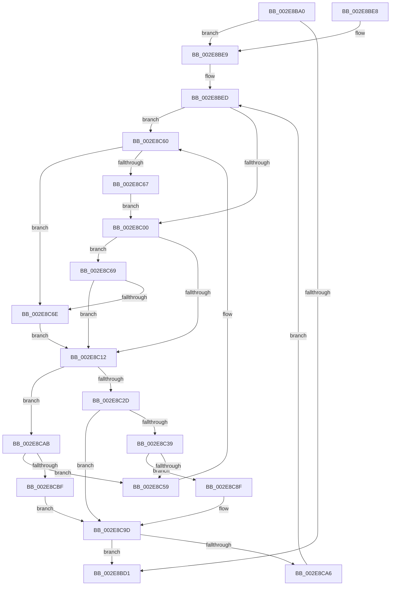

# RtlpHpLfhOwnerFreeListProcess

- RVA: `0x002E8BA0`–`0x002E8CCF` (길이 `303` bytes)
- VA: `0x00000001402E8BA0`
- 실행 섹션: `.text`
- PDB 이름 있음: `예`; PDB Function 태그: `아니요`
- unwind 정보 RVA: `0x0007146C`
- 디코드: `91`개 명령, `303/303` bytes 표시
- 미해석 바이트: `0` (있으면 어셈블리에 `.byte`로 보존)

> 이 문서는 커널 이미지의 기계어와 PDB 기호를 분석해 생성했습니다. 4번과 5번은 함수 원형과 자료형을 바이너리 사용 방식에서 추정한 C 해석이며 원본 소스 복구 결과는 아닙니다.

## 1. Dependencies

- 직접 호출 지점: **4**; 고유 호출 대상: **2**
- 직접 호출자로 확인된 함수: **4**
- RIP 상대 이미지 참조: **0**

### Outgoing calls
- `0x002E8C30` → [RtlpHpLfhOwnerMoveSubsegment](RtlpHpLfhOwnerMoveSubsegment_function_002E85CC.md) (function, `0x002E85CC`)
- `0x002E8C4B` → [RtlpHpLfhOwnerMoveSubsegment](RtlpHpLfhOwnerMoveSubsegment_function_002E85CC.md) (function, `0x002E85CC`)
- `0x002E8C88` → [RtlpHpLfhSubsegmentDelayFreeListProcess](../32/RtlpHpLfhSubsegmentDelayFreeListProcess_function_00323CE0.md) (function, `0x00323CE0`)
- `0x002E8CB1` → [RtlpHpLfhOwnerMoveSubsegment](RtlpHpLfhOwnerMoveSubsegment_function_002E85CC.md) (function, `0x002E85CC`)

### Direct callers
- [RtlpHpLfhOwnerRunMaintenance](RtlpHpLfhOwnerRunMaintenance_function_002E8980.md) at `0x002E8A64`
- [RtlpHpLfhContextSlotAllocate](../4C/RtlpHpLfhContextSlotAllocate_function_004C45BC.md) at `0x004C4645`
- [sub_006DE040](../6D/Unknown_function_006DE040.md) at `0x006DE17E`
- [sub_006F9A96](../6F/Unknown_function_006F9A96.md) at `0x006F9AE1`

### Static image references
- 디코드된 RIP-relative 메모리 참조가 없습니다.

## 2. Other-region calls and transfers

- 다른 실행 섹션으로 향하는 call: **0**
- 별도 외부 분기/꼬리 이동을 확인하지 못했습니다.

## 3. Assembly (complete function range)

```asm
002E8BA0  48 89 5C 24 08                  mov qword ptr [rsp + 8], rbx
002E8BA5  48 89 6C 24 18                  mov qword ptr [rsp + 0x18], rbp
002E8BAA  56                              push rsi
002E8BAB  57                              push rdi
002E8BAC  41 54                           push r12
002E8BAE  41 56                           push r14
002E8BB0  41 57                           push r15
002E8BB2  48 83 EC 30                     sub rsp, 0x30
002E8BB6  45 33 E4                        xor r12d, r12d
002E8BB9  45 8B F1                        mov r14d, r9d
002E8BBC  41 8B FC                        mov edi, r12d
002E8BBF  49 8B F0                        mov rsi, r8
002E8BC2  48 87 7A 08                     xchg qword ptr [rdx + 8], rdi
002E8BC6  48 8B EA                        mov rbp, rdx
002E8BC9  4C 8B F9                        mov r15, rcx
002E8BCC  48 85 FF                        test rdi, rdi
002E8BCF  75 18                           jne 0x1402e8be9
002E8BD1  48 8B 5C 24 60                  mov rbx, qword ptr [rsp + 0x60]
002E8BD6  48 8B 6C 24 70                  mov rbp, qword ptr [rsp + 0x70]
002E8BDB  48 83 C4 30                     add rsp, 0x30
002E8BDF  41 5F                           pop r15
002E8BE1  41 5E                           pop r14
002E8BE3  41 5C                           pop r12
002E8BE5  5F                              pop rdi
002E8BE6  5E                              pop rsi
002E8BE7  C3                              ret
002E8BE8  CC                              int3
002E8BE9  41 83 E6 01                     and r14d, 1
002E8BED  48 8B DF                        mov rbx, rdi
002E8BF0  48 8B 7F 18                     mov rdi, qword ptr [rdi + 0x18]
002E8BF4  48 81 E7 00 F0 FF FF            and rdi, 0xfffffffffffff000
002E8BFB  45 85 F6                        test r14d, r14d
002E8BFE  75 60                           jne 0x1402e8c60
002E8C00  0F B7 53 12                     movzx edx, word ptr [rbx + 0x12]
002E8C04  0F B7 4B 20                     movzx ecx, word ptr [rbx + 0x20]
002E8C08  0F B7 43 22                     movzx eax, word ptr [rbx + 0x22]
002E8C0C  03 CA                           add ecx, edx
002E8C0E  3B C8                           cmp ecx, eax
002E8C10  74 57                           je 0x1402e8c69
002E8C12  0F B7 43 22                     movzx eax, word ptr [rbx + 0x22]
002E8C16  4C 8B C3                        mov r8, rbx
002E8C19  48 8B D5                        mov rdx, rbp
002E8C1C  C7 44 24 20 02 00 00 00         mov dword ptr [rsp + 0x20], 2
002E8C24  49 8B CF                        mov rcx, r15
002E8C27  66 39 43 20                     cmp word ptr [rbx + 0x20], ax
002E8C2B  74 7E                           je 0x1402e8cab
002E8C2D  45 33 C9                        xor r9d, r9d
002E8C30  E8 97 F9 FF FF                  call 0x1402e85cc
002E8C35  85 C0                           test eax, eax
002E8C37  75 64                           jne 0x1402e8c9d
002E8C39  44 8D 48 03                     lea r9d, [rax + 3]
002E8C3D  C7 44 24 20 02 00 00 00         mov dword ptr [rsp + 0x20], 2
002E8C45  48 8B D5                        mov rdx, rbp
002E8C48  49 8B CF                        mov rcx, r15
002E8C4B  E8 7C F9 FF FF                  call 0x1402e85cc
002E8C50  48 8B 46 08                     mov rax, qword ptr [rsi + 8]
002E8C54  48 39 30                        cmp qword ptr [rax], rsi
002E8C57  74 36                           je 0x1402e8c8f
002E8C59  B9 03 00 00 00                  mov ecx, 3
002E8C5E  CD 29                           int 0x29
002E8C60  66 44 39 63 12                  cmp word ptr [rbx + 0x12], r12w
002E8C65  75 07                           jne 0x1402e8c6e
002E8C67  EB 97                           jmp 0x1402e8c00
002E8C69  66 85 D2                        test dx, dx
002E8C6C  74 A4                           je 0x1402e8c12
002E8C6E  41 8B C4                        mov eax, r12d
002E8C71  4C 89 64 24 68                  mov qword ptr [rsp + 0x68], r12
002E8C76  87 43 10                        xchg dword ptr [rbx + 0x10], eax
002E8C79  89 44 24 68                     mov dword ptr [rsp + 0x68], eax
002E8C7D  48 8B D3                        mov rdx, rbx
002E8C80  4C 8B 44 24 68                  mov r8, qword ptr [rsp + 0x68]
002E8C85  49 8B CF                        mov rcx, r15
002E8C88  E8 53 B0 03 00                  call 0x140323ce0
002E8C8D  EB 83                           jmp 0x1402e8c12
002E8C8F  48 89 33                        mov qword ptr [rbx], rsi
002E8C92  48 89 43 08                     mov qword ptr [rbx + 8], rax
002E8C96  48 89 18                        mov qword ptr [rax], rbx
002E8C99  48 89 5E 08                     mov qword ptr [rsi + 8], rbx
002E8C9D  48 85 FF                        test rdi, rdi
002E8CA0  0F 84 2B FF FF FF               je 0x1402e8bd1
002E8CA6  E9 42 FF FF FF                  jmp 0x1402e8bed
002E8CAB  41 B9 03 00 00 00               mov r9d, 3
002E8CB1  E8 16 F9 FF FF                  call 0x1402e85cc
002E8CB6  4C 8B 06                        mov r8, qword ptr [rsi]
002E8CB9  49 39 70 08                     cmp qword ptr [r8 + 8], rsi
002E8CBD  75 9A                           jne 0x1402e8c59
002E8CBF  4C 89 03                        mov qword ptr [rbx], r8
002E8CC2  48 89 73 08                     mov qword ptr [rbx + 8], rsi
002E8CC6  49 89 58 08                     mov qword ptr [r8 + 8], rbx
002E8CCA  48 89 1E                        mov qword ptr [rsi], rbx
002E8CCD  EB CE                           jmp 0x1402e8c9d
```

## 4. C-style interpretation (structured pseudocode)

```c
__int64 __fastcall RtlpHpLfhOwnerFreeListProcess(__int64 a1, __int64 a2, __int64 a3, int a4)
{
    __int64 result;
    __int64 v_r12;
    __int64 v_r14;
    __int64 v_rdi;
    __int64 v_rsp;
    unsigned __int64 v_stack_p18;
    unsigned int v_stack_p20;
    unsigned __int64 v_stack_p68;
    unsigned __int64 v_stack_p8;

    v_stack_p8 = v_rbx;
    v_stack_p18 = v_rbp;
    v_rsp = (v_rsp) - (48);
    v_r12 = 0;
    if (0 != 0) goto loc_002E8BE9;
loc_002E8BD1:
    v_rsp = (v_rsp) + (48);
    return result;
loc_002E8BE9:
    v_r14 = (unsigned int)(((unsigned int)(a4)) & (1));
loc_002E8BED:
    v_rdi = (*(unsigned __int64 *)(0 + 24)) & (0xFFFFFFFFFFFFF000ULL);
    if ((unsigned int)(v_r14) != 0) goto loc_002E8C60;
loc_002E8C00:
    a1 = (unsigned int)((*(unsigned __int16 *)(0 + 32)) + ((unsigned int)(*(unsigned __int16 *)(0 + 18))));
    if (((unsigned int)(a1)) == ((unsigned int)(*(unsigned __int16 *)(0 + 34)))) goto loc_002E8C69;
loc_002E8C12:
    v_stack_p20 = 2;
    if ((*(unsigned __int16 *)(0 + 32)) == ((unsigned __int16)(*(unsigned __int16 *)(0 + 34)))) goto loc_002E8CAB;
    a4 = 0;
    result = RtlpHpLfhOwnerMoveSubsegment(a1, v_stack_p18, 0, a4);
    if ((unsigned int)(result) != 0) goto loc_002E8C9D;
    v_stack_p20 = 2;
    result = RtlpHpLfhOwnerMoveSubsegment(a1, v_stack_p18, 0, result + 3);
    if ((*(unsigned __int64 *)(*(unsigned __int64 *)(a3 + 8))) == a3) goto loc_002E8C8F;
loc_002E8C59:
loc_002E8C60:
    if ((*(unsigned __int16 *)(0 + 18)) != 0) goto loc_002E8C6E;
    goto loc_002E8C00;
loc_002E8C69:
    if ((unsigned __int16)(v_stack_p18) == 0) goto loc_002E8C12;
loc_002E8C6E:
    v_stack_p68 = 0;
    v_stack_p68 = 0;
    result = RtlpHpLfhSubsegmentDelayFreeListProcess(a1, 0, v_stack_p68, result + 3);
    goto loc_002E8C12;
loc_002E8C8F:
    *(unsigned __int64 *)(0) = a3;
    *(unsigned __int64 *)(0 + 8) = result;
    *(unsigned __int64 *)(result) = 0;
    *(unsigned __int64 *)(a3 + 8) = 0;
loc_002E8C9D:
    if (v_rdi == 0) goto loc_002E8BD1;
    goto loc_002E8BED;
loc_002E8CAB:
    result = RtlpHpLfhOwnerMoveSubsegment(a1, 0, v_stack_p68, 3);
    if ((*(unsigned __int64 *)(*(unsigned __int64 *)(a3) + 8)) != a3) goto loc_002E8C59;
    *(unsigned __int64 *)(0) = *(unsigned __int64 *)(a3);
    *(unsigned __int64 *)(0 + 8) = a3;
    *(unsigned __int64 *)(*(unsigned __int64 *)(a3) + 8) = 0;
    *(unsigned __int64 *)(a3) = 0;
    goto loc_002E8C9D;
}
```

## 5. (Beta) C Style

```c
int64_t RtlpHpLfhOwnerFreeListProcess(int64_t Arg1, void *Arg2, void *Arg3, int32_t Arg4)
{
    uint8_t *arg2 = (uint8_t *)Arg2;
    uint8_t *arg3 = (uint8_t *)Arg3;

    int64_t result;
    int64_t local_r12;
    int64_t local_r14;
    int64_t local_rdi;
    int64_t local_rsp;
    uint64_t v_stack_p18;
    uint32_t v_stack_p20;
    uint64_t v_stack_p68;
    uint64_t v_stack_p8;

    v_stack_p8 = local_rbx;
    v_stack_p18 = local_rbp;
    local_rsp = (local_rsp) - (48);
    local_r12 = 0;
    if (0 != 0) goto loc_002E8BE9;
loc_002E8BD1:
    local_rsp = (local_rsp) + (48);
    return result;
loc_002E8BE9:
    local_r14 = (uint32_t)(((uint32_t)(Arg4)) & (1));
loc_002E8BED:
    local_rdi = (*(uint64_t *)(0 + 0x18)) & (0xFFFFFFFFFFFFF000ULL);
    if ((uint32_t)(local_r14) != 0) goto loc_002E8C60;
loc_002E8C00:
    Arg1 = (uint32_t)((*(uint16_t *)(0 + 0x20)) + ((uint32_t)(*(uint16_t *)(0 + 0x12))));
    if (((uint32_t)(Arg1)) == ((uint32_t)(*(uint16_t *)(0 + 0x22)))) goto loc_002E8C69;
loc_002E8C12:
    v_stack_p20 = 2;
    if ((*(uint16_t *)(0 + 0x20)) == ((uint16_t)(*(uint16_t *)(0 + 0x22)))) goto loc_002E8CAB;
    Arg4 = 0;
    result = RtlpHpLfhOwnerMoveSubsegment(Arg1, v_stack_p18, 0, Arg4);
    if ((uint32_t)(result) != 0) goto loc_002E8C9D;
    v_stack_p20 = 2;
    result = RtlpHpLfhOwnerMoveSubsegment(Arg1, v_stack_p18, 0, result + 3);
    if ((*(uint64_t *)(*(uint64_t *)(arg3 + 0x8))) == Arg3) goto loc_002E8C8F;
loc_002E8C59:
loc_002E8C60:
    if ((*(uint16_t *)(0 + 0x12)) != 0) goto loc_002E8C6E;
    goto loc_002E8C00;
loc_002E8C69:
    if ((uint16_t)(v_stack_p18) == 0) goto loc_002E8C12;
loc_002E8C6E:
    v_stack_p68 = 0;
    v_stack_p68 = 0;
    result = RtlpHpLfhSubsegmentDelayFreeListProcess(Arg1, 0, v_stack_p68, result + 3);
    goto loc_002E8C12;
loc_002E8C8F:
    *(void **)(0) = Arg3;
    *(uint64_t *)(0 + 0x8) = result;
    *(uint64_t *)(result) = 0;
    *(uint64_t *)(arg3 + 0x8) = 0;
loc_002E8C9D:
    if (local_rdi == 0) goto loc_002E8BD1;
    goto loc_002E8BED;
loc_002E8CAB:
    result = RtlpHpLfhOwnerMoveSubsegment(Arg1, 0, v_stack_p68, 3);
    if ((*(uint64_t *)(*(uint64_t *)(arg3) + 0x8)) != Arg3) goto loc_002E8C59;
    *(uint64_t *)(0) = *(uint64_t *)(arg3);
    *(void **)(0 + 0x8) = Arg3;
    *(uint64_t *)(*(uint64_t *)(arg3) + 0x8) = 0;
    *(uint64_t *)(arg3) = 0;
    goto loc_002E8C9D;
}
```

### 관측된 메모리 오프셋

구조체 형식이 확인되지 않은 접근은 인자 기준의 오프셋으로만 기록했습니다.

| 기준 인자 | 오프셋 표현 | 폭 (bit) | 접근 |
|---|---:|---:|---|
| `Arg2` | `+ 0x8` | `64` | `R/W` |
| `Arg3` | `+ 0x0` | `64` | `R` |
| `Arg3` | `+ 0x0` | `64` | `W` |
| `Arg3` | `+ 0x8` | `64` | `R` |
| `Arg3` | `+ 0x8` | `64` | `W` |

## 6. Execution-region graph

[열기: 2D/3D 그래프와 함수 탐색 컨트롤 패널](../../../control-panel.html?section=text&rva=0x002E8BA0&view=graph)

- 2D 그래프는 위에서 아래로 흐르고, 3D 그래프는 빈 공간을 드래그해 회전합니다. Shift+드래그는 이동, 휠은 확대·축소, 함수 노드 선택은 대상 보고서 이동입니다.

### Static fallback


