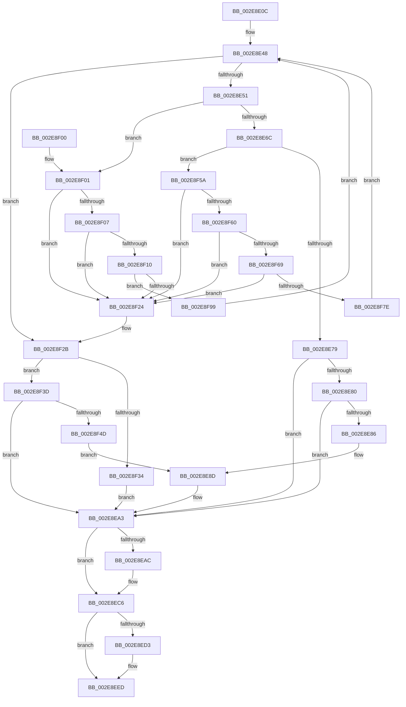

# RtlpHpLfhOwnerGetSubsegment

- RVA: `0x002E8E0C`–`0x002E8FB4` (길이 `424` bytes)
- VA: `0x00000001402E8E0C`
- 실행 섹션: `.text`
- PDB 이름 있음: `예`; PDB Function 태그: `아니요`
- unwind 정보 RVA: `0x000714A8`
- 디코드: `120`개 명령, `424/424` bytes 표시
- 미해석 바이트: `0` (있으면 어셈블리에 `.byte`로 보존)

> 이 문서는 커널 이미지의 기계어와 PDB 기호를 분석해 생성했습니다. 4번과 5번은 함수 원형과 자료형을 바이너리 사용 방식에서 추정한 C 해석이며 원본 소스 복구 결과는 아닙니다.

## 1. Dependencies

- 직접 호출 지점: **1**; 고유 호출 대상: **1**
- 직접 호출자로 확인된 함수: **2**
- RIP 상대 이미지 참조: **0**

### Outgoing calls
- `0x002E8E9A` → [RtlpHpLfhSubsegmentDelayFreeListProcess](../32/RtlpHpLfhSubsegmentDelayFreeListProcess_function_00323CE0.md) (function, `0x00323CE0`)

### Direct callers
- [RtlpHpLfhBucketGetSubsegment](RtlpHpLfhBucketGetSubsegment_function_002E8474.md) at `0x002E84BE`
- [RtlpHpLfhSlotAllocateSlow](RtlpHpLfhSlotAllocateSlow_function_002E8FBC.md) at `0x002E9164`

### Static image references
- 디코드된 RIP-relative 메모리 참조가 없습니다.

## 2. Other-region calls and transfers

- 다른 실행 섹션으로 향하는 call: **0**
- 별도 외부 분기/꼬리 이동을 확인하지 못했습니다.

## 3. Assembly (complete function range)

```asm
002E8E0C  48 89 5C 24 08                  mov qword ptr [rsp + 8], rbx
002E8E11  48 89 7C 24 18                  mov qword ptr [rsp + 0x18], rdi
002E8E16  55                              push rbp
002E8E17  48 8B EC                        mov rbp, rsp
002E8E1A  48 83 EC 40                     sub rsp, 0x40
002E8E1E  48 8D 45 F0                     lea rax, [rbp - 0x10]
002E8E22  4C 8B D9                        mov r11, rcx
002E8E25  48 89 45 F8                     mov qword ptr [rbp - 8], rax
002E8E29  4C 8D 45 E0                     lea r8, [rbp - 0x20]
002E8E2D  48 8D 45 F0                     lea rax, [rbp - 0x10]
002E8E31  4C 89 45 E0                     mov qword ptr [rbp - 0x20], r8
002E8E35  48 89 45 F0                     mov qword ptr [rbp - 0x10], rax
002E8E39  48 8D 7A 18                     lea rdi, [rdx + 0x18]
002E8E3D  48 8B 17                        mov rdx, qword ptr [rdi]
002E8E40  48 8D 45 E0                     lea rax, [rbp - 0x20]
002E8E44  48 89 45 E8                     mov qword ptr [rbp - 0x18], rax
002E8E48  48 3B D7                        cmp rdx, rdi
002E8E4B  0F 84 DA 00 00 00               je 0x1402e8f2b
002E8E51  48 8B DA                        mov rbx, rdx
002E8E54  48 8B 12                        mov rdx, qword ptr [rdx]
002E8E57  0F B7 4B 12                     movzx ecx, word ptr [rbx + 0x12]
002E8E5B  44 0F B7 53 20                  movzx r10d, word ptr [rbx + 0x20]
002E8E60  44 8B C9                        mov r9d, ecx
002E8E63  45 03 CA                        add r9d, r10d
002E8E66  0F 84 95 00 00 00               je 0x1402e8f01
002E8E6C  0F B7 43 22                     movzx eax, word ptr [rbx + 0x22]
002E8E70  44 3B C8                        cmp r9d, eax
002E8E73  0F 84 E1 00 00 00               je 0x1402e8f5a
002E8E79  33 C0                           xor eax, eax
002E8E7B  66 85 C9                        test cx, cx
002E8E7E  74 23                           je 0x1402e8ea3
002E8E80  66 41 3B CA                     cmp cx, r10w
002E8E84  72 1D                           jb 0x1402e8ea3
002E8E86  48 89 45 18                     mov qword ptr [rbp + 0x18], rax
002E8E8A  87 43 10                        xchg dword ptr [rbx + 0x10], eax
002E8E8D  89 45 18                        mov dword ptr [rbp + 0x18], eax
002E8E90  48 8B D3                        mov rdx, rbx
002E8E93  4C 8B 45 18                     mov r8, qword ptr [rbp + 0x18]
002E8E97  49 8B CB                        mov rcx, r11
002E8E9A  E8 41 AE 03 00                  call 0x140323ce0
002E8E9F  4C 8B 45 E0                     mov r8, qword ptr [rbp - 0x20]
002E8EA3  48 8D 45 E0                     lea rax, [rbp - 0x20]
002E8EA7  4C 3B C0                        cmp r8, rax
002E8EAA  74 1A                           je 0x1402e8ec6
002E8EAC  48 8B 4F 08                     mov rcx, qword ptr [rdi + 8]
002E8EB0  4C 89 01                        mov qword ptr [rcx], r8
002E8EB3  48 8B 45 E8                     mov rax, qword ptr [rbp - 0x18]
002E8EB7  48 89 47 08                     mov qword ptr [rdi + 8], rax
002E8EBB  48 89 38                        mov qword ptr [rax], rdi
002E8EBE  48 8B 45 E0                     mov rax, qword ptr [rbp - 0x20]
002E8EC2  48 89 48 08                     mov qword ptr [rax + 8], rcx
002E8EC6  48 8B 45 F0                     mov rax, qword ptr [rbp - 0x10]
002E8ECA  48 8D 4D F0                     lea rcx, [rbp - 0x10]
002E8ECE  48 3B C1                        cmp rax, rcx
002E8ED1  74 1A                           je 0x1402e8eed
002E8ED3  48 8B 57 08                     mov rdx, qword ptr [rdi + 8]
002E8ED7  48 89 02                        mov qword ptr [rdx], rax
002E8EDA  48 8B 4D F8                     mov rcx, qword ptr [rbp - 8]
002E8EDE  48 89 4F 08                     mov qword ptr [rdi + 8], rcx
002E8EE2  48 89 39                        mov qword ptr [rcx], rdi
002E8EE5  48 8B 4D F0                     mov rcx, qword ptr [rbp - 0x10]
002E8EE9  48 89 51 08                     mov qword ptr [rcx + 8], rdx
002E8EED  48 8B 7C 24 60                  mov rdi, qword ptr [rsp + 0x60]
002E8EF2  48 8B C3                        mov rax, rbx
002E8EF5  48 8B 5C 24 50                  mov rbx, qword ptr [rsp + 0x50]
002E8EFA  48 83 C4 40                     add rsp, 0x40
002E8EFE  5D                              pop rbp
002E8EFF  C3                              ret
002E8F00  CC                              int3
002E8F01  48 39 5A 08                     cmp qword ptr [rdx + 8], rbx
002E8F05  75 1D                           jne 0x1402e8f24
002E8F07  48 8B 43 08                     mov rax, qword ptr [rbx + 8]
002E8F0B  48 39 18                        cmp qword ptr [rax], rbx
002E8F0E  75 14                           jne 0x1402e8f24
002E8F10  48 89 10                        mov qword ptr [rax], rdx
002E8F13  48 8D 4D F0                     lea rcx, [rbp - 0x10]
002E8F17  48 89 42 08                     mov qword ptr [rdx + 8], rax
002E8F1B  48 8B 45 F8                     mov rax, qword ptr [rbp - 8]
002E8F1F  48 39 08                        cmp qword ptr [rax], rcx
002E8F22  74 75                           je 0x1402e8f99
002E8F24  B9 03 00 00 00                  mov ecx, 3
002E8F29  CD 29                           int 0x29
002E8F2B  48 8D 45 E0                     lea rax, [rbp - 0x20]
002E8F2F  4C 3B C0                        cmp r8, rax
002E8F32  75 09                           jne 0x1402e8f3d
002E8F34  33 C0                           xor eax, eax
002E8F36  8B D8                           mov ebx, eax
002E8F38  E9 66 FF FF FF                  jmp 0x1402e8ea3
002E8F3D  33 C0                           xor eax, eax
002E8F3F  49 8B D8                        mov rbx, r8
002E8F42  66 41 39 40 12                  cmp word ptr [r8 + 0x12], ax
002E8F47  0F 84 56 FF FF FF               je 0x1402e8ea3
002E8F4D  48 89 45 18                     mov qword ptr [rbp + 0x18], rax
002E8F51  41 87 40 10                     xchg dword ptr [r8 + 0x10], eax
002E8F55  E9 33 FF FF FF                  jmp 0x1402e8e8d
002E8F5A  48 39 5A 08                     cmp qword ptr [rdx + 8], rbx
002E8F5E  75 C4                           jne 0x1402e8f24
002E8F60  48 8B 43 08                     mov rax, qword ptr [rbx + 8]
002E8F64  48 39 18                        cmp qword ptr [rax], rbx
002E8F67  75 BB                           jne 0x1402e8f24
002E8F69  48 89 10                        mov qword ptr [rax], rdx
002E8F6C  48 8D 4D E0                     lea rcx, [rbp - 0x20]
002E8F70  48 89 42 08                     mov qword ptr [rdx + 8], rax
002E8F74  48 8B 45 E0                     mov rax, qword ptr [rbp - 0x20]
002E8F78  48 39 48 08                     cmp qword ptr [rax + 8], rcx
002E8F7C  75 A6                           jne 0x1402e8f24
002E8F7E  48 89 03                        mov qword ptr [rbx], rax
002E8F81  48 8D 4D E0                     lea rcx, [rbp - 0x20]
002E8F85  48 89 4B 08                     mov qword ptr [rbx + 8], rcx
002E8F89  4C 8B C3                        mov r8, rbx
002E8F8C  48 89 58 08                     mov qword ptr [rax + 8], rbx
002E8F90  48 89 5D E0                     mov qword ptr [rbp - 0x20], rbx
002E8F94  E9 AF FE FF FF                  jmp 0x1402e8e48
002E8F99  48 89 43 08                     mov qword ptr [rbx + 8], rax
002E8F9D  48 8D 4D F0                     lea rcx, [rbp - 0x10]
002E8FA1  48 89 0B                        mov qword ptr [rbx], rcx
002E8FA4  48 89 18                        mov qword ptr [rax], rbx
002E8FA7  4C 8B 45 E0                     mov r8, qword ptr [rbp - 0x20]
002E8FAB  48 89 5D F8                     mov qword ptr [rbp - 8], rbx
002E8FAF  E9 94 FE FF FF                  jmp 0x1402e8e48
```

## 4. C-style interpretation (structured pseudocode)

```c
__int64 __fastcall RtlpHpLfhOwnerGetSubsegment(__int64 a1, __int64 a2)
{
    __int64 result;
    __int64 v_rsp;
    unsigned __int64 v_stack_m10;
    unsigned __int64 v_stack_m18;
    unsigned __int64 v_stack_m20;
    unsigned __int64 v_stack_m28;
    unsigned __int64 v_stack_p10;
    unsigned __int64 v_stack_p18;
    unsigned __int64 v_stack_p8;

    v_stack_p8 = v_rbx;
    v_stack_p18 = v_rdi;
    v_rsp = (v_rsp) - (64);
    v_stack_m10 = v_stack_m18;
    v_stack_m28 = v_stack_m28;
    v_stack_m18 = v_stack_m18;
    v_stack_m20 = v_stack_m28;
loc_002E8E48:
    if ((*(unsigned __int64 *)(a2 + 24)) == (a2 + 24)) goto loc_002E8F2B;
    a4 = (unsigned int)(((unsigned int)((unsigned int)(*(unsigned __int16 *)(*(unsigned __int64 *)(a2 + 24) + 18)))) + ((unsigned int)(*(unsigned __int16 *)(*(unsigned __int64 *)(a2 + 24) + 32))));
    if (condition_is_equal) goto loc_002E8F01;
    if (((unsigned int)(a4)) == ((unsigned int)(*(unsigned __int16 *)(*(unsigned __int64 *)(a2 + 24) + 34)))) goto loc_002E8F5A;
    result = 0;
    if ((unsigned __int16)(*(unsigned __int16 *)(*(unsigned __int64 *)(a2 + 24) + 18)) == 0) goto loc_002E8EA3;
    if (((unsigned __int16)(*(unsigned __int16 *)(*(unsigned __int64 *)(a2 + 24) + 18))) < ((unsigned __int16)(*(unsigned __int16 *)(*(unsigned __int64 *)(a2 + 24) + 32)))) goto loc_002E8EA3;
    v_stack_p10 = 0;
loc_002E8E8D:
    v_stack_p10 = 0;
    result = RtlpHpLfhSubsegmentDelayFreeListProcess(a1, *(unsigned __int64 *)(a2 + 24), v_stack_p10, a4);
loc_002E8EA3:
    result = v_stack_m28;
    if (v_stack_m28 != v_stack_m28) {
        a1 = *(unsigned __int64 *)(a2 + 24 + 8);
        *(unsigned __int64 *)(a1) = v_stack_m28;
        result = v_stack_m20;
        *(unsigned __int64 *)(a2 + 24 + 8) = result;
        *(unsigned __int64 *)(result) = a2 + 24;
        result = v_stack_m28;
        *(unsigned __int64 *)(result + 8) = a1;
    }
    if (v_stack_m18 != v_stack_m18) {
        a2 = *(unsigned __int64 *)(a2 + 24 + 8);
        *(unsigned __int64 *)(a2) = v_stack_m18;
        a1 = v_stack_m10;
        *(unsigned __int64 *)(a2 + 24 + 8) = a1;
        *(unsigned __int64 *)(a1) = a2 + 24;
        a1 = v_stack_m18;
        *(unsigned __int64 *)(a1 + 8) = a2;
    }
    v_rsp = (v_rsp) + (64);
    return *(unsigned __int64 *)(a2 + 24);
loc_002E8F01:
    if ((*(unsigned __int64 *)(a2 + 8)) != v_stack_p8) goto loc_002E8F24;
    if ((*(unsigned __int64 *)(*(unsigned __int64 *)(v_stack_p8 + 8))) != v_stack_p8) goto loc_002E8F24;
    *(unsigned __int64 *)(*(unsigned __int64 *)(v_stack_p8 + 8)) = a2;
    *(unsigned __int64 *)(a2 + 8) = *(unsigned __int64 *)(v_stack_p8 + 8);
    if ((*(unsigned __int64 *)(v_stack_m10)) == v_stack_m18) goto loc_002E8F99;
loc_002E8F24:
loc_002E8F2B:
    if (v_stack_m28 != v_stack_m28) goto loc_002E8F3D;
    result = 0;
    goto loc_002E8EA3;
loc_002E8F3D:
    result = 0;
    if ((*(unsigned __int16 *)(v_stack_m28 + 18)) == 0) goto loc_002E8EA3;
    v_stack_p10 = 0;
    goto loc_002E8E8D;
loc_002E8F5A:
    if ((*(unsigned __int64 *)(a2 + 8)) != v_stack_m28) goto loc_002E8F24;
    if ((*(unsigned __int64 *)(*(unsigned __int64 *)(v_stack_m28 + 8))) != v_stack_m28) goto loc_002E8F24;
    *(unsigned __int64 *)(*(unsigned __int64 *)(v_stack_m28 + 8)) = a2;
    *(unsigned __int64 *)(a2 + 8) = *(unsigned __int64 *)(v_stack_m28 + 8);
    if ((*(unsigned __int64 *)(v_stack_m28 + 8)) != v_stack_m28) goto loc_002E8F24;
    *(unsigned __int64 *)(v_stack_m28) = v_stack_m28;
    *(unsigned __int64 *)(v_stack_m28 + 8) = v_stack_m28;
    *(unsigned __int64 *)(v_stack_m28 + 8) = v_stack_m28;
    v_stack_m28 = v_stack_m28;
    goto loc_002E8E48;
loc_002E8F99:
    *(unsigned __int64 *)(v_stack_m28 + 8) = v_stack_m28;
    *(unsigned __int64 *)(v_stack_m28) = v_stack_m18;
    *(unsigned __int64 *)(v_stack_m28) = v_stack_m28;
    v_stack_m10 = v_stack_m28;
    goto loc_002E8E48;
}
```

## 5. (Beta) C Style

```c
int64_t RtlpHpLfhOwnerGetSubsegment(int64_t Arg1, void *Arg2)
{
    uint8_t *arg2 = (uint8_t *)Arg2;

    int64_t result;
    int64_t local_rsp;
    uint64_t v_stack_m10;
    uint64_t v_stack_m18;
    uint64_t v_stack_m20;
    uint64_t v_stack_m28;
    uint64_t v_stack_p10;
    uint64_t v_stack_p18;
    uint64_t v_stack_p8;

    v_stack_p8 = local_rbx;
    v_stack_p18 = local_rdi;
    local_rsp = (local_rsp) - (64);
    v_stack_m10 = v_stack_m18;
    v_stack_m28 = v_stack_m28;
    v_stack_m18 = v_stack_m18;
    v_stack_m20 = v_stack_m28;
loc_002E8E48:
    if ((*(uint64_t *)(arg2 + 0x18)) == (Arg2 + 24)) goto loc_002E8F2B;
    a4 = (uint32_t)(((uint32_t)((uint32_t)(*(uint16_t *)(*(uint64_t *)(arg2 + 0x18) + 0x12)))) + ((uint32_t)(*(uint16_t *)(*(uint64_t *)(arg2 + 0x18) + 0x20))));
    if (condition_is_equal) goto loc_002E8F01;
    if (((uint32_t)(a4)) == ((uint32_t)(*(uint16_t *)(*(uint64_t *)(arg2 + 0x18) + 0x22)))) goto loc_002E8F5A;
    result = 0;
    if ((uint16_t)(*(uint16_t *)(*(uint64_t *)(arg2 + 0x18) + 0x12)) == 0) goto loc_002E8EA3;
    if (((uint16_t)(*(uint16_t *)(*(uint64_t *)(arg2 + 0x18) + 0x12))) < ((uint16_t)(*(uint16_t *)(*(uint64_t *)(arg2 + 0x18) + 0x20)))) goto loc_002E8EA3;
    v_stack_p10 = 0;
loc_002E8E8D:
    v_stack_p10 = 0;
    result = RtlpHpLfhSubsegmentDelayFreeListProcess(Arg1, *(uint64_t *)(arg2 + 0x18), v_stack_p10, a4);
loc_002E8EA3:
    result = v_stack_m28;
    if (v_stack_m28 != v_stack_m28) {
        Arg1 = *(uint64_t *)(arg2 + 0x18 + 0x8);
        *(uint64_t *)(Arg1) = v_stack_m28;
        result = v_stack_m20;
        *(uint64_t *)(arg2 + 0x18 + 0x8) = result;
        *(void **)(result) = Arg2 + 24;
        result = v_stack_m28;
        *(uint64_t *)(result + 0x8) = Arg1;
    }
    if (v_stack_m18 != v_stack_m18) {
        Arg2 = *(uint64_t *)(arg2 + 0x18 + 0x8);
        *(uint64_t *)(arg2) = v_stack_m18;
        Arg1 = v_stack_m10;
        *(uint64_t *)(arg2 + 0x18 + 0x8) = Arg1;
        *(void **)(Arg1) = Arg2 + 24;
        Arg1 = v_stack_m18;
        *(void **)(Arg1 + 0x8) = Arg2;
    }
    local_rsp = (local_rsp) + (64);
    return *(uint64_t *)(arg2 + 0x18);
loc_002E8F01:
    if ((*(uint64_t *)(arg2 + 0x8)) != v_stack_p8) goto loc_002E8F24;
    if ((*(uint64_t *)(*(uint64_t *)(v_stack_p8 + 0x8))) != v_stack_p8) goto loc_002E8F24;
    *(void **)(*(uint64_t *)(v_stack_p8 + 0x8)) = Arg2;
    *(uint64_t *)(arg2 + 0x8) = *(uint64_t *)(v_stack_p8 + 0x8);
    if ((*(uint64_t *)(v_stack_m10)) == v_stack_m18) goto loc_002E8F99;
loc_002E8F24:
loc_002E8F2B:
    if (v_stack_m28 != v_stack_m28) goto loc_002E8F3D;
    result = 0;
    goto loc_002E8EA3;
loc_002E8F3D:
    result = 0;
    if ((*(uint16_t *)(v_stack_m28 + 0x12)) == 0) goto loc_002E8EA3;
    v_stack_p10 = 0;
    goto loc_002E8E8D;
loc_002E8F5A:
    if ((*(uint64_t *)(arg2 + 0x8)) != v_stack_m28) goto loc_002E8F24;
    if ((*(uint64_t *)(*(uint64_t *)(v_stack_m28 + 0x8))) != v_stack_m28) goto loc_002E8F24;
    *(void **)(*(uint64_t *)(v_stack_m28 + 0x8)) = Arg2;
    *(uint64_t *)(arg2 + 0x8) = *(uint64_t *)(v_stack_m28 + 0x8);
    if ((*(uint64_t *)(v_stack_m28 + 0x8)) != v_stack_m28) goto loc_002E8F24;
    *(uint64_t *)(v_stack_m28) = v_stack_m28;
    *(uint64_t *)(v_stack_m28 + 0x8) = v_stack_m28;
    *(uint64_t *)(v_stack_m28 + 0x8) = v_stack_m28;
    v_stack_m28 = v_stack_m28;
    goto loc_002E8E48;
loc_002E8F99:
    *(uint64_t *)(v_stack_m28 + 0x8) = v_stack_m28;
    *(uint64_t *)(v_stack_m28) = v_stack_m18;
    *(uint64_t *)(v_stack_m28) = v_stack_m28;
    v_stack_m10 = v_stack_m28;
    goto loc_002E8E48;
}
```

### 관측된 메모리 오프셋

구조체 형식이 확인되지 않은 접근은 인자 기준의 오프셋으로만 기록했습니다.

| 기준 인자 | 오프셋 표현 | 폭 (bit) | 접근 |
|---|---:|---:|---|
| `Arg2` | `+ 0x0` | `64` | `R` |
| `Arg2` | `+ 0x8` | `64` | `R` |
| `Arg2` | `+ 0x8` | `64` | `W` |
| `Arg2` | `+ 0x18` | `64` | `R` |

## 6. Execution-region graph

[열기: 2D/3D 그래프와 함수 탐색 컨트롤 패널](../../../control-panel.html?section=text&rva=0x002E8E0C&view=graph)

- 2D 그래프는 위에서 아래로 흐르고, 3D 그래프는 빈 공간을 드래그해 회전합니다. Shift+드래그는 이동, 휠은 확대·축소, 함수 노드 선택은 대상 보고서 이동입니다.

### Static fallback


