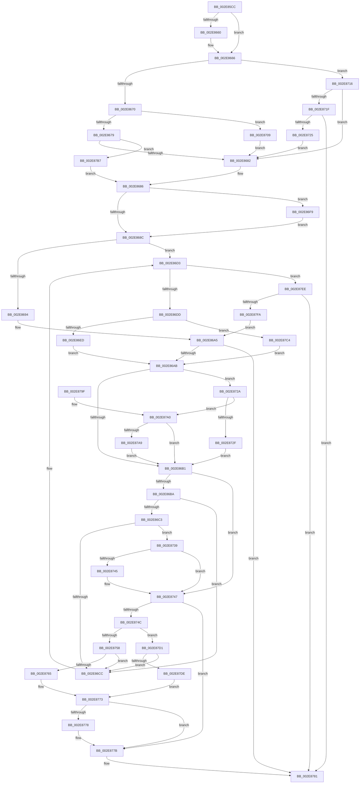

# RtlpHpLfhOwnerMoveSubsegment

- RVA: `0x002E85CC`–`0x002E880C` (길이 `576` bytes)
- VA: `0x00000001402E85CC`
- 실행 섹션: `.text`
- PDB 이름 있음: `예`; PDB Function 태그: `아니요`
- unwind 정보 RVA: `0x00071418`
- 디코드: `163`개 명령, `576/576` bytes 표시
- 미해석 바이트: `0` (있으면 어셈블리에 `.byte`로 보존)

> 이 문서는 커널 이미지의 기계어와 PDB 기호를 분석해 생성했습니다. 4번과 5번은 함수 원형과 자료형을 바이너리 사용 방식에서 추정한 C 해석이며 원본 소스 복구 결과는 아닙니다.

## 1. Dependencies

- 직접 호출 지점: **1**; 고유 호출 대상: **1**
- 직접 호출자로 확인된 함수: **7**
- RIP 상대 이미지 참조: **1**

### Outgoing calls
- `0x002E878B` → [_security_check_cookie](../6A/_security_check_cookie_function_006AC640.md) (function, `0x006AC640`)

### Direct callers
- [RtlpHpLfhOwnerCompact](RtlpHpLfhOwnerCompact_function_002E785C.md) at `0x002E79B3`
- [RtlpHpLfhBucketGetSubsegment](RtlpHpLfhBucketGetSubsegment_function_002E8474.md) at `0x002E84E3`
- [RtlpHpLfhOwnerRunMaintenance](RtlpHpLfhOwnerRunMaintenance_function_002E8980.md) at `0x002E8A00`
- [RtlpHpLfhOwnerRunMaintenance](RtlpHpLfhOwnerRunMaintenance_function_002E8980.md) at `0x002E8B1F`
- [RtlpHpLfhOwnerRunMaintenance](RtlpHpLfhOwnerRunMaintenance_function_002E8980.md) at `0x002E8B5E`
- [RtlpHpLfhOwnerFreeListProcess](RtlpHpLfhOwnerFreeListProcess_function_002E8BA0.md) at `0x002E8C30`
- [RtlpHpLfhOwnerFreeListProcess](RtlpHpLfhOwnerFreeListProcess_function_002E8BA0.md) at `0x002E8C4B`
- [RtlpHpLfhOwnerFreeListProcess](RtlpHpLfhOwnerFreeListProcess_function_002E8BA0.md) at `0x002E8CB1`
- [RtlpHpLfhBucketAddSubsegment](RtlpHpLfhBucketAddSubsegment_function_002E8CD8.md) at `0x002E8D5A`
- [RtlpHpLfhSlotAllocateSlow](RtlpHpLfhSlotAllocateSlow_function_002E8FBC.md) at `0x002E95DB`
- [RtlpHpLfhPrivateSlotShutdown](../60/RtlpHpLfhPrivateSlotShutdown_function_0060502C.md) at `0x006050B5`
- [RtlpHpLfhPrivateSlotShutdown](../60/RtlpHpLfhPrivateSlotShutdown_function_0060502C.md) at `0x00605111`

### Static image references
- `0x002E85DE` → RVA `0x00E0A740` (`.data`; read)

## 2. Other-region calls and transfers

- 다른 실행 섹션으로 향하는 call: **0**
- 별도 외부 분기/꼬리 이동을 확인하지 못했습니다.

## 3. Assembly (complete function range)

```asm
002E85CC  40 55                           push rbp
002E85CE  53                              push rbx
002E85CF  56                              push rsi
002E85D0  57                              push rdi
002E85D1  41 54                           push r12
002E85D3  41 56                           push r14
002E85D5  41 57                           push r15
002E85D7  48 8B EC                        mov rbp, rsp
002E85DA  48 83 EC 60                     sub rsp, 0x60
002E85DE  48 8B 05 5B 21 B2 00            mov rax, qword ptr [rip + 0xb2215b]
002E85E5  48 33 C4                        xor rax, rsp
002E85E8  48 89 45 F0                     mov qword ptr [rbp - 0x10], rax
002E85EC  48 8D 42 18                     lea rax, [rdx + 0x18]
002E85F0  49 63 D9                        movsxd rbx, r9d
002E85F3  48 89 45 B0                     mov qword ptr [rbp - 0x50], rax
002E85F7  4C 8B F9                        mov r15, rcx
002E85FA  48 8D 42 01                     lea rax, [rdx + 1]
002E85FE  48 8B F2                        mov rsi, rdx
002E8601  48 89 45 B8                     mov qword ptr [rbp - 0x48], rax
002E8605  45 33 C9                        xor r9d, r9d
002E8608  48 8D 42 28                     lea rax, [rdx + 0x28]
002E860C  4C 89 4D C8                     mov qword ptr [rbp - 0x38], r9
002E8610  48 89 45 C0                     mov qword ptr [rbp - 0x40], rax
002E8614  0F 57 C0                        xorps xmm0, xmm0
002E8617  48 89 45 D0                     mov qword ptr [rbp - 0x30], rax
002E861B  49 8B 40 10                     mov rax, qword ptr [r8 + 0x10]
002E861F  44 8A 36                        mov r14b, byte ptr [rsi]
002E8622  48 8B C8                        mov rcx, rax
002E8625  48 C1 E9 30                     shr rcx, 0x30
002E8629  4C 89 4D D8                     mov qword ptr [rbp - 0x28], r9
002E862D  66 0F 7F 45 E0                  movdqa xmmword ptr [rbp - 0x20], xmm0
002E8632  0F B6 D1                        movzx edx, cl
002E8635  48 8B CB                        mov rcx, rbx
002E8638  48 03 C9                        add rcx, rcx
002E863B  48 89 45 A8                     mov qword ptr [rbp - 0x58], rax
002E863F  48 03 D2                        add rdx, rdx
002E8642  48 89 45 A0                     mov qword ptr [rbp - 0x60], rax
002E8646  4C 8B 54 CD B0                  mov r10, qword ptr [rbp + rcx*8 - 0x50]
002E864B  4C 8B 5C CD B8                  mov r11, qword ptr [rbp + rcx*8 - 0x48]
002E8650  4C 8B 64 D5 B0                  mov r12, qword ptr [rbp + rdx*8 - 0x50]
002E8655  48 8B 7C D5 B8                  mov rdi, qword ptr [rbp + rdx*8 - 0x48]
002E865A  41 80 E6 01                     and r14b, 1
002E865E  74 06                           je 0x1402e8666
002E8660  41 8B F9                        mov edi, r9d
002E8663  45 8B D9                        mov r11d, r9d
002E8666  8B D3                           mov edx, ebx
002E8668  85 DB                           test ebx, ebx
002E866A  0F 84 A6 00 00 00               je 0x1402e8716
002E8670  83 EA 01                        sub edx, 1
002E8673  0F 84 90 00 00 00               je 0x1402e8709
002E8679  83 FA 02                        cmp edx, 2
002E867C  0F 84 35 01 00 00               je 0x1402e87b7
002E8682  0F B7 55 A4                     movzx edx, word ptr [rbp - 0x5c]
002E8686  80 7D AE 03                     cmp byte ptr [rbp - 0x52], 3
002E868A  74 6D                           je 0x1402e86f9
002E868C  88 5D A6                        mov byte ptr [rbp - 0x5a], bl
002E868F  83 FB 01                        cmp ebx, 1
002E8692  75 3F                           jne 0x1402e86d3
002E8694  48 8B 4D A0                     mov rcx, qword ptr [rbp - 0x60]
002E8698  F0 49 0F B1 48 10               lock cmpxchg qword ptr [r8 + 0x10], rcx
002E869E  48 89 45 A8                     mov qword ptr [rbp - 0x58], rax
002E86A2  41 3B C1                        cmp eax, r9d
002E86A5  0F 85 D6 00 00 00               jne 0x1402e8781
002E86AB  66 39 55 AC                     cmp word ptr [rbp - 0x54], dx
002E86AF  75 79                           jne 0x1402e872a
002E86B1  4D 85 E4                        test r12, r12
002E86B4  0F 84 8D 00 00 00               je 0x1402e8747
002E86BA  49 8B 08                        mov rcx, qword ptr [r8]
002E86BD  4C 39 41 08                     cmp qword ptr [rcx + 8], r8
002E86C1  75 09                           jne 0x1402e86cc
002E86C3  49 8B 40 08                     mov rax, qword ptr [r8 + 8]
002E86C7  4C 39 00                        cmp qword ptr [rax], r8
002E86CA  74 6D                           je 0x1402e8739
002E86CC  B9 03 00 00 00                  mov ecx, 3
002E86D1  CD 29                           int 0x29
002E86D3  F6 45 60 01                     test byte ptr [rbp + 0x60], 1
002E86D7  0F 85 11 01 00 00               jne 0x1402e87ee
002E86DD  41 0F B7 40 22                  movzx eax, word ptr [r8 + 0x22]
002E86E2  66 41 39 40 20                  cmp word ptr [r8 + 0x20], ax
002E86E7  0F 84 D7 00 00 00               je 0x1402e87c4
002E86ED  8B 45 A4                        mov eax, dword ptr [rbp - 0x5c]
002E86F0  41 87 40 14                     xchg dword ptr [r8 + 0x14], eax
002E86F4  89 45 AC                        mov dword ptr [rbp - 0x54], eax
002E86F7  EB B2                           jmp 0x1402e86ab
002E86F9  48 8B D6                        mov rdx, rsi
002E86FC  49 2B D7                        sub rdx, r15
002E86FF  48 C1 EA 06                     shr rdx, 6
002E8703  66 89 55 A4                     mov word ptr [rbp - 0x5c], dx
002E8707  EB 83                           jmp 0x1402e868c
002E8709  44 89 4D A8                     mov dword ptr [rbp - 0x58], r9d
002E870D  48 8B 45 A8                     mov rax, qword ptr [rbp - 0x58]
002E8711  E9 6C FF FF FF                  jmp 0x1402e8682
002E8716  45 84 F6                        test r14b, r14b
002E8719  0F 85 63 FF FF FF               jne 0x1402e8682
002E871F  41 80 3B 08                     cmp byte ptr [r11], 8
002E8723  73 5C                           jae 0x1402e8781
002E8725  E9 58 FF FF FF                  jmp 0x1402e8682
002E872A  66 85 D2                        test dx, dx
002E872D  75 71                           jne 0x1402e87a0
002E872F  66 45 89 48 2E                  mov word ptr [r8 + 0x2e], r9w
002E8734  E9 78 FF FF FF                  jmp 0x1402e86b1
002E8739  48 89 08                        mov qword ptr [rax], rcx
002E873C  48 89 41 08                     mov qword ptr [rcx + 8], rax
002E8740  48 85 FF                        test rdi, rdi
002E8743  74 02                           je 0x1402e8747
002E8745  FE 0F                           dec byte ptr [rdi]
002E8747  4D 85 D2                        test r10, r10
002E874A  74 2F                           je 0x1402e877b
002E874C  41 0F B7 40 22                  movzx eax, word ptr [r8 + 0x22]
002E8751  66 41 39 40 20                  cmp word ptr [r8 + 0x20], ax
002E8756  74 79                           je 0x1402e87d1
002E8758  49 8B 02                        mov rax, qword ptr [r10]
002E875B  4C 39 50 08                     cmp qword ptr [rax + 8], r10
002E875F  0F 85 67 FF FF FF               jne 0x1402e86cc
002E8765  49 89 00                        mov qword ptr [r8], rax
002E8768  4D 89 50 08                     mov qword ptr [r8 + 8], r10
002E876C  4C 89 40 08                     mov qword ptr [rax + 8], r8
002E8770  4D 89 02                        mov qword ptr [r10], r8
002E8773  4D 85 DB                        test r11, r11
002E8776  74 03                           je 0x1402e877b
002E8778  41 FE 03                        inc byte ptr [r11]
002E877B  41 B9 01 00 00 00               mov r9d, 1
002E8781  41 8B C1                        mov eax, r9d
002E8784  48 8B 4D F0                     mov rcx, qword ptr [rbp - 0x10]
002E8788  48 33 CC                        xor rcx, rsp
002E878B  E8 B0 3E 3C 00                  call 0x1406ac640
002E8790  48 83 C4 60                     add rsp, 0x60
002E8794  41 5F                           pop r15
002E8796  41 5E                           pop r14
002E8798  41 5C                           pop r12
002E879A  5F                              pop rdi
002E879B  5E                              pop rsi
002E879C  5B                              pop rbx
002E879D  5D                              pop rbp
002E879E  C3                              ret
002E879F  CC                              int3
002E87A0  F6 06 01                        test byte ptr [rsi], 1
002E87A3  0F 85 08 FF FF FF               jne 0x1402e86b1
002E87A9  0F B7 46 04                     movzx eax, word ptr [rsi + 4]
002E87AD  66 41 89 40 2E                  mov word ptr [r8 + 0x2e], ax
002E87B2  E9 FA FE FF FF                  jmp 0x1402e86b1
002E87B7  41 0F B7 D1                     movzx edx, r9w
002E87BB  66 89 55 A4                     mov word ptr [rbp - 0x5c], dx
002E87BF  E9 C2 FE FF FF                  jmp 0x1402e8686
002E87C4  48 8B 45 A0                     mov rax, qword ptr [rbp - 0x60]
002E87C8  49 89 40 10                     mov qword ptr [r8 + 0x10], rax
002E87CC  E9 DA FE FF FF                  jmp 0x1402e86ab
002E87D1  49 8B 42 08                     mov rax, qword ptr [r10 + 8]
002E87D5  4C 39 10                        cmp qword ptr [rax], r10
002E87D8  0F 85 EE FE FF FF               jne 0x1402e86cc
002E87DE  4D 89 10                        mov qword ptr [r8], r10
002E87E1  49 89 40 08                     mov qword ptr [r8 + 8], rax
002E87E5  4C 89 00                        mov qword ptr [rax], r8
002E87E8  4D 89 42 08                     mov qword ptr [r10 + 8], r8
002E87EC  EB 85                           jmp 0x1402e8773
002E87EE  48 8B C8                        mov rcx, rax
002E87F1  48 C1 E9 30                     shr rcx, 0x30
002E87F5  80 F9 02                        cmp cl, 2
002E87F8  74 87                           je 0x1402e8781
002E87FA  8B 4D A4                        mov ecx, dword ptr [rbp - 0x5c]
002E87FD  48 C1 E8 20                     shr rax, 0x20
002E8801  F0 41 0F B1 48 14               lock cmpxchg dword ptr [r8 + 0x14], ecx
002E8807  E9 99 FE FF FF                  jmp 0x1402e86a5
```

## 4. C-style interpretation (structured pseudocode)

```c
__int64 __fastcall RtlpHpLfhOwnerMoveSubsegment(__int64 a1, __int64 a2, __int64 a3, int a4, unsigned __int8 a5)
{
    __int64 result;
    __int64 v_r11;
    __int64 v_r14;
    __int64 v_rdi;
    __int64 v_rsp;
    unsigned __int64 v_stack_m48;
    unsigned __int64 v_stack_m58;
    unsigned __int64 v_stack_m60;
    unsigned __int64 v_stack_m68;
    unsigned __int64 v_stack_m70;
    unsigned __int64 v_stack_m78;
    unsigned __int64 v_stack_m80;
    unsigned __int64 v_stack_m88;
    unsigned __int8 v_stack_m8A;
    unsigned __int16 v_stack_m8C;
    unsigned __int64 v_stack_m90;
    unsigned __int8 v_stack_m92;
    unsigned __int16 v_stack_m94;
    unsigned __int64 v_stack_m98;

    v_rsp = (v_rsp) - (96);
    result = (*(unsigned __int64 *)(v_rip + 11673947)) ^ (v_rsp);
    v_stack_m48 = result;
    v_stack_m88 = a2 + 24;
    v_stack_m80 = a2 + 1;
    a4 = 0;
    v_stack_m70 = 0;
    v_stack_m78 = a2 + 40;
    v_stack_m68 = a2 + 40;
    a1 = (*(unsigned __int64 *)(a3 + 16)) >> (48);
    v_stack_m60 = 0;
    v_stack_m58 = v_xmm0;
    a1 = ((int)(a4)) + ((int)(a4));
    v_stack_m90 = *(unsigned __int64 *)(a3 + 16);
    a2 = ((unsigned __int8)(a1)) + ((unsigned __int8)(a1));
    v_stack_m98 = *(unsigned __int64 *)(a3 + 16);
    v_r14 = (unsigned __int8)((*(unsigned __int8 *)(a2)) & (1));
    v_rdi = *(unsigned __int64 *)(v_rsp + a2 * 8 - 72);
    v_r11 = *(unsigned __int64 *)(v_rsp + a1 * 8 - 72);
    if (!(condition_is_equal)) {
        v_rdi = 0;
        v_r11 = 0;
    }
    if ((unsigned int)((int)(a4)) == 0) goto loc_002E8716;
    a2 = (unsigned int)(((unsigned int)((unsigned int)((int)(a4)))) - (1));
    if (condition_is_equal) goto loc_002E8709;
    if (((unsigned int)(a2)) == 2) goto loc_002E87B7;
loc_002E8682:
loc_002E8686:
    if (v_stack_m8A == 3) goto loc_002E86F9;
loc_002E868C:
    v_stack_m92 = (unsigned __int8)((int)(a4));
    if (((unsigned int)((int)(a4))) != 1) goto loc_002E86D3;
    v_stack_m90 = *(unsigned __int64 *)(a3 + 16);
loc_002E86A5:
    if (((unsigned int)(*(unsigned __int64 *)(a3 + 16))) != 0) goto loc_002E8781;
loc_002E86AB:
    if (v_stack_m8C != ((unsigned __int16)(v_stack_m94))) goto loc_002E872A;
loc_002E86B1:
    if (*(unsigned __int64 *)(v_rsp + a2 * 8 - 80) == 0) goto loc_002E8747;
    if ((*(unsigned __int64 *)(*(unsigned __int64 *)(a3) + 8)) != a3) goto loc_002E86CC;
    if ((*(unsigned __int64 *)(*(unsigned __int64 *)(a3 + 8))) == a3) goto loc_002E8739;
loc_002E86CC:
loc_002E86D3:
    if (((a5) & (1)) != 0) goto loc_002E87EE;
    if ((*(unsigned __int16 *)(a3 + 32)) == ((unsigned __int16)(*(unsigned __int16 *)(a3 + 34)))) goto loc_002E87C4;
    v_stack_m8C = (unsigned int)((unsigned int)(v_stack_m94));
    goto loc_002E86AB;
loc_002E86F9:
    a2 = (a2) - (a1);
    a2 = (a2) >> (6);
    v_stack_m94 = (unsigned __int16)(a2);
    goto loc_002E868C;
loc_002E8709:
    v_stack_m90 = 0;
    goto loc_002E8682;
loc_002E8716:
    if ((unsigned __int8)(v_r14) != 0) goto loc_002E8682;
    if ((*(unsigned __int8 *)(v_r11)) >= 8) goto loc_002E8781;
    goto loc_002E8682;
loc_002E872A:
    if ((unsigned __int16)(a2) != 0) goto loc_002E87A0;
    *(unsigned __int16 *)(a3 + 46) = 0;
    goto loc_002E86B1;
loc_002E8739:
    *(unsigned __int64 *)(v_stack_m90) = 3;
    *(unsigned __int64 *)(3 + 8) = v_stack_m90;
    if (v_rdi != 0) {
    }
    if (*(unsigned __int64 *)(v_rsp + a1 * 8 - 80) == 0) goto loc_002E877B;
    if ((*(unsigned __int16 *)(a3 + 32)) == ((unsigned __int16)(*(unsigned __int16 *)(a3 + 34)))) goto loc_002E87D1;
    if ((*(unsigned __int64 *)(*(unsigned __int64 *)(*(unsigned __int64 *)(v_rsp + a1 * 8 - 80)) + 8)) != (*(unsigned __int64 *)(v_rsp + a1 * 8 - 80))) goto loc_002E86CC;
    *(unsigned __int64 *)(a3) = *(unsigned __int64 *)(*(unsigned __int64 *)(v_rsp + a1 * 8 - 80));
    *(unsigned __int64 *)(a3 + 8) = *(unsigned __int64 *)(v_rsp + a1 * 8 - 80);
    *(unsigned __int64 *)(*(unsigned __int64 *)(*(unsigned __int64 *)(v_rsp + a1 * 8 - 80)) + 8) = a3;
    *(unsigned __int64 *)(*(unsigned __int64 *)(v_rsp + a1 * 8 - 80)) = a3;
loc_002E8773:
    if (v_r11 != 0) {
    }
loc_002E8781:
    a1 = (v_stack_m48) ^ (v_rsp);
    result = _security_check_cookie(a1, a2, a3, 1);
    v_rsp = (v_rsp) + (96);
    return result;
loc_002E87A0:
    if (((*(unsigned __int8 *)(a2)) & (1)) != 0) goto loc_002E86B1;
    *(unsigned __int16 *)(a3 + 46) = (unsigned __int16)(*(unsigned __int16 *)(a2 + 4));
    goto loc_002E86B1;
loc_002E87B7:
    v_stack_m94 = 1;
    goto loc_002E8686;
loc_002E87C4:
    *(unsigned __int64 *)(a3 + 16) = v_stack_m98;
    goto loc_002E86AB;
loc_002E87D1:
    if ((*(unsigned __int64 *)(*(unsigned __int64 *)(*(unsigned __int64 *)(v_rsp + a1 * 8 - 80) + 8))) != (*(unsigned __int64 *)(v_rsp + a1 * 8 - 80))) goto loc_002E86CC;
    *(unsigned __int64 *)(a3) = *(unsigned __int64 *)(v_rsp + a1 * 8 - 80);
    *(unsigned __int64 *)(a3 + 8) = *(unsigned __int64 *)(*(unsigned __int64 *)(v_rsp + a1 * 8 - 80) + 8);
    *(unsigned __int64 *)(*(unsigned __int64 *)(*(unsigned __int64 *)(v_rsp + a1 * 8 - 80) + 8)) = a3;
    *(unsigned __int64 *)(*(unsigned __int64 *)(v_rsp + a1 * 8 - 80) + 8) = a3;
    goto loc_002E8773;
loc_002E87EE:
    a1 = (*(unsigned __int64 *)(*(unsigned __int64 *)(v_rsp + a1 * 8 - 80) + 8)) >> (48);
    if (((unsigned __int8)(a1)) == 2) goto loc_002E8781;
    result = (*(unsigned __int64 *)(*(unsigned __int64 *)(v_rsp + a1 * 8 - 80) + 8)) >> (32);
    goto loc_002E86A5;
}
```

## 5. (Beta) C Style

```c
int64_t RtlpHpLfhOwnerMoveSubsegment(int64_t Arg1, void *Arg2, void *Arg3, int32_t Arg4, uint8_t Arg5)
{
    uint8_t *arg2 = (uint8_t *)Arg2;
    uint8_t *arg3 = (uint8_t *)Arg3;

    int64_t result;
    int64_t local_r11;
    int64_t local_r14;
    int64_t local_rdi;
    int64_t local_rsp;
    uint64_t v_stack_m48;
    uint64_t v_stack_m58;
    uint64_t v_stack_m60;
    uint64_t v_stack_m68;
    uint64_t v_stack_m70;
    uint64_t v_stack_m78;
    uint64_t v_stack_m80;
    uint64_t v_stack_m88;
    uint8_t v_stack_m8A;
    uint16_t v_stack_m8C;
    uint64_t v_stack_m90;
    uint8_t v_stack_m92;
    uint16_t v_stack_m94;
    uint64_t v_stack_m98;

    local_rsp = (local_rsp) - (96);
    result = (*(uint64_t *)(v_rip + 0xB2215B)) ^ (local_rsp);
    v_stack_m48 = result;
    v_stack_m88 = Arg2 + 24;
    v_stack_m80 = Arg2 + 1;
    Arg4 = 0;
    v_stack_m70 = 0;
    v_stack_m78 = Arg2 + 40;
    v_stack_m68 = Arg2 + 40;
    Arg1 = (*(uint64_t *)(arg3 + 0x10)) >> (48);
    v_stack_m60 = 0;
    v_stack_m58 = v_xmm0;
    Arg1 = ((int32_t)(Arg4)) + ((int32_t)(Arg4));
    v_stack_m90 = *(uint64_t *)(arg3 + 0x10);
    Arg2 = ((uint8_t)(Arg1)) + ((uint8_t)(Arg1));
    v_stack_m98 = *(uint64_t *)(arg3 + 0x10);
    local_r14 = (uint8_t)((*(uint8_t *)(arg2)) & (1));
    local_rdi = *(uint64_t *)(local_rsp + arg2 * 8 - 0x48);
    local_r11 = *(uint64_t *)(local_rsp + Arg1 * 8 - 0x48);
    if (!(condition_is_equal)) {
        local_rdi = 0;
        local_r11 = 0;
    }
    if ((uint32_t)((int32_t)(Arg4)) == 0) goto loc_002E8716;
    Arg2 = (uint32_t)(((uint32_t)((uint32_t)((int32_t)(Arg4)))) - (1));
    if (condition_is_equal) goto loc_002E8709;
    if (((uint32_t)(Arg2)) == 2) goto loc_002E87B7;
loc_002E8682:
loc_002E8686:
    if (v_stack_m8A == 3) goto loc_002E86F9;
loc_002E868C:
    v_stack_m92 = (uint8_t)((int32_t)(Arg4));
    if (((uint32_t)((int32_t)(Arg4))) != 1) goto loc_002E86D3;
    v_stack_m90 = *(uint64_t *)(arg3 + 0x10);
loc_002E86A5:
    if (((uint32_t)(*(uint64_t *)(arg3 + 0x10))) != 0) goto loc_002E8781;
loc_002E86AB:
    if (v_stack_m8C != ((uint16_t)(v_stack_m94))) goto loc_002E872A;
loc_002E86B1:
    if (*(uint64_t *)(local_rsp + arg2 * 8 - 0x50) == 0) goto loc_002E8747;
    if ((*(uint64_t *)(*(uint64_t *)(arg3) + 0x8)) != Arg3) goto loc_002E86CC;
    if ((*(uint64_t *)(*(uint64_t *)(arg3 + 0x8))) == Arg3) goto loc_002E8739;
loc_002E86CC:
loc_002E86D3:
    if (((Arg5) & (1)) != 0) goto loc_002E87EE;
    if ((*(uint16_t *)(arg3 + 0x20)) == ((uint16_t)(*(uint16_t *)(arg3 + 0x22)))) goto loc_002E87C4;
    v_stack_m8C = (uint32_t)((uint32_t)(v_stack_m94));
    goto loc_002E86AB;
loc_002E86F9:
    Arg2 = (Arg2) - (Arg1);
    Arg2 = (Arg2) >> (6);
    v_stack_m94 = (uint16_t)(Arg2);
    goto loc_002E868C;
loc_002E8709:
    v_stack_m90 = 0;
    goto loc_002E8682;
loc_002E8716:
    if ((uint8_t)(local_r14) != 0) goto loc_002E8682;
    if ((*(uint8_t *)(local_r11)) >= 8) goto loc_002E8781;
    goto loc_002E8682;
loc_002E872A:
    if ((uint16_t)(Arg2) != 0) goto loc_002E87A0;
    *(uint16_t *)(arg3 + 0x2E) = 0;
    goto loc_002E86B1;
loc_002E8739:
    *(uint64_t *)(v_stack_m90) = 3;
    *(uint64_t *)(3 + 0x8) = v_stack_m90;
    if (local_rdi != 0) {
    }
    if (*(uint64_t *)(local_rsp + Arg1 * 8 - 0x50) == 0) goto loc_002E877B;
    if ((*(uint16_t *)(arg3 + 0x20)) == ((uint16_t)(*(uint16_t *)(arg3 + 0x22)))) goto loc_002E87D1;
    if ((*(uint64_t *)(*(uint64_t *)(*(uint64_t *)(local_rsp + Arg1 * 8 - 0x50)) + 0x8)) != (*(uint64_t *)(local_rsp + Arg1 * 8 - 0x50))) goto loc_002E86CC;
    *(uint64_t *)(arg3) = *(uint64_t *)(*(uint64_t *)(local_rsp + Arg1 * 8 - 0x50));
    *(uint64_t *)(arg3 + 0x8) = *(uint64_t *)(local_rsp + Arg1 * 8 - 0x50);
    *(void **)(*(uint64_t *)(*(uint64_t *)(local_rsp + Arg1 * 8 - 0x50)) + 0x8) = Arg3;
    *(void **)(*(uint64_t *)(local_rsp + Arg1 * 8 - 0x50)) = Arg3;
loc_002E8773:
    if (local_r11 != 0) {
    }
loc_002E8781:
    Arg1 = (v_stack_m48) ^ (local_rsp);
    result = _security_check_cookie(Arg1, Arg2, Arg3, 1);
    local_rsp = (local_rsp) + (96);
    return result;
loc_002E87A0:
    if (((*(uint8_t *)(arg2)) & (1)) != 0) goto loc_002E86B1;
    *(uint16_t *)(arg3 + 0x2E) = (uint16_t)(*(uint16_t *)(arg2 + 0x4));
    goto loc_002E86B1;
loc_002E87B7:
    v_stack_m94 = 1;
    goto loc_002E8686;
loc_002E87C4:
    *(uint64_t *)(arg3 + 0x10) = v_stack_m98;
    goto loc_002E86AB;
loc_002E87D1:
    if ((*(uint64_t *)(*(uint64_t *)(*(uint64_t *)(local_rsp + Arg1 * 8 - 0x50) + 0x8))) != (*(uint64_t *)(local_rsp + Arg1 * 8 - 0x50))) goto loc_002E86CC;
    *(uint64_t *)(arg3) = *(uint64_t *)(local_rsp + Arg1 * 8 - 0x50);
    *(uint64_t *)(arg3 + 0x8) = *(uint64_t *)(*(uint64_t *)(local_rsp + Arg1 * 8 - 0x50) + 0x8);
    *(void **)(*(uint64_t *)(*(uint64_t *)(local_rsp + Arg1 * 8 - 0x50) + 0x8)) = Arg3;
    *(void **)(*(uint64_t *)(local_rsp + Arg1 * 8 - 0x50) + 0x8) = Arg3;
    goto loc_002E8773;
loc_002E87EE:
    Arg1 = (*(uint64_t *)(*(uint64_t *)(local_rsp + Arg1 * 8 - 0x50) + 0x8)) >> (48);
    if (((uint8_t)(Arg1)) == 2) goto loc_002E8781;
    result = (*(uint64_t *)(*(uint64_t *)(local_rsp + Arg1 * 8 - 0x50) + 0x8)) >> (32);
    goto loc_002E86A5;
}
```

### 관측된 메모리 오프셋

구조체 형식이 확인되지 않은 접근은 인자 기준의 오프셋으로만 기록했습니다.

| 기준 인자 | 오프셋 표현 | 폭 (bit) | 접근 |
|---|---:|---:|---|
| `Arg2` | `+ 0x0` | `8` | `R` |
| `Arg2` | `+ 0x1` | `64` | `R` |
| `Arg2` | `+ 0x4` | `16` | `R` |
| `Arg2` | `+ 0x18` | `64` | `R` |
| `Arg2` | `+ 0x28` | `64` | `R` |
| `Arg3` | `+ 0x0` | `64` | `R` |
| `Arg3` | `+ 0x0` | `64` | `W` |
| `Arg3` | `+ 0x8` | `64` | `R` |
| `Arg3` | `+ 0x8` | `64` | `W` |
| `Arg3` | `+ 0x10` | `64` | `R` |
| `Arg3` | `+ 0x10` | `64` | `W` |
| `Arg3` | `+ 0x14` | `32` | `R` |
| `Arg3` | `+ 0x14` | `32` | `R/W` |
| `Arg3` | `+ 0x20` | `16` | `R` |
| `Arg3` | `+ 0x22` | `16` | `R` |
| `Arg3` | `+ 0x2E` | `16` | `W` |

## 6. Execution-region graph

[열기: 2D/3D 그래프와 함수 탐색 컨트롤 패널](../../../control-panel.html?section=text&rva=0x002E85CC&view=graph)

- 2D 그래프는 위에서 아래로 흐르고, 3D 그래프는 빈 공간을 드래그해 회전합니다. Shift+드래그는 이동, 휠은 확대·축소, 함수 노드 선택은 대상 보고서 이동입니다.

### Static fallback


