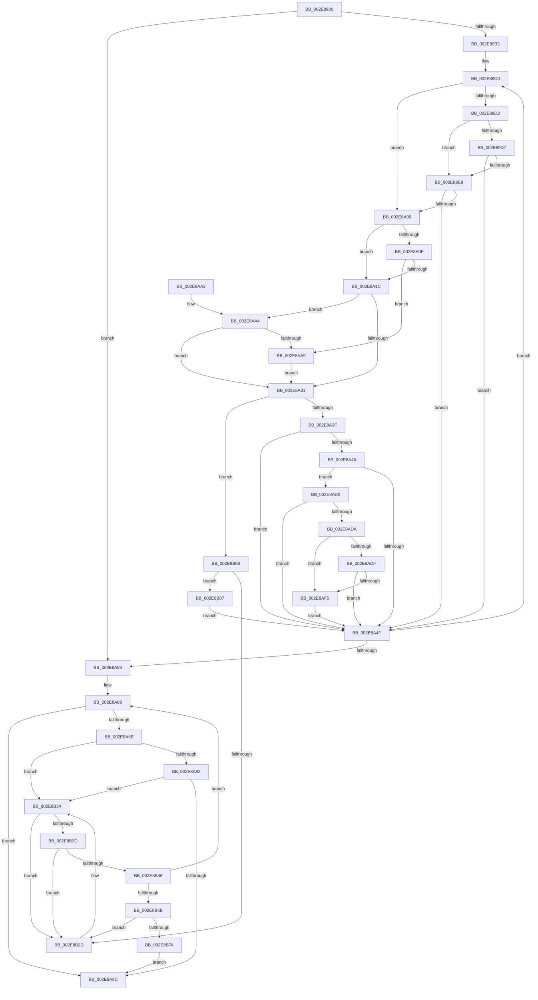

# RtlpHpLfhOwnerRunMaintenance

- RVA: `0x002E8980`–`0x002E8B9A` (길이 `538` bytes)
- VA: `0x00000001402E8980`
- 실행 섹션: `.text`
- PDB 이름 있음: `예`; PDB Function 태그: `아니요`
- unwind 정보 RVA: `0x00071450`
- 디코드: `147`개 명령, `538/538` bytes 표시
- 미해석 바이트: `0` (있으면 어셈블리에 `.byte`로 보존)

> 이 문서는 커널 이미지의 기계어와 PDB 기호를 분석해 생성했습니다. 4번과 5번은 함수 원형과 자료형을 바이너리 사용 방식에서 추정한 C 해석이며 원본 소스 복구 결과는 아닙니다.

## 1. Dependencies

- 직접 호출 지점: **6**; 고유 호출 대상: **4**
- 직접 호출자로 확인된 함수: **4**
- RIP 상대 이미지 참조: **0**

### Outgoing calls
- `0x002E8A00` → [RtlpHpLfhOwnerMoveSubsegment](RtlpHpLfhOwnerMoveSubsegment_function_002E85CC.md) (function, `0x002E85CC`)
- `0x002E8A64` → [RtlpHpLfhOwnerFreeListProcess](RtlpHpLfhOwnerFreeListProcess_function_002E8BA0.md) (function, `0x002E8BA0`)
- `0x002E8AC6` → [RtlpHpLfhSubsegmentDelayFreeListProcess](../32/RtlpHpLfhSubsegmentDelayFreeListProcess_function_00323CE0.md) (function, `0x00323CE0`)
- `0x002E8AFE` → [RtlpHpLfhSubsegmentReformatAsMulti](RtlpHpLfhSubsegmentReformatAsMulti_function_002E8814.md) (function, `0x002E8814`)
- `0x002E8B1F` → [RtlpHpLfhOwnerMoveSubsegment](RtlpHpLfhOwnerMoveSubsegment_function_002E85CC.md) (function, `0x002E85CC`)
- `0x002E8B5E` → [RtlpHpLfhOwnerMoveSubsegment](RtlpHpLfhOwnerMoveSubsegment_function_002E85CC.md) (function, `0x002E85CC`)

### Direct callers
- [RtlpHpLfhOwnerCompact](RtlpHpLfhOwnerCompact_function_002E785C.md) at `0x002E7916`
- [RtlpHpLfhBucketGetSubsegment](RtlpHpLfhBucketGetSubsegment_function_002E8474.md) at `0x002E85A5`
- [RtlpHpLfhSlotAllocateSlow](RtlpHpLfhSlotAllocateSlow_function_002E8FBC.md) at `0x002E9519`
- [RtlpHpLfhPrivateSlotShutdown](../60/RtlpHpLfhPrivateSlotShutdown_function_0060502C.md) at `0x0060508A`

### Static image references
- 디코드된 RIP-relative 메모리 참조가 없습니다.

## 2. Other-region calls and transfers

- 다른 실행 섹션으로 향하는 call: **0**
- 별도 외부 분기/꼬리 이동을 확인하지 못했습니다.

## 3. Assembly (complete function range)

```asm
002E8980  48 89 5C 24 08                  mov qword ptr [rsp + 8], rbx
002E8985  48 89 6C 24 18                  mov qword ptr [rsp + 0x18], rbp
002E898A  56                              push rsi
002E898B  57                              push rdi
002E898C  41 54                           push r12
002E898E  41 56                           push r14
002E8990  41 57                           push r15
002E8992  48 83 EC 30                     sub rsp, 0x30
002E8996  48 8B 5A 18                     mov rbx, qword ptr [rdx + 0x18]
002E899A  4C 8D 72 18                     lea r14, [rdx + 0x18]
002E899E  41 8B E9                        mov ebp, r9d
002E89A1  4D 8B F8                        mov r15, r8
002E89A4  48 8B F2                        mov rsi, rdx
002E89A7  4C 8B E1                        mov r12, rcx
002E89AA  49 3B DE                        cmp rbx, r14
002E89AD  0F 84 A5 00 00 00               je 0x1402e8a58
002E89B3  0F 1F 40 00                     nop dword ptr [rax]
002E89B7  66 0F 1F 84 00 00 00 00 00      nop word ptr [rax + rax]
002E89C0  48 8B FB                        mov rdi, rbx
002E89C3  48 8B 1B                        mov rbx, qword ptr [rbx]
002E89C6  0F B7 4F 20                     movzx ecx, word ptr [rdi + 0x20]
002E89CA  0F B7 47 12                     movzx eax, word ptr [rdi + 0x12]
002E89CE  03 C8                           add ecx, eax
002E89D0  75 37                           jne 0x1402e8a09
002E89D2  F6 06 01                        test byte ptr [rsi], 1
002E89D5  75 12                           jne 0x1402e89e9
002E89D7  48 8B C7                        mov rax, rdi
002E89DA  48 33 46 38                     xor rax, qword ptr [rsi + 0x38]
002E89DE  48 FF C8                        dec rax
002E89E1  48 3D FE 0F 00 00               cmp rax, 0xffe
002E89E7  76 66                           jbe 0x1402e8a4f
002E89E9  41 B9 01 00 00 00               mov r9d, 1
002E89EF  C7 44 24 20 02 00 00 00         mov dword ptr [rsp + 0x20], 2
002E89F7  4C 8B C7                        mov r8, rdi
002E89FA  48 8B D6                        mov rdx, rsi
002E89FD  49 8B CC                        mov rcx, r12
002E8A00  E8 C7 FB FF FF                  call 0x1402e85cc
002E8A05  85 C0                           test eax, eax
002E8A07  75 46                           jne 0x1402e8a4f
002E8A09  40 F6 C5 01                     test bpl, 1
002E8A0D  74 0D                           je 0x1402e8a1c
002E8A0F  0F B7 57 12                     movzx edx, word ptr [rdi + 0x12]
002E8A13  66 85 D2                        test dx, dx
002E8A16  0F 85 8D 00 00 00               jne 0x1402e8aa9
002E8A1C  0F B7 47 12                     movzx eax, word ptr [rdi + 0x12]
002E8A20  0F B7 4F 20                     movzx ecx, word ptr [rdi + 0x20]
002E8A24  0F B7 D0                        movzx edx, ax
002E8A27  03 C8                           add ecx, eax
002E8A29  0F B7 47 22                     movzx eax, word ptr [rdi + 0x22]
002E8A2D  3B C8                           cmp ecx, eax
002E8A2F  74 73                           je 0x1402e8aa4
002E8A31  0F B7 47 22                     movzx eax, word ptr [rdi + 0x22]
002E8A35  66 39 47 20                     cmp word ptr [rdi + 0x20], ax
002E8A39  0F 84 C9 00 00 00               je 0x1402e8b08
002E8A3F  40 F6 C5 04                     test bpl, 4
002E8A43  74 0A                           je 0x1402e8a4f
002E8A45  80 7F 27 01                     cmp byte ptr [rdi + 0x27], 1
002E8A49  0F 84 81 00 00 00               je 0x1402e8ad0
002E8A4F  49 3B DE                        cmp rbx, r14
002E8A52  0F 85 68 FF FF FF               jne 0x1402e89c0
002E8A58  44 8B CD                        mov r9d, ebp
002E8A5B  4D 8B C7                        mov r8, r15
002E8A5E  48 8B D6                        mov rdx, rsi
002E8A61  49 8B CC                        mov rcx, r12
002E8A64  E8 37 01 00 00                  call 0x1402e8ba0
002E8A69  4D 39 3F                        cmp qword ptr [r15], r15
002E8A6C  74 1E                           je 0x1402e8a8c
002E8A6E  4D 8B 47 08                     mov r8, qword ptr [r15 + 8]
002E8A72  41 0F B7 40 22                  movzx eax, word ptr [r8 + 0x22]
002E8A77  66 41 39 40 20                  cmp word ptr [r8 + 0x20], ax
002E8A7C  0F 85 B2 00 00 00               jne 0x1402e8b34
002E8A82  40 F6 C5 02                     test bpl, 2
002E8A86  0F 84 A8 00 00 00               je 0x1402e8b34
002E8A8C  48 8B 5C 24 60                  mov rbx, qword ptr [rsp + 0x60]
002E8A91  48 8B 6C 24 70                  mov rbp, qword ptr [rsp + 0x70]
002E8A96  48 83 C4 30                     add rsp, 0x30
002E8A9A  41 5F                           pop r15
002E8A9C  41 5E                           pop r14
002E8A9E  41 5C                           pop r12
002E8AA0  5F                              pop rdi
002E8AA1  5E                              pop rsi
002E8AA2  C3                              ret
002E8AA3  CC                              int3
002E8AA4  66 85 D2                        test dx, dx
002E8AA7  74 88                           je 0x1402e8a31
002E8AA9  33 C0                           xor eax, eax
002E8AAB  48 C7 44 24 68 00 00 00 00      mov qword ptr [rsp + 0x68], 0
002E8AB4  87 47 10                        xchg dword ptr [rdi + 0x10], eax
002E8AB7  89 44 24 68                     mov dword ptr [rsp + 0x68], eax
002E8ABB  48 8B D7                        mov rdx, rdi
002E8ABE  4C 8B 44 24 68                  mov r8, qword ptr [rsp + 0x68]
002E8AC3  49 8B CC                        mov rcx, r12
002E8AC6  E8 15 B2 03 00                  call 0x140323ce0
002E8ACB  E9 61 FF FF FF                  jmp 0x1402e8a31
002E8AD0  80 7F 26 00                     cmp byte ptr [rdi + 0x26], 0
002E8AD4  0F 86 75 FF FF FF               jbe 0x1402e8a4f
002E8ADA  F6 06 01                        test byte ptr [rsi], 1
002E8ADD  75 16                           jne 0x1402e8af5
002E8ADF  48 8B C7                        mov rax, rdi
002E8AE2  48 33 46 38                     xor rax, qword ptr [rsi + 0x38]
002E8AE6  48 FF C8                        dec rax
002E8AE9  48 3D FE 0F 00 00               cmp rax, 0xffe
002E8AEF  0F 86 5A FF FF FF               jbe 0x1402e8a4f
002E8AF5  45 33 C0                        xor r8d, r8d
002E8AF8  48 8B D7                        mov rdx, rdi
002E8AFB  49 8B CC                        mov rcx, r12
002E8AFE  E8 11 FD FF FF                  call 0x1402e8814
002E8B03  E9 47 FF FF FF                  jmp 0x1402e8a4f
002E8B08  41 B9 03 00 00 00               mov r9d, 3
002E8B0E  C7 44 24 20 02 00 00 00         mov dword ptr [rsp + 0x20], 2
002E8B16  4C 8B C7                        mov r8, rdi
002E8B19  48 8B D6                        mov rdx, rsi
002E8B1C  49 8B CC                        mov rcx, r12
002E8B1F  E8 A8 FA FF FF                  call 0x1402e85cc
002E8B24  4D 8B 07                        mov r8, qword ptr [r15]
002E8B27  4D 39 78 08                     cmp qword ptr [r8 + 8], r15
002E8B2B  74 5A                           je 0x1402e8b87
002E8B2D  B9 03 00 00 00                  mov ecx, 3
002E8B32  CD 29                           int 0x29
002E8B34  49 8B 00                        mov rax, qword ptr [r8]
002E8B37  4C 39 40 08                     cmp qword ptr [rax + 8], r8
002E8B3B  75 F0                           jne 0x1402e8b2d
002E8B3D  49 8B 48 08                     mov rcx, qword ptr [r8 + 8]
002E8B41  4C 39 01                        cmp qword ptr [rcx], r8
002E8B44  75 E7                           jne 0x1402e8b2d
002E8B46  48 89 01                        mov qword ptr [rcx], rax
002E8B49  45 33 C9                        xor r9d, r9d
002E8B4C  48 89 48 08                     mov qword ptr [rax + 8], rcx
002E8B50  48 8B D6                        mov rdx, rsi
002E8B53  49 8B CC                        mov rcx, r12
002E8B56  C7 44 24 20 02 00 00 00         mov dword ptr [rsp + 0x20], 2
002E8B5E  E8 69 FA FF FF                  call 0x1402e85cc
002E8B63  85 C0                           test eax, eax
002E8B65  0F 85 FE FE FF FF               jne 0x1402e8a69
002E8B6B  49 8B 47 08                     mov rax, qword ptr [r15 + 8]
002E8B6F  4C 39 38                        cmp qword ptr [rax], r15
002E8B72  75 B9                           jne 0x1402e8b2d
002E8B74  4D 89 38                        mov qword ptr [r8], r15
002E8B77  49 89 40 08                     mov qword ptr [r8 + 8], rax
002E8B7B  4C 89 00                        mov qword ptr [rax], r8
002E8B7E  4D 89 47 08                     mov qword ptr [r15 + 8], r8
002E8B82  E9 05 FF FF FF                  jmp 0x1402e8a8c
002E8B87  4C 89 07                        mov qword ptr [rdi], r8
002E8B8A  4C 89 7F 08                     mov qword ptr [rdi + 8], r15
002E8B8E  49 89 78 08                     mov qword ptr [r8 + 8], rdi
002E8B92  49 89 3F                        mov qword ptr [r15], rdi
002E8B95  E9 B5 FE FF FF                  jmp 0x1402e8a4f
```

## 4. C-style interpretation (structured pseudocode)

```c
__int64 __fastcall RtlpHpLfhOwnerRunMaintenance(__int64 a1, __int64 a2, __int64 a3, int a4)
{
    __int64 result;
    __int64 v_rsp;
    unsigned int v_stack_m38;
    unsigned __int64 v_stack_p18;
    unsigned int v_stack_p20;
    unsigned __int64 v_stack_p68;
    unsigned __int64 v_stack_p8;

    v_stack_p8 = v_rbx;
    v_stack_p18 = v_rbp;
    v_rsp = (v_rsp) - (48);
    if ((*(unsigned __int64 *)(a2 + 24)) == (a2 + 24)) goto loc_002E8A58;
loc_002E89C0:
    a1 = (unsigned int)((*(unsigned __int16 *)(*(unsigned __int64 *)(a2 + 24) + 32)) + ((unsigned int)(*(unsigned __int16 *)(*(unsigned __int64 *)(a2 + 24) + 18))));
    if (condition_is_not_equal) goto loc_002E8A09;
    if (((*(unsigned __int8 *)(a2)) & (1)) != 0) goto loc_002E89E9;
    result = (*(unsigned __int64 *)(a2 + 24)) ^ (*(unsigned __int64 *)(a2 + 56));
    result = (result) - 1;
    if (result <= 0xFFEULL) goto loc_002E8A4F;
loc_002E89E9:
    v_stack_m38 = 2;
    result = RtlpHpLfhOwnerMoveSubsegment(a1, a2, *(unsigned __int64 *)(a2 + 24), 1);
    if ((unsigned int)(result) != 0) goto loc_002E8A4F;
loc_002E8A09:
    if ((((unsigned __int8)((unsigned int)(a4))) & (1)) == 0) goto loc_002E8A1C;
    if ((unsigned __int16)(*(unsigned __int16 *)(*(unsigned __int64 *)(a2 + 24) + 18)) != 0) goto loc_002E8AA9;
loc_002E8A1C:
    a1 = (unsigned int)((*(unsigned __int16 *)(*(unsigned __int64 *)(a2 + 24) + 32)) + ((unsigned int)(*(unsigned __int16 *)(*(unsigned __int64 *)(a2 + 24) + 18))));
    if (((unsigned int)(a1)) == ((unsigned int)(*(unsigned __int16 *)(*(unsigned __int64 *)(a2 + 24) + 34)))) goto loc_002E8AA4;
loc_002E8A31:
    if ((*(unsigned __int16 *)(*(unsigned __int64 *)(a2 + 24) + 32)) == ((unsigned __int16)(*(unsigned __int16 *)(*(unsigned __int64 *)(a2 + 24) + 34)))) goto loc_002E8B08;
    if ((((unsigned __int8)((unsigned int)(a4))) & (4)) == 0) goto loc_002E8A4F;
    if ((*(unsigned __int8 *)(*(unsigned __int64 *)(a2 + 24) + 39)) == 1) goto loc_002E8AD0;
loc_002E8A4F:
    if ((*(unsigned __int64 *)(*(unsigned __int64 *)(a2 + 24))) != (a2 + 24)) goto loc_002E89C0;
loc_002E8A58:
    result = RtlpHpLfhOwnerFreeListProcess(a1, a2, a3, (unsigned int)((unsigned int)((unsigned int)(a4))));
loc_002E8A69:
    if ((*(unsigned __int64 *)(a3)) == a3) goto loc_002E8A8C;
    if ((*(unsigned __int16 *)(*(unsigned __int64 *)(a3 + 8) + 32)) != ((unsigned __int16)(*(unsigned __int16 *)(*(unsigned __int64 *)(a3 + 8) + 34)))) goto loc_002E8B34;
    if ((((unsigned __int8)((unsigned int)(a4))) & (2)) == 0) goto loc_002E8B34;
loc_002E8A8C:
    v_rsp = (v_rsp) + (48);
    return *(unsigned __int16 *)(*(unsigned __int64 *)(a3 + 8) + 34);
loc_002E8AA4:
    if ((unsigned __int16)(a2) == 0) goto loc_002E8A31;
loc_002E8AA9:
    result = 0;
    v_stack_p68 = 0;
    v_stack_p68 = 0;
    result = RtlpHpLfhSubsegmentDelayFreeListProcess(a1, *(unsigned __int64 *)(a2 + 24), v_stack_p68, (unsigned int)((unsigned int)((unsigned int)(a4))));
    goto loc_002E8A31;
loc_002E8AD0:
    if ((*(unsigned __int8 *)(*(unsigned __int64 *)(a2 + 24) + 38)) <= 0) goto loc_002E8A4F;
    if (((*(unsigned __int8 *)(a2)) & (1)) != 0) goto loc_002E8AF5;
    result = (*(unsigned __int64 *)(a2 + 24)) ^ (*(unsigned __int64 *)(a2 + 56));
    result = (result) - 1;
    if (result <= 0xFFEULL) goto loc_002E8A4F;
loc_002E8AF5:
    a3 = 0;
    result = RtlpHpLfhSubsegmentReformatAsMulti(a1, *(unsigned __int64 *)(a2 + 24), a3, (unsigned int)((unsigned int)((unsigned int)(a4))));
    goto loc_002E8A4F;
loc_002E8B08:
    v_stack_p20 = 2;
    result = RtlpHpLfhOwnerMoveSubsegment(a1, a2, *(unsigned __int64 *)(a2 + 24), 3);
    if ((*(unsigned __int64 *)(*(unsigned __int64 *)(a3) + 8)) == 0) goto loc_002E8B87;
loc_002E8B2D:
loc_002E8B34:
    if ((*(unsigned __int64 *)(*(unsigned __int64 *)(*(unsigned __int64 *)(a3)) + 8)) != (*(unsigned __int64 *)(a3))) goto loc_002E8B2D;
    if ((*(unsigned __int64 *)(*(unsigned __int64 *)(*(unsigned __int64 *)(a3) + 8))) != (*(unsigned __int64 *)(a3))) goto loc_002E8B2D;
    *(unsigned __int64 *)(*(unsigned __int64 *)(*(unsigned __int64 *)(a3) + 8)) = *(unsigned __int64 *)(*(unsigned __int64 *)(a3));
    a4 = 0;
    *(unsigned __int64 *)(*(unsigned __int64 *)(*(unsigned __int64 *)(a3)) + 8) = *(unsigned __int64 *)(*(unsigned __int64 *)(a3) + 8);
    v_stack_p20 = 2;
    result = RtlpHpLfhOwnerMoveSubsegment(a1, a2, *(unsigned __int64 *)(a3), a4);
    if ((unsigned int)(result) != 0) goto loc_002E8A69;
    if ((*(unsigned __int64 *)(*(unsigned __int64 *)(a3 + 8))) != 0) goto loc_002E8B2D;
    *(unsigned __int64 *)(*(unsigned __int64 *)(a3)) = 0;
    *(unsigned __int64 *)(*(unsigned __int64 *)(a3) + 8) = *(unsigned __int64 *)(a3 + 8);
    *(unsigned __int64 *)(*(unsigned __int64 *)(a3 + 8)) = *(unsigned __int64 *)(a3);
    *(unsigned __int64 *)(a3 + 8) = *(unsigned __int64 *)(a3);
    goto loc_002E8A8C;
loc_002E8B87:
    *(unsigned __int64 *)(*(unsigned __int64 *)(a2 + 24)) = *(unsigned __int64 *)(a3);
    *(unsigned __int64 *)(*(unsigned __int64 *)(a2 + 24) + 8) = 0;
    *(unsigned __int64 *)(*(unsigned __int64 *)(a3) + 8) = *(unsigned __int64 *)(a2 + 24);
    *(unsigned __int64 *)(a3) = *(unsigned __int64 *)(a2 + 24);
    goto loc_002E8A4F;
}
```

## 5. (Beta) C Style

```c
int64_t RtlpHpLfhOwnerRunMaintenance(int64_t Arg1, void *Arg2, void *Arg3, int32_t Arg4)
{
    uint8_t *arg2 = (uint8_t *)Arg2;
    uint8_t *arg3 = (uint8_t *)Arg3;

    int64_t result;
    int64_t local_rsp;
    uint32_t v_stack_m38;
    uint64_t v_stack_p18;
    uint32_t v_stack_p20;
    uint64_t v_stack_p68;
    uint64_t v_stack_p8;

    v_stack_p8 = local_rbx;
    v_stack_p18 = local_rbp;
    local_rsp = (local_rsp) - (48);
    if ((*(uint64_t *)(arg2 + 0x18)) == (Arg2 + 24)) goto loc_002E8A58;
loc_002E89C0:
    Arg1 = (uint32_t)((*(uint16_t *)(*(uint64_t *)(arg2 + 0x18) + 0x20)) + ((uint32_t)(*(uint16_t *)(*(uint64_t *)(arg2 + 0x18) + 0x12))));
    if (condition_is_not_equal) goto loc_002E8A09;
    if (((*(uint8_t *)(arg2)) & (1)) != 0) goto loc_002E89E9;
    result = (*(uint64_t *)(arg2 + 0x18)) ^ (*(uint64_t *)(arg2 + 0x38));
    result = (result) - 1;
    if (result <= 0xFFEULL) goto loc_002E8A4F;
loc_002E89E9:
    v_stack_m38 = 2;
    result = RtlpHpLfhOwnerMoveSubsegment(Arg1, Arg2, *(uint64_t *)(arg2 + 0x18), 1);
    if ((uint32_t)(result) != 0) goto loc_002E8A4F;
loc_002E8A09:
    if ((((uint8_t)((uint32_t)(Arg4))) & (1)) == 0) goto loc_002E8A1C;
    if ((uint16_t)(*(uint16_t *)(*(uint64_t *)(arg2 + 0x18) + 0x12)) != 0) goto loc_002E8AA9;
loc_002E8A1C:
    Arg1 = (uint32_t)((*(uint16_t *)(*(uint64_t *)(arg2 + 0x18) + 0x20)) + ((uint32_t)(*(uint16_t *)(*(uint64_t *)(arg2 + 0x18) + 0x12))));
    if (((uint32_t)(Arg1)) == ((uint32_t)(*(uint16_t *)(*(uint64_t *)(arg2 + 0x18) + 0x22)))) goto loc_002E8AA4;
loc_002E8A31:
    if ((*(uint16_t *)(*(uint64_t *)(arg2 + 0x18) + 0x20)) == ((uint16_t)(*(uint16_t *)(*(uint64_t *)(arg2 + 0x18) + 0x22)))) goto loc_002E8B08;
    if ((((uint8_t)((uint32_t)(Arg4))) & (4)) == 0) goto loc_002E8A4F;
    if ((*(uint8_t *)(*(uint64_t *)(arg2 + 0x18) + 0x27)) == 1) goto loc_002E8AD0;
loc_002E8A4F:
    if ((*(uint64_t *)(*(uint64_t *)(arg2 + 0x18))) != (Arg2 + 24)) goto loc_002E89C0;
loc_002E8A58:
    result = RtlpHpLfhOwnerFreeListProcess(Arg1, Arg2, Arg3, (uint32_t)((uint32_t)((uint32_t)(Arg4))));
loc_002E8A69:
    if ((*(uint64_t *)(arg3)) == Arg3) goto loc_002E8A8C;
    if ((*(uint16_t *)(*(uint64_t *)(arg3 + 0x8) + 0x20)) != ((uint16_t)(*(uint16_t *)(*(uint64_t *)(arg3 + 0x8) + 0x22)))) goto loc_002E8B34;
    if ((((uint8_t)((uint32_t)(Arg4))) & (2)) == 0) goto loc_002E8B34;
loc_002E8A8C:
    local_rsp = (local_rsp) + (48);
    return *(uint16_t *)(*(uint64_t *)(arg3 + 0x8) + 0x22);
loc_002E8AA4:
    if ((uint16_t)(Arg2) == 0) goto loc_002E8A31;
loc_002E8AA9:
    result = 0;
    v_stack_p68 = 0;
    v_stack_p68 = 0;
    result = RtlpHpLfhSubsegmentDelayFreeListProcess(Arg1, *(uint64_t *)(arg2 + 0x18), v_stack_p68, (uint32_t)((uint32_t)((uint32_t)(Arg4))));
    goto loc_002E8A31;
loc_002E8AD0:
    if ((*(uint8_t *)(*(uint64_t *)(arg2 + 0x18) + 0x26)) <= 0) goto loc_002E8A4F;
    if (((*(uint8_t *)(arg2)) & (1)) != 0) goto loc_002E8AF5;
    result = (*(uint64_t *)(arg2 + 0x18)) ^ (*(uint64_t *)(arg2 + 0x38));
    result = (result) - 1;
    if (result <= 0xFFEULL) goto loc_002E8A4F;
loc_002E8AF5:
    Arg3 = 0;
    result = RtlpHpLfhSubsegmentReformatAsMulti(Arg1, *(uint64_t *)(arg2 + 0x18), Arg3, (uint32_t)((uint32_t)((uint32_t)(Arg4))));
    goto loc_002E8A4F;
loc_002E8B08:
    v_stack_p20 = 2;
    result = RtlpHpLfhOwnerMoveSubsegment(Arg1, Arg2, *(uint64_t *)(arg2 + 0x18), 3);
    if ((*(uint64_t *)(*(uint64_t *)(arg3) + 0x8)) == 0) goto loc_002E8B87;
loc_002E8B2D:
loc_002E8B34:
    if ((*(uint64_t *)(*(uint64_t *)(*(uint64_t *)(arg3)) + 0x8)) != (*(uint64_t *)(arg3))) goto loc_002E8B2D;
    if ((*(uint64_t *)(*(uint64_t *)(*(uint64_t *)(arg3) + 0x8))) != (*(uint64_t *)(arg3))) goto loc_002E8B2D;
    *(uint64_t *)(*(uint64_t *)(*(uint64_t *)(arg3) + 0x8)) = *(uint64_t *)(*(uint64_t *)(arg3));
    Arg4 = 0;
    *(uint64_t *)(*(uint64_t *)(*(uint64_t *)(arg3)) + 0x8) = *(uint64_t *)(*(uint64_t *)(arg3) + 0x8);
    v_stack_p20 = 2;
    result = RtlpHpLfhOwnerMoveSubsegment(Arg1, Arg2, *(uint64_t *)(arg3), Arg4);
    if ((uint32_t)(result) != 0) goto loc_002E8A69;
    if ((*(uint64_t *)(*(uint64_t *)(arg3 + 0x8))) != 0) goto loc_002E8B2D;
    *(uint64_t *)(*(uint64_t *)(arg3)) = 0;
    *(uint64_t *)(*(uint64_t *)(arg3) + 0x8) = *(uint64_t *)(arg3 + 0x8);
    *(uint64_t *)(*(uint64_t *)(arg3 + 0x8)) = *(uint64_t *)(arg3);
    *(uint64_t *)(arg3 + 0x8) = *(uint64_t *)(arg3);
    goto loc_002E8A8C;
loc_002E8B87:
    *(uint64_t *)(*(uint64_t *)(arg2 + 0x18)) = *(uint64_t *)(arg3);
    *(uint64_t *)(*(uint64_t *)(arg2 + 0x18) + 0x8) = 0;
    *(uint64_t *)(*(uint64_t *)(arg3) + 0x8) = *(uint64_t *)(arg2 + 0x18);
    *(uint64_t *)(arg3) = *(uint64_t *)(arg2 + 0x18);
    goto loc_002E8A4F;
}
```

### 관측된 메모리 오프셋

구조체 형식이 확인되지 않은 접근은 인자 기준의 오프셋으로만 기록했습니다.

| 기준 인자 | 오프셋 표현 | 폭 (bit) | 접근 |
|---|---:|---:|---|
| `Arg2` | `+ 0x0` | `8` | `R` |
| `Arg2` | `+ 0x18` | `64` | `R` |
| `Arg2` | `+ 0x38` | `64` | `R` |
| `Arg3` | `+ 0x0` | `64` | `R` |
| `Arg3` | `+ 0x0` | `64` | `W` |
| `Arg3` | `+ 0x8` | `64` | `R` |
| `Arg3` | `+ 0x8` | `64` | `W` |

## 6. Execution-region graph

[열기: 2D/3D 그래프와 함수 탐색 컨트롤 패널](../../../control-panel.html?section=text&rva=0x002E8980&view=graph)

- 2D 그래프는 위에서 아래로 흐르고, 3D 그래프는 빈 공간을 드래그해 회전합니다. Shift+드래그는 이동, 휠은 확대·축소, 함수 노드 선택은 대상 보고서 이동입니다.

### Static fallback


