# RtlpHpLfhSubsegmentCommitBlock

- RVA: `0x002EA630`–`0x002EA93E` (길이 `782` bytes)
- VA: `0x00000001402EA630`
- 실행 섹션: `.text`
- PDB 이름 있음: `예`; PDB Function 태그: `아니요`
- unwind 정보 RVA: `0x00071594`
- 디코드: `199`개 명령, `782/782` bytes 표시
- 미해석 바이트: `0` (있으면 어셈블리에 `.byte`로 보존)

> 이 문서는 커널 이미지의 기계어와 PDB 기호를 분석해 생성했습니다. 4번과 5번은 함수 원형과 자료형을 바이너리 사용 방식에서 추정한 C 해석이며 원본 소스 복구 결과는 아닙니다.

## 1. Dependencies

- 직접 호출 지점: **8**; 고유 호출 대상: **7**
- 직접 호출자로 확인된 함수: **5**
- RIP 상대 이미지 참조: **6**

### Outgoing calls
- `0x002EA783` → [RtlpHpReleaseLockExclusive](../32/RtlpHpReleaseLockExclusive_function_00324230.md) (function, `0x00324230`)
- `0x002EA7D4` → [RtlpHpAcquireLockExclusive](../32/RtlpHpAcquireLockExclusive_function_003246B0.md) (function, `0x003246B0`)
- `0x002EA846` → [RtlpHpSegLfhVsCommit](../32/RtlpHpSegLfhVsCommit_function_00325750.md) (function, `0x00325750`)
- `0x002EA885` → [RtlpHpLfhSubsegmentIncBlockCounts](RtlpHpLfhSubsegmentIncBlockCounts_function_002EB4A0.md) (function, `0x002EB4A0`)
- `0x002EA8F5` → [RtlpHpEnvCompactionSchedule](../32/RtlpHpEnvCompactionSchedule_function_003264A0.md) (function, `0x003264A0`)
- `0x002EA90A` → [guard_dispatch_icall](../6B/guard_dispatch_icall_function_006BAAD0.md) (function, `0x006BAAD0`)
- `0x002EA921` → [RtlpHpLfhSubsegmentDecBlockCounts](../32/RtlpHpLfhSubsegmentDecBlockCounts_function_003244D0.md) (function, `0x003244D0`)
- `0x002EA932` → [RtlpHpReleaseLockExclusive](../32/RtlpHpReleaseLockExclusive_function_00324230.md) (function, `0x00324230`)

### Direct callers
- [RtlpHpLfhSlotAllocateSlow](RtlpHpLfhSlotAllocateSlow_function_002E8FBC.md) at `0x002E938D`
- [sub_002E98D9](Unknown_function_002E98D9.md) at `0x002E9B5A`
- [RtlpHpAllocateHeapSlow](RtlpHpAllocateHeapSlow_function_002E9DEC.md) at `0x002EA254`
- [ExAllocateHeapPool](../35/ExAllocateHeapPool_function_0035BA30.md) at `0x0035C43D`
- [ExAllocateHeapPool](../35/ExAllocateHeapPool_function_0035BA30.md) at `0x0035C75B`
- [sub_006DE832](../6D/Unknown_function_006DE832.md) at `0x006DEA32`

### Static image references
- `0x002EA687` → RVA `0x00E28308` (`.data`; read)
- `0x002EA759` → RVA `0x00EFA7BC` (`.data`; read)
- `0x002EA7E6` → RVA `0x00325750` (`RtlpHpSegLfhVsCommit`; read)
- `0x002EA7FE` → RVA `0x00E28300` (`.data`; read)
- `0x002EA88A` → RVA `0x00F059A0` (`.data`; read)
- `0x002EA8E6` → RVA `0x00EFA7C0` (`.data`; read)

## 2. Other-region calls and transfers

- 다른 실행 섹션으로 향하는 call: **0**
- 별도 외부 분기/꼬리 이동을 확인하지 못했습니다.

## 3. Assembly (complete function range)

```asm
002EA630  48 8B C4                        mov rax, rsp
002EA633  48 89 58 08                     mov qword ptr [rax + 8], rbx
002EA637  44 89 40 18                     mov dword ptr [rax + 0x18], r8d
002EA63B  55                              push rbp
002EA63C  56                              push rsi
002EA63D  57                              push rdi
002EA63E  41 54                           push r12
002EA640  41 55                           push r13
002EA642  41 56                           push r14
002EA644  41 57                           push r15
002EA646  48 83 EC 60                     sub rsp, 0x60
002EA64A  4C 8B F2                        mov r14, rdx
002EA64D  C7 40 AC 00 00 00 00            mov dword ptr [rax - 0x54], 0
002EA654  C7 40 A8 00 00 00 00            mov dword ptr [rax - 0x58], 0
002EA65B  45 8B C8                        mov r9d, r8d
002EA65E  C6 40 10 FF                     mov byte ptr [rax + 0x10], 0xff
002EA662  41 FF C8                        dec r8d
002EA665  48 8B C2                        mov rax, rdx
002EA668  41 C1 E9 0C                     shr r9d, 0xc
002EA66C  48 C1 E8 0C                     shr rax, 0xc
002EA670  48 8B F1                        mov rsi, rcx
002EA673  0F B6 4A 26                     movzx ecx, byte ptr [rdx + 0x26]
002EA677  45 33 ED                        xor r13d, r13d
002EA67A  0F B7 D0                        movzx edx, ax
002EA67D  41 0F B7 46 28                  movzx eax, word ptr [r14 + 0x28]
002EA682  33 D0                           xor edx, eax
002EA684  41 D3 E9                        shr r9d, cl
002EA687  0F B7 05 7A DC B3 00            movzx eax, word ptr [rip + 0xb3dc7a]
002EA68E  33 D0                           xor edx, eax
002EA690  41 0F B6 46 18                  movzx eax, byte ptr [r14 + 0x18]
002EA695  89 54 24 48                     mov dword ptr [rsp + 0x48], edx
002EA699  41 03 D0                        add edx, r8d
002EA69C  C1 EA 0C                        shr edx, 0xc
002EA69F  4F 8D 3C 09                     lea r15, [r9 + r9]
002EA6A3  D3 EA                           shr edx, cl
002EA6A5  41 2B D1                        sub edx, r9d
002EA6A8  49 8D 1C C6                     lea rbx, [r14 + rax*8]
002EA6AC  FF C2                           inc edx
002EA6AE  49 03 DF                        add rbx, r15
002EA6B1  0F 0D 0B                        prefetchw byte ptr [rbx]
002EA6B4  4C 8D 24 53                     lea r12, [rbx + rdx*2]
002EA6B8  44 89 6C 24 50                  mov dword ptr [rsp + 0x50], r13d
002EA6BD  33 FF                           xor edi, edi
002EA6BF  41 B8 FF FF FF FF               mov r8d, 0xffffffff
002EA6C5  44 89 84 24 B8 00 00 00         mov dword ptr [rsp + 0xb8], r8d
002EA6CD  49 3B DC                        cmp rbx, r12
002EA6D0  0F 83 B2 00 00 00               jae 0x1402ea788
002EA6D6  40 B5 FF                        mov bpl, 0xff
002EA6D9  0F B7 03                        movzx eax, word ptr [rbx]
002EA6DC  66 85 C0                        test ax, ax
002EA6DF  0F 8E BE 00 00 00               jle 0x1402ea7a3
002EA6E5  8D 48 01                        lea ecx, [rax + 1]
002EA6E8  66 F0 0F B1 0B                  lock cmpxchg word ptr [rbx], cx
002EA6ED  75 ED                           jne 0x1402ea6dc
002EA6EF  44 8B 84 24 B8 00 00 00         mov r8d, dword ptr [rsp + 0xb8]
002EA6F7  48 83 C3 02                     add rbx, 2
002EA6FB  49 83 C7 02                     add r15, 2
002EA6FF  49 3B DC                        cmp rbx, r12
002EA702  72 D5                           jb 0x1402ea6d9
002EA704  85 FF                           test edi, edi
002EA706  74 64                           je 0x1402ea76c
002EA708  41 0F B6 4E 26                  movzx ecx, byte ptr [r14 + 0x26]
002EA70D  C1 E7 0C                        shl edi, 0xc
002EA710  D3 E7                           shl edi, cl
002EA712  8B C7                           mov eax, edi
002EA714  99                              cdq
002EA715  81 E2 FF 0F 00 00               and edx, 0xfff
002EA71B  03 C2                           add eax, edx
002EA71D  C1 F8 0C                        sar eax, 0xc
002EA720  48 63 C8                        movsxd rcx, eax
002EA723  48 0F BF 46 42                  movsx rax, word ptr [rsi + 0x42]
002EA728  F0 48 01 4C 30 18               lock add qword ptr [rax + rsi + 0x18], rcx
002EA72E  48 85 C9                        test rcx, rcx
002EA731  7E 39                           jle 0x1402ea76c
002EA733  41 0F B7 5E 2C                  movzx ebx, word ptr [r14 + 0x2c]
002EA738  48 C1 E3 06                     shl rbx, 6
002EA73C  80 7C 33 5C 00                  cmp byte ptr [rbx + rsi + 0x5c], 0
002EA741  75 29                           jne 0x1402ea76c
002EA743  48 8B 0E                        mov rcx, qword ptr [rsi]
002EA746  48 8B 41 38                     mov rax, qword ptr [rcx + 0x38]
002EA74A  48 8B 00                        mov rax, qword ptr [rax]
002EA74D  48 C1 E8 08                     shr rax, 8
002EA751  3C 01                           cmp al, 1
002EA753  0F 85 8D 01 00 00               jne 0x1402ea8e6
002EA759  8B 05 5D 00 C1 00               mov eax, dword ptr [rip + 0xc1005d]
002EA75F  85 C0                           test eax, eax
002EA761  0F 84 8A 01 00 00               je 0x1402ea8f1
002EA767  C6 44 33 5C 01                  mov byte ptr [rbx + rsi + 0x5c], 1
002EA76C  41 83 F8 FF                     cmp r8d, -1
002EA770  75 6F                           jne 0x1402ea7e1
002EA772  45 85 ED                        test r13d, r13d
002EA775  74 11                           je 0x1402ea788
002EA777  0F B6 56 41                     movzx edx, byte ptr [rsi + 0x41]
002EA77B  49 8D 4E 38                     lea rcx, [r14 + 0x38]
002EA77F  44 0F B6 C5                     movzx r8d, bpl
002EA783  E8 A8 9A 03 00                  call 0x140324230
002EA788  33 C0                           xor eax, eax
002EA78A  48 8B 9C 24 A0 00 00 00         mov rbx, qword ptr [rsp + 0xa0]
002EA792  48 83 C4 60                     add rsp, 0x60
002EA796  41 5F                           pop r15
002EA798  41 5E                           pop r14
002EA79A  41 5D                           pop r13
002EA79C  41 5C                           pop r12
002EA79E  5F                              pop rdi
002EA79F  5E                              pop rsi
002EA7A0  5D                              pop rbp
002EA7A1  C3                              ret
002EA7A2  CC                              int3
002EA7A3  45 85 ED                        test r13d, r13d
002EA7A6  74 1E                           je 0x1402ea7c6
002EA7A8  44 8B 84 24 B8 00 00 00         mov r8d, dword ptr [rsp + 0xb8]
002EA7B0  66 85 C0                        test ax, ax
002EA7B3  0F 85 0B 01 00 00               jne 0x1402ea8c4
002EA7B9  FF CF                           dec edi
002EA7BB  66 FF C0                        inc ax
002EA7BE  66 89 03                        mov word ptr [rbx], ax
002EA7C1  E9 31 FF FF FF                  jmp 0x1402ea6f7
002EA7C6  0F B6 56 41                     movzx edx, byte ptr [rsi + 0x41]
002EA7CA  49 8D 4E 38                     lea rcx, [r14 + 0x38]
002EA7CE  41 BD 01 00 00 00               mov r13d, 1
002EA7D4  E8 D7 9E 03 00                  call 0x1403246b0
002EA7D9  0F B6 E8                        movzx ebp, al
002EA7DC  E9 F8 FE FF FF                  jmp 0x1402ea6d9
002EA7E1  41 0F B6 4E 26                  movzx ecx, byte ptr [r14 + 0x26]
002EA7E6  48 8D 05 63 AF 03 00            lea rax, [rip + 0x3af63]
002EA7ED  4C 8B 7C 24 50                  mov r15, qword ptr [rsp + 0x50]
002EA7F2  4C 8D 4C 24 40                  lea r9, [rsp + 0x40]
002EA7F7  4C 8B 56 18                     mov r10, qword ptr [rsi + 0x18]
002EA7FB  45 2B F8                        sub r15d, r8d
002EA7FE  4C 33 15 FB DA B3 00            xor r10, qword ptr [rip + 0xb3dafb]
002EA805  41 FF C7                        inc r15d
002EA808  41 C1 E0 0C                     shl r8d, 0xc
002EA80C  4C 33 D6                        xor r10, rsi
002EA80F  41 D3 E0                        shl r8d, cl
002EA812  44 89 7C 24 44                  mov dword ptr [rsp + 0x44], r15d
002EA817  41 C1 E7 0C                     shl r15d, 0xc
002EA81B  41 D3 E7                        shl r15d, cl
002EA81E  48 8B 0E                        mov rcx, qword ptr [rsi]
002EA821  41 8B D8                        mov ebx, r8d
002EA824  49 03 DE                        add rbx, r14
002EA827  44 89 84 24 B8 00 00 00         mov dword ptr [rsp + 0xb8], r8d
002EA82F  40 88 AC 24 A8 00 00 00         mov byte ptr [rsp + 0xa8], bpl
002EA837  45 8B C7                        mov r8d, r15d
002EA83A  48 8B D3                        mov rdx, rbx
002EA83D  4C 3B D0                        cmp r10, rax
002EA840  0F 85 C1 00 00 00               jne 0x1402ea907
002EA846  E8 05 AF 03 00                  call 0x140325750
002EA84B  8B F8                           mov edi, eax
002EA84D  49 8B D6                        mov rdx, r14
002EA850  48 8B CE                        mov rcx, rsi
002EA853  85 C0                           test eax, eax
002EA855  0F 88 B9 00 00 00               js 0x1402ea914
002EA85B  44 8B 84 24 B8 00 00 00         mov r8d, dword ptr [rsp + 0xb8]
002EA863  48 8D 84 24 A8 00 00 00         lea rax, [rsp + 0xa8]
002EA86B  48 89 44 24 30                  mov qword ptr [rsp + 0x30], rax
002EA870  45 8B CF                        mov r9d, r15d
002EA873  48 8D 44 24 44                  lea rax, [rsp + 0x44]
002EA878  C7 44 24 28 01 00 00 00         mov dword ptr [rsp + 0x28], 1
002EA880  48 89 44 24 20                  mov qword ptr [rsp + 0x20], rax
002EA885  E8 16 0C 00 00                  call 0x1402eb4a0
002EA88A  8B 05 10 B1 C1 00               mov eax, dword ptr [rip + 0xc1b110]
002EA890  41 8B CF                        mov ecx, r15d
002EA893  48 03 CB                        add rcx, rbx
002EA896  A8 02                           test al, 2
002EA898  0F 84 EA FE FF FF               je 0x1402ea788
002EA89E  48 3B D9                        cmp rbx, rcx
002EA8A1  0F 83 E1 FE FF FF               jae 0x1402ea788
002EA8A7  66 0F 1F 84 00 00 00 00 00      nop word ptr [rax + rax]
002EA8B0  0F B6 03                        movzx eax, byte ptr [rbx]
002EA8B3  48 81 C3 00 10 00 00            add rbx, 0x1000
002EA8BA  48 3B D9                        cmp rbx, rcx
002EA8BD  72 F1                           jb 0x1402ea8b0
002EA8BF  E9 C4 FE FF FF                  jmp 0x1402ea788
002EA8C4  49 8B CF                        mov rcx, r15
002EA8C7  FF C7                           inc edi
002EA8C9  48 D1 F9                        sar rcx, 1
002EA8CC  41 83 F8 FF                     cmp r8d, -1
002EA8D0  48 89 4C 24 50                  mov qword ptr [rsp + 0x50], rcx
002EA8D5  44 0F 44 C1                     cmove r8d, ecx
002EA8D9  44 89 84 24 B8 00 00 00         mov dword ptr [rsp + 0xb8], r8d
002EA8E1  E9 D5 FE FF FF                  jmp 0x1402ea7bb
002EA8E6  8B 05 D4 FE C0 00               mov eax, dword ptr [rip + 0xc0fed4]
002EA8EC  E9 6E FE FF FF                  jmp 0x1402ea75f
002EA8F1  48 8B 49 38                     mov rcx, qword ptr [rcx + 0x38]
002EA8F5  E8 A6 BB 03 00                  call 0x1403264a0
002EA8FA  44 8B 84 24 B8 00 00 00         mov r8d, dword ptr [rsp + 0xb8]
002EA902  E9 60 FE FF FF                  jmp 0x1402ea767
002EA907  49 8B C2                        mov rax, r10
002EA90A  E8 C1 01 3D 00                  call 0x1406baad0
002EA90F  E9 37 FF FF FF                  jmp 0x1402ea84b
002EA914  44 8B 4C 24 48                  mov r9d, dword ptr [rsp + 0x48]
002EA919  44 8B 84 24 B0 00 00 00         mov r8d, dword ptr [rsp + 0xb0]
002EA921  E8 AA 9B 03 00                  call 0x1403244d0
002EA926  0F B6 56 41                     movzx edx, byte ptr [rsi + 0x41]
002EA92A  49 8D 4E 38                     lea rcx, [r14 + 0x38]
002EA92E  44 0F B6 C5                     movzx r8d, bpl
002EA932  E8 F9 98 03 00                  call 0x140324230
002EA937  8B C7                           mov eax, edi
002EA939  E9 4C FE FF FF                  jmp 0x1402ea78a
```

## 4. C-style interpretation (structured pseudocode)

```c
__int64 __fastcall RtlpHpLfhSubsegmentCommitBlock(__int64 a1, __int64 a2, int a3)
{
    __int64 result;
    __int64 v_r10;
    __int64 v_r13;
    __int64 v_r15;
    __int64 v_rbx;
    __int64 v_rdi;
    __int64 v_rsp;
    unsigned int v_stack_m48;
    unsigned int v_stack_m50;
    unsigned int v_stack_p20;
    unsigned int v_stack_p28;
    unsigned __int64 v_stack_p30;
    unsigned __int64 v_stack_p40;
    unsigned int v_stack_p44;
    unsigned int v_stack_p48;
    unsigned __int64 v_stack_p50;
    unsigned __int64 v_stack_p8;
    unsigned __int8 v_stack_pA8;
    unsigned int v_stack_pB0;
    unsigned int v_stack_pB8;

    *(unsigned __int64 *)(v_rsp + 8) = v_rbx;
    *(unsigned int *)(v_rsp + 24) = a3;
    v_rsp = (v_rsp) - (96);
    *(unsigned int *)(v_rsp - 84) = 0;
    *(unsigned int *)(v_rsp - 88) = 0;
    *(unsigned __int8 *)(v_rsp + 16) = 255;
    a3 = (unsigned int)((a3) - 1);
    a4 = (unsigned int)(((unsigned int)(a3)) >> (12));
    result = (a2) >> (12);
    v_r13 = 0;
    a2 = (unsigned int)(((unsigned __int16)(result)) ^ ((unsigned int)(*(unsigned __int16 *)(a2 + 40))));
    a4 = (unsigned int)((a4) >> ((unsigned __int8)(*(unsigned __int8 *)(a2 + 38))));
    a2 = (unsigned int)((a2) ^ ((unsigned int)(*(unsigned __int16 *)(v_rip + 11787386))));
    v_stack_m50 = (unsigned int)(a2);
    a2 = (unsigned int)((a2) + (a3));
    a2 = (unsigned int)((a2) >> (12));
    a2 = (unsigned int)((a2) >> ((unsigned __int8)(*(unsigned __int8 *)(a2 + 38))));
    a2 = (unsigned int)((a2) - ((unsigned int)(a4)));
    a2 = (unsigned int)((a2) + 1);
    v_rbx = (a2 + *(unsigned __int8 *)(a2 + 24) * 8) + (a4 + a4 * 1);
    v_stack_m48 = 0;
    v_rdi = 0;
    v_stack_p20 = (unsigned int)((unsigned int)(0xFFFFFFFFULL));
    if (v_rbx >= (v_rbx + a2 * 2)) goto loc_002EA788;
loc_002EA6D9:
loc_002EA6DC:
    if (condition_is_less_or_equal) goto loc_002EA7A3;
    if ((unsigned __int16)(*(unsigned __int16 *)(v_rbx)) != 0) goto loc_002EA6DC;
loc_002EA6F7:
    v_rbx = (v_rbx) + (2);
    v_r15 = (a4 + a4 * 1) + (2);
    if (v_rbx < (v_rbx + a2 * 2)) goto loc_002EA6D9;
    if (0 == 0) goto loc_002EA76C;
    v_rdi = (unsigned int)((v_rdi) << (12));
    v_rdi = (unsigned int)((v_rdi) << ((unsigned __int8)(*(unsigned __int8 *)(a2 + 38))));
    a2 = (unsigned int)((a2) & (0xFFFULL));
    result = (unsigned int)(((unsigned int)((unsigned int)(v_rdi))) + ((unsigned int)(a2)));
    result = (unsigned int)((result) >> (12));
    if (condition_is_less_or_equal) goto loc_002EA76C;
    v_rbx = (*(unsigned __int16 *)(a2 + 44)) << (6);
    if ((*(unsigned __int8 *)(v_rbx + a1 * 1 + 92)) != 0) goto loc_002EA76C;
    result = (*(unsigned __int64 *)(*(unsigned __int64 *)(*(unsigned __int64 *)(a1) + 56))) >> (8);
    if (((unsigned __int8)(result)) != 1) goto loc_002EA8E6;
loc_002EA75F:
    if ((unsigned int)((unsigned int)(*(unsigned int *)(v_rip + 12648541))) == 0) goto loc_002EA8F1;
loc_002EA767:
    *(unsigned __int8 *)(v_rbx + a1 * 1 + 92) = 1;
loc_002EA76C:
    if (((unsigned int)((unsigned int)(v_stack_p20))) != -1) goto loc_002EA7E1;
    result = (unsigned int)(*(unsigned int *)(v_rip + 12648541));
    if (0 != 0) {
        a2 = *(unsigned __int8 *)(a1 + 65);
        a1 = a2 + 56;
        a3 = 255;
        result = RtlpHpReleaseLockExclusive(a1, a2, a3, a4);
    }
    result = 0;
loc_002EA78A:
    v_rsp = (v_rsp) + (96);
    return result;
loc_002EA7A3:
    if (0 == 0) goto loc_002EA7C6;
    if (0 != 0) goto loc_002EA8C4;
    v_rdi = (unsigned int)((v_rdi) - 1);
loc_002EA7BB:
    result = (unsigned __int16)((result) + 1);
    *(unsigned __int16 *)(v_stack_p8) = (unsigned __int16)(result);
    goto loc_002EA6F7;
loc_002EA7C6:
    result = RtlpHpAcquireLockExclusive(a2 + 56, *(unsigned __int8 *)(a1 + 65), (unsigned int)(v_stack_pB8), a4);
    goto loc_002EA6D9;
loc_002EA7E1:
    v_r15 = (unsigned int)((v_stack_p50) - ((unsigned int)((unsigned int)(v_stack_pB8))));
    v_r10 = (*(unsigned __int64 *)(a1 + 24)) ^ (*(unsigned __int64 *)(v_rip + 11787003));
    v_r15 = (unsigned int)((v_r15) + 1);
    a3 = (unsigned int)(((unsigned int)(v_stack_pB8)) << (12));
    v_r10 = (v_r10) ^ (a1);
    a3 = (unsigned int)((a3) << ((unsigned __int8)(*(unsigned __int8 *)(a2 + 38))));
    v_stack_p44 = (unsigned int)(v_r15);
    v_r15 = (unsigned int)((v_r15) << (12));
    v_r15 = (unsigned int)((v_r15) << ((unsigned __int8)(*(unsigned __int8 *)(a2 + 38))));
    v_rbx = ((unsigned int)(a3)) + (a2);
    v_stack_pB8 = a3;
    v_stack_pA8 = (unsigned __int8)((unsigned __int8)(result));
    if (v_r10 != (v_rip + 241507)) goto loc_002EA907;
    result = RtlpHpSegLfhVsCommit(*(unsigned __int64 *)(a1), v_rbx, (unsigned int)((unsigned int)(v_r15)), v_stack_p40);
loc_002EA84B:
    if (sign_flag) goto loc_002EA914;
    v_stack_p30 = v_stack_pA8;
    v_stack_p28 = 1;
    v_stack_p20 = v_stack_p44;
    result = RtlpHpLfhSubsegmentIncBlockCounts(a1, a2, (unsigned int)(v_stack_pB8), (unsigned int)((unsigned int)(v_r15)));
    a1 = ((unsigned int)((unsigned int)(v_r15))) + (v_rbx);
    if ((((unsigned __int8)((unsigned int)(*(unsigned int *)(v_rip + 12693776)))) & (2)) == 0) goto loc_002EA788;
    if (v_rbx >= a1) goto loc_002EA788;
loc_002EA8B0:
    v_rbx = (v_rbx) + (0x1000ULL);
    if (v_rbx < a1) goto loc_002EA8B0;
    goto loc_002EA788;
loc_002EA8C4:
    v_rdi = (unsigned int)(((unsigned int)((unsigned int)(result))) + 1);
    a1 = (v_r15) >> (1);
    v_stack_p50 = a1;
    a3 = (unsigned int)(v_stack_pB8);
    if (((unsigned int)((unsigned int)(v_stack_pB8))) == -1) { a3 = (unsigned int)(a1); }
    v_stack_pB8 = a3;
    goto loc_002EA7BB;
loc_002EA8E6:
    goto loc_002EA75F;
loc_002EA8F1:
    result = RtlpHpEnvCompactionSchedule(*(unsigned __int64 *)(a1 + 56), a2, a3, (unsigned int)((unsigned int)(v_r15)));
    goto loc_002EA767;
loc_002EA907:
    result = guard_dispatch_icall(*(unsigned __int64 *)(a1 + 56), a2, (unsigned int)(v_stack_pB8), (unsigned int)((unsigned int)(v_r15)));
    goto loc_002EA84B;
loc_002EA914:
    result = RtlpHpLfhSubsegmentDecBlockCounts(*(unsigned __int64 *)(a1 + 56), a2, (unsigned int)(v_stack_pB0), (unsigned int)(v_stack_p48));
    result = RtlpHpReleaseLockExclusive(a2 + 56, *(unsigned __int8 *)(a1 + 65), (unsigned __int8)((unsigned __int8)(result)), (unsigned int)(v_stack_p48));
    goto loc_002EA78A;
}
```

## 5. (Beta) C Style

```c
int64_t RtlpHpLfhSubsegmentCommitBlock(void *Arg1, void *Arg2, int32_t Arg3)
{
    uint8_t *arg1 = (uint8_t *)Arg1;
    uint8_t *arg2 = (uint8_t *)Arg2;

    int64_t result;
    int64_t local_r10;
    int64_t local_r13;
    int64_t local_r15;
    int64_t local_rbx;
    int64_t local_rdi;
    int64_t local_rsp;
    uint32_t v_stack_m48;
    uint32_t v_stack_m50;
    uint32_t v_stack_p20;
    uint32_t v_stack_p28;
    uint64_t v_stack_p30;
    uint64_t v_stack_p40;
    uint32_t v_stack_p44;
    uint32_t v_stack_p48;
    uint64_t v_stack_p50;
    uint64_t v_stack_p8;
    uint8_t v_stack_pA8;
    uint32_t v_stack_pB0;
    uint32_t v_stack_pB8;

    *(uint64_t *)(local_rsp + 0x8) = local_rbx;
    *(uint32_t *)(local_rsp + 0x18) = Arg3;
    local_rsp = (local_rsp) - (96);
    *(uint32_t *)(local_rsp - 0x54) = 0;
    *(uint32_t *)(local_rsp - 0x58) = 0;
    *(uint8_t *)(local_rsp + 0x10) = 255;
    Arg3 = (uint32_t)((Arg3) - 1);
    a4 = (uint32_t)(((uint32_t)(Arg3)) >> (12));
    result = (Arg2) >> (12);
    local_r13 = 0;
    Arg2 = (uint32_t)(((uint16_t)(result)) ^ ((uint32_t)(*(uint16_t *)(arg2 + 0x28))));
    a4 = (uint32_t)((a4) >> ((uint8_t)(*(uint8_t *)(arg2 + 0x26))));
    Arg2 = (uint32_t)((Arg2) ^ ((uint32_t)(*(uint16_t *)(v_rip + 0xB3DC7A))));
    v_stack_m50 = (uint32_t)(Arg2);
    Arg2 = (uint32_t)((Arg2) + (Arg3));
    Arg2 = (uint32_t)((Arg2) >> (12));
    Arg2 = (uint32_t)((Arg2) >> ((uint8_t)(*(uint8_t *)(arg2 + 0x26))));
    Arg2 = (uint32_t)((Arg2) - ((uint32_t)(a4)));
    Arg2 = (uint32_t)((Arg2) + 1);
    local_rbx = (Arg2 + *(uint8_t *)(arg2 + 0x18) * 8) + (a4 + a4 * 1);
    v_stack_m48 = 0;
    local_rdi = 0;
    v_stack_p20 = (uint32_t)((uint32_t)(0xFFFFFFFFULL));
    if (local_rbx >= (local_rbx + Arg2 * 2)) goto loc_002EA788;
loc_002EA6D9:
loc_002EA6DC:
    if (condition_is_less_or_equal) goto loc_002EA7A3;
    if ((uint16_t)(*(uint16_t *)(local_rbx)) != 0) goto loc_002EA6DC;
loc_002EA6F7:
    local_rbx = (local_rbx) + (2);
    local_r15 = (a4 + a4 * 1) + (2);
    if (local_rbx < (local_rbx + Arg2 * 2)) goto loc_002EA6D9;
    if (0 == 0) goto loc_002EA76C;
    local_rdi = (uint32_t)((local_rdi) << (12));
    local_rdi = (uint32_t)((local_rdi) << ((uint8_t)(*(uint8_t *)(arg2 + 0x26))));
    Arg2 = (uint32_t)((Arg2) & (0xFFFULL));
    result = (uint32_t)(((uint32_t)((uint32_t)(local_rdi))) + ((uint32_t)(Arg2)));
    result = (uint32_t)((result) >> (12));
    if (condition_is_less_or_equal) goto loc_002EA76C;
    local_rbx = (*(uint16_t *)(arg2 + 0x2C)) << (6);
    if ((*(uint8_t *)(local_rbx + arg1 * 1 + 0x5C)) != 0) goto loc_002EA76C;
    result = (*(uint64_t *)(*(uint64_t *)(*(uint64_t *)(arg1) + 0x38))) >> (8);
    if (((uint8_t)(result)) != 1) goto loc_002EA8E6;
loc_002EA75F:
    if ((uint32_t)((uint32_t)(*(uint32_t *)(v_rip + 0xC1005D))) == 0) goto loc_002EA8F1;
loc_002EA767:
    *(uint8_t *)(local_rbx + arg1 * 1 + 0x5C) = 1;
loc_002EA76C:
    if (((uint32_t)((uint32_t)(v_stack_p20))) != -1) goto loc_002EA7E1;
    result = (uint32_t)(*(uint32_t *)(v_rip + 0xC1005D));
    if (0 != 0) {
        Arg2 = *(uint8_t *)(arg1 + 0x41);
        Arg1 = Arg2 + 56;
        Arg3 = 255;
        result = RtlpHpReleaseLockExclusive(Arg1, Arg2, Arg3, a4);
    }
    result = 0;
loc_002EA78A:
    local_rsp = (local_rsp) + (96);
    return result;
loc_002EA7A3:
    if (0 == 0) goto loc_002EA7C6;
    if (0 != 0) goto loc_002EA8C4;
    local_rdi = (uint32_t)((local_rdi) - 1);
loc_002EA7BB:
    result = (uint16_t)((result) + 1);
    *(uint16_t *)(v_stack_p8) = (uint16_t)(result);
    goto loc_002EA6F7;
loc_002EA7C6:
    result = RtlpHpAcquireLockExclusive(Arg2 + 56, *(uint8_t *)(arg1 + 0x41), (uint32_t)(v_stack_pB8), a4);
    goto loc_002EA6D9;
loc_002EA7E1:
    local_r15 = (uint32_t)((v_stack_p50) - ((uint32_t)((uint32_t)(v_stack_pB8))));
    local_r10 = (*(uint64_t *)(arg1 + 0x18)) ^ (*(uint64_t *)(v_rip + 0xB3DAFB));
    local_r15 = (uint32_t)((local_r15) + 1);
    Arg3 = (uint32_t)(((uint32_t)(v_stack_pB8)) << (12));
    local_r10 = (local_r10) ^ (Arg1);
    Arg3 = (uint32_t)((Arg3) << ((uint8_t)(*(uint8_t *)(arg2 + 0x26))));
    v_stack_p44 = (uint32_t)(local_r15);
    local_r15 = (uint32_t)((local_r15) << (12));
    local_r15 = (uint32_t)((local_r15) << ((uint8_t)(*(uint8_t *)(arg2 + 0x26))));
    local_rbx = ((uint32_t)(Arg3)) + (Arg2);
    v_stack_pB8 = Arg3;
    v_stack_pA8 = (uint8_t)((uint8_t)(result));
    if (local_r10 != (v_rip + 241507)) goto loc_002EA907;
    result = RtlpHpSegLfhVsCommit(*(uint64_t *)(arg1), local_rbx, (uint32_t)((uint32_t)(local_r15)), v_stack_p40);
loc_002EA84B:
    if (sign_flag) goto loc_002EA914;
    v_stack_p30 = v_stack_pA8;
    v_stack_p28 = 1;
    v_stack_p20 = v_stack_p44;
    result = RtlpHpLfhSubsegmentIncBlockCounts(Arg1, Arg2, (uint32_t)(v_stack_pB8), (uint32_t)((uint32_t)(local_r15)));
    Arg1 = ((uint32_t)((uint32_t)(local_r15))) + (local_rbx);
    if ((((uint8_t)((uint32_t)(*(uint32_t *)(v_rip + 0xC1B110)))) & (2)) == 0) goto loc_002EA788;
    if (local_rbx >= Arg1) goto loc_002EA788;
loc_002EA8B0:
    local_rbx = (local_rbx) + (0x1000ULL);
    if (local_rbx < Arg1) goto loc_002EA8B0;
    goto loc_002EA788;
loc_002EA8C4:
    local_rdi = (uint32_t)(((uint32_t)((uint32_t)(result))) + 1);
    Arg1 = (local_r15) >> (1);
    v_stack_p50 = Arg1;
    Arg3 = (uint32_t)(v_stack_pB8);
    if (((uint32_t)((uint32_t)(v_stack_pB8))) == -1) { Arg3 = (uint32_t)(Arg1); }
    v_stack_pB8 = Arg3;
    goto loc_002EA7BB;
loc_002EA8E6:
    goto loc_002EA75F;
loc_002EA8F1:
    result = RtlpHpEnvCompactionSchedule(*(uint64_t *)(arg1 + 0x38), Arg2, Arg3, (uint32_t)((uint32_t)(local_r15)));
    goto loc_002EA767;
loc_002EA907:
    result = guard_dispatch_icall(*(uint64_t *)(arg1 + 0x38), Arg2, (uint32_t)(v_stack_pB8), (uint32_t)((uint32_t)(local_r15)));
    goto loc_002EA84B;
loc_002EA914:
    result = RtlpHpLfhSubsegmentDecBlockCounts(*(uint64_t *)(arg1 + 0x38), Arg2, (uint32_t)(v_stack_pB0), (uint32_t)(v_stack_p48));
    result = RtlpHpReleaseLockExclusive(Arg2 + 56, *(uint8_t *)(arg1 + 0x41), (uint8_t)((uint8_t)(result)), (uint32_t)(v_stack_p48));
    goto loc_002EA78A;
}
```

### 관측된 메모리 오프셋

구조체 형식이 확인되지 않은 접근은 인자 기준의 오프셋으로만 기록했습니다.

| 기준 인자 | 오프셋 표현 | 폭 (bit) | 접근 |
|---|---:|---:|---|
| `Arg1` | `+ 0x0` | `64` | `R` |
| `Arg1` | `+ 0x18` | `64` | `R` |
| `Arg1` | `+ 0x41` | `8` | `R` |
| `Arg1` | `+ 0x42` | `16` | `R` |
| `Arg2` | `+ 0x0` | `8` | `R` |
| `Arg2` | `+ 0x0 + rax*8` | `64` | `R` |
| `Arg2` | `+ 0x0 + rdx*2` | `64` | `R` |
| `Arg2` | `+ 0x18` | `8` | `R` |
| `Arg2` | `+ 0x26` | `8` | `R` |
| `Arg2` | `+ 0x28` | `16` | `R` |
| `Arg2` | `+ 0x2C` | `16` | `R` |
| `Arg2` | `+ 0x38` | `64` | `R` |

## 6. Execution-region graph

[열기: 2D/3D 그래프와 함수 탐색 컨트롤 패널](../../../control-panel.html?section=text&rva=0x002EA630&view=graph)

- 2D 그래프는 위에서 아래로 흐르고, 3D 그래프는 빈 공간을 드래그해 회전합니다. Shift+드래그는 이동, 휠은 확대·축소, 함수 노드 선택은 대상 보고서 이동입니다.

### Static fallback

```mermaid
flowchart TD
  bb_002EA630[BB_002EA630]
  bb_002EA6D6[BB_002EA6D6]
  bb_002EA6D9[BB_002EA6D9]
  bb_002EA6DC[BB_002EA6DC]
  bb_002EA6E5[BB_002EA6E5]
  bb_002EA6EF[BB_002EA6EF]
  bb_002EA6F7[BB_002EA6F7]
  bb_002EA704[BB_002EA704]
  bb_002EA708[BB_002EA708]
  bb_002EA733[BB_002EA733]
  bb_002EA743[BB_002EA743]
  bb_002EA759[BB_002EA759]
  bb_002EA75F[BB_002EA75F]
  bb_002EA767[BB_002EA767]
  bb_002EA76C[BB_002EA76C]
  bb_002EA772[BB_002EA772]
  bb_002EA777[BB_002EA777]
  bb_002EA788[BB_002EA788]
  bb_002EA78A[BB_002EA78A]
  bb_002EA7A2[BB_002EA7A2]
  bb_002EA7A3[BB_002EA7A3]
  bb_002EA7A8[BB_002EA7A8]
  bb_002EA7B9[BB_002EA7B9]
  bb_002EA7BB[BB_002EA7BB]
  bb_002EA7C6[BB_002EA7C6]
  bb_002EA7E1[BB_002EA7E1]
  bb_002EA846[BB_002EA846]
  bb_002EA84B[BB_002EA84B]
  bb_002EA85B[BB_002EA85B]
  bb_002EA89E[BB_002EA89E]
  bb_002EA8A7[BB_002EA8A7]
  bb_002EA8B0[BB_002EA8B0]
  bb_002EA8BF[BB_002EA8BF]
  bb_002EA8C4[BB_002EA8C4]
  bb_002EA8E6[BB_002EA8E6]
  bb_002EA8F1[BB_002EA8F1]
  bb_002EA907[BB_002EA907]
  bb_002EA914[BB_002EA914]
  bb_002EA630 -->|branch| bb_002EA788
  bb_002EA630 -->|fallthrough| bb_002EA6D6
  bb_002EA6D6 -->|flow| bb_002EA6D9
  bb_002EA6D9 -->|flow| bb_002EA6DC
  bb_002EA6DC -->|branch| bb_002EA7A3
  bb_002EA6DC -->|fallthrough| bb_002EA6E5
  bb_002EA6E5 -->|branch| bb_002EA6DC
  bb_002EA6E5 -->|fallthrough| bb_002EA6EF
  bb_002EA6EF -->|flow| bb_002EA6F7
  bb_002EA6F7 -->|branch| bb_002EA6D9
  bb_002EA6F7 -->|fallthrough| bb_002EA704
  bb_002EA704 -->|branch| bb_002EA76C
  bb_002EA704 -->|fallthrough| bb_002EA708
  bb_002EA708 -->|branch| bb_002EA76C
  bb_002EA708 -->|fallthrough| bb_002EA733
  bb_002EA733 -->|branch| bb_002EA76C
  bb_002EA733 -->|fallthrough| bb_002EA743
  bb_002EA743 -->|branch| bb_002EA8E6
  bb_002EA743 -->|fallthrough| bb_002EA759
  bb_002EA759 -->|flow| bb_002EA75F
  bb_002EA75F -->|branch| bb_002EA8F1
  bb_002EA75F -->|fallthrough| bb_002EA767
  bb_002EA767 -->|flow| bb_002EA76C
  bb_002EA76C -->|branch| bb_002EA7E1
  bb_002EA76C -->|fallthrough| bb_002EA772
  bb_002EA772 -->|branch| bb_002EA788
  bb_002EA772 -->|fallthrough| bb_002EA777
  bb_002EA777 -->|flow| bb_002EA788
  bb_002EA788 -->|flow| bb_002EA78A
  bb_002EA7A2 -->|flow| bb_002EA7A3
  bb_002EA7A3 -->|branch| bb_002EA7C6
  bb_002EA7A3 -->|fallthrough| bb_002EA7A8
  bb_002EA7A8 -->|branch| bb_002EA8C4
  bb_002EA7A8 -->|fallthrough| bb_002EA7B9
  bb_002EA7B9 -->|flow| bb_002EA7BB
  bb_002EA7BB -->|branch| bb_002EA6F7
  bb_002EA7C6 -->|branch| bb_002EA6D9
  bb_002EA7E1 -->|branch| bb_002EA907
  bb_002EA7E1 -->|fallthrough| bb_002EA846
  bb_002EA846 -->|flow| bb_002EA84B
  bb_002EA84B -->|branch| bb_002EA914
  bb_002EA84B -->|fallthrough| bb_002EA85B
  bb_002EA85B -->|branch| bb_002EA788
  bb_002EA85B -->|fallthrough| bb_002EA89E
  bb_002EA89E -->|branch| bb_002EA788
  bb_002EA89E -->|fallthrough| bb_002EA8A7
  bb_002EA8A7 -->|flow| bb_002EA8B0
  bb_002EA8B0 -->|branch| bb_002EA8B0
  bb_002EA8B0 -->|fallthrough| bb_002EA8BF
  bb_002EA8BF -->|branch| bb_002EA788
  bb_002EA8C4 -->|branch| bb_002EA7BB
  bb_002EA8E6 -->|branch| bb_002EA75F
  bb_002EA8F1 -->|branch| bb_002EA767
  bb_002EA907 -->|branch| bb_002EA84B
  bb_002EA914 -->|branch| bb_002EA78A
```


