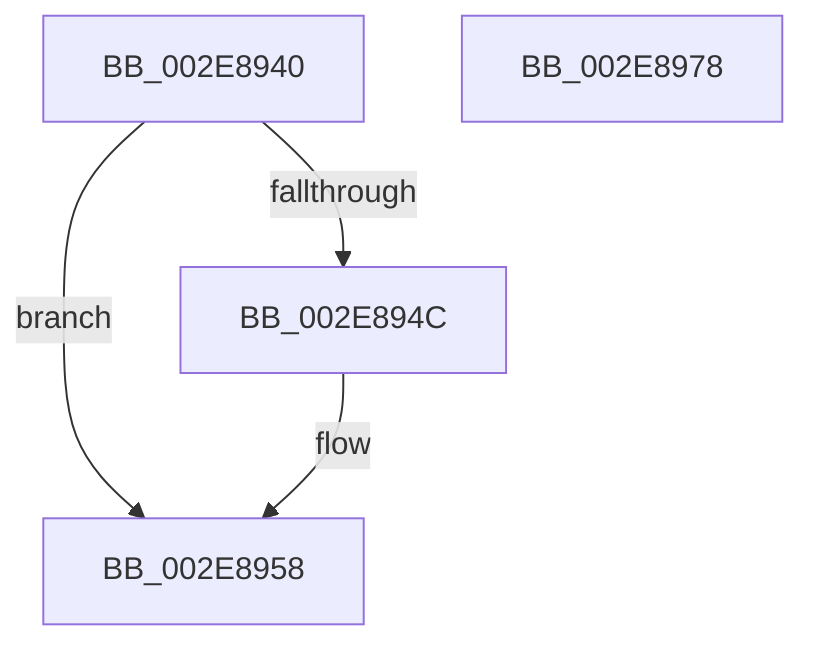

# RtlpHpLfhSubsegmentComputeCommitUnit

- RVA: `0x002E8940`–`0x002E8979` (길이 `57` bytes)
- VA: `0x00000001402E8940`
- 실행 섹션: `.text`
- PDB 이름 있음: `예`; PDB Function 태그: `아니요`
- unwind 정보 RVA: `0x000DB714`
- 디코드: `21`개 명령, `57/57` bytes 표시
- 미해석 바이트: `0` (있으면 어셈블리에 `.byte`로 보존)

> 이 문서는 커널 이미지의 기계어와 PDB 기호를 분석해 생성했습니다. 4번과 5번은 함수 원형과 자료형을 바이너리 사용 방식에서 추정한 C 해석이며 원본 소스 복구 결과는 아닙니다.

## 1. Dependencies

- 직접 호출 지점: **0**; 고유 호출 대상: **0**
- 직접 호출자로 확인된 함수: **3**
- RIP 상대 이미지 참조: **0**

### Outgoing calls
- 직접 디코드된 call 명령이 없습니다.

### Direct callers
- [RtlpHpLfhSubsegmentInitialize](RtlpHpLfhSubsegmentInitialize_function_002E806C.md) at `0x002E80C6`
- [RtlpHpLfhSubsegmentReformatAsMulti](RtlpHpLfhSubsegmentReformatAsMulti_function_002E8814.md) at `0x002E885A`
- [RtlpHpLfhSubsegmentCreate](RtlpHpLfhSubsegmentCreate_function_002EC5A0.md) at `0x002EC6AF`

### Static image references
- 디코드된 RIP-relative 메모리 참조가 없습니다.

## 2. Other-region calls and transfers

- 다른 실행 섹션으로 향하는 call: **0**
- 별도 외부 분기/꼬리 이동을 확인하지 못했습니다.

## 3. Assembly (complete function range)

```asm
002E8940  03 D2                           add edx, edx
002E8942  44 8B C1                        mov r8d, ecx
002E8945  8D 42 FF                        lea eax, [rdx - 1]
002E8948  85 C2                           test edx, eax
002E894A  74 0C                           je 0x1402e8958
002E894C  0F BD CA                        bsr ecx, edx
002E894F  BA 01 00 00 00                  mov edx, 1
002E8954  FF C1                           inc ecx
002E8956  D3 E2                           shl edx, cl
002E8958  B8 00 10 00 00                  mov eax, 0x1000
002E895D  41 8B C8                        mov ecx, r8d
002E8960  3B D0                           cmp edx, eax
002E8962  0F 46 D0                        cmovbe edx, eax
002E8965  C1 E9 06                        shr ecx, 6
002E8968  3B D1                           cmp edx, ecx
002E896A  0F 46 D1                        cmovbe edx, ecx
002E896D  41 3B D0                        cmp edx, r8d
002E8970  44 0F 42 C2                     cmovb r8d, edx
002E8974  41 8B C0                        mov eax, r8d
002E8977  C3                              ret
002E8978  CC                              int3
```

## 4. C-style interpretation (structured pseudocode)

```c
__int64 __fastcall RtlpHpLfhSubsegmentComputeCommitUnit(int a1, int a2)
{
    a2 = (unsigned int)((a2) + (a2));
    if (((a2) & ((unsigned int)(a2 - 1))) != 0) {
        a2 = 1;
        a1 = (unsigned int)((a1) + 1);
        a2 = (unsigned int)((a2) << ((unsigned __int8)(a1)));
    }
    if (a2 <= ((unsigned int)((unsigned int)(0x1000ULL)))) { a2 = (unsigned int)((unsigned int)(0x1000ULL)); }
    a1 = (unsigned int)(((unsigned int)((unsigned int)((unsigned int)(a1)))) >> (6));
    if (a2 <= a1) { a2 = a1; }
    a3 = (unsigned int)(a1);
    if (a2 < ((unsigned int)((unsigned int)(a1)))) { a3 = a2; }
    return (unsigned int)((unsigned int)(a3));
}
```

## 5. (Beta) C Style

```c
int64_t RtlpHpLfhSubsegmentComputeCommitUnit(int32_t Arg1, void *Arg2)
{
    uint8_t *arg2 = (uint8_t *)Arg2;

    Arg2 = (uint32_t)((Arg2) + (Arg2));
    if (((Arg2) & ((uint32_t)(Arg2 - 1))) != 0) {
        Arg2 = 1;
        Arg1 = (uint32_t)((Arg1) + 1);
        Arg2 = (uint32_t)((Arg2) << ((uint8_t)(Arg1)));
    }
    if (Arg2 <= ((uint32_t)((uint32_t)(0x1000ULL)))) { Arg2 = (uint32_t)((uint32_t)(0x1000ULL)); }
    Arg1 = (uint32_t)(((uint32_t)((uint32_t)((uint32_t)(Arg1)))) >> (6));
    if (Arg2 <= Arg1) { Arg2 = Arg1; }
    a3 = (uint32_t)(Arg1);
    if (Arg2 < ((uint32_t)((uint32_t)(Arg1)))) { a3 = Arg2; }
    return (uint32_t)((uint32_t)(a3));
}
```

### 관측된 메모리 오프셋

구조체 형식이 확인되지 않은 접근은 인자 기준의 오프셋으로만 기록했습니다.

| 기준 인자 | 오프셋 표현 | 폭 (bit) | 접근 |
|---|---:|---:|---|
| `Arg2` | `- 0x1` | `32` | `R` |

## 6. Execution-region graph

[열기: 2D/3D 그래프와 함수 탐색 컨트롤 패널](../../../control-panel.html?section=text&rva=0x002E8940&view=graph)

- 2D 그래프는 위에서 아래로 흐르고, 3D 그래프는 빈 공간을 드래그해 회전합니다. Shift+드래그는 이동, 휠은 확대·축소, 함수 노드 선택은 대상 보고서 이동입니다.

### Static fallback


