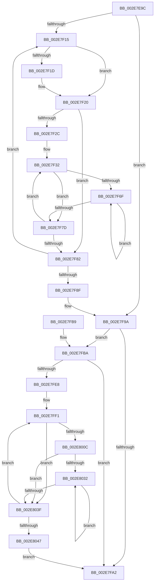

# RtlpHpLfhSubsegmentConstructCommitState

- RVA: `0x002E7E9C`–`0x002E804C` (길이 `432` bytes)
- VA: `0x00000001402E7E9C`
- 실행 섹션: `.text`
- PDB 이름 있음: `예`; PDB Function 태그: `아니요`
- unwind 정보 RVA: `0x000713C0`
- 디코드: `135`개 명령, `432/432` bytes 표시
- 미해석 바이트: `0` (있으면 어셈블리에 `.byte`로 보존)

> 이 문서는 커널 이미지의 기계어와 PDB 기호를 분석해 생성했습니다. 4번과 5번은 함수 원형과 자료형을 바이너리 사용 방식에서 추정한 C 해석이며 원본 소스 복구 결과는 아닙니다.

## 1. Dependencies

- 직접 호출 지점: **0**; 고유 호출 대상: **0**
- 직접 호출자로 확인된 함수: **2**
- RIP 상대 이미지 참조: **1**

### Outgoing calls
- 직접 디코드된 call 명령이 없습니다.

### Direct callers
- [RtlpHpLfhSubsegmentReformatAsMulti](RtlpHpLfhSubsegmentReformatAsMulti_function_002E8814.md) at `0x002E88DF`
- [RtlpHpLfhSubsegmentReformatCheck](../46/RtlpHpLfhSubsegmentReformatCheck_function_00461EA4.md) at `0x00461F51`

### Static image references
- `0x002E7ED8` → RVA `0x00E28308` (`.data`; read)

## 2. Other-region calls and transfers

- 다른 실행 섹션으로 향하는 call: **0**
- 별도 외부 분기/꼬리 이동을 확인하지 못했습니다.

## 3. Assembly (complete function range)

```asm
002E7E9C  48 8B C4                        mov rax, rsp
002E7E9F  48 89 58 18                     mov qword ptr [rax + 0x18], rbx
002E7EA3  48 89 68 20                     mov qword ptr [rax + 0x20], rbp
002E7EA7  48 89 48 08                     mov qword ptr [rax + 8], rcx
002E7EAB  56                              push rsi
002E7EAC  57                              push rdi
002E7EAD  41 54                           push r12
002E7EAF  41 55                           push r13
002E7EB1  41 56                           push r14
002E7EB3  41 57                           push r15
002E7EB5  83 60 10 00                     and dword ptr [rax + 0x10], 0
002E7EB9  4D 8B D0                        mov r10, r8
002E7EBC  4C 8B C1                        mov r8, rcx
002E7EBF  49 83 CF FF                     or r15, 0xffffffffffffffff
002E7EC3  48 8B C2                        mov rax, rdx
002E7EC6  41 BC 01 00 00 00               mov r12d, 1
002E7ECC  48 C1 E8 0C                     shr rax, 0xc
002E7ED0  33 FF                           xor edi, edi
002E7ED2  33 42 28                        xor eax, dword ptr [rdx + 0x28]
002E7ED5  45 33 F6                        xor r14d, r14d
002E7ED8  33 05 2A 04 B4 00               xor eax, dword ptr [rip + 0xb4042a]
002E7EDE  49 8B F1                        mov rsi, r9
002E7EE1  66 45 89 21                     mov word ptr [r9], r12w
002E7EE5  48 8B DA                        mov rbx, rdx
002E7EE8  0F B6 6A 18                     movzx ebp, byte ptr [rdx + 0x18]
002E7EEC  8A 4A 22                        mov cl, byte ptr [rdx + 0x22]
002E7EEF  83 C5 F8                        add ebp, -8
002E7EF2  02 4A 25                        add cl, byte ptr [rdx + 0x25]
002E7EF5  48 FF CD                        dec rbp
002E7EF8  F6 D9                           neg cl
002E7EFA  89 44 24 40                     mov dword ptr [rsp + 0x40], eax
002E7EFE  80 E1 3F                        and cl, 0x3f
002E7F01  44 0F B7 E8                     movzx r13d, ax
002E7F05  49 D3 EF                        shr r15, cl
002E7F08  49 8D 2C EA                     lea rbp, [r10 + rbp*8]
002E7F0C  4C 3B D5                        cmp r10, rbp
002E7F0F  0F 87 85 00 00 00               ja 0x1402e7f9a
002E7F15  4D 8B 02                        mov r8, qword ptr [r10]
002E7F18  4C 3B D5                        cmp r10, rbp
002E7F1B  75 03                           jne 0x1402e7f20
002E7F1D  4D 23 C7                        and r8, r15
002E7F20  F3 49 0F B8 C0                  popcnt rax, r8
002E7F25  03 F8                           add edi, eax
002E7F27  4D 85 C0                        test r8, r8
002E7F2A  74 56                           je 0x1402e7f82
002E7F2C  44 0F B7 64 24 42               movzx r12d, word ptr [rsp + 0x42]
002E7F32  0F B6 4B 26                     movzx ecx, byte ptr [rbx + 0x26]
002E7F36  45 8D 4D FF                     lea r9d, [r13 - 1]
002E7F3A  49 0F BC D0                     bsf rdx, r8
002E7F3E  8B C2                           mov eax, edx
002E7F40  41 03 D6                        add edx, r14d
002E7F43  41 0F AF D5                     imul edx, r13d
002E7F47  49 0F BB C0                     btc r8, rax
002E7F4B  41 03 D4                        add edx, r12d
002E7F4E  44 03 CA                        add r9d, edx
002E7F51  44 8B DA                        mov r11d, edx
002E7F54  41 C1 E9 0C                     shr r9d, 0xc
002E7F58  41 D3 E9                        shr r9d, cl
002E7F5B  41 C1 EB 0C                     shr r11d, 0xc
002E7F5F  41 D3 EB                        shr r11d, cl
002E7F62  B9 01 00 00 00                  mov ecx, 1
002E7F67  45 2B CB                        sub r9d, r11d
002E7F6A  44 03 C9                        add r9d, ecx
002E7F6D  74 0E                           je 0x1402e7f7d
002E7F6F  66 42 01 0C 5E                  add word ptr [rsi + r11*2], cx
002E7F74  44 03 D9                        add r11d, ecx
002E7F77  41 83 C1 FF                     add r9d, -1
002E7F7B  75 F2                           jne 0x1402e7f6f
002E7F7D  4D 85 C0                        test r8, r8
002E7F80  75 B0                           jne 0x1402e7f32
002E7F82  49 83 C2 08                     add r10, 8
002E7F86  41 83 C6 40                     add r14d, 0x40
002E7F8A  4C 3B D5                        cmp r10, rbp
002E7F8D  76 86                           jbe 0x1402e7f15
002E7F8F  4C 8B 44 24 38                  mov r8, qword ptr [rsp + 0x38]
002E7F94  41 BC 01 00 00 00               mov r12d, 1
002E7F9A  0F B6 43 25                     movzx eax, byte ptr [rbx + 0x25]
002E7F9E  84 C0                           test al, al
002E7FA0  75 18                           jne 0x1402e7fba
002E7FA2  48 8B 5C 24 48                  mov rbx, qword ptr [rsp + 0x48]
002E7FA7  8B C7                           mov eax, edi
002E7FA9  48 8B 6C 24 50                  mov rbp, qword ptr [rsp + 0x50]
002E7FAE  41 5F                           pop r15
002E7FB0  41 5E                           pop r14
002E7FB2  41 5D                           pop r13
002E7FB4  41 5C                           pop r12
002E7FB6  5F                              pop rdi
002E7FB7  5E                              pop rsi
002E7FB8  C3                              ret
002E7FB9  CC                              int3
002E7FBA  0F B7 4B 26                     movzx ecx, word ptr [rbx + 0x26]
002E7FBE  41 BE 00 10 00 00               mov r14d, 0x1000
002E7FC4  44 0F B7 5B 2C                  movzx r11d, word ptr [rbx + 0x2c]
002E7FC9  44 8B C9                        mov r9d, ecx
002E7FCC  41 C1 E9 08                     shr r9d, 8
002E7FD0  2B F8                           sub edi, eax
002E7FD2  41 C1 E1 0C                     shl r9d, 0xc
002E7FD6  45 8B D6                        mov r10d, r14d
002E7FD9  49 C1 E3 06                     shl r11, 6
002E7FDD  41 D3 E1                        shl r9d, cl
002E7FE0  4D 03 D8                        add r11, r8
002E7FE3  45 3B CE                        cmp r9d, r14d
002E7FE6  76 BA                           jbe 0x1402e7fa2
002E7FE8  0F B7 6C 24 42                  movzx ebp, word ptr [rsp + 0x42]
002E7FED  49 83 CF FF                     or r15, 0xffffffffffffffff
002E7FF1  41 8B 4B 48                     mov ecx, dword ptr [r11 + 0x48]
002E7FF5  41 8B D2                        mov edx, r10d
002E7FF8  2B D5                           sub edx, ebp
002E7FFA  8B C2                           mov eax, edx
002E7FFC  48 0F AF C8                     imul rcx, rax
002E8000  48 C1 E9 20                     shr rcx, 0x20
002E8004  41 0F AF CD                     imul ecx, r13d
002E8008  2B D1                           sub edx, ecx
002E800A  74 33                           je 0x1402e803f
002E800C  0F B6 4B 26                     movzx ecx, byte ptr [rbx + 0x26]
002E8010  41 8B C2                        mov eax, r10d
002E8013  2B C2                           sub eax, edx
002E8015  41 8D 55 FF                     lea edx, [r13 - 1]
002E8019  03 D0                           add edx, eax
002E801B  44 8B C0                        mov r8d, eax
002E801E  C1 EA 0C                        shr edx, 0xc
002E8021  41 C1 E8 0C                     shr r8d, 0xc
002E8025  D3 EA                           shr edx, cl
002E8027  41 D3 E8                        shr r8d, cl
002E802A  41 2B D0                        sub edx, r8d
002E802D  41 03 D4                        add edx, r12d
002E8030  74 0D                           je 0x1402e803f
002E8032  66 46 01 3C 46                  add word ptr [rsi + r8*2], r15w
002E8037  45 03 C4                        add r8d, r12d
002E803A  83 C2 FF                        add edx, -1
002E803D  75 F3                           jne 0x1402e8032
002E803F  45 03 D6                        add r10d, r14d
002E8042  45 3B D1                        cmp r10d, r9d
002E8045  72 AA                           jb 0x1402e7ff1
002E8047  E9 56 FF FF FF                  jmp 0x1402e7fa2
```

## 4. C-style interpretation (structured pseudocode)

```c
__int64 __fastcall RtlpHpLfhSubsegmentConstructCommitState(__int64 a1, __int64 a2, __int64 a3, __int64 a4)
{
    __int64 result;
    __int64 v_r10;
    __int64 v_r11;
    __int64 v_r14;
    __int64 v_r15;
    __int64 v_rbp;
    __int64 v_rdi;
    unsigned int v_stack_p10;
    unsigned __int16 v_stack_p12;
    unsigned __int64 v_stack_p18;
    unsigned __int64 v_stack_p20;
    unsigned __int16 v_stack_p42;
    unsigned __int64 v_stack_p8;

    *(unsigned __int64 *)(v_rsp + 24) = v_rbx;
    *(unsigned __int64 *)(v_rsp + 32) = v_rbp;
    *(unsigned __int64 *)(v_rsp + 8) = a1;
    v_r15 = (v_r15) | (-1);
    result = (a2) >> (12);
    v_rdi = 0;
    result = (unsigned int)((result) ^ (*(unsigned int *)(a2 + 40)));
    v_r14 = 0;
    result = (unsigned int)((result) ^ (*(unsigned int *)(v_rip + 11797546)));
    *(unsigned __int16 *)(a4) = 1;
    v_rbp = (unsigned int)((*(unsigned __int8 *)(a2 + 24)) + (-8));
    a1 = (unsigned __int8)((*(unsigned __int8 *)(a2 + 34)) + (*(unsigned __int8 *)(a2 + 37)));
    v_rbp = (v_rbp) - 1;
    a1 = (unsigned __int8)(-(a1));
    v_stack_p10 = (unsigned int)(result);
    a1 = (unsigned __int8)((a1) & (63));
    v_r15 = (v_r15) >> ((unsigned __int8)(a1));
    if (a3 > (a3 + v_rbp * 8)) goto loc_002E7F9A;
loc_002E7F15:
    if (a3 == (a3 + v_rbp * 8)) {
        a3 = (*(unsigned __int64 *)(a3)) & (v_r15);
    }
    v_rdi = (unsigned int)((v_rdi) + ((unsigned int)(result)));
    if (a3 == 0) goto loc_002E7F82;
loc_002E7F32:
    a2 = (unsigned int)((a2) + (0));
    a2 = (unsigned int)((a2) * ((unsigned int)((unsigned __int16)(result))));
    a2 = (unsigned int)((a2) + ((unsigned int)(v_stack_p12)));
    a4 = (unsigned int)(((unsigned __int16)(result) - 1) + ((unsigned int)(a2)));
    a4 = (unsigned int)((a4) >> (12));
    a4 = (unsigned int)((a4) >> ((unsigned __int8)(*(unsigned __int8 *)(a2 + 38))));
    v_r11 = (unsigned int)(((unsigned int)((unsigned int)(a2))) >> (12));
    v_r11 = (unsigned int)((v_r11) >> ((unsigned __int8)(*(unsigned __int8 *)(a2 + 38))));
    a4 = (unsigned int)((a4) - ((unsigned int)(v_r11)));
    a4 = (unsigned int)((a4) + (1));
    if (condition_is_equal) goto loc_002E7F7D;
loc_002E7F6F:
    v_r11 = (unsigned int)((v_r11) + (1));
    a4 = (unsigned int)((a4) + (-1));
    if (condition_is_not_equal) goto loc_002E7F6F;
loc_002E7F7D:
    if (a3 != 0) goto loc_002E7F32;
loc_002E7F82:
    v_r10 = (a3) + (8);
    v_r14 = (unsigned int)((v_r14) + (64));
    if (v_r10 <= (a3 + v_rbp * 8)) goto loc_002E7F15;
loc_002E7F9A:
    if ((unsigned __int8)(*(unsigned __int8 *)(a2 + 37)) != 0) goto loc_002E7FBA;
loc_002E7FA2:
    return (unsigned int)((unsigned int)(v_rdi));
loc_002E7FBA:
    a4 = (unsigned int)(((unsigned int)((unsigned int)(*(unsigned __int16 *)(v_stack_p18 + 38)))) >> (8));
    v_rdi = (unsigned int)((v_rdi) - ((unsigned int)((unsigned int)((unsigned int)(v_rdi)))));
    a4 = (unsigned int)((a4) << (12));
    v_r11 = (*(unsigned __int16 *)(v_stack_p18 + 44)) << (6);
    a4 = (unsigned int)((a4) << ((unsigned __int8)(*(unsigned __int16 *)(v_stack_p18 + 38))));
    v_r11 = (v_r11) + (v_stack_p8);
    if (((unsigned int)(a4)) <= ((unsigned int)((unsigned int)(0x1000ULL)))) goto loc_002E7FA2;
    v_r15 = (v_r15) | (-1);
loc_002E7FF1:
    a2 = (unsigned int)(((unsigned int)((unsigned int)((unsigned int)((unsigned int)((unsigned int)(0x1000ULL)))))) - ((unsigned int)(v_stack_p42)));
    a1 = ((unsigned int)(*(unsigned int *)(v_r11 + 72))) * ((unsigned int)((unsigned int)(a2)));
    a1 = (a1) >> (32);
    a1 = (unsigned int)((a1) * ((unsigned int)((unsigned __int16)(result))));
    a2 = (unsigned int)((a2) - ((unsigned int)(a1)));
    if (condition_is_equal) goto loc_002E803F;
    result = (unsigned int)(((unsigned int)((unsigned int)((unsigned int)((unsigned int)((unsigned int)(0x1000ULL)))))) - ((unsigned int)(a2)));
    a2 = (unsigned int)(((unsigned __int16)(result) - 1) + ((unsigned int)(result)));
    a2 = (unsigned int)((a2) >> (12));
    a3 = (unsigned int)(((unsigned int)((unsigned int)(result))) >> (12));
    a2 = (unsigned int)((a2) >> ((unsigned __int8)(*(unsigned __int8 *)(v_stack_p18 + 38))));
    a3 = (unsigned int)((a3) >> ((unsigned __int8)(*(unsigned __int8 *)(v_stack_p18 + 38))));
    a2 = (unsigned int)((a2) - ((unsigned int)(a3)));
    a2 = (unsigned int)((a2) + (1));
    if (condition_is_equal) goto loc_002E803F;
loc_002E8032:
    a3 = (unsigned int)((a3) + (1));
    a2 = (unsigned int)((a2) + (-1));
    if (condition_is_not_equal) goto loc_002E8032;
loc_002E803F:
    v_r10 = (unsigned int)(((unsigned int)((unsigned int)((unsigned int)(0x1000ULL)))) + ((unsigned int)((unsigned int)(0x1000ULL))));
    if (((unsigned int)(v_r10)) < ((unsigned int)(a4))) goto loc_002E7FF1;
    goto loc_002E7FA2;
}
```

## 5. (Beta) C Style

```c
int64_t RtlpHpLfhSubsegmentConstructCommitState(int64_t Arg1, void *Arg2, void *Arg3, void *Arg4)
{
    uint8_t *arg2 = (uint8_t *)Arg2;
    uint8_t *arg3 = (uint8_t *)Arg3;
    uint8_t *arg4 = (uint8_t *)Arg4;

    int64_t result;
    int64_t local_r10;
    int64_t local_r11;
    int64_t local_r14;
    int64_t local_r15;
    int64_t local_rbp;
    int64_t local_rdi;
    uint32_t v_stack_p10;
    uint16_t v_stack_p12;
    uint64_t v_stack_p18;
    uint64_t v_stack_p20;
    uint16_t v_stack_p42;
    uint64_t v_stack_p8;

    *(uint64_t *)(local_rsp + 0x18) = local_rbx;
    *(uint64_t *)(local_rsp + 0x20) = local_rbp;
    *(uint64_t *)(local_rsp + 0x8) = Arg1;
    local_r15 = (local_r15) | (-1);
    result = (Arg2) >> (12);
    local_rdi = 0;
    result = (uint32_t)((result) ^ (*(uint32_t *)(arg2 + 0x28)));
    local_r14 = 0;
    result = (uint32_t)((result) ^ (*(uint32_t *)(v_rip + 0xB4042A)));
    *(uint16_t *)(arg4) = 1;
    local_rbp = (uint32_t)((*(uint8_t *)(arg2 + 0x18)) + (-8));
    Arg1 = (uint8_t)((*(uint8_t *)(arg2 + 0x22)) + (*(uint8_t *)(arg2 + 0x25)));
    local_rbp = (local_rbp) - 1;
    Arg1 = (uint8_t)(-(Arg1));
    v_stack_p10 = (uint32_t)(result);
    Arg1 = (uint8_t)((Arg1) & (63));
    local_r15 = (local_r15) >> ((uint8_t)(Arg1));
    if (Arg3 > (Arg3 + local_rbp * 8)) goto loc_002E7F9A;
loc_002E7F15:
    if (Arg3 == (Arg3 + local_rbp * 8)) {
        Arg3 = (*(uint64_t *)(arg3)) & (local_r15);
    }
    local_rdi = (uint32_t)((local_rdi) + ((uint32_t)(result)));
    if (Arg3 == NULL) goto loc_002E7F82;
loc_002E7F32:
    Arg2 = (uint32_t)((Arg2) + (0));
    Arg2 = (uint32_t)((Arg2) * ((uint32_t)((uint16_t)(result))));
    Arg2 = (uint32_t)((Arg2) + ((uint32_t)(v_stack_p12)));
    Arg4 = (uint32_t)(((uint16_t)(result) - 1) + ((uint32_t)(Arg2)));
    Arg4 = (uint32_t)((Arg4) >> (12));
    Arg4 = (uint32_t)((Arg4) >> ((uint8_t)(*(uint8_t *)(arg2 + 0x26))));
    local_r11 = (uint32_t)(((uint32_t)((uint32_t)(Arg2))) >> (12));
    local_r11 = (uint32_t)((local_r11) >> ((uint8_t)(*(uint8_t *)(arg2 + 0x26))));
    Arg4 = (uint32_t)((Arg4) - ((uint32_t)(local_r11)));
    Arg4 = (uint32_t)((Arg4) + (1));
    if (condition_is_equal) goto loc_002E7F7D;
loc_002E7F6F:
    local_r11 = (uint32_t)((local_r11) + (1));
    Arg4 = (uint32_t)((Arg4) + (-1));
    if (condition_is_not_equal) goto loc_002E7F6F;
loc_002E7F7D:
    if (Arg3 != NULL) goto loc_002E7F32;
loc_002E7F82:
    local_r10 = (Arg3) + (8);
    local_r14 = (uint32_t)((local_r14) + (64));
    if (local_r10 <= (Arg3 + local_rbp * 8)) goto loc_002E7F15;
loc_002E7F9A:
    if ((uint8_t)(*(uint8_t *)(arg2 + 0x25)) != 0) goto loc_002E7FBA;
loc_002E7FA2:
    return (uint32_t)((uint32_t)(local_rdi));
loc_002E7FBA:
    Arg4 = (uint32_t)(((uint32_t)((uint32_t)(*(uint16_t *)(v_stack_p18 + 0x26)))) >> (8));
    local_rdi = (uint32_t)((local_rdi) - ((uint32_t)((uint32_t)((uint32_t)(local_rdi)))));
    Arg4 = (uint32_t)((Arg4) << (12));
    local_r11 = (*(uint16_t *)(v_stack_p18 + 0x2C)) << (6);
    Arg4 = (uint32_t)((Arg4) << ((uint8_t)(*(uint16_t *)(v_stack_p18 + 0x26))));
    local_r11 = (local_r11) + (v_stack_p8);
    if (((uint32_t)(Arg4)) <= ((uint32_t)((uint32_t)(0x1000ULL)))) goto loc_002E7FA2;
    local_r15 = (local_r15) | (-1);
loc_002E7FF1:
    Arg2 = (uint32_t)(((uint32_t)((uint32_t)((uint32_t)((uint32_t)((uint32_t)(0x1000ULL)))))) - ((uint32_t)(v_stack_p42)));
    Arg1 = ((uint32_t)(*(uint32_t *)(local_r11 + 0x48))) * ((uint32_t)((uint32_t)(Arg2)));
    Arg1 = (Arg1) >> (32);
    Arg1 = (uint32_t)((Arg1) * ((uint32_t)((uint16_t)(result))));
    Arg2 = (uint32_t)((Arg2) - ((uint32_t)(Arg1)));
    if (condition_is_equal) goto loc_002E803F;
    result = (uint32_t)(((uint32_t)((uint32_t)((uint32_t)((uint32_t)((uint32_t)(0x1000ULL)))))) - ((uint32_t)(Arg2)));
    Arg2 = (uint32_t)(((uint16_t)(result) - 1) + ((uint32_t)(result)));
    Arg2 = (uint32_t)((Arg2) >> (12));
    Arg3 = (uint32_t)(((uint32_t)((uint32_t)(result))) >> (12));
    Arg2 = (uint32_t)((Arg2) >> ((uint8_t)(*(uint8_t *)(v_stack_p18 + 0x26))));
    Arg3 = (uint32_t)((Arg3) >> ((uint8_t)(*(uint8_t *)(v_stack_p18 + 0x26))));
    Arg2 = (uint32_t)((Arg2) - ((uint32_t)(Arg3)));
    Arg2 = (uint32_t)((Arg2) + (1));
    if (condition_is_equal) goto loc_002E803F;
loc_002E8032:
    Arg3 = (uint32_t)((Arg3) + (1));
    Arg2 = (uint32_t)((Arg2) + (-1));
    if (condition_is_not_equal) goto loc_002E8032;
loc_002E803F:
    local_r10 = (uint32_t)(((uint32_t)((uint32_t)((uint32_t)(0x1000ULL)))) + ((uint32_t)((uint32_t)(0x1000ULL))));
    if (((uint32_t)(local_r10)) < ((uint32_t)(Arg4))) goto loc_002E7FF1;
    goto loc_002E7FA2;
}
```

### 관측된 메모리 오프셋

구조체 형식이 확인되지 않은 접근은 인자 기준의 오프셋으로만 기록했습니다.

| 기준 인자 | 오프셋 표현 | 폭 (bit) | 접근 |
|---|---:|---:|---|
| `Arg2` | `+ 0x18` | `8` | `R` |
| `Arg2` | `+ 0x22` | `8` | `R` |
| `Arg2` | `+ 0x25` | `8` | `R` |
| `Arg2` | `+ 0x26` | `8` | `R` |
| `Arg2` | `+ 0x26` | `16` | `R` |
| `Arg2` | `+ 0x28` | `32` | `R` |
| `Arg2` | `+ 0x2C` | `16` | `R` |
| `Arg3` | `+ 0x0 + rbp*8` | `64` | `R` |
| `Arg4` | `+ 0x0` | `16` | `W` |
| `Arg4` | `+ 0x0 + r11*2` | `16` | `R/W` |
| `Arg4` | `+ 0x0 + r8*2` | `16` | `R/W` |

## 6. Execution-region graph

[열기: 2D/3D 그래프와 함수 탐색 컨트롤 패널](../../../control-panel.html?section=text&rva=0x002E7E9C&view=graph)

- 2D 그래프는 위에서 아래로 흐르고, 3D 그래프는 빈 공간을 드래그해 회전합니다. Shift+드래그는 이동, 휠은 확대·축소, 함수 노드 선택은 대상 보고서 이동입니다.

### Static fallback


