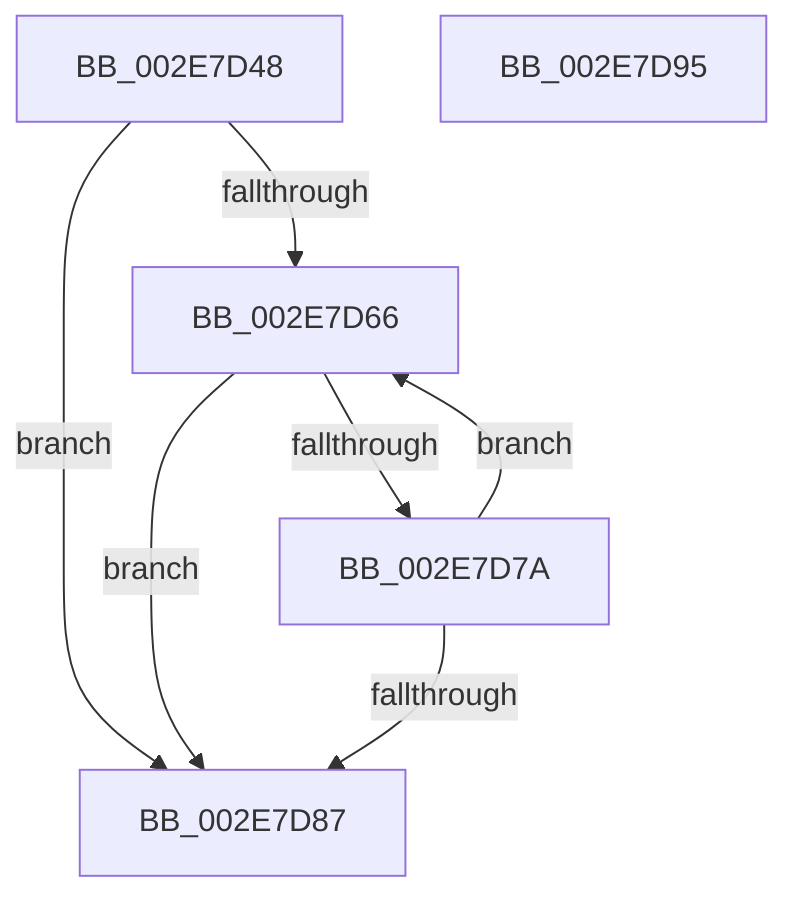

# RtlpHpLfhSubsegmentCountEmptyUnits

- RVA: `0x002E7D48`–`0x002E7D96` (길이 `78` bytes)
- VA: `0x00000001402E7D48`
- 실행 섹션: `.text`
- PDB 이름 있음: `예`; PDB Function 태그: `아니요`
- unwind 정보 RVA: `0x00068D5C`
- 디코드: `26`개 명령, `78/78` bytes 표시
- 미해석 바이트: `0` (있으면 어셈블리에 `.byte`로 보존)

> 이 문서는 커널 이미지의 기계어와 PDB 기호를 분석해 생성했습니다. 4번과 5번은 함수 원형과 자료형을 바이너리 사용 방식에서 추정한 C 해석이며 원본 소스 복구 결과는 아닙니다.

## 1. Dependencies

- 직접 호출 지점: **1**; 고유 호출 대상: **1**
- 직접 호출자로 확인된 함수: **2**
- RIP 상대 이미지 참조: **0**

### Outgoing calls
- `0x002E7D70` → [RtlpHpLfhSubsegmentFindEmptyUnits](../32/RtlpHpLfhSubsegmentFindEmptyUnits_function_00324600.md) (function, `0x00324600`)

### Direct callers
- [RtlpHpLfhSubsegmentFree](RtlpHpLfhSubsegmentFree_function_002E7CA0.md) at `0x002E7CCB`
- [RtlpHpLfhSubsegmentReformatAsMulti](RtlpHpLfhSubsegmentReformatAsMulti_function_002E8814.md) at `0x002E88E7`

### Static image references
- 디코드된 RIP-relative 메모리 참조가 없습니다.

## 2. Other-region calls and transfers

- 다른 실행 섹션으로 향하는 call: **0**
- 별도 외부 분기/꼬리 이동을 확인하지 못했습니다.

## 3. Assembly (complete function range)

```asm
002E7D48  48 89 5C 24 10                  mov qword ptr [rsp + 0x10], rbx
002E7D4D  57                              push rdi
002E7D4E  48 83 EC 20                     sub rsp, 0x20
002E7D52  0F B6 59 27                     movzx ebx, byte ptr [rcx + 0x27]
002E7D56  33 C0                           xor eax, eax
002E7D58  89 44 24 30                     mov dword ptr [rsp + 0x30], eax
002E7D5C  48 8B F9                        mov rdi, rcx
002E7D5F  44 8B D8                        mov r11d, eax
002E7D62  85 DB                           test ebx, ebx
002E7D64  74 21                           je 0x1402e7d87
002E7D66  4C 8D 44 24 30                  lea r8, [rsp + 0x30]
002E7D6B  8B D0                           mov edx, eax
002E7D6D  48 8B CF                        mov rcx, rdi
002E7D70  E8 8B C8 03 00                  call 0x140324600
002E7D75  83 F8 FF                        cmp eax, -1
002E7D78  74 0D                           je 0x1402e7d87
002E7D7A  44 03 5C 24 30                  add r11d, dword ptr [rsp + 0x30]
002E7D7F  03 44 24 30                     add eax, dword ptr [rsp + 0x30]
002E7D83  3B C3                           cmp eax, ebx
002E7D85  72 DF                           jb 0x1402e7d66
002E7D87  48 8B 5C 24 38                  mov rbx, qword ptr [rsp + 0x38]
002E7D8C  41 8B C3                        mov eax, r11d
002E7D8F  48 83 C4 20                     add rsp, 0x20
002E7D93  5F                              pop rdi
002E7D94  C3                              ret
002E7D95  CC                              int3
```

## 4. C-style interpretation (structured pseudocode)

```c
__int64 __fastcall RtlpHpLfhSubsegmentCountEmptyUnits(__int64 a1)
{
    __int64 result;
    __int64 v_r11;
    __int64 v_rsp;
    unsigned __int64 v_stack_p10;
    unsigned int v_stack_p8;

    v_stack_p10 = v_rbx;
    v_rsp = (v_rsp) - (32);
    result = 0;
    v_stack_p8 = 0;
    if ((unsigned int)(*(unsigned __int8 *)(a1 + 39)) == 0) goto loc_002E7D87;
loc_002E7D66:
    result = RtlpHpLfhSubsegmentFindEmptyUnits(a1, 0, v_stack_p8, a4);
    if (((unsigned int)(result)) == -1) goto loc_002E7D87;
    v_r11 = (unsigned int)((0) + (v_stack_p8));
    result = (unsigned int)((result) + (v_stack_p8));
    if (((unsigned int)(result)) < ((unsigned int)(*(unsigned __int8 *)(a1 + 39)))) goto loc_002E7D66;
loc_002E7D87:
    v_rsp = (v_rsp) + (32);
    return (unsigned int)((unsigned int)(v_r11));
}
```

## 5. (Beta) C Style

```c
int64_t RtlpHpLfhSubsegmentCountEmptyUnits(void *Arg1)
{
    uint8_t *arg1 = (uint8_t *)Arg1;

    int64_t result;
    int64_t local_r11;
    int64_t local_rsp;
    uint64_t v_stack_p10;
    uint32_t v_stack_p8;

    v_stack_p10 = local_rbx;
    local_rsp = (local_rsp) - (32);
    result = 0;
    v_stack_p8 = 0;
    if ((uint32_t)(*(uint8_t *)(arg1 + 0x27)) == 0) goto loc_002E7D87;
loc_002E7D66:
    result = RtlpHpLfhSubsegmentFindEmptyUnits(Arg1, 0, v_stack_p8, a4);
    if (((uint32_t)(result)) == -1) goto loc_002E7D87;
    local_r11 = (uint32_t)((0) + (v_stack_p8));
    result = (uint32_t)((result) + (v_stack_p8));
    if (((uint32_t)(result)) < ((uint32_t)(*(uint8_t *)(arg1 + 0x27)))) goto loc_002E7D66;
loc_002E7D87:
    local_rsp = (local_rsp) + (32);
    return (uint32_t)((uint32_t)(local_r11));
}
```

### 관측된 메모리 오프셋

구조체 형식이 확인되지 않은 접근은 인자 기준의 오프셋으로만 기록했습니다.

| 기준 인자 | 오프셋 표현 | 폭 (bit) | 접근 |
|---|---:|---:|---|
| `Arg1` | `+ 0x27` | `8` | `R` |

## 6. Execution-region graph

[열기: 2D/3D 그래프와 함수 탐색 컨트롤 패널](../../../control-panel.html?section=text&rva=0x002E7D48&view=graph)

- 2D 그래프는 위에서 아래로 흐르고, 3D 그래프는 빈 공간을 드래그해 회전합니다. Shift+드래그는 이동, 휠은 확대·축소, 함수 노드 선택은 대상 보고서 이동입니다.

### Static fallback


