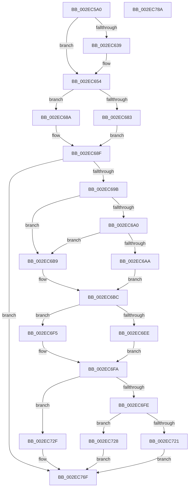

# RtlpHpLfhSubsegmentCreate

- RVA: `0x002EC5A0`–`0x002EC78B` (길이 `491` bytes)
- VA: `0x00000001402EC5A0`
- 실행 섹션: `.text`
- PDB 이름 있음: `예`; PDB Function 태그: `아니요`
- unwind 정보 RVA: `0x000717C4`
- 디코드: `140`개 명령, `491/491` bytes 표시
- 미해석 바이트: `0` (있으면 어셈블리에 `.byte`로 보존)

> 이 문서는 커널 이미지의 기계어와 PDB 기호를 분석해 생성했습니다. 4번과 5번은 함수 원형과 자료형을 바이너리 사용 방식에서 추정한 C 해석이며 원본 소스 복구 결과는 아닙니다.

## 1. Dependencies

- 직접 호출 지점: **11**; 고유 호출 대상: **8**
- 직접 호출자로 확인된 함수: **1**
- RIP 상대 이미지 참조: **5**

### Outgoing calls
- `0x002EC5E5` → [RtlpHpLfhBucketComputeNewSubsegmentBlockCount](RtlpHpLfhBucketComputeNewSubsegmentBlockCount_function_002EC7C4.md) (function, `0x002EC7C4`)
- `0x002EC618` → [RtlpCalculateSubsegmentSizeIndex](RtlpCalculateSubsegmentSizeIndex_function_002EC794.md) (function, `0x002EC794`)
- `0x002EC63C` → [RtlpCalculateSubsegmentSizeIndex](RtlpCalculateSubsegmentSizeIndex_function_002EC794.md) (function, `0x002EC794`)
- `0x002EC683` → [RtlpHpSegVsAllocate](RtlpHpSegVsAllocate_function_002EB320.md) (function, `0x002EB320`)
- `0x002EC68A` → [guard_dispatch_icall](../6B/guard_dispatch_icall_function_006BAAD0.md) (function, `0x006BAAD0`)
- `0x002EC6AF` → [RtlpHpLfhSubsegmentComputeCommitUnit](RtlpHpLfhSubsegmentComputeCommitUnit_function_002E8940.md) (function, `0x002E8940`)
- `0x002EC6EE` → [RtlpHpSegLfhVsCommit](../32/RtlpHpSegLfhVsCommit_function_00325750.md) (function, `0x00325750`)
- `0x002EC6F5` → [guard_dispatch_icall](../6B/guard_dispatch_icall_function_006BAAD0.md) (function, `0x006BAAD0`)
- `0x002EC721` → [RtlpHpSegLfhVsFree](RtlpHpSegLfhVsFree_function_002E7DF0.md) (function, `0x002E7DF0`)
- `0x002EC728` → [guard_dispatch_icall](../6B/guard_dispatch_icall_function_006BAAD0.md) (function, `0x006BAAD0`)
- `0x002EC755` → [RtlpHpLfhSubsegmentInitialize](RtlpHpLfhSubsegmentInitialize_function_002E806C.md) (function, `0x002E806C`)

### Direct callers
- [RtlpHpLfhSlotAllocateSlow](RtlpHpLfhSlotAllocateSlow_function_002E8FBC.md) at `0x002E96B7`

### Static image references
- `0x002EC5BE` → RVA `0x0001C3C0` (`.rdata`; read)
- `0x002EC658` → RVA `0x002EB320` (`RtlpHpSegVsAllocate`; read)
- `0x002EC65F` → RVA `0x00E28300` (`.data`; read)
- `0x002EC6C0` → RVA `0x00325750` (`RtlpHpSegLfhVsCommit`; read)
- `0x002EC702` → RVA `0x002E7DF0` (`RtlpHpSegLfhVsFree`; read)

## 2. Other-region calls and transfers

- 다른 실행 섹션으로 향하는 call: **0**
- 별도 외부 분기/꼬리 이동을 확인하지 못했습니다.

## 3. Assembly (complete function range)

```asm
002EC5A0  48 8B C4                        mov rax, rsp
002EC5A3  48 89 58 18                     mov qword ptr [rax + 0x18], rbx
002EC5A7  55                              push rbp
002EC5A8  56                              push rsi
002EC5A9  57                              push rdi
002EC5AA  41 54                           push r12
002EC5AC  41 55                           push r13
002EC5AE  41 56                           push r14
002EC5B0  41 57                           push r15
002EC5B2  48 83 EC 40                     sub rsp, 0x40
002EC5B6  33 DB                           xor ebx, ebx
002EC5B8  48 8B F1                        mov rsi, rcx
002EC5BB  89 58 20                        mov dword ptr [rax + 0x20], ebx
002EC5BE  48 8D 0D FB FD D2 FF            lea rcx, [rip - 0x2d0205]
002EC5C5  89 58 08                        mov dword ptr [rax + 8], ebx
002EC5C8  4C 8B FA                        mov r15, rdx
002EC5CB  0F B6 02                        movzx eax, byte ptr [rdx]
002EC5CE  45 8B E0                        mov r12d, r8d
002EC5D1  D1 E8                           shr eax, 1
002EC5D3  44 8D 6B 01                     lea r13d, [rbx + 1]
002EC5D7  41 03 C5                        add eax, r13d
002EC5DA  41 8B D0                        mov edx, r8d
002EC5DD  44 0F B7 34 41                  movzx r14d, word ptr [rcx + rax*2]
002EC5E2  49 8B CF                        mov rcx, r15
002EC5E5  E8 DA 01 00 00                  call 0x1402ec7c4
002EC5EA  44 8B C0                        mov r8d, eax
002EC5ED  8B C8                           mov ecx, eax
002EC5EF  48 83 C1 3F                     add rcx, 0x3f
002EC5F3  45 0F AF C6                     imul r8d, r14d
002EC5F7  48 C1 E9 06                     shr rcx, 6
002EC5FB  8D 0C CD 4F 00 00 00            lea ecx, [rcx*8 + 0x4f]
002EC602  83 E1 F0                        and ecx, 0xfffffff0
002EC605  41 8D 80 FF 0F 00 00            lea eax, [r8 + 0xfff]
002EC60C  03 C1                           add eax, ecx
002EC60E  C1 E8 0C                        shr eax, 0xc
002EC611  8D 14 41                        lea edx, [rcx + rax*2]
002EC614  42 8D 0C 02                     lea ecx, [rdx + r8]
002EC618  E8 77 01 00 00                  call 0x1402ec794
002EC61D  44 8D 4B 0C                     lea r9d, [rbx + 0xc]
002EC621  41 8B FD                        mov edi, r13d
002EC624  41 3B C1                        cmp eax, r9d
002EC627  41 0F 46 C1                     cmovbe eax, r9d
002EC62B  8B C8                           mov ecx, eax
002EC62D  41 8B C0                        mov eax, r8d
002EC630  C1 E8 06                        shr eax, 6
002EC633  D3 E7                           shl edi, cl
002EC635  3B D0                           cmp edx, eax
002EC637  77 1B                           ja 0x1402ec654
002EC639  41 8B C8                        mov ecx, r8d
002EC63C  E8 53 01 00 00                  call 0x1402ec794
002EC641  41 3B C1                        cmp eax, r9d
002EC644  41 0F 46 C1                     cmovbe eax, r9d
002EC648  8B C8                           mov ecx, eax
002EC64A  41 8B C5                        mov eax, r13d
002EC64D  D3 E0                           shl eax, cl
002EC64F  3B F8                           cmp edi, eax
002EC651  0F 47 F8                        cmova edi, eax
002EC654  48 8B 46 08                     mov rax, qword ptr [rsi + 8]
002EC658  48 8D 15 C1 EC FF FF            lea rdx, [rip - 0x133f]
002EC65F  48 33 05 9A BC B3 00            xor rax, qword ptr [rip + 0xb3bc9a]
002EC666  4C 8D 8C 24 98 00 00 00         lea r9, [rsp + 0x98]
002EC66E  48 8B 0E                        mov rcx, qword ptr [rsi]
002EC671  4C 8D 84 24 80 00 00 00         lea r8, [rsp + 0x80]
002EC679  48 33 C6                        xor rax, rsi
002EC67C  48 3B C2                        cmp rax, rdx
002EC67F  8B D7                           mov edx, edi
002EC681  75 07                           jne 0x1402ec68a
002EC683  E8 98 EC FF FF                  call 0x1402eb320
002EC688  EB 05                           jmp 0x1402ec68f
002EC68A  E8 41 E4 3C 00                  call 0x1406baad0
002EC68F  48 8B E8                        mov rbp, rax
002EC692  48 85 C0                        test rax, rax
002EC695  0F 84 D4 00 00 00               je 0x1402ec76f
002EC69B  45 3B E5                        cmp r12d, r13d
002EC69E  7D 19                           jge 0x1402ec6b9
002EC6A0  44 84 AC 24 80 00 00 00         test byte ptr [rsp + 0x80], r13b
002EC6A8  75 0F                           jne 0x1402ec6b9
002EC6AA  41 8B D6                        mov edx, r14d
002EC6AD  8B CF                           mov ecx, edi
002EC6AF  E8 8C C2 FF FF                  call 0x1402e8940
002EC6B4  44 8B F0                        mov r14d, eax
002EC6B7  EB 03                           jmp 0x1402ec6bc
002EC6B9  44 8B F7                        mov r14d, edi
002EC6BC  48 8B 46 18                     mov rax, qword ptr [rsi + 0x18]
002EC6C0  48 8D 15 89 90 03 00            lea rdx, [rip + 0x39089]
002EC6C7  48 33 05 32 BC B3 00            xor rax, qword ptr [rip + 0xb3bc32]
002EC6CE  4C 8D 8C 24 88 00 00 00         lea r9, [rsp + 0x88]
002EC6D6  48 8B 0E                        mov rcx, qword ptr [rsi]
002EC6D9  48 33 C6                        xor rax, rsi
002EC6DC  48 3B C2                        cmp rax, rdx
002EC6DF  89 9C 24 88 00 00 00            mov dword ptr [rsp + 0x88], ebx
002EC6E6  48 8B D5                        mov rdx, rbp
002EC6E9  45 8B C6                        mov r8d, r14d
002EC6EC  75 07                           jne 0x1402ec6f5
002EC6EE  E8 5D 90 03 00                  call 0x140325750
002EC6F3  EB 05                           jmp 0x1402ec6fa
002EC6F5  E8 D6 E3 3C 00                  call 0x1406baad0
002EC6FA  85 C0                           test eax, eax
002EC6FC  79 31                           jns 0x1402ec72f
002EC6FE  48 8B 46 10                     mov rax, qword ptr [rsi + 0x10]
002EC702  48 8D 15 E7 B6 FF FF            lea rdx, [rip - 0x4919]
002EC709  48 33 05 F0 BB B3 00            xor rax, qword ptr [rip + 0xb3bbf0]
002EC710  44 8B C7                        mov r8d, edi
002EC713  48 8B 0E                        mov rcx, qword ptr [rsi]
002EC716  48 33 C6                        xor rax, rsi
002EC719  48 3B C2                        cmp rax, rdx
002EC71C  48 8B D5                        mov rdx, rbp
002EC71F  75 07                           jne 0x1402ec728
002EC721  E8 CA B6 FF FF                  call 0x1402e7df0
002EC726  EB 47                           jmp 0x1402ec76f
002EC728  E8 A3 E3 3C 00                  call 0x1406baad0
002EC72D  EB 40                           jmp 0x1402ec76f
002EC72F  39 9C 24 88 00 00 00            cmp dword ptr [rsp + 0x88], ebx
002EC736  8B C3                           mov eax, ebx
002EC738  45 8B CC                        mov r9d, r12d
002EC73B  45 8B C6                        mov r8d, r14d
002EC73E  41 0F 44 C5                     cmove eax, r13d
002EC742  8B D7                           mov edx, edi
002EC744  89 44 24 30                     mov dword ptr [rsp + 0x30], eax
002EC748  48 8B CD                        mov rcx, rbp
002EC74B  48 89 74 24 28                  mov qword ptr [rsp + 0x28], rsi
002EC750  4C 89 7C 24 20                  mov qword ptr [rsp + 0x20], r15
002EC755  E8 12 B9 FF FF                  call 0x1402e806c
002EC75A  F0 09 1C 24                     lock or dword ptr [rsp], ebx
002EC75E  F0 4D 01 6F 40                  lock add qword ptr [r15 + 0x40], r13
002EC763  0F B7 45 22                     movzx eax, word ptr [rbp + 0x22]
002EC767  F0 49 01 47 38                  lock add qword ptr [r15 + 0x38], rax
002EC76C  48 8B DD                        mov rbx, rbp
002EC76F  48 8B C3                        mov rax, rbx
002EC772  48 8B 9C 24 90 00 00 00         mov rbx, qword ptr [rsp + 0x90]
002EC77A  48 83 C4 40                     add rsp, 0x40
002EC77E  41 5F                           pop r15
002EC780  41 5E                           pop r14
002EC782  41 5D                           pop r13
002EC784  41 5C                           pop r12
002EC786  5F                              pop rdi
002EC787  5E                              pop rsi
002EC788  5D                              pop rbp
002EC789  C3                              ret
002EC78A  CC                              int3
```

## 4. C-style interpretation (structured pseudocode)

```c
__int64 __fastcall RtlpHpLfhSubsegmentCreate(__int64 a1, __int64 a2, int a3)
{
    __int64 result;
    __int64 v_rbx;
    __int64 v_rdi;
    __int64 v_rsp;
    unsigned int v_stack_m48;
    unsigned __int64 v_stack_m50;
    unsigned __int64 v_stack_m58;
    unsigned int v_stack_m78;
    unsigned __int64 v_stack_p10;
    unsigned __int64 v_stack_p18;
    unsigned __int64 v_stack_p20;
    unsigned __int64 v_stack_p8;

    *(unsigned __int64 *)(v_rsp + 24) = v_rbx;
    v_rsp = (v_rsp) - (64);
    v_rbx = 0;
    *(unsigned int *)(v_rsp + 32) = 0;
    *(unsigned int *)(v_rsp + 8) = 0;
    result = (unsigned int)((*(unsigned __int8 *)(a2)) >> (1));
    result = (unsigned int)((result) + ((unsigned int)(v_rbx + 1)));
    result = RtlpHpLfhBucketComputeNewSubsegmentBlockCount(a2, (unsigned int)(a3), a3, a4);
    a1 = ((unsigned int)((unsigned int)(result))) + (63);
    a3 = (unsigned int)(((unsigned int)((unsigned int)(result))) * ((unsigned int)(*(unsigned __int16 *)(v_rip - 2949637 + result * 2))));
    a1 = (a1) >> (6);
    a1 = (unsigned int)((a1 * 8 + 79) & (0xFFFFFFF0ULL));
    result = (unsigned int)((a3 + 4095) + ((unsigned int)(a1)));
    result = (unsigned int)((result) >> (12));
    result = RtlpCalculateSubsegmentSizeIndex(a1 + result * 2 + a3 * 1, a1 + result * 2, a3, a4);
    if (((unsigned int)(result)) <= ((unsigned int)(v_rbx + 12))) { result = (unsigned int)(v_rbx + 12); }
    result = (unsigned int)(((unsigned int)(a3)) >> (6));
    v_rdi = (unsigned int)(((unsigned int)((unsigned int)(v_rbx + 1))) << ((unsigned __int8)((unsigned int)((unsigned int)(result)))));
    if (((unsigned int)(a1 + result * 2)) <= ((unsigned int)(result))) {
        a1 = a3;
        result = RtlpCalculateSubsegmentSizeIndex(a1, a1 + result * 2, a3, v_rbx + 12);
        if (((unsigned int)(result)) <= ((unsigned int)(v_rbx + 12))) { result = (unsigned int)(v_rbx + 12); }
        a1 = (unsigned int)(result);
        result = (unsigned int)(v_rbx + 1);
        result = (unsigned int)((result) << ((unsigned __int8)(a1)));
        if (((unsigned int)(v_rdi)) > ((unsigned int)(result))) { v_rdi = (unsigned int)(result); }
    }
    result = (*(unsigned __int64 *)(a1 + 8)) ^ (*(unsigned __int64 *)(v_rip + 11779226));
    result = (result) ^ (a1);
    if (result != (v_rip - 4927)) goto loc_002EC68A;
    result = RtlpHpSegVsAllocate(*(unsigned __int64 *)(a1), (unsigned int)((unsigned int)(v_rdi)), v_stack_p8, v_stack_p20);
    goto loc_002EC68F;
loc_002EC68A:
    result = guard_dispatch_icall(*(unsigned __int64 *)(a1), (unsigned int)((unsigned int)(v_rdi)), v_stack_p8, v_stack_p20);
loc_002EC68F:
    if (result == 0) goto loc_002EC76F;
    if (((unsigned int)((unsigned int)(a3))) >= ((unsigned int)(v_rbx + 1))) goto loc_002EC6B9;
    if (((v_stack_p8) & ((unsigned __int8)(v_rbx + 1))) != 0) goto loc_002EC6B9;
    result = RtlpHpLfhSubsegmentComputeCommitUnit((unsigned int)((unsigned int)(v_rdi)), (unsigned int)((unsigned int)(*(unsigned __int16 *)(v_rip - 2949637 + result * 2))), v_stack_p8, v_stack_p20);
    goto loc_002EC6BC;
loc_002EC6B9:
loc_002EC6BC:
    result = (*(unsigned __int64 *)(a1 + 24)) ^ (*(unsigned __int64 *)(v_rip + 11779122));
    result = (result) ^ (a1);
    v_stack_p10 = 0;
    if (result != (v_rip + 233609)) goto loc_002EC6F5;
    result = RtlpHpSegLfhVsCommit(*(unsigned __int64 *)(a1), result, (unsigned int)((unsigned int)((unsigned int)((unsigned int)(v_rdi)))), v_stack_p10);
    goto loc_002EC6FA;
loc_002EC6F5:
    result = guard_dispatch_icall(*(unsigned __int64 *)(a1), result, (unsigned int)((unsigned int)((unsigned int)((unsigned int)(v_rdi)))), v_stack_p10);
loc_002EC6FA:
    if (!sign_flag) goto loc_002EC72F;
    result = (*(unsigned __int64 *)(a1 + 16)) ^ (*(unsigned __int64 *)(v_rip + 11779056));
    result = (result) ^ (a1);
    if (result != (v_rip - 18713)) goto loc_002EC728;
    result = RtlpHpSegLfhVsFree(*(unsigned __int64 *)(a1), result, (unsigned int)((unsigned int)(v_rdi)), v_stack_p10);
    goto loc_002EC76F;
loc_002EC728:
    result = guard_dispatch_icall(*(unsigned __int64 *)(a1), result, (unsigned int)((unsigned int)(v_rdi)), v_stack_p10);
    goto loc_002EC76F;
loc_002EC72F:
    result = 0;
    if (v_stack_p10 == 0) { result = (unsigned int)(v_rbx + 1); }
    v_stack_m48 = (unsigned int)(result);
    v_stack_m50 = a1;
    v_stack_m58 = a2;
    result = RtlpHpLfhSubsegmentInitialize(result, (unsigned int)((unsigned int)(v_rdi)), (unsigned int)((unsigned int)((unsigned int)((unsigned int)(v_rdi)))), (unsigned int)((unsigned int)((unsigned int)(a3))));
loc_002EC76F:
    v_rsp = (v_rsp) + (64);
    return result;
}
```

## 5. (Beta) C Style

```c
int64_t RtlpHpLfhSubsegmentCreate(void *Arg1, void *Arg2, int32_t Arg3)
{
    uint8_t *arg1 = (uint8_t *)Arg1;
    uint8_t *arg2 = (uint8_t *)Arg2;

    int64_t result;
    int64_t local_rbx;
    int64_t local_rdi;
    int64_t local_rsp;
    uint32_t v_stack_m48;
    uint64_t v_stack_m50;
    uint64_t v_stack_m58;
    uint32_t v_stack_m78;
    uint64_t v_stack_p10;
    uint64_t v_stack_p18;
    uint64_t v_stack_p20;
    uint64_t v_stack_p8;

    *(uint64_t *)(local_rsp + 0x18) = local_rbx;
    local_rsp = (local_rsp) - (64);
    local_rbx = 0;
    *(uint32_t *)(local_rsp + 0x20) = 0;
    *(uint32_t *)(local_rsp + 0x8) = 0;
    result = (uint32_t)((*(uint8_t *)(arg2)) >> (1));
    result = (uint32_t)((result) + ((uint32_t)(local_rbx + 1)));
    result = RtlpHpLfhBucketComputeNewSubsegmentBlockCount(Arg2, (uint32_t)(Arg3), Arg3, a4);
    Arg1 = ((uint32_t)((uint32_t)(result))) + (63);
    Arg3 = (uint32_t)(((uint32_t)((uint32_t)(result))) * ((uint32_t)(*(uint16_t *)(v_rip - 0x2D0205 + result * 2))));
    Arg1 = (Arg1) >> (6);
    Arg1 = (uint32_t)((Arg1 * 8 + 79) & (0xFFFFFFF0ULL));
    result = (uint32_t)((Arg3 + 4095) + ((uint32_t)(Arg1)));
    result = (uint32_t)((result) >> (12));
    result = RtlpCalculateSubsegmentSizeIndex(Arg1 + result * 2 + Arg3 * 1, Arg1 + result * 2, Arg3, a4);
    if (((uint32_t)(result)) <= ((uint32_t)(local_rbx + 12))) { result = (uint32_t)(local_rbx + 12); }
    result = (uint32_t)(((uint32_t)(Arg3)) >> (6));
    local_rdi = (uint32_t)(((uint32_t)((uint32_t)(local_rbx + 1))) << ((uint8_t)((uint32_t)((uint32_t)(result)))));
    if (((uint32_t)(Arg1 + result * 2)) <= ((uint32_t)(result))) {
        Arg1 = Arg3;
        result = RtlpCalculateSubsegmentSizeIndex(Arg1, Arg1 + result * 2, Arg3, local_rbx + 12);
        if (((uint32_t)(result)) <= ((uint32_t)(local_rbx + 12))) { result = (uint32_t)(local_rbx + 12); }
        Arg1 = (uint32_t)(result);
        result = (uint32_t)(local_rbx + 1);
        result = (uint32_t)((result) << ((uint8_t)(Arg1)));
        if (((uint32_t)(local_rdi)) > ((uint32_t)(result))) { local_rdi = (uint32_t)(result); }
    }
    result = (*(uint64_t *)(arg1 + 0x8)) ^ (*(uint64_t *)(v_rip + 0xB3BC9A));
    result = (result) ^ (Arg1);
    if (result != (v_rip - 4927)) goto loc_002EC68A;
    result = RtlpHpSegVsAllocate(*(uint64_t *)(arg1), (uint32_t)((uint32_t)(local_rdi)), v_stack_p8, v_stack_p20);
    goto loc_002EC68F;
loc_002EC68A:
    result = guard_dispatch_icall(*(uint64_t *)(arg1), (uint32_t)((uint32_t)(local_rdi)), v_stack_p8, v_stack_p20);
loc_002EC68F:
    if (result == 0) goto loc_002EC76F;
    if (((uint32_t)((uint32_t)(Arg3))) >= ((uint32_t)(local_rbx + 1))) goto loc_002EC6B9;
    if (((v_stack_p8) & ((uint8_t)(local_rbx + 1))) != 0) goto loc_002EC6B9;
    result = RtlpHpLfhSubsegmentComputeCommitUnit((uint32_t)((uint32_t)(local_rdi)), (uint32_t)((uint32_t)(*(uint16_t *)(v_rip - 0x2D0205 + result * 2))), v_stack_p8, v_stack_p20);
    goto loc_002EC6BC;
loc_002EC6B9:
loc_002EC6BC:
    result = (*(uint64_t *)(arg1 + 0x18)) ^ (*(uint64_t *)(v_rip + 0xB3BC32));
    result = (result) ^ (Arg1);
    v_stack_p10 = 0;
    if (result != (v_rip + 233609)) goto loc_002EC6F5;
    result = RtlpHpSegLfhVsCommit(*(uint64_t *)(arg1), result, (uint32_t)((uint32_t)((uint32_t)((uint32_t)(local_rdi)))), v_stack_p10);
    goto loc_002EC6FA;
loc_002EC6F5:
    result = guard_dispatch_icall(*(uint64_t *)(arg1), result, (uint32_t)((uint32_t)((uint32_t)((uint32_t)(local_rdi)))), v_stack_p10);
loc_002EC6FA:
    if (!sign_flag) goto loc_002EC72F;
    result = (*(uint64_t *)(arg1 + 0x10)) ^ (*(uint64_t *)(v_rip + 0xB3BBF0));
    result = (result) ^ (Arg1);
    if (result != (v_rip - 18713)) goto loc_002EC728;
    result = RtlpHpSegLfhVsFree(*(uint64_t *)(arg1), result, (uint32_t)((uint32_t)(local_rdi)), v_stack_p10);
    goto loc_002EC76F;
loc_002EC728:
    result = guard_dispatch_icall(*(uint64_t *)(arg1), result, (uint32_t)((uint32_t)(local_rdi)), v_stack_p10);
    goto loc_002EC76F;
loc_002EC72F:
    result = 0;
    if (v_stack_p10 == 0) { result = (uint32_t)(local_rbx + 1); }
    v_stack_m48 = (uint32_t)(result);
    v_stack_m50 = Arg1;
    v_stack_m58 = Arg2;
    result = RtlpHpLfhSubsegmentInitialize(result, (uint32_t)((uint32_t)(local_rdi)), (uint32_t)((uint32_t)((uint32_t)((uint32_t)(local_rdi)))), (uint32_t)((uint32_t)((uint32_t)(Arg3))));
loc_002EC76F:
    local_rsp = (local_rsp) + (64);
    return result;
}
```

### 관측된 메모리 오프셋

구조체 형식이 확인되지 않은 접근은 인자 기준의 오프셋으로만 기록했습니다.

| 기준 인자 | 오프셋 표현 | 폭 (bit) | 접근 |
|---|---:|---:|---|
| `Arg1` | `+ 0x0` | `64` | `R` |
| `Arg1` | `+ 0x8` | `64` | `R` |
| `Arg1` | `+ 0x10` | `64` | `R` |
| `Arg1` | `+ 0x18` | `64` | `R` |
| `Arg2` | `+ 0x0` | `8` | `R` |
| `Arg2` | `+ 0x38` | `64` | `R/W` |
| `Arg2` | `+ 0x40` | `64` | `R/W` |

## 6. Execution-region graph

[열기: 2D/3D 그래프와 함수 탐색 컨트롤 패널](../../../control-panel.html?section=text&rva=0x002EC5A0&view=graph)

- 2D 그래프는 위에서 아래로 흐르고, 3D 그래프는 빈 공간을 드래그해 회전합니다. Shift+드래그는 이동, 휠은 확대·축소, 함수 노드 선택은 대상 보고서 이동입니다.

### Static fallback


