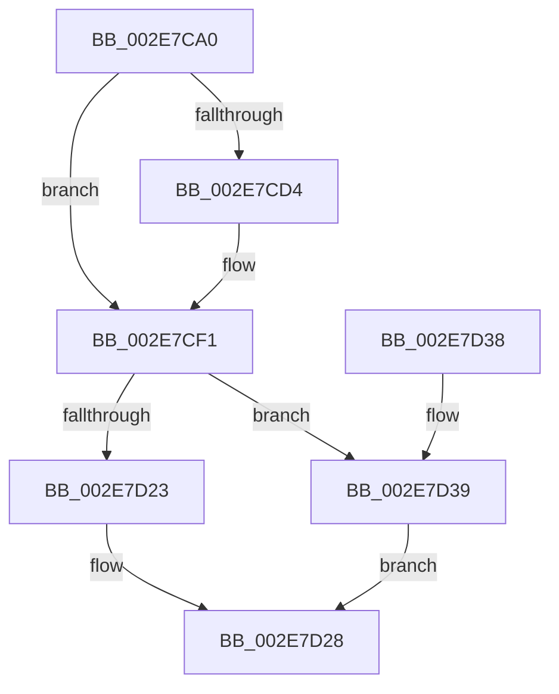

# RtlpHpLfhSubsegmentFree

- RVA: `0x002E7CA0`–`0x002E7D40` (길이 `160` bytes)
- VA: `0x00000001402E7CA0`
- 실행 섹션: `.text`
- PDB 이름 있음: `예`; PDB Function 태그: `아니요`
- unwind 정보 RVA: `0x0006383C`
- 디코드: `46`개 명령, `160/160` bytes 표시
- 미해석 바이트: `0` (있으면 어셈블리에 `.byte`로 보존)

> 이 문서는 커널 이미지의 기계어와 PDB 기호를 분석해 생성했습니다. 4번과 5번은 함수 원형과 자료형을 바이너리 사용 방식에서 추정한 C 해석이며 원본 소스 복구 결과는 아닙니다.

## 1. Dependencies

- 직접 호출 지점: **4**; 고유 호출 대상: **4**
- 직접 호출자로 확인된 함수: **3**
- RIP 상대 이미지 참조: **2**

### Outgoing calls
- `0x002E7CCB` → [RtlpHpLfhSubsegmentCountEmptyUnits](RtlpHpLfhSubsegmentCountEmptyUnits_function_002E7D48.md) (function, `0x002E7D48`)
- `0x002E7CEC` → [RtlpHpLfhContextUpdateFreeCommitCount](../49/RtlpHpLfhContextUpdateFreeCommitCount_function_00497E98.md) (function, `0x00497E98`)
- `0x002E7D23` → [RtlpHpSegLfhVsFree](RtlpHpSegLfhVsFree_function_002E7DF0.md) (function, `0x002E7DF0`)
- `0x002E7D39` → [guard_dispatch_icall](../6B/guard_dispatch_icall_function_006BAAD0.md) (function, `0x006BAAD0`)

### Direct callers
- [RtlpHpLfhOwnerCompact](RtlpHpLfhOwnerCompact_function_002E785C.md) at `0x002E7B1D`
- [RtlpHpLfhBucketAddSubsegment](RtlpHpLfhBucketAddSubsegment_function_002E8CD8.md) at `0x002E8DE2`
- [RtlpHpLfhOwnerCleanup](../60/RtlpHpLfhOwnerCleanup_function_00604C78.md) at `0x00604D1F`

### Static image references
- `0x002E7CF5` → RVA `0x002E7DF0` (`RtlpHpSegLfhVsFree`; read)
- `0x002E7D03` → RVA `0x00E28300` (`.data`; read)

## 2. Other-region calls and transfers

- 다른 실행 섹션으로 향하는 call: **0**
- 별도 외부 분기/꼬리 이동을 확인하지 못했습니다.

## 3. Assembly (complete function range)

```asm
002E7CA0  48 89 5C 24 08                  mov qword ptr [rsp + 8], rbx
002E7CA5  48 89 74 24 10                  mov qword ptr [rsp + 0x10], rsi
002E7CAA  57                              push rdi
002E7CAB  48 83 EC 20                     sub rsp, 0x20
002E7CAF  F0 49 FF 48 40                  lock dec qword ptr [r8 + 0x40]
002E7CB4  48 8B DA                        mov rbx, rdx
002E7CB7  0F BF 42 22                     movsx eax, word ptr [rdx + 0x22]
002E7CBB  48 8B F1                        mov rsi, rcx
002E7CBE  F7 D8                           neg eax
002E7CC0  4C 63 C8                        movsxd r9, eax
002E7CC3  F0 4D 01 48 38                  lock add qword ptr [r8 + 0x38], r9
002E7CC8  48 8B CA                        mov rcx, rdx
002E7CCB  E8 78 00 00 00                  call 0x1402e7d48
002E7CD0  85 C0                           test eax, eax
002E7CD2  74 1D                           je 0x1402e7cf1
002E7CD4  8A 4B 26                        mov cl, byte ptr [rbx + 0x26]
002E7CD7  48 8B D3                        mov rdx, rbx
002E7CDA  C1 E0 0C                        shl eax, 0xc
002E7CDD  D3 E0                           shl eax, cl
002E7CDF  48 8B CE                        mov rcx, rsi
002E7CE2  44 8B C0                        mov r8d, eax
002E7CE5  49 C1 E8 0C                     shr r8, 0xc
002E7CE9  49 F7 D8                        neg r8
002E7CEC  E8 A7 01 1B 00                  call 0x140497e98
002E7CF1  0F B7 4B 26                     movzx ecx, word ptr [rbx + 0x26]
002E7CF5  48 8D 15 F4 00 00 00            lea rdx, [rip + 0xf4]
002E7CFC  48 8B 46 10                     mov rax, qword ptr [rsi + 0x10]
002E7D00  44 8B C1                        mov r8d, ecx
002E7D03  48 33 05 F6 05 B4 00            xor rax, qword ptr [rip + 0xb405f6]
002E7D0A  41 C1 E8 08                     shr r8d, 8
002E7D0E  48 33 C6                        xor rax, rsi
002E7D11  41 C1 E0 0C                     shl r8d, 0xc
002E7D15  41 D3 E0                        shl r8d, cl
002E7D18  48 8B 0E                        mov rcx, qword ptr [rsi]
002E7D1B  48 3B C2                        cmp rax, rdx
002E7D1E  48 8B D3                        mov rdx, rbx
002E7D21  75 16                           jne 0x1402e7d39
002E7D23  E8 C8 00 00 00                  call 0x1402e7df0
002E7D28  48 8B 5C 24 30                  mov rbx, qword ptr [rsp + 0x30]
002E7D2D  48 8B 74 24 38                  mov rsi, qword ptr [rsp + 0x38]
002E7D32  48 83 C4 20                     add rsp, 0x20
002E7D36  5F                              pop rdi
002E7D37  C3                              ret
002E7D38  CC                              int3
002E7D39  E8 92 2D 3D 00                  call 0x1406baad0
002E7D3E  EB E8                           jmp 0x1402e7d28
```

## 4. C-style interpretation (structured pseudocode)

```c
__int64 __fastcall RtlpHpLfhSubsegmentFree(__int64 a1, __int64 a2, __int64 a3)
{
    __int64 result;
    __int64 v_rsp;
    unsigned __int64 v_stack_p10;
    unsigned __int64 v_stack_p8;

    v_stack_p8 = v_rbx;
    v_stack_p10 = v_rsi;
    v_rsp = (v_rsp) - (32);
    result = (unsigned int)(-((__int16)(*(unsigned __int16 *)(a2 + 34))));
    result = RtlpHpLfhSubsegmentCountEmptyUnits(a2, a2, a3, (int)((unsigned int)(result)));
    if ((unsigned int)(result) != 0) {
        a1 = *(unsigned __int8 *)(a2 + 38);
        a2 = a2;
        result = (unsigned int)((result) << (12));
        result = (unsigned int)((result) << ((unsigned __int8)(a1)));
        a1 = a1;
        a3 = (unsigned int)(result);
        a3 = (a3) >> (12);
        a3 = -(a3);
        result = RtlpHpLfhContextUpdateFreeCommitCount(a1, a2, a3, (int)((unsigned int)(result)));
    }
    result = (*(unsigned __int64 *)(a1 + 16)) ^ (*(unsigned __int64 *)(v_rip + 11798006));
    a3 = (unsigned int)(((unsigned int)((unsigned int)(*(unsigned __int16 *)(a2 + 38)))) >> (8));
    result = (result) ^ (a1);
    a3 = (unsigned int)((a3) << (12));
    a3 = (unsigned int)((a3) << ((unsigned __int8)(*(unsigned __int16 *)(a2 + 38))));
    if (result != (v_rip + 244)) goto loc_002E7D39;
    result = RtlpHpSegLfhVsFree(*(unsigned __int64 *)(a1), a2, a3, (int)((unsigned int)(result)));
loc_002E7D28:
    v_rsp = (v_rsp) + (32);
    return result;
loc_002E7D39:
    result = guard_dispatch_icall(*(unsigned __int64 *)(a1), a2, a3, (int)((unsigned int)(result)));
    goto loc_002E7D28;
}
```

## 5. (Beta) C Style

```c
int64_t RtlpHpLfhSubsegmentFree(void *Arg1, void *Arg2, void *Arg3)
{
    uint8_t *arg1 = (uint8_t *)Arg1;
    uint8_t *arg2 = (uint8_t *)Arg2;
    uint8_t *arg3 = (uint8_t *)Arg3;

    int64_t result;
    int64_t local_rsp;
    uint64_t v_stack_p10;
    uint64_t v_stack_p8;

    v_stack_p8 = local_rbx;
    v_stack_p10 = local_rsi;
    local_rsp = (local_rsp) - (32);
    result = (uint32_t)(-((int16_t)(*(uint16_t *)(arg2 + 0x22))));
    result = RtlpHpLfhSubsegmentCountEmptyUnits(Arg2, Arg2, Arg3, (int32_t)((uint32_t)(result)));
    if ((uint32_t)(result) != 0) {
        Arg1 = *(uint8_t *)(arg2 + 0x26);
        Arg2 = Arg2;
        result = (uint32_t)((result) << (12));
        result = (uint32_t)((result) << ((uint8_t)(Arg1)));
        Arg1 = Arg1;
        Arg3 = (uint32_t)(result);
        Arg3 = (Arg3) >> (12);
        Arg3 = -(Arg3);
        result = RtlpHpLfhContextUpdateFreeCommitCount(Arg1, Arg2, Arg3, (int32_t)((uint32_t)(result)));
    }
    result = (*(uint64_t *)(arg1 + 0x10)) ^ (*(uint64_t *)(v_rip + 0xB405F6));
    Arg3 = (uint32_t)(((uint32_t)((uint32_t)(*(uint16_t *)(arg2 + 0x26)))) >> (8));
    result = (result) ^ (Arg1);
    Arg3 = (uint32_t)((Arg3) << (12));
    Arg3 = (uint32_t)((Arg3) << ((uint8_t)(*(uint16_t *)(arg2 + 0x26))));
    if (result != (v_rip + 244)) goto loc_002E7D39;
    result = RtlpHpSegLfhVsFree(*(uint64_t *)(arg1), Arg2, Arg3, (int32_t)((uint32_t)(result)));
loc_002E7D28:
    local_rsp = (local_rsp) + (32);
    return result;
loc_002E7D39:
    result = guard_dispatch_icall(*(uint64_t *)(arg1), Arg2, Arg3, (int32_t)((uint32_t)(result)));
    goto loc_002E7D28;
}
```

### 관측된 메모리 오프셋

구조체 형식이 확인되지 않은 접근은 인자 기준의 오프셋으로만 기록했습니다.

| 기준 인자 | 오프셋 표현 | 폭 (bit) | 접근 |
|---|---:|---:|---|
| `Arg1` | `+ 0x0` | `64` | `R` |
| `Arg1` | `+ 0x10` | `64` | `R` |
| `Arg2` | `+ 0x22` | `16` | `R` |
| `Arg2` | `+ 0x26` | `8` | `R` |
| `Arg2` | `+ 0x26` | `16` | `R` |
| `Arg3` | `+ 0x38` | `64` | `R/W` |
| `Arg3` | `+ 0x40` | `64` | `R/W` |

## 6. Execution-region graph

[열기: 2D/3D 그래프와 함수 탐색 컨트롤 패널](../../../control-panel.html?section=text&rva=0x002E7CA0&view=graph)

- 2D 그래프는 위에서 아래로 흐르고, 3D 그래프는 빈 공간을 드래그해 회전합니다. Shift+드래그는 이동, 휠은 확대·축소, 함수 노드 선택은 대상 보고서 이동입니다.

### Static fallback


