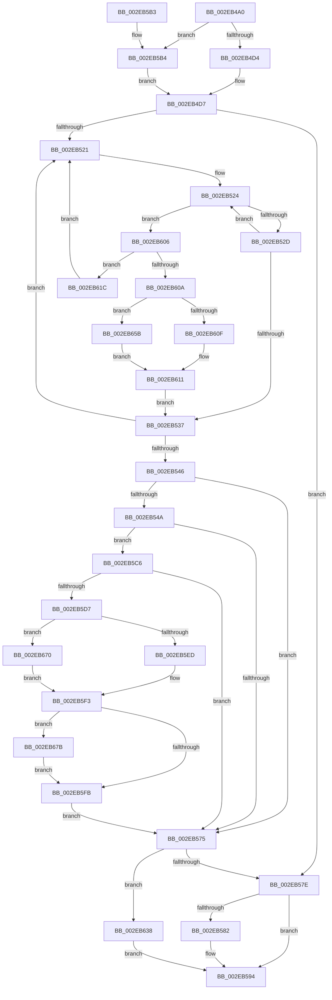

# RtlpHpLfhSubsegmentIncBlockCounts

- RVA: `0x002EB4A0`–`0x002EB689` (길이 `489` bytes)
- VA: `0x00000001402EB4A0`
- 실행 섹션: `.text`
- PDB 이름 있음: `예`; PDB Function 태그: `아니요`
- unwind 정보 RVA: `0x00071658`
- 디코드: `135`개 명령, `489/489` bytes 표시
- 미해석 바이트: `0` (있으면 어셈블리에 `.byte`로 보존)

> 이 문서는 커널 이미지의 기계어와 PDB 기호를 분석해 생성했습니다. 4번과 5번은 함수 원형과 자료형을 바이너리 사용 방식에서 추정한 C 해석이며 원본 소스 복구 결과는 아닙니다.

## 1. Dependencies

- 직접 호출 지점: **3**; 고유 호출 대상: **3**
- 직접 호출자로 확인된 함수: **1**
- RIP 상대 이미지 참조: **2**

### Outgoing calls
- `0x002EB58F` → [RtlpHpReleaseLockExclusive](../32/RtlpHpReleaseLockExclusive_function_00324230.md) (function, `0x00324230`)
- `0x002EB62A` → [RtlpHpAcquireLockExclusive](../32/RtlpHpAcquireLockExclusive_function_003246B0.md) (function, `0x003246B0`)
- `0x002EB67F` → [RtlpHpEnvCompactionSchedule](../32/RtlpHpEnvCompactionSchedule_function_003264A0.md) (function, `0x003264A0`)

### Direct callers
- [RtlpHpLfhSubsegmentCommitBlock](RtlpHpLfhSubsegmentCommitBlock_function_002EA630.md) at `0x002EA885`

### Static image references
- `0x002EB5ED` → RVA `0x00EFA7BC` (`.data`; read)
- `0x002EB670` → RVA `0x00EFA7C0` (`.data`; read)

## 2. Other-region calls and transfers

- 다른 실행 섹션으로 향하는 call: **0**
- 별도 외부 분기/꼬리 이동을 확인하지 못했습니다.

## 3. Assembly (complete function range)

```asm
002EB4A0  48 89 5C 24 08                  mov qword ptr [rsp + 8], rbx
002EB4A5  48 89 6C 24 18                  mov qword ptr [rsp + 0x18], rbp
002EB4AA  48 89 74 24 20                  mov qword ptr [rsp + 0x20], rsi
002EB4AF  57                              push rdi
002EB4B0  41 54                           push r12
002EB4B2  41 55                           push r13
002EB4B4  41 56                           push r14
002EB4B6  41 57                           push r15
002EB4B8  48 83 EC 30                     sub rsp, 0x30
002EB4BC  8B AC 24 88 00 00 00            mov ebp, dword ptr [rsp + 0x88]
002EB4C3  45 8B D0                        mov r10d, r8d
002EB4C6  4C 8B FA                        mov r15, rdx
002EB4C9  4C 8B F1                        mov r14, rcx
002EB4CC  85 ED                           test ebp, ebp
002EB4CE  0F 85 E0 00 00 00               jne 0x1402eb5b4
002EB4D4  41 B4 FF                        mov r12b, 0xff
002EB4D7  0F B6 4A 26                     movzx ecx, byte ptr [rdx + 0x26]
002EB4DB  0F B6 42 18                     movzx eax, byte ptr [rdx + 0x18]
002EB4DF  41 C1 E8 0C                     shr r8d, 0xc
002EB4E3  41 D3 E8                        shr r8d, cl
002EB4E6  48 8D 1C C2                     lea rbx, [rdx + rax*8]
002EB4EA  4F 8D 2C 00                     lea r13, [r8 + r8]
002EB4EE  49 03 DD                        add rbx, r13
002EB4F1  0F 0D 0B                        prefetchw byte ptr [rbx]
002EB4F4  41 8D 41 FF                     lea eax, [r9 - 1]
002EB4F8  BE FF FF FF FF                  mov esi, 0xffffffff
002EB4FD  41 03 C2                        add eax, r10d
002EB500  C1 E8 0C                        shr eax, 0xc
002EB503  D3 E8                           shr eax, cl
002EB505  33 C9                           xor ecx, ecx
002EB507  41 2B C0                        sub eax, r8d
002EB50A  48 89 4C 24 68                  mov qword ptr [rsp + 0x68], rcx
002EB50F  FF C0                           inc eax
002EB511  8B F9                           mov edi, ecx
002EB513  48 8D 14 43                     lea rdx, [rbx + rax*2]
002EB517  48 89 54 24 20                  mov qword ptr [rsp + 0x20], rdx
002EB51C  48 3B DA                        cmp rbx, rdx
002EB51F  73 5D                           jae 0x1402eb57e
002EB521  0F B7 03                        movzx eax, word ptr [rbx]
002EB524  66 85 C0                        test ax, ax
002EB527  0F 8E D9 00 00 00               jle 0x1402eb606
002EB52D  8D 48 01                        lea ecx, [rax + 1]
002EB530  66 F0 0F B1 0B                  lock cmpxchg word ptr [rbx], cx
002EB535  75 ED                           jne 0x1402eb524
002EB537  48 83 C3 02                     add rbx, 2
002EB53B  49 83 C5 02                     add r13, 2
002EB53F  48 3B 5C 24 20                  cmp rbx, qword ptr [rsp + 0x20]
002EB544  72 DB                           jb 0x1402eb521
002EB546  85 FF                           test edi, edi
002EB548  74 2B                           je 0x1402eb575
002EB54A  41 0F B6 4F 26                  movzx ecx, byte ptr [r15 + 0x26]
002EB54F  C1 E7 0C                        shl edi, 0xc
002EB552  D3 E7                           shl edi, cl
002EB554  8B C7                           mov eax, edi
002EB556  99                              cdq
002EB557  81 E2 FF 0F 00 00               and edx, 0xfff
002EB55D  03 C2                           add eax, edx
002EB55F  C1 F8 0C                        sar eax, 0xc
002EB562  48 63 C8                        movsxd rcx, eax
002EB565  49 0F BF 46 42                  movsx rax, word ptr [r14 + 0x42]
002EB56A  F0 4A 01 4C 30 18               lock add qword ptr [rax + r14 + 0x18], rcx
002EB570  48 85 C9                        test rcx, rcx
002EB573  7F 51                           jg 0x1402eb5c6
002EB575  83 FE FF                        cmp esi, -1
002EB578  0F 85 BA 00 00 00               jne 0x1402eb638
002EB57E  85 ED                           test ebp, ebp
002EB580  74 12                           je 0x1402eb594
002EB582  41 0F B6 56 41                  movzx edx, byte ptr [r14 + 0x41]
002EB587  49 8D 4F 38                     lea rcx, [r15 + 0x38]
002EB58B  45 0F B6 C4                     movzx r8d, r12b
002EB58F  E8 9C 8C 03 00                  call 0x140324230
002EB594  48 8B 5C 24 60                  mov rbx, qword ptr [rsp + 0x60]
002EB599  8B C6                           mov eax, esi
002EB59B  48 8B 74 24 78                  mov rsi, qword ptr [rsp + 0x78]
002EB5A0  48 8B 6C 24 70                  mov rbp, qword ptr [rsp + 0x70]
002EB5A5  48 83 C4 30                     add rsp, 0x30
002EB5A9  41 5F                           pop r15
002EB5AB  41 5E                           pop r14
002EB5AD  41 5D                           pop r13
002EB5AF  41 5C                           pop r12
002EB5B1  5F                              pop rdi
002EB5B2  C3                              ret
002EB5B3  CC                              int3
002EB5B4  4C 8B A4 24 90 00 00 00         mov r12, qword ptr [rsp + 0x90]
002EB5BC  45 0F B6 24 24                  movzx r12d, byte ptr [r12]
002EB5C1  E9 11 FF FF FF                  jmp 0x1402eb4d7
002EB5C6  41 0F B7 5F 2C                  movzx ebx, word ptr [r15 + 0x2c]
002EB5CB  48 C1 E3 06                     shl rbx, 6
002EB5CF  42 80 7C 33 5C 00               cmp byte ptr [rbx + r14 + 0x5c], 0
002EB5D5  75 9E                           jne 0x1402eb575
002EB5D7  49 8B 0E                        mov rcx, qword ptr [r14]
002EB5DA  48 8B 41 38                     mov rax, qword ptr [rcx + 0x38]
002EB5DE  48 8B 00                        mov rax, qword ptr [rax]
002EB5E1  48 C1 E8 08                     shr rax, 8
002EB5E5  3C 01                           cmp al, 1
002EB5E7  0F 85 83 00 00 00               jne 0x1402eb670
002EB5ED  8B 05 C9 F1 C0 00               mov eax, dword ptr [rip + 0xc0f1c9]
002EB5F3  85 C0                           test eax, eax
002EB5F5  0F 84 80 00 00 00               je 0x1402eb67b
002EB5FB  42 C6 44 33 5C 01               mov byte ptr [rbx + r14 + 0x5c], 1
002EB601  E9 6F FF FF FF                  jmp 0x1402eb575
002EB606  85 ED                           test ebp, ebp
002EB608  74 12                           je 0x1402eb61c
002EB60A  66 85 C0                        test ax, ax
002EB60D  75 4C                           jne 0x1402eb65b
002EB60F  FF CF                           dec edi
002EB611  66 FF C0                        inc ax
002EB614  66 89 03                        mov word ptr [rbx], ax
002EB617  E9 1B FF FF FF                  jmp 0x1402eb537
002EB61C  41 0F B6 56 41                  movzx edx, byte ptr [r14 + 0x41]
002EB621  49 8D 4F 38                     lea rcx, [r15 + 0x38]
002EB625  BD 01 00 00 00                  mov ebp, 1
002EB62A  E8 81 90 03 00                  call 0x1403246b0
002EB62F  44 0F B6 E0                     movzx r12d, al
002EB633  E9 E9 FE FF FF                  jmp 0x1402eb521
002EB638  48 8B 44 24 68                  mov rax, qword ptr [rsp + 0x68]
002EB63D  48 8B 8C 24 80 00 00 00         mov rcx, qword ptr [rsp + 0x80]
002EB645  2B C6                           sub eax, esi
002EB647  FF C0                           inc eax
002EB649  89 01                           mov dword ptr [rcx], eax
002EB64B  48 8B 84 24 90 00 00 00         mov rax, qword ptr [rsp + 0x90]
002EB653  44 88 20                        mov byte ptr [rax], r12b
002EB656  E9 39 FF FF FF                  jmp 0x1402eb594
002EB65B  49 8B CD                        mov rcx, r13
002EB65E  FF C7                           inc edi
002EB660  48 D1 F9                        sar rcx, 1
002EB663  83 FE FF                        cmp esi, -1
002EB666  48 89 4C 24 68                  mov qword ptr [rsp + 0x68], rcx
002EB66B  0F 44 F1                        cmove esi, ecx
002EB66E  EB A1                           jmp 0x1402eb611
002EB670  8B 05 4A F1 C0 00               mov eax, dword ptr [rip + 0xc0f14a]
002EB676  E9 78 FF FF FF                  jmp 0x1402eb5f3
002EB67B  48 8B 49 38                     mov rcx, qword ptr [rcx + 0x38]
002EB67F  E8 1C AE 03 00                  call 0x1403264a0
002EB684  E9 72 FF FF FF                  jmp 0x1402eb5fb
```

## 4. C-style interpretation (structured pseudocode)

```c
__int64 __fastcall RtlpHpLfhSubsegmentIncBlockCounts(__int64 a1, __int64 a2, int a3, __int64 a4, __int64 a5, unsigned int a6, __int64 a7)
{
    __int64 result;
    __int64 v_r13;
    __int64 v_rbx;
    __int64 v_rdi;
    __int64 v_rsi;
    __int64 v_rsp;
    unsigned __int64 v_stack_m38;
    unsigned __int64 v_stack_p10;
    unsigned __int64 v_stack_p18;
    unsigned __int64 v_stack_p20;
    unsigned __int64 v_stack_p68;
    unsigned __int64 v_stack_p8;

    v_stack_p8 = v_rbx;
    v_stack_p18 = v_rbp;
    v_stack_p20 = v_rsi;
    v_rsp = (v_rsp) - (48);
    if ((unsigned int)((unsigned int)(a6)) != 0) goto loc_002EB5B4;
loc_002EB4D7:
    a3 = (unsigned int)((a3) >> (12));
    a3 = (unsigned int)((a3) >> ((unsigned __int8)(*(unsigned __int8 *)(a2 + 38))));
    v_rbx = (a2 + *(unsigned __int8 *)(a2 + 24) * 8) + (a3 + a3 * 1);
    result = (unsigned int)((a4 - 1) + ((unsigned int)((unsigned int)(a3))));
    result = (unsigned int)((result) >> (12));
    result = (unsigned int)((result) >> ((unsigned __int8)(*(unsigned __int8 *)(a2 + 38))));
    a1 = 0;
    result = (unsigned int)((result) - (a3));
    v_stack_p10 = 0;
    result = (unsigned int)((result) + 1);
    v_stack_m38 = v_rbx + result * 2;
    if (v_rbx >= (v_rbx + result * 2)) goto loc_002EB57E;
loc_002EB521:
loc_002EB524:
    if (condition_is_less_or_equal) goto loc_002EB606;
    if ((unsigned __int16)(*(unsigned __int16 *)(v_rbx)) != 0) goto loc_002EB524;
loc_002EB537:
    v_rbx = (v_rbx) + (2);
    v_r13 = (a3 + a3 * 1) + (2);
    if (v_rbx < v_stack_m38) goto loc_002EB521;
    if (0 == 0) goto loc_002EB575;
    v_rdi = (unsigned int)((0) << (12));
    v_rdi = (unsigned int)((v_rdi) << ((unsigned __int8)(*(unsigned __int8 *)(a2 + 38))));
    a2 = (unsigned int)((v_rbx + result * 2) & (0xFFFULL));
    result = (unsigned int)(((unsigned int)((unsigned int)(v_rdi))) + ((unsigned int)(a2)));
    result = (unsigned int)((result) >> (12));
    if (condition_is_greater) goto loc_002EB5C6;
loc_002EB575:
    if (((unsigned int)((unsigned int)(0xFFFFFFFFULL))) != -1) goto loc_002EB638;
loc_002EB57E:
    result = (__int16)(*(unsigned __int16 *)(a1 + 66));
    if ((unsigned int)((unsigned int)(a6)) != 0) {
        a2 = *(unsigned __int8 *)(a1 + 65);
        a1 = a2 + 56;
        a3 = 255;
        result = RtlpHpReleaseLockExclusive(a1, a2, a3, a4);
    }
    v_rsp = (v_rsp) + (48);
    return (unsigned int)((unsigned int)((unsigned int)(0xFFFFFFFFULL)));
loc_002EB5B4:
    goto loc_002EB4D7;
loc_002EB5C6:
    v_rbx = (*(unsigned __int16 *)(a2 + 44)) << (6);
    if ((*(unsigned __int8 *)(v_rbx + a1 * 1 + 92)) != 0) goto loc_002EB575;
    result = (*(unsigned __int64 *)(*(unsigned __int64 *)(*(unsigned __int64 *)(a1) + 56))) >> (8);
    if (((unsigned __int8)(result)) != 1) goto loc_002EB670;
loc_002EB5F3:
    if ((unsigned int)((unsigned int)(*(unsigned int *)(v_rip + 12644809))) == 0) goto loc_002EB67B;
loc_002EB5FB:
    *(unsigned __int8 *)(v_rbx + a1 * 1 + 92) = 1;
    goto loc_002EB575;
loc_002EB606:
    if ((unsigned int)(v_stack_p18) == 0) goto loc_002EB61C;
    if ((unsigned __int16)((unsigned int)(*(unsigned int *)(v_rip + 12644809))) != 0) goto loc_002EB65B;
    v_rdi = (unsigned int)((v_rdi) - 1);
loc_002EB611:
    result = (unsigned __int16)(((unsigned int)(*(unsigned int *)(v_rip + 12644809))) + 1);
    *(unsigned __int16 *)(v_rbx) = (unsigned __int16)(result);
    goto loc_002EB537;
loc_002EB61C:
    result = RtlpHpAcquireLockExclusive(a2 + 56, *(unsigned __int8 *)(a1 + 65), a3, a4);
    goto loc_002EB521;
loc_002EB638:
    result = (unsigned int)((v_stack_p68) - ((unsigned int)(v_stack_p20)));
    result = (unsigned int)((result) + 1);
    *(unsigned int *)(a5) = (unsigned int)(result);
    *(unsigned __int8 *)(a7) = (unsigned __int8)((unsigned __int8)(result));
    goto loc_002EB594;
loc_002EB65B:
    v_rdi = (unsigned int)((v_rdi) + 1);
    a1 = (v_r13) >> (1);
    v_stack_p68 = a1;
    v_rsi = v_stack_p20;
    if (((unsigned int)(v_stack_p20)) == -1) { v_rsi = (unsigned int)(a1); }
    goto loc_002EB611;
loc_002EB670:
    goto loc_002EB5F3;
loc_002EB67B:
    result = RtlpHpEnvCompactionSchedule(*(unsigned __int64 *)(a1 + 56), *(unsigned __int8 *)(a1 + 65), a3, a4);
    goto loc_002EB5FB;
}
```

## 5. (Beta) C Style

```c
int64_t RtlpHpLfhSubsegmentIncBlockCounts(void *Arg1, void *Arg2, int32_t Arg3, void *Arg4, void *Arg5, uint32_t Arg6, void *Arg7)
{
    uint8_t *arg1 = (uint8_t *)Arg1;
    uint8_t *arg2 = (uint8_t *)Arg2;
    uint8_t *arg4 = (uint8_t *)Arg4;
    uint8_t *arg5 = (uint8_t *)Arg5;
    uint8_t *arg7 = (uint8_t *)Arg7;

    int64_t result;
    int64_t local_r13;
    int64_t local_rbx;
    int64_t local_rdi;
    int64_t local_rsi;
    int64_t local_rsp;
    uint64_t v_stack_m38;
    uint64_t v_stack_p10;
    uint64_t v_stack_p18;
    uint64_t v_stack_p20;
    uint64_t v_stack_p68;
    uint64_t v_stack_p8;

    v_stack_p8 = local_rbx;
    v_stack_p18 = local_rbp;
    v_stack_p20 = local_rsi;
    local_rsp = (local_rsp) - (48);
    if ((uint32_t)((uint32_t)(Arg6)) != 0) goto loc_002EB5B4;
loc_002EB4D7:
    Arg3 = (uint32_t)((Arg3) >> (12));
    Arg3 = (uint32_t)((Arg3) >> ((uint8_t)(*(uint8_t *)(arg2 + 0x26))));
    local_rbx = (Arg2 + *(uint8_t *)(arg2 + 0x18) * 8) + (Arg3 + Arg3 * 1);
    result = (uint32_t)((Arg4 - 1) + ((uint32_t)((uint32_t)(Arg3))));
    result = (uint32_t)((result) >> (12));
    result = (uint32_t)((result) >> ((uint8_t)(*(uint8_t *)(arg2 + 0x26))));
    Arg1 = 0;
    result = (uint32_t)((result) - (Arg3));
    v_stack_p10 = 0;
    result = (uint32_t)((result) + 1);
    v_stack_m38 = local_rbx + result * 2;
    if (local_rbx >= (local_rbx + result * 2)) goto loc_002EB57E;
loc_002EB521:
loc_002EB524:
    if (condition_is_less_or_equal) goto loc_002EB606;
    if ((uint16_t)(*(uint16_t *)(local_rbx)) != 0) goto loc_002EB524;
loc_002EB537:
    local_rbx = (local_rbx) + (2);
    local_r13 = (Arg3 + Arg3 * 1) + (2);
    if (local_rbx < v_stack_m38) goto loc_002EB521;
    if (0 == 0) goto loc_002EB575;
    local_rdi = (uint32_t)((0) << (12));
    local_rdi = (uint32_t)((local_rdi) << ((uint8_t)(*(uint8_t *)(arg2 + 0x26))));
    Arg2 = (uint32_t)((local_rbx + result * 2) & (0xFFFULL));
    result = (uint32_t)(((uint32_t)((uint32_t)(local_rdi))) + ((uint32_t)(Arg2)));
    result = (uint32_t)((result) >> (12));
    if (condition_is_greater) goto loc_002EB5C6;
loc_002EB575:
    if (((uint32_t)((uint32_t)(0xFFFFFFFFULL))) != -1) goto loc_002EB638;
loc_002EB57E:
    result = (int16_t)(*(uint16_t *)(arg1 + 0x42));
    if ((uint32_t)((uint32_t)(Arg6)) != 0) {
        Arg2 = *(uint8_t *)(arg1 + 0x41);
        Arg1 = Arg2 + 56;
        Arg3 = 255;
        result = RtlpHpReleaseLockExclusive(Arg1, Arg2, Arg3, Arg4);
    }
    local_rsp = (local_rsp) + (48);
    return (uint32_t)((uint32_t)((uint32_t)(0xFFFFFFFFULL)));
loc_002EB5B4:
    goto loc_002EB4D7;
loc_002EB5C6:
    local_rbx = (*(uint16_t *)(arg2 + 0x2C)) << (6);
    if ((*(uint8_t *)(local_rbx + arg1 * 1 + 0x5C)) != 0) goto loc_002EB575;
    result = (*(uint64_t *)(*(uint64_t *)(*(uint64_t *)(arg1) + 0x38))) >> (8);
    if (((uint8_t)(result)) != 1) goto loc_002EB670;
loc_002EB5F3:
    if ((uint32_t)((uint32_t)(*(uint32_t *)(v_rip + 0xC0F1C9))) == 0) goto loc_002EB67B;
loc_002EB5FB:
    *(uint8_t *)(local_rbx + arg1 * 1 + 0x5C) = 1;
    goto loc_002EB575;
loc_002EB606:
    if ((uint32_t)(v_stack_p18) == 0) goto loc_002EB61C;
    if ((uint16_t)((uint32_t)(*(uint32_t *)(v_rip + 0xC0F1C9))) != 0) goto loc_002EB65B;
    local_rdi = (uint32_t)((local_rdi) - 1);
loc_002EB611:
    result = (uint16_t)(((uint32_t)(*(uint32_t *)(v_rip + 0xC0F1C9))) + 1);
    *(uint16_t *)(local_rbx) = (uint16_t)(result);
    goto loc_002EB537;
loc_002EB61C:
    result = RtlpHpAcquireLockExclusive(Arg2 + 56, *(uint8_t *)(arg1 + 0x41), Arg3, Arg4);
    goto loc_002EB521;
loc_002EB638:
    result = (uint32_t)((v_stack_p68) - ((uint32_t)(v_stack_p20)));
    result = (uint32_t)((result) + 1);
    *(uint32_t *)(arg5) = (uint32_t)(result);
    *(uint8_t *)(arg7) = (uint8_t)((uint8_t)(result));
    goto loc_002EB594;
loc_002EB65B:
    local_rdi = (uint32_t)((local_rdi) + 1);
    Arg1 = (local_r13) >> (1);
    v_stack_p68 = Arg1;
    local_rsi = v_stack_p20;
    if (((uint32_t)(v_stack_p20)) == -1) { local_rsi = (uint32_t)(Arg1); }
    goto loc_002EB611;
loc_002EB670:
    goto loc_002EB5F3;
loc_002EB67B:
    result = RtlpHpEnvCompactionSchedule(*(uint64_t *)(arg1 + 0x38), *(uint8_t *)(arg1 + 0x41), Arg3, Arg4);
    goto loc_002EB5FB;
}
```

### 관측된 메모리 오프셋

구조체 형식이 확인되지 않은 접근은 인자 기준의 오프셋으로만 기록했습니다.

| 기준 인자 | 오프셋 표현 | 폭 (bit) | 접근 |
|---|---:|---:|---|
| `Arg1` | `+ 0x0` | `64` | `R` |
| `Arg1` | `+ 0x41` | `8` | `R` |
| `Arg1` | `+ 0x42` | `16` | `R` |
| `Arg2` | `+ 0x0` | `8` | `R` |
| `Arg2` | `+ 0x0 + rax*2` | `64` | `R` |
| `Arg2` | `+ 0x0 + rax*8` | `64` | `R` |
| `Arg2` | `+ 0x18` | `8` | `R` |
| `Arg2` | `+ 0x26` | `8` | `R` |
| `Arg2` | `+ 0x2C` | `16` | `R` |
| `Arg2` | `+ 0x38` | `64` | `R` |
| `Arg4` | `- 0x1` | `32` | `R` |
| `Arg5` | `+ 0x0` | `32` | `W` |
| `Arg7` | `+ 0x0` | `8` | `R` |
| `Arg7` | `+ 0x0` | `8` | `W` |

## 6. Execution-region graph

[열기: 2D/3D 그래프와 함수 탐색 컨트롤 패널](../../../control-panel.html?section=text&rva=0x002EB4A0&view=graph)

- 2D 그래프는 위에서 아래로 흐르고, 3D 그래프는 빈 공간을 드래그해 회전합니다. Shift+드래그는 이동, 휠은 확대·축소, 함수 노드 선택은 대상 보고서 이동입니다.

### Static fallback


