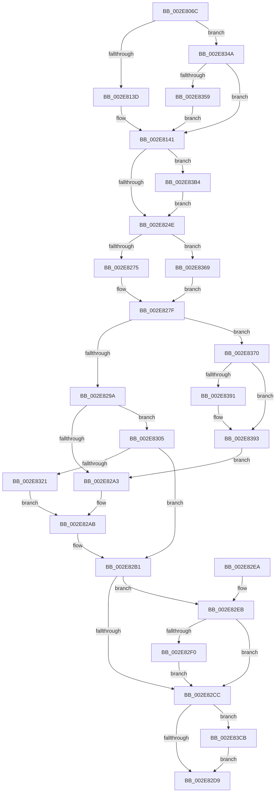

# RtlpHpLfhSubsegmentInitialize

- RVA: `0x002E806C`–`0x002E83D9` (길이 `877` bytes)
- VA: `0x00000001402E806C`
- 실행 섹션: `.text`
- PDB 이름 있음: `예`; PDB Function 태그: `아니요`
- unwind 정보 RVA: `0x000713DC`
- 디코드: `227`개 명령, `877/877` bytes 표시
- 미해석 바이트: `0` (있으면 어셈블리에 `.byte`로 보존)

> 이 문서는 커널 이미지의 기계어와 PDB 기호를 분석해 생성했습니다. 4번과 5번은 함수 원형과 자료형을 바이너리 사용 방식에서 추정한 C 해석이며 원본 소스 복구 결과는 아닙니다.

## 1. Dependencies

- 직접 호출 지점: **6**; 고유 호출 대상: **6**
- 직접 호출자로 확인된 함수: **1**
- RIP 상대 이미지 참조: **2**

### Outgoing calls
- `0x002E80C6` → [RtlpHpLfhSubsegmentComputeCommitUnit](RtlpHpLfhSubsegmentComputeCommitUnit_function_002E8940.md) (function, `0x002E8940`)
- `0x002E815A` → [RtlpHpLfhSubsegmentPrefetchRange](RtlpHpLfhSubsegmentPrefetchRange_function_002E83E0.md) (function, `0x002E83E0`)
- `0x002E8168` → [memset](../6C/memset_function_006C6C40.md) (function, `0x006C6C40`)
- `0x002E817E` → [RtlpHpInitializeLock](RtlpHpInitializeLock_function_002E8054.md) (function, `0x002E8054`)
- `0x002E8288` → [RtlpHpLfhBlockBitmapInitialize](RtlpHpLfhBlockBitmapInitialize_function_002E8418.md) (function, `0x002E8418`)
- `0x002E8335` → [RtlpHpLfhSubsegmentSetWitheldBlocks](../48/RtlpHpLfhSubsegmentSetWitheldBlocks_function_0048478C.md) (function, `0x0048478C`)

### Direct callers
- [RtlpHpLfhSubsegmentCreate](RtlpHpLfhSubsegmentCreate_function_002EC5A0.md) at `0x002EC755`

### Static image references
- `0x002E808D` → RVA `0x00000000` (`image boundary/outside`; read)
- `0x002E81A2` → RVA `0x00E28308` (`.data`; read)

## 2. Other-region calls and transfers

- 다른 실행 섹션으로 향하는 call: **0**
- 별도 외부 분기/꼬리 이동을 확인하지 못했습니다.

## 3. Assembly (complete function range)

```asm
002E806C  48 8B C4                        mov rax, rsp
002E806F  44 89 48 20                     mov dword ptr [rax + 0x20], r9d
002E8073  44 89 40 18                     mov dword ptr [rax + 0x18], r8d
002E8077  53                              push rbx
002E8078  55                              push rbp
002E8079  56                              push rsi
002E807A  57                              push rdi
002E807B  41 54                           push r12
002E807D  41 55                           push r13
002E807F  41 56                           push r14
002E8081  41 57                           push r15
002E8083  48 83 EC 48                     sub rsp, 0x48
002E8087  48 8B D9                        mov rbx, rcx
002E808A  44 8B F2                        mov r14d, edx
002E808D  48 8D 0D 6C 7F D1 FF            lea rcx, [rip - 0x2e8094]
002E8094  45 33 DB                        xor r11d, r11d
002E8097  44 89 58 08                     mov dword ptr [rax + 8], r11d
002E809B  41 8B E8                        mov ebp, r8d
002E809E  48 8B 84 24 B0 00 00 00         mov rax, qword ptr [rsp + 0xb0]
002E80A6  45 8D 53 01                     lea r10d, [r11 + 1]
002E80AA  0F B6 00                        movzx eax, byte ptr [rax]
002E80AD  D1 E8                           shr eax, 1
002E80AF  41 03 C2                        add eax, r10d
002E80B2  48 89 44 24 38                  mov qword ptr [rsp + 0x38], rax
002E80B7  44 0F B7 AC 41 C0 C3 01 00      movzx r13d, word ptr [rcx + rax*2 + 0x1c3c0]
002E80C0  41 8B CE                        mov ecx, r14d
002E80C3  41 8B D5                        mov edx, r13d
002E80C6  E8 75 08 00 00                  call 0x1402e8940
002E80CB  8B C8                           mov ecx, eax
002E80CD  33 D2                           xor edx, edx
002E80CF  41 8B C6                        mov eax, r14d
002E80D2  F7 F1                           div ecx
002E80D4  33 D2                           xor edx, edx
002E80D6  41 8B CE                        mov ecx, r14d
002E80D9  8B F8                           mov edi, eax
002E80DB  03 FF                           add edi, edi
002E80DD  2B CF                           sub ecx, edi
002E80DF  8D 04 CD 00 FE FF FF            lea eax, [rcx*8 - 0x200]
002E80E6  42 8D 0C ED 00 00 00 00         lea ecx, [r13*8]
002E80EE  49 03 CA                        add rcx, r10
002E80F1  48 F7 F1                        div rcx
002E80F4  33 D2                           xor edx, edx
002E80F6  8B C8                           mov ecx, eax
002E80F8  4C 8B C0                        mov r8, rax
002E80FB  48 83 C1 3F                     add rcx, 0x3f
002E80FF  41 8B C6                        mov eax, r14d
002E8102  48 C1 E9 06                     shr rcx, 6
002E8106  44 8D 3C CD 4F 00 00 00         lea r15d, [rcx*8 + 0x4f]
002E810E  44 03 FF                        add r15d, edi
002E8111  41 83 E7 F0                     and r15d, 0xfffffff0
002E8115  41 2B C7                        sub eax, r15d
002E8118  41 F7 F5                        div r13d
002E811B  44 3B C0                        cmp r8d, eax
002E811E  41 0F 42 C0                     cmovb eax, r8d
002E8122  8B F0                           mov esi, eax
002E8124  48 83 C0 3F                     add rax, 0x3f
002E8128  48 C1 E8 06                     shr rax, 6
002E812C  C1 E0 03                        shl eax, 3
002E812F  48 89 44 24 30                  mov qword ptr [rsp + 0x30], rax
002E8134  45 85 C9                        test r9d, r9d
002E8137  0F 85 0D 02 00 00               jne 0x1402e834a
002E813D  45 8D 4B 03                     lea r9d, [r11 + 3]
002E8141  44 21 94 24 C0 00 00 00         and dword ptr [rsp + 0xc0], r10d
002E8149  B8 02 00 00 00                  mov eax, 2
002E814E  44 8B C5                        mov r8d, ebp
002E8151  48 8B CB                        mov rcx, rbx
002E8154  44 0F 45 C8                     cmovne r9d, eax
002E8158  33 D2                           xor edx, edx
002E815A  E8 81 02 00 00                  call 0x1402e83e0
002E815F  8D 7A 40                        lea edi, [rdx + 0x40]
002E8162  48 8B CB                        mov rcx, rbx
002E8165  44 8B C7                        mov r8d, edi
002E8168  E8 D3 EA 3D 00                  call 0x1406c6c40
002E816D  4C 8B 84 24 B8 00 00 00         mov r8, qword ptr [rsp + 0xb8]
002E8175  48 8D 4B 38                     lea rcx, [rbx + 0x38]
002E8179  41 0F B6 50 41                  movzx edx, byte ptr [r8 + 0x41]
002E817E  E8 D1 FE FF FF                  call 0x1402e8054
002E8183  45 33 C9                        xor r9d, r9d
002E8186  66 44 89 BC 24 9A 00 00 00      mov word ptr [rsp + 0x9a], r15w
002E818F  4C 8B E3                        mov r12, rbx
002E8192  66 44 89 AC 24 98 00 00 00      mov word ptr [rsp + 0x98], r13w
002E819B  49 C1 EC 0C                     shr r12, 0xc
002E819F  41 8B C4                        mov eax, r12d
002E81A2  33 05 60 01 B4 00               xor eax, dword ptr [rip + 0xb40160]
002E81A8  33 84 24 98 00 00 00            xor eax, dword ptr [rsp + 0x98]
002E81AF  89 43 28                        mov dword ptr [rbx + 0x28], eax
002E81B2  48 8B 84 24 B0 00 00 00         mov rax, qword ptr [rsp + 0xb0]
002E81BA  49 2B C0                        sub rax, r8
002E81BD  66 89 73 20                     mov word ptr [rbx + 0x20], si
002E81C1  48 C1 E8 06                     shr rax, 6
002E81C5  66 89 43 2C                     mov word ptr [rbx + 0x2c], ax
002E81C9  8B 84 24 A0 00 00 00            mov eax, dword ptr [rsp + 0xa0]
002E81D0  C1 E8 0C                        shr eax, 0xc
002E81D3  0F BC C8                        bsf ecx, eax
002E81D6  41 8B C6                        mov eax, r14d
002E81D9  66 89 73 22                     mov word ptr [rbx + 0x22], si
002E81DD  C1 E8 0C                        shr eax, 0xc
002E81E0  D3 E8                           shr eax, cl
002E81E2  88 8C 24 A0 00 00 00            mov byte ptr [rsp + 0xa0], cl
002E81E9  89 8C 24 90 00 00 00            mov dword ptr [rsp + 0x90], ecx
002E81F0  88 84 24 A1 00 00 00            mov byte ptr [rsp + 0xa1], al
002E81F7  0F B7 84 24 A0 00 00 00         movzx eax, word ptr [rsp + 0xa0]
002E81FF  C6 43 16 03                     mov byte ptr [rbx + 0x16], 3
002E8203  66 44 89 4B 2E                  mov word ptr [rbx + 0x2e], r9w
002E8208  66 89 43 26                     mov word ptr [rbx + 0x26], ax
002E820C  48 8B 44 24 30                  mov rax, qword ptr [rsp + 0x30]
002E8211  03 C7                           add eax, edi
002E8213  C1 E8 03                        shr eax, 3
002E8216  0F B6 C8                        movzx ecx, al
002E8219  0F B6 43 27                     movzx eax, byte ptr [rbx + 0x27]
002E821D  88 4B 18                        mov byte ptr [rbx + 0x18], cl
002E8220  48 8D 14 CB                     lea rdx, [rbx + rcx*8]
002E8224  4C 8D 04 42                     lea r8, [rdx + rax*2]
002E8228  8D 47 C1                        lea eax, [rdi - 0x3f]
002E822B  49 8B C8                        mov rcx, r8
002E822E  66 89 02                        mov word ptr [rdx], ax
002E8231  48 83 C2 02                     add rdx, 2
002E8235  48 2B CA                        sub rcx, rdx
002E8238  48 03 C8                        add rcx, rax
002E823B  48 D1 E9                        shr rcx, 1
002E823E  49 3B D0                        cmp rdx, r8
002E8241  49 0F 47 C9                     cmova rcx, r9
002E8245  48 85 C9                        test rcx, rcx
002E8248  0F 85 66 01 00 00               jne 0x1402e83b4
002E824E  48 8B 44 24 38                  mov rax, qword ptr [rsp + 0x38]
002E8253  48 8D 0D A6 7D D1 FF            lea rcx, [rip - 0x2e825a]
002E825A  0F B6 8C 08 00 C2 01 00         movzx ecx, byte ptr [rax + rcx + 0x1c200]
002E8262  8B C7                           mov eax, edi
002E8264  40 3A CF                        cmp cl, dil
002E8267  0F 42 C1                        cmovb eax, ecx
002E826A  0F B6 C0                        movzx eax, al
002E826D  3B C6                           cmp eax, esi
002E826F  0F 83 F4 00 00 00               jae 0x1402e8369
002E8275  40 3A CF                        cmp cl, dil
002E8278  0F 42 F9                        cmovb edi, ecx
002E827B  40 0F B6 C7                     movzx eax, dil
002E827F  8B D6                           mov edx, esi
002E8281  88 43 32                        mov byte ptr [rbx + 0x32], al
002E8284  48 8D 4B 40                     lea rcx, [rbx + 0x40]
002E8288  E8 8B 01 00 00                  call 0x1402e8418
002E828D  41 8D 55 FF                     lea edx, [r13 - 1]
002E8291  41 85 D5                        test r13d, edx
002E8294  0F 84 D6 00 00 00               je 0x1402e8370
002E829A  41 81 FE 00 10 00 00            cmp r14d, 0x1000
002E82A1  77 62                           ja 0x1402e8305
002E82A3  48 8B B4 24 B0 00 00 00         mov rsi, qword ptr [rsp + 0xb0]
002E82AB  41 B8 01 00 00 00               mov r8d, 1
002E82B1  0F B6 4B 25                     movzx ecx, byte ptr [rbx + 0x25]
002E82B5  0F B7 43 22                     movzx eax, word ptr [rbx + 0x22]
002E82B9  8B 94 24 A8 00 00 00            mov edx, dword ptr [rsp + 0xa8]
002E82C0  03 C8                           add ecx, eax
002E82C2  83 BC 24 C0 00 00 00 00         cmp dword ptr [rsp + 0xc0], 0
002E82CA  74 1F                           je 0x1402e82eb
002E82CC  66 89 4B 30                     mov word ptr [rbx + 0x30], cx
002E82D0  83 FA 02                        cmp edx, 2
002E82D3  0F 84 F2 00 00 00               je 0x1402e83cb
002E82D9  48 83 C4 48                     add rsp, 0x48
002E82DD  41 5F                           pop r15
002E82DF  41 5E                           pop r14
002E82E1  41 5D                           pop r13
002E82E3  41 5C                           pop r12
002E82E5  5F                              pop rdi
002E82E6  5E                              pop rsi
002E82E7  5D                              pop rbp
002E82E8  5B                              pop rbx
002E82E9  C3                              ret
002E82EA  CC                              int3
002E82EB  41 3B D0                        cmp edx, r8d
002E82EE  75 DC                           jne 0x1402e82cc
002E82F0  8B 46 48                        mov eax, dword ptr [rsi + 0x48]
002E82F3  41 2B EF                        sub ebp, r15d
002E82F6  8B CD                           mov ecx, ebp
002E82F8  48 0F AF C8                     imul rcx, rax
002E82FC  48 C1 E9 20                     shr rcx, 0x20
002E8300  41 2B C8                        sub ecx, r8d
002E8303  EB C7                           jmp 0x1402e82cc
002E8305  48 8B 84 24 B8 00 00 00         mov rax, qword ptr [rsp + 0xb8]
002E830D  41 B8 01 00 00 00               mov r8d, 1
002E8313  48 8B B4 24 B0 00 00 00         mov rsi, qword ptr [rsp + 0xb0]
002E831B  44 84 40 46                     test byte ptr [rax + 0x46], r8b
002E831F  74 90                           je 0x1402e82b1
002E8321  44 8B 8C 24 98 00 00 00         mov r9d, dword ptr [rsp + 0x98]
002E8329  48 8D 4B 40                     lea rcx, [rbx + 0x40]
002E832D  4C 8B C6                        mov r8, rsi
002E8330  44 89 74 24 20                  mov dword ptr [rsp + 0x20], r14d
002E8335  E8 52 C4 19 00                  call 0x14048478c
002E833A  66 29 43 20                     sub word ptr [rbx + 0x20], ax
002E833E  66 29 43 22                     sub word ptr [rbx + 0x22], ax
002E8342  00 43 25                        add byte ptr [rbx + 0x25], al
002E8345  E9 61 FF FF FF                  jmp 0x1402e82ab
002E834A  45 3B CA                        cmp r9d, r10d
002E834D  41 8B EE                        mov ebp, r14d
002E8350  45 8B CA                        mov r9d, r10d
002E8353  0F 85 E8 FD FF FF               jne 0x1402e8141
002E8359  B8 00 00 01 00                  mov eax, 0x10000
002E835E  44 3B F0                        cmp r14d, eax
002E8361  0F 43 E8                        cmovae ebp, eax
002E8364  E9 D8 FD FF FF                  jmp 0x1402e8141
002E8369  8B C6                           mov eax, esi
002E836B  E9 0F FF FF FF                  jmp 0x1402e827f
002E8370  41 0F B7 CF                     movzx ecx, r15w
002E8374  41 8D 45 FF                     lea eax, [r13 - 1]
002E8378  03 C1                           add eax, ecx
002E837A  41 0F AF F5                     imul esi, r13d
002E837E  23 C2                           and eax, edx
002E8380  45 8D 7D FF                     lea r15d, [r13 - 1]
002E8384  2B C8                           sub ecx, eax
002E8386  44 03 F9                        add r15d, ecx
002E8389  41 03 F7                        add esi, r15d
002E838C  41 3B F6                        cmp esi, r14d
002E838F  74 02                           je 0x1402e8393
002E8391  CD 2C                           int 0x2c
002E8393  44 33 25 6E FF B3 00            xor r12d, dword ptr [rip + 0xb3ff6e]
002E839A  66 44 89 BC 24 9A 00 00 00      mov word ptr [rsp + 0x9a], r15w
002E83A3  44 33 A4 24 98 00 00 00         xor r12d, dword ptr [rsp + 0x98]
002E83AB  44 89 63 28                     mov dword ptr [rbx + 0x28], r12d
002E83AF  E9 EF FE FF FF                  jmp 0x1402e82a3
002E83B4  83 C8 FF                        or eax, 0xffffffff
002E83B7  48 8B FA                        mov rdi, rdx
002E83BA  48 0F BF C0                     movsx rax, ax
002E83BE  66 F3 AB                        rep stosw word ptr [rdi], ax
002E83C1  BF 40 00 00 00                  mov edi, 0x40
002E83C6  E9 83 FE FF FF                  jmp 0x1402e824e
002E83CB  8A 43 33                        mov al, byte ptr [rbx + 0x33]
002E83CE  41 0A C0                        or al, r8b
002E83D1  88 43 33                        mov byte ptr [rbx + 0x33], al
002E83D4  E9 00 FF FF FF                  jmp 0x1402e82d9
```

## 4. C-style interpretation (structured pseudocode)

```c
__int64 __fastcall RtlpHpLfhSubsegmentInitialize(__int64 a1, int a2, int a3, int a4, __int64 a5, __int64 a6, unsigned int a7)
{
    __int64 result;
    __int64 v_r11;
    __int64 v_r12;
    __int64 v_r15;
    __int64 v_rbp;
    __int64 v_rdi;
    __int64 v_rsi;
    __int64 v_rsp;
    unsigned __int64 v_stack_m50;
    unsigned __int64 v_stack_m58;
    unsigned __int16 v_stack_p10;
    unsigned __int16 v_stack_p12;
    unsigned int v_stack_p18;
    unsigned __int8 v_stack_p19;
    unsigned int v_stack_p20;
    unsigned int v_stack_p8;
    unsigned int v_stack_p98;
    unsigned __int16 v_stack_p9A;

    *(unsigned int *)(v_rsp + 32) = a4;
    *(unsigned int *)(v_rsp + 24) = a3;
    v_rsp = (v_rsp) - (72);
    v_r11 = 0;
    *(unsigned int *)(v_rsp + 8) = 0;
    result = (unsigned int)((*(unsigned __int8 *)(a5)) >> (1));
    result = (unsigned int)((result) + ((unsigned int)(v_r11 + 1)));
    v_stack_m50 = result;
    result = RtlpHpLfhSubsegmentComputeCommitUnit((unsigned int)((unsigned int)((unsigned int)(a2))), (unsigned int)((unsigned int)(*(unsigned __int16 *)(v_rip - 3047572 + result * 2 + 115648))), a3, a4);
    a2 = 0;
    a2 = 0;
    v_rdi = (unsigned int)(((unsigned int)((unsigned int)((unsigned int)((unsigned int)((unsigned int)(a2)))))) + ((unsigned int)((unsigned int)((unsigned int)((unsigned int)((unsigned int)((unsigned int)(a2))))))));
    a1 = (unsigned int)(((unsigned int)((unsigned int)((unsigned int)(a2)))) - ((unsigned int)(v_rdi)));
    a1 = (*(unsigned __int16 *)(v_rip - 3047572 + result * 2 + 115648) * 8) + (v_r11 + 1);
    a2 = 0;
    a1 = ((unsigned int)((unsigned int)(a1 * 8 - 512))) + (63);
    a1 = (a1) >> (6);
    v_r15 = (unsigned int)((a1 * 8 + 79) + ((unsigned int)(v_rdi)));
    v_r15 = (unsigned int)((v_r15) & (0xFFFFFFF0ULL));
    result = (unsigned int)(((unsigned int)((unsigned int)((unsigned int)(a2)))) - ((unsigned int)(v_r15)));
    if (((unsigned int)(a1 * 8 - 512)) < ((unsigned int)(result))) { result = (unsigned int)(a1 * 8 - 512); }
    result = (result) + (63);
    result = (result) >> (6);
    result = (unsigned int)((result) << (3));
    v_stack_m58 = result;
    if (a4 != 0) goto loc_002E834A;
loc_002E8141:
    a4 = v_r11 + 3;
    if (a4 != 0) { a4 = 2; }
    a2 = 0;
    result = RtlpHpLfhSubsegmentPrefetchRange(a1, a2, (unsigned int)((unsigned int)((unsigned int)(a3))), a4);
    result = memset(a1, a2, (unsigned int)((unsigned int)(a2 + 64)), a4);
    result = RtlpHpInitializeLock(a1 + 56, *(unsigned __int8 *)(a6 + 65), a6, a4);
    a4 = 0;
    v_stack_p12 = (unsigned __int16)(v_r15);
    v_stack_p10 = (unsigned __int16)(*(unsigned __int16 *)(v_rip - 3047572 + result * 2 + 115648));
    v_r12 = (a1) >> (12);
    result = (unsigned int)(((unsigned int)((unsigned int)(v_r12))) ^ (*(unsigned int *)(v_rip + 11796832)));
    result = (unsigned int)((result) ^ (v_stack_p10));
    *(unsigned int *)(a1 + 40) = (unsigned int)(result);
    result = (a5) - (a6);
    *(unsigned __int16 *)(a1 + 32) = (unsigned __int16)((unsigned int)((unsigned int)(result)));
    result = (result) >> (6);
    *(unsigned __int16 *)(a1 + 44) = (unsigned __int16)(result);
    result = (unsigned int)(((unsigned int)(v_stack_p18)) >> (12));
    *(unsigned __int16 *)(a1 + 34) = (unsigned __int16)((unsigned int)((unsigned int)(result)));
    result = (unsigned int)(((unsigned int)((unsigned int)((unsigned int)(a2)))) >> (12));
    result = (unsigned int)((result) >> ((unsigned __int8)(a1 + 56)));
    v_stack_p18 = (unsigned __int8)(a1 + 56);
    v_stack_p8 = (unsigned int)(a1 + 56);
    v_stack_p19 = (unsigned __int8)(result);
    *(unsigned __int8 *)(a1 + 22) = 3;
    *(unsigned __int16 *)(a1 + 46) = 0;
    *(unsigned __int16 *)(a1 + 38) = (unsigned __int16)(v_stack_p18);
    result = (unsigned int)((v_stack_m58) + ((unsigned int)(a2 + 64)));
    result = (unsigned int)((result) >> (3));
    *(unsigned __int8 *)(a1 + 24) = (unsigned __int8)((unsigned __int8)(result));
    *(unsigned __int16 *)(a1 + (unsigned __int8)(result) * 8) = (unsigned __int16)(a2 + 64 - 63);
    a2 = (a1 + (unsigned __int8)(result) * 8) + (2);
    a1 = (a1 + (unsigned __int8)(result) * 8 + *(unsigned __int8 *)(a1 + 39) * 2) - (a2);
    a1 = (a1) + (a2 + 64 - 63);
    a1 = (a1) >> (1);
    if (a2 > (a1 + (unsigned __int8)(result) * 8 + *(unsigned __int8 *)(a1 + 39) * 2)) { a1 = 0; }
    if (a1 != 0) goto loc_002E83B4;
loc_002E824E:
    result = (unsigned int)((unsigned int)(a2 + 64));
    if (((unsigned __int8)(*(unsigned __int8 *)(v_stack_m50 + v_rip - 3048026 * 1 + 115200))) < ((unsigned __int8)(a2 + 64))) { result = (unsigned int)(*(unsigned __int8 *)(v_stack_m50 + v_rip - 3048026 * 1 + 115200)); }
    if (((unsigned int)((unsigned __int8)(result))) >= ((unsigned int)((unsigned int)((unsigned int)(result))))) goto loc_002E8369;
    v_rdi = a2 + 64;
    if (((unsigned __int8)(*(unsigned __int8 *)(v_stack_m50 + v_rip - 3048026 * 1 + 115200))) < ((unsigned __int8)(a2 + 64))) { v_rdi = (unsigned int)(*(unsigned __int8 *)(v_stack_m50 + v_rip - 3048026 * 1 + 115200)); }
loc_002E827F:
    *(unsigned __int8 *)(a1 + 50) = (unsigned __int8)((unsigned __int8)(v_rdi));
    result = RtlpHpLfhBlockBitmapInitialize(a1 + 64, (unsigned int)((unsigned int)((unsigned int)((unsigned int)(result)))), a1 + (unsigned __int8)(result) * 8 + *(unsigned __int8 *)(a1 + 39) * 2, a4);
    if ((((unsigned int)(*(unsigned __int16 *)(v_rip - 3047572 + result * 2 + 115648))) & ((unsigned int)(*(unsigned __int16 *)(v_rip - 3047572 + result * 2 + 115648) - 1))) == 0) goto loc_002E8370;
    if (((unsigned int)((unsigned int)(a2))) > 0x1000ULL) goto loc_002E8305;
loc_002E82A3:
loc_002E82AB:
loc_002E82B1:
    a1 = (unsigned int)((*(unsigned __int8 *)(a1 + 37)) + ((unsigned int)(*(unsigned __int16 *)(a1 + 34))));
    if (a7 == 0) goto loc_002E82EB;
loc_002E82CC:
    *(unsigned __int16 *)(a1 + 48) = (unsigned __int16)(a1);
    if (((unsigned int)((unsigned int)(v_stack_p20))) == 2) goto loc_002E83CB;
loc_002E82D9:
    v_rsp = (v_rsp) + (72);
    return *(unsigned __int16 *)(a1 + 34);
loc_002E82EB:
    if (((unsigned int)((unsigned int)(v_stack_p20))) != 1) goto loc_002E82CC;
    v_rbp = (unsigned int)(((unsigned int)(a3)) - ((unsigned int)(v_r15)));
    a1 = ((unsigned int)((unsigned int)(v_rbp))) * ((unsigned int)(*(unsigned int *)(a5 + 72)));
    a1 = (a1) >> (32);
    a1 = (unsigned int)((a1) - (1));
    goto loc_002E82CC;
loc_002E8305:
    if (((*(unsigned __int8 *)(a6 + 70)) & (1)) == 0) goto loc_002E82B1;
    v_stack_p20 = (unsigned int)((unsigned int)(a2));
    result = RtlpHpLfhSubsegmentSetWitheldBlocks(a1 + 64, (unsigned int)(v_stack_p20), a5, (unsigned int)(v_stack_p98));
    goto loc_002E82AB;
loc_002E834A:
    if (((unsigned int)((unsigned int)(v_stack_p98))) != ((unsigned int)(v_r11 + 1))) goto loc_002E8141;
    v_rbp = (unsigned int)((unsigned int)((unsigned int)(a2)));
    if (((unsigned int)((unsigned int)(a2))) >= ((unsigned int)((unsigned int)(0x10000ULL)))) { v_rbp = (unsigned int)((unsigned int)(0x10000ULL)); }
    goto loc_002E8141;
loc_002E8369:
    goto loc_002E827F;
loc_002E8370:
    result = (unsigned int)((*(unsigned __int16 *)(v_rip - 3047572 + result * 2 + 115648) - 1) + ((unsigned int)((unsigned __int16)(v_r15))));
    v_rsi = (unsigned int)((a5) * ((unsigned int)(*(unsigned __int16 *)(v_rip - 3047572 + result * 2 + 115648))));
    result = (unsigned int)((result) & ((unsigned int)((unsigned int)(v_stack_p20))));
    a1 = (unsigned int)(((unsigned __int16)(v_r15)) - ((unsigned int)(result)));
    v_r15 = (unsigned int)((*(unsigned __int16 *)(v_rip - 3047572 + result * 2 + 115648) - 1) + ((unsigned int)(a1)));
    v_rsi = (unsigned int)((v_rsi) + ((unsigned int)(v_r15)));
    if (((unsigned int)(v_rsi)) != ((unsigned int)((unsigned int)(a2)))) {
    }
    v_r12 = (unsigned int)((v_r12) ^ (*(unsigned int *)(v_rip + 11796334)));
    v_stack_p9A = (unsigned __int16)(v_r15);
    v_r12 = (unsigned int)((v_r12) ^ (v_stack_p98));
    *(unsigned int *)(a1 + 40) = (unsigned int)(v_r12);
    goto loc_002E82A3;
loc_002E83B4:
    result = (unsigned int)((result) | (0xFFFFFFFFULL));
    goto loc_002E824E;
loc_002E83CB:
    result = (unsigned __int8)((*(unsigned __int8 *)(a1 + 51)) | ((unsigned __int8)(a5)));
    *(unsigned __int8 *)(a1 + 51) = (unsigned __int8)(result);
    goto loc_002E82D9;
}
```

## 5. (Beta) C Style

```c
int64_t RtlpHpLfhSubsegmentInitialize(void *Arg1, int32_t Arg2, int32_t Arg3, int32_t Arg4, void *Arg5, void *Arg6, uint32_t Arg7)
{
    uint8_t *arg1 = (uint8_t *)Arg1;
    uint8_t *arg5 = (uint8_t *)Arg5;
    uint8_t *arg6 = (uint8_t *)Arg6;

    int64_t result;
    int64_t local_r11;
    int64_t local_r12;
    int64_t local_r15;
    int64_t local_rbp;
    int64_t local_rdi;
    int64_t local_rsi;
    int64_t local_rsp;
    uint64_t v_stack_m50;
    uint64_t v_stack_m58;
    uint16_t v_stack_p10;
    uint16_t v_stack_p12;
    uint32_t v_stack_p18;
    uint8_t v_stack_p19;
    uint32_t v_stack_p20;
    uint32_t v_stack_p8;
    uint32_t v_stack_p98;
    uint16_t v_stack_p9A;

    *(uint32_t *)(local_rsp + 0x20) = Arg4;
    *(uint32_t *)(local_rsp + 0x18) = Arg3;
    local_rsp = (local_rsp) - (72);
    local_r11 = 0;
    *(uint32_t *)(local_rsp + 0x8) = 0;
    result = (uint32_t)((*(uint8_t *)(arg5)) >> (1));
    result = (uint32_t)((result) + ((uint32_t)(local_r11 + 1)));
    v_stack_m50 = result;
    result = RtlpHpLfhSubsegmentComputeCommitUnit((uint32_t)((uint32_t)((uint32_t)(Arg2))), (uint32_t)((uint32_t)(*(uint16_t *)(v_rip - 0x2E8094 + result * 2 + 0x1C3C0))), Arg3, Arg4);
    Arg2 = 0;
    Arg2 = 0;
    local_rdi = (uint32_t)(((uint32_t)((uint32_t)((uint32_t)((uint32_t)((uint32_t)(Arg2)))))) + ((uint32_t)((uint32_t)((uint32_t)((uint32_t)((uint32_t)((uint32_t)(Arg2))))))));
    Arg1 = (uint32_t)(((uint32_t)((uint32_t)((uint32_t)(Arg2)))) - ((uint32_t)(local_rdi)));
    Arg1 = (*(uint16_t *)(v_rip - 0x2E8094 + result * 2 + 0x1C3C0) * 8) + (local_r11 + 1);
    Arg2 = 0;
    Arg1 = ((uint32_t)((uint32_t)(Arg1 * 8 - 512))) + (63);
    Arg1 = (Arg1) >> (6);
    local_r15 = (uint32_t)((Arg1 * 8 + 79) + ((uint32_t)(local_rdi)));
    local_r15 = (uint32_t)((local_r15) & (0xFFFFFFF0ULL));
    result = (uint32_t)(((uint32_t)((uint32_t)((uint32_t)(Arg2)))) - ((uint32_t)(local_r15)));
    if (((uint32_t)(Arg1 * 8 - 512)) < ((uint32_t)(result))) { result = (uint32_t)(Arg1 * 8 - 512); }
    result = (result) + (63);
    result = (result) >> (6);
    result = (uint32_t)((result) << (3));
    v_stack_m58 = result;
    if (Arg4 != 0) goto loc_002E834A;
loc_002E8141:
    Arg4 = local_r11 + 3;
    if (Arg4 != 0) { Arg4 = 2; }
    Arg2 = 0;
    result = RtlpHpLfhSubsegmentPrefetchRange(Arg1, Arg2, (uint32_t)((uint32_t)((uint32_t)(Arg3))), Arg4);
    result = memset(Arg1, Arg2, (uint32_t)((uint32_t)(Arg2 + 64)), Arg4);
    result = RtlpHpInitializeLock(Arg1 + 56, *(uint8_t *)(arg6 + 0x41), Arg6, Arg4);
    Arg4 = 0;
    v_stack_p12 = (uint16_t)(local_r15);
    v_stack_p10 = (uint16_t)(*(uint16_t *)(v_rip - 0x2E8094 + result * 2 + 0x1C3C0));
    local_r12 = (Arg1) >> (12);
    result = (uint32_t)(((uint32_t)((uint32_t)(local_r12))) ^ (*(uint32_t *)(v_rip + 0xB40160)));
    result = (uint32_t)((result) ^ (v_stack_p10));
    *(uint32_t *)(arg1 + 0x28) = (uint32_t)(result);
    result = (Arg5) - (Arg6);
    *(uint16_t *)(arg1 + 0x20) = (uint16_t)((uint32_t)((uint32_t)(result)));
    result = (result) >> (6);
    *(uint16_t *)(arg1 + 0x2C) = (uint16_t)(result);
    result = (uint32_t)(((uint32_t)(v_stack_p18)) >> (12));
    *(uint16_t *)(arg1 + 0x22) = (uint16_t)((uint32_t)((uint32_t)(result)));
    result = (uint32_t)(((uint32_t)((uint32_t)((uint32_t)(Arg2)))) >> (12));
    result = (uint32_t)((result) >> ((uint8_t)(Arg1 + 56)));
    v_stack_p18 = (uint8_t)(Arg1 + 56);
    v_stack_p8 = (uint32_t)(Arg1 + 56);
    v_stack_p19 = (uint8_t)(result);
    *(uint8_t *)(arg1 + 0x16) = 3;
    *(uint16_t *)(arg1 + 0x2E) = 0;
    *(uint16_t *)(arg1 + 0x26) = (uint16_t)(v_stack_p18);
    result = (uint32_t)((v_stack_m58) + ((uint32_t)(Arg2 + 64)));
    result = (uint32_t)((result) >> (3));
    *(uint8_t *)(arg1 + 0x18) = (uint8_t)((uint8_t)(result));
    *(uint16_t *)(arg1 + (uint8_t)(result) * 8) = (uint16_t)(Arg2 + 64 - 63);
    Arg2 = (Arg1 + (uint8_t)(result) * 8) + (2);
    Arg1 = (Arg1 + (uint8_t)(result) * 8 + *(uint8_t *)(arg1 + 0x27) * 2) - (Arg2);
    Arg1 = (Arg1) + (Arg2 + 64 - 63);
    Arg1 = (Arg1) >> (1);
    if (Arg2 > (Arg1 + (uint8_t)(result) * 8 + *(uint8_t *)(arg1 + 0x27) * 2)) { Arg1 = 0; }
    if (Arg1 != NULL) goto loc_002E83B4;
loc_002E824E:
    result = (uint32_t)((uint32_t)(Arg2 + 64));
    if (((uint8_t)(*(uint8_t *)(v_stack_m50 + v_rip - 0x2E825A * 1 + 0x1C200))) < ((uint8_t)(Arg2 + 64))) { result = (uint32_t)(*(uint8_t *)(v_stack_m50 + v_rip - 0x2E825A * 1 + 0x1C200)); }
    if (((uint32_t)((uint8_t)(result))) >= ((uint32_t)((uint32_t)((uint32_t)(result))))) goto loc_002E8369;
    local_rdi = Arg2 + 64;
    if (((uint8_t)(*(uint8_t *)(v_stack_m50 + v_rip - 0x2E825A * 1 + 0x1C200))) < ((uint8_t)(Arg2 + 64))) { local_rdi = (uint32_t)(*(uint8_t *)(v_stack_m50 + v_rip - 0x2E825A * 1 + 0x1C200)); }
loc_002E827F:
    *(uint8_t *)(arg1 + 0x32) = (uint8_t)((uint8_t)(local_rdi));
    result = RtlpHpLfhBlockBitmapInitialize(Arg1 + 64, (uint32_t)((uint32_t)((uint32_t)((uint32_t)(result)))), Arg1 + (uint8_t)(result) * 8 + *(uint8_t *)(arg1 + 0x27) * 2, Arg4);
    if ((((uint32_t)(*(uint16_t *)(v_rip - 0x2E8094 + result * 2 + 0x1C3C0))) & ((uint32_t)(*(uint16_t *)(v_rip - 0x2E8094 + result * 2 + 0x1C3C0) - 1))) == 0) goto loc_002E8370;
    if (((uint32_t)((uint32_t)(Arg2))) > 0x1000ULL) goto loc_002E8305;
loc_002E82A3:
loc_002E82AB:
loc_002E82B1:
    Arg1 = (uint32_t)((*(uint8_t *)(arg1 + 0x25)) + ((uint32_t)(*(uint16_t *)(arg1 + 0x22))));
    if (Arg7 == 0) goto loc_002E82EB;
loc_002E82CC:
    *(uint16_t *)(arg1 + 0x30) = (uint16_t)(Arg1);
    if (((uint32_t)((uint32_t)(v_stack_p20))) == 2) goto loc_002E83CB;
loc_002E82D9:
    local_rsp = (local_rsp) + (72);
    return *(uint16_t *)(arg1 + 0x22);
loc_002E82EB:
    if (((uint32_t)((uint32_t)(v_stack_p20))) != 1) goto loc_002E82CC;
    local_rbp = (uint32_t)(((uint32_t)(Arg3)) - ((uint32_t)(local_r15)));
    Arg1 = ((uint32_t)((uint32_t)(local_rbp))) * ((uint32_t)(*(uint32_t *)(arg5 + 0x48)));
    Arg1 = (Arg1) >> (32);
    Arg1 = (uint32_t)((Arg1) - (1));
    goto loc_002E82CC;
loc_002E8305:
    if (((*(uint8_t *)(arg6 + 0x46)) & (1)) == 0) goto loc_002E82B1;
    v_stack_p20 = (uint32_t)((uint32_t)(Arg2));
    result = RtlpHpLfhSubsegmentSetWitheldBlocks(Arg1 + 64, (uint32_t)(v_stack_p20), Arg5, (uint32_t)(v_stack_p98));
    goto loc_002E82AB;
loc_002E834A:
    if (((uint32_t)((uint32_t)(v_stack_p98))) != ((uint32_t)(local_r11 + 1))) goto loc_002E8141;
    local_rbp = (uint32_t)((uint32_t)((uint32_t)(Arg2)));
    if (((uint32_t)((uint32_t)(Arg2))) >= ((uint32_t)((uint32_t)(0x10000ULL)))) { local_rbp = (uint32_t)((uint32_t)(0x10000ULL)); }
    goto loc_002E8141;
loc_002E8369:
    goto loc_002E827F;
loc_002E8370:
    result = (uint32_t)((*(uint16_t *)(v_rip - 0x2E8094 + result * 2 + 0x1C3C0) - 1) + ((uint32_t)((uint16_t)(local_r15))));
    local_rsi = (uint32_t)((Arg5) * ((uint32_t)(*(uint16_t *)(v_rip - 0x2E8094 + result * 2 + 0x1C3C0))));
    result = (uint32_t)((result) & ((uint32_t)((uint32_t)(v_stack_p20))));
    Arg1 = (uint32_t)(((uint16_t)(local_r15)) - ((uint32_t)(result)));
    local_r15 = (uint32_t)((*(uint16_t *)(v_rip - 0x2E8094 + result * 2 + 0x1C3C0) - 1) + ((uint32_t)(Arg1)));
    local_rsi = (uint32_t)((local_rsi) + ((uint32_t)(local_r15)));
    if (((uint32_t)(local_rsi)) != ((uint32_t)((uint32_t)(Arg2)))) {
    }
    local_r12 = (uint32_t)((local_r12) ^ (*(uint32_t *)(v_rip + 0xB3FF6E)));
    v_stack_p9A = (uint16_t)(local_r15);
    local_r12 = (uint32_t)((local_r12) ^ (v_stack_p98));
    *(uint32_t *)(arg1 + 0x28) = (uint32_t)(local_r12);
    goto loc_002E82A3;
loc_002E83B4:
    result = (uint32_t)((result) | (0xFFFFFFFFULL));
    goto loc_002E824E;
loc_002E83CB:
    result = (uint8_t)((*(uint8_t *)(arg1 + 0x33)) | ((uint8_t)(Arg5)));
    *(uint8_t *)(arg1 + 0x33) = (uint8_t)(result);
    goto loc_002E82D9;
}
```

### 관측된 메모리 오프셋

구조체 형식이 확인되지 않은 접근은 인자 기준의 오프셋으로만 기록했습니다.

| 기준 인자 | 오프셋 표현 | 폭 (bit) | 접근 |
|---|---:|---:|---|
| `Arg1` | `+ 0x0` | `16` | `W` |
| `Arg1` | `+ 0x0 + rax*2` | `64` | `R` |
| `Arg1` | `+ 0x0 + rcx*8` | `64` | `R` |
| `Arg1` | `+ 0x16` | `8` | `W` |
| `Arg1` | `+ 0x18` | `8` | `W` |
| `Arg1` | `+ 0x20` | `16` | `R/W` |
| `Arg1` | `+ 0x20` | `16` | `W` |
| `Arg1` | `+ 0x22` | `16` | `R` |
| `Arg1` | `+ 0x22` | `16` | `R/W` |
| `Arg1` | `+ 0x22` | `16` | `W` |
| `Arg1` | `+ 0x25` | `8` | `R` |
| `Arg1` | `+ 0x25` | `8` | `R/W` |
| `Arg1` | `+ 0x26` | `16` | `W` |
| `Arg1` | `+ 0x27` | `8` | `R` |
| `Arg1` | `+ 0x28` | `32` | `W` |
| `Arg1` | `+ 0x2C` | `16` | `W` |
| `Arg1` | `+ 0x2E` | `16` | `W` |
| `Arg1` | `+ 0x30` | `16` | `W` |
| `Arg1` | `+ 0x32` | `8` | `W` |
| `Arg1` | `+ 0x33` | `8` | `R` |
| `Arg1` | `+ 0x33` | `8` | `W` |
| `Arg1` | `+ 0x38` | `64` | `R` |
| `Arg1` | `+ 0x40` | `64` | `R` |
| `Arg5` | `+ 0x0` | `8` | `R` |
| `Arg5` | `+ 0x48` | `32` | `R` |
| `Arg6` | `+ 0x41` | `8` | `R` |
| `Arg6` | `+ 0x46` | `8` | `R` |

## 6. Execution-region graph

[열기: 2D/3D 그래프와 함수 탐색 컨트롤 패널](../../../control-panel.html?section=text&rva=0x002E806C&view=graph)

- 2D 그래프는 위에서 아래로 흐르고, 3D 그래프는 빈 공간을 드래그해 회전합니다. Shift+드래그는 이동, 휠은 확대·축소, 함수 노드 선택은 대상 보고서 이동입니다.

### Static fallback


