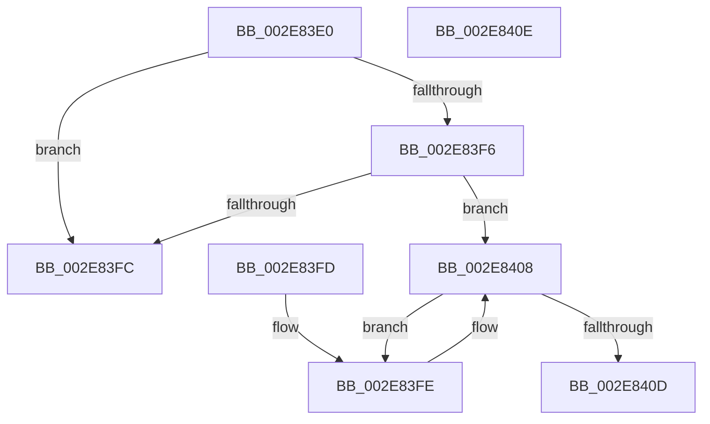

# RtlpHpLfhSubsegmentPrefetchRange

- RVA: `0x002E83E0`–`0x002E840F` (길이 `47` bytes)
- VA: `0x00000001402E83E0`
- 실행 섹션: `.text`
- PDB 이름 있음: `예`; PDB Function 태그: `아니요`
- unwind 정보 RVA: `0x000DB714`
- 디코드: `17`개 명령, `47/47` bytes 표시
- 미해석 바이트: `0` (있으면 어셈블리에 `.byte`로 보존)

> 이 문서는 커널 이미지의 기계어와 PDB 기호를 분석해 생성했습니다. 4번과 5번은 함수 원형과 자료형을 바이너리 사용 방식에서 추정한 C 해석이며 원본 소스 복구 결과는 아닙니다.

## 1. Dependencies

- 직접 호출 지점: **0**; 고유 호출 대상: **0**
- 직접 호출자로 확인된 함수: **1**
- RIP 상대 이미지 참조: **1**

### Outgoing calls
- 직접 디코드된 call 명령이 없습니다.

### Direct callers
- [RtlpHpLfhSubsegmentInitialize](RtlpHpLfhSubsegmentInitialize_function_002E806C.md) at `0x002E815A`

### Static image references
- `0x002E83E0` → RVA `0x00F059A0` (`.data`; read)

## 2. Other-region calls and transfers

- 다른 실행 섹션으로 향하는 call: **0**
- 별도 외부 분기/꼬리 이동을 확인하지 못했습니다.

## 3. Assembly (complete function range)

```asm
002E83E0  8B 05 BA D5 C1 00               mov eax, dword ptr [rip + 0xc1d5ba]
002E83E6  44 8B D2                        mov r10d, edx
002E83E9  4C 03 D1                        add r10, rcx
002E83EC  41 8B C8                        mov ecx, r8d
002E83EF  49 03 CA                        add rcx, r10
002E83F2  A8 02                           test al, 2
002E83F4  74 06                           je 0x1402e83fc
002E83F6  41 F6 C1 02                     test r9b, 2
002E83FA  75 0C                           jne 0x1402e8408
002E83FC  C3                              ret
002E83FD  CC                              int3
002E83FE  41 8A 02                        mov al, byte ptr [r10]
002E8401  49 81 C2 00 10 00 00            add r10, 0x1000
002E8408  4C 3B D1                        cmp r10, rcx
002E840B  72 F1                           jb 0x1402e83fe
002E840D  C3                              ret
002E840E  CC                              int3
```

## 4. C-style interpretation (structured pseudocode)

```c
__int64 __fastcall RtlpHpLfhSubsegmentPrefetchRange(__int64 a1, int a2, int a3, unsigned __int8 a4)
{
    __int64 v_r10;

    v_r10 = ((unsigned int)(a2)) + (a1);
    a1 = ((unsigned int)(a3)) + (v_r10);
    if ((((unsigned __int8)((unsigned int)(*(unsigned int *)(v_rip + 12703162)))) & (2)) == 0) goto loc_002E83FC;
    if (((a4) & (2)) != 0) goto loc_002E8408;
loc_002E83FC:
    return (unsigned int)(*(unsigned int *)(v_rip + 12703162));
loc_002E83FE:
    v_r10 = (v_r10) + (0x1000ULL);
loc_002E8408:
    if (v_r10 < a1) goto loc_002E83FE;
    return *(unsigned __int8 *)(v_r10);
}
```

## 5. (Beta) C Style

```c
int64_t RtlpHpLfhSubsegmentPrefetchRange(int64_t Arg1, int32_t Arg2, int32_t Arg3, uint8_t Arg4)
{
    int64_t local_r10;

    local_r10 = ((uint32_t)(Arg2)) + (Arg1);
    Arg1 = ((uint32_t)(Arg3)) + (local_r10);
    if ((((uint8_t)((uint32_t)(*(uint32_t *)(v_rip + 0xC1D5BA)))) & (2)) == 0) goto loc_002E83FC;
    if (((Arg4) & (2)) != 0) goto loc_002E8408;
loc_002E83FC:
    return (uint32_t)(*(uint32_t *)(v_rip + 0xC1D5BA));
loc_002E83FE:
    local_r10 = (local_r10) + (0x1000ULL);
loc_002E8408:
    if (local_r10 < Arg1) goto loc_002E83FE;
    return *(uint8_t *)(local_r10);
}
```

## 6. Execution-region graph

[열기: 2D/3D 그래프와 함수 탐색 컨트롤 패널](../../../control-panel.html?section=text&rva=0x002E83E0&view=graph)

- 2D 그래프는 위에서 아래로 흐르고, 3D 그래프는 빈 공간을 드래그해 회전합니다. Shift+드래그는 이동, 휠은 확대·축소, 함수 노드 선택은 대상 보고서 이동입니다.

### Static fallback


