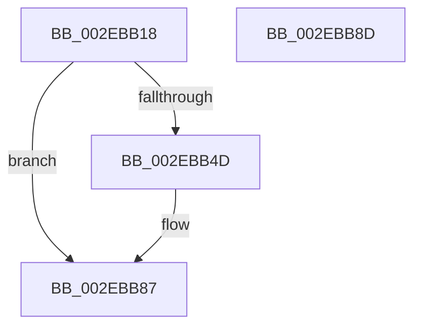

# RtlpHpLfhSubsegmentPrefetch

- RVA: `0x002EBB18`–`0x002EBB8E` (길이 `118` bytes)
- VA: `0x00000001402EBB18`
- 실행 섹션: `.text`
- PDB 이름 있음: `예`; PDB Function 태그: `아니요`
- unwind 정보 RVA: `0x00071750`
- 디코드: `32`개 명령, `118/118` bytes 표시
- 미해석 바이트: `0` (있으면 어셈블리에 `.byte`로 보존)

> 이 문서는 커널 이미지의 기계어와 PDB 기호를 분석해 생성했습니다. 4번과 5번은 함수 원형과 자료형을 바이너리 사용 방식에서 추정한 C 해석이며 원본 소스 복구 결과는 아닙니다.

## 1. Dependencies

- 직접 호출 지점: **0**; 고유 호출 대상: **0**
- 직접 호출자로 확인된 함수: **5**
- RIP 상대 이미지 참조: **1**

### Outgoing calls
- 직접 디코드된 call 명령이 없습니다.

### Direct callers
- [RtlpHpLfhSlotAllocateSlow](RtlpHpLfhSlotAllocateSlow_function_002E8FBC.md) at `0x002E96E7`
- [sub_002E9C01](Unknown_function_002E9C01.md) at `0x002E9D48`
- [RtlpHpAllocateHeapSlow](RtlpHpAllocateHeapSlow_function_002E9DEC.md) at `0x002EA293`
- [ExAllocateHeapPool](../35/ExAllocateHeapPool_function_0035BA30.md) at `0x0035DE2F`
- [ExAllocateHeapPool](../35/ExAllocateHeapPool_function_0035BA30.md) at `0x0035DE96`
- [sub_006DE832](../6D/Unknown_function_006DE832.md) at `0x006DEA7C`

### Static image references
- `0x002EBB5D` → RVA `0x00E2830A` (`.data`; read)

## 2. Other-region calls and transfers

- 다른 실행 섹션으로 향하는 call: **0**
- 별도 외부 분기/꼬리 이동을 확인하지 못했습니다.

## 3. Assembly (complete function range)

```asm
002EBB18  48 89 5C 24 08                  mov qword ptr [rsp + 8], rbx
002EBB1D  44 0F B7 52 30                  movzx r10d, word ptr [rdx + 0x30]
002EBB22  45 8D 99 FF FF 00 00            lea r11d, [r9 + 0xffff]
002EBB29  41 FF C2                        inc r10d
002EBB2C  B8 00 00 FF FF                  mov eax, 0xffff0000
002EBB31  45 0F AF D1                     imul r10d, r9d
002EBB35  45 03 D8                        add r11d, r8d
002EBB38  44 23 D8                        and r11d, eax
002EBB3B  48 8B D9                        mov rbx, rcx
002EBB3E  41 81 C2 FF FF 00 00            add r10d, 0xffff
002EBB45  44 23 D0                        and r10d, eax
002EBB48  45 3B DA                        cmp r11d, r10d
002EBB4B  76 3A                           jbe 0x1402ebb87
002EBB4D  0F B7 42 2A                     movzx eax, word ptr [rdx + 0x2a]
002EBB51  48 8B CA                        mov rcx, rdx
002EBB54  48 C1 E9 0C                     shr rcx, 0xc
002EBB58  C1 E9 10                        shr ecx, 0x10
002EBB5B  33 C8                           xor ecx, eax
002EBB5D  0F B7 05 A6 C7 B3 00            movzx eax, word ptr [rip + 0xb3c7a6]
002EBB64  33 C8                           xor ecx, eax
002EBB66  0F B7 42 2C                     movzx eax, word ptr [rdx + 0x2c]
002EBB6A  44 2B D9                        sub r11d, ecx
002EBB6D  48 C1 E0 06                     shl rax, 6
002EBB71  41 8B CB                        mov ecx, r11d
002EBB74  8B 44 18 48                     mov eax, dword ptr [rax + rbx + 0x48]
002EBB78  48 0F AF C8                     imul rcx, rax
002EBB7C  48 C1 E9 20                     shr rcx, 0x20
002EBB80  66 FF C9                        dec cx
002EBB83  66 89 4A 30                     mov word ptr [rdx + 0x30], cx
002EBB87  48 8B 5C 24 08                  mov rbx, qword ptr [rsp + 8]
002EBB8C  C3                              ret
002EBB8D  CC                              int3
```

## 4. C-style interpretation (structured pseudocode)

```c
__int64 __fastcall RtlpHpLfhSubsegmentPrefetch(__int64 a1, __int64 a2, int a3, __int64 a4)
{
    __int64 result;
    __int64 v_r10;
    __int64 v_r11;
    unsigned __int64 v_stack_p8;

    v_stack_p8 = v_rbx;
    v_r10 = (unsigned int)((*(unsigned __int16 *)(a2 + 48)) + 1);
    v_r10 = (unsigned int)((v_r10) * ((unsigned int)(a4)));
    v_r11 = (unsigned int)((a4 + 65535) + (a3));
    v_r11 = (unsigned int)((v_r11) & ((unsigned int)((unsigned int)(0xFFFF0000ULL))));
    v_r10 = (unsigned int)((v_r10) + (0xFFFFULL));
    v_r10 = (unsigned int)((v_r10) & ((unsigned int)((unsigned int)(0xFFFF0000ULL))));
    result = (unsigned int)(0xFFFF0000ULL);
    if (((unsigned int)(v_r11)) >= = ((unsigned int)(v_r10))) {
        result = *(unsigned __int16 *)(a2 + 42);
        a1 = a2;
        a1 = (a1) >> (12);
        a1 = (unsigned int)((a1) >> (16));
        a1 = (unsigned int)((a1) ^ ((unsigned int)(result)));
        result = *(unsigned __int16 *)(v_rip + 11782054);
        a1 = (unsigned int)((a1) ^ ((unsigned int)(result)));
        result = *(unsigned __int16 *)(a2 + 44);
        v_r11 = (unsigned int)((v_r11) - ((unsigned int)(a1)));
        result = (result) << (6);
        a1 = (unsigned int)(v_r11);
        result = *(unsigned int *)(result + a1 * 1 + 72);
        a1 = (a1) * (result);
        a1 = (a1) >> (32);
        a1 = (unsigned __int16)((a1) - 1);
        *(unsigned __int16 *)(a2 + 48) = (unsigned __int16)(a1);
    }
    return result;
}
```

## 5. (Beta) C Style

```c
int64_t RtlpHpLfhSubsegmentPrefetch(int64_t Arg1, void *Arg2, int32_t Arg3, void *Arg4)
{
    uint8_t *arg2 = (uint8_t *)Arg2;
    uint8_t *arg4 = (uint8_t *)Arg4;

    int64_t result;
    int64_t local_r10;
    int64_t local_r11;
    uint64_t v_stack_p8;

    v_stack_p8 = local_rbx;
    local_r10 = (uint32_t)((*(uint16_t *)(arg2 + 0x30)) + 1);
    local_r10 = (uint32_t)((local_r10) * ((uint32_t)(Arg4)));
    local_r11 = (uint32_t)((Arg4 + 65535) + (Arg3));
    local_r11 = (uint32_t)((local_r11) & ((uint32_t)((uint32_t)(0xFFFF0000ULL))));
    local_r10 = (uint32_t)((local_r10) + (0xFFFFULL));
    local_r10 = (uint32_t)((local_r10) & ((uint32_t)((uint32_t)(0xFFFF0000ULL))));
    result = (uint32_t)(0xFFFF0000ULL);
    if (((uint32_t)(local_r11)) >= = ((uint32_t)(local_r10))) {
        result = *(uint16_t *)(arg2 + 0x2A);
        Arg1 = Arg2;
        Arg1 = (Arg1) >> (12);
        Arg1 = (uint32_t)((Arg1) >> (16));
        Arg1 = (uint32_t)((Arg1) ^ ((uint32_t)(result)));
        result = *(uint16_t *)(v_rip + 0xB3C7A6);
        Arg1 = (uint32_t)((Arg1) ^ ((uint32_t)(result)));
        result = *(uint16_t *)(arg2 + 0x2C);
        local_r11 = (uint32_t)((local_r11) - ((uint32_t)(Arg1)));
        result = (result) << (6);
        Arg1 = (uint32_t)(local_r11);
        result = *(uint32_t *)(result + Arg1 * 1 + 0x48);
        Arg1 = (Arg1) * (result);
        Arg1 = (Arg1) >> (32);
        Arg1 = (uint16_t)((Arg1) - 1);
        *(uint16_t *)(arg2 + 0x30) = (uint16_t)(Arg1);
    }
    return result;
}
```

### 관측된 메모리 오프셋

구조체 형식이 확인되지 않은 접근은 인자 기준의 오프셋으로만 기록했습니다.

| 기준 인자 | 오프셋 표현 | 폭 (bit) | 접근 |
|---|---:|---:|---|
| `Arg2` | `+ 0x2A` | `16` | `R` |
| `Arg2` | `+ 0x2C` | `16` | `R` |
| `Arg2` | `+ 0x30` | `16` | `R` |
| `Arg2` | `+ 0x30` | `16` | `W` |
| `Arg4` | `+ 0xFFFF` | `32` | `R` |

## 6. Execution-region graph

[열기: 2D/3D 그래프와 함수 탐색 컨트롤 패널](../../../control-panel.html?section=text&rva=0x002EBB18&view=graph)

- 2D 그래프는 위에서 아래로 흐르고, 3D 그래프는 빈 공간을 드래그해 회전합니다. Shift+드래그는 이동, 휠은 확대·축소, 함수 노드 선택은 대상 보고서 이동입니다.

### Static fallback


