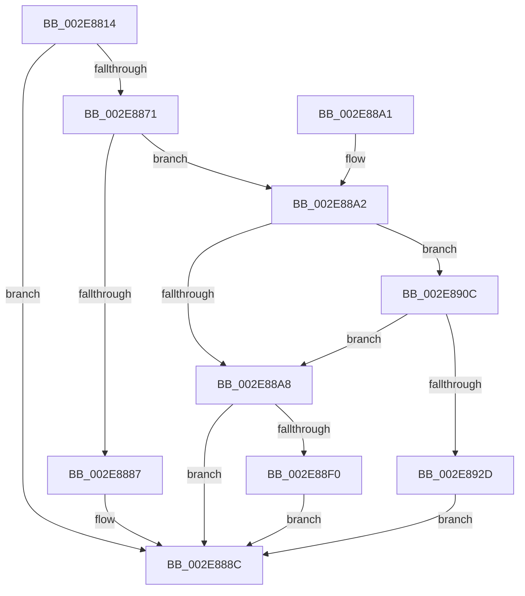

# RtlpHpLfhSubsegmentReformatAsMulti

- RVA: `0x002E8814`–`0x002E8937` (길이 `291` bytes)
- VA: `0x00000001402E8814`
- 실행 섹션: `.text`
- PDB 이름 있음: `예`; PDB Function 태그: `아니요`
- unwind 정보 RVA: `0x00071438`
- 디코드: `88`개 명령, `291/291` bytes 표시
- 미해석 바이트: `0` (있으면 어셈블리에 `.byte`로 보존)

> 이 문서는 커널 이미지의 기계어와 PDB 기호를 분석해 생성했습니다. 4번과 5번은 함수 원형과 자료형을 바이너리 사용 방식에서 추정한 C 해석이며 원본 소스 복구 결과는 아닙니다.

## 1. Dependencies

- 직접 호출 지점: **6**; 고유 호출 대상: **6**
- 직접 호출자로 확인된 함수: **2**
- RIP 상대 이미지 참조: **1**

### Outgoing calls
- `0x002E885A` → [RtlpHpLfhSubsegmentComputeCommitUnit](RtlpHpLfhSubsegmentComputeCommitUnit_function_002E8940.md) (function, `0x002E8940`)
- `0x002E88CD` → [memset](../6C/memset_function_006C6C40.md) (function, `0x006C6C40`)
- `0x002E88DF` → [RtlpHpLfhSubsegmentConstructCommitState](RtlpHpLfhSubsegmentConstructCommitState_function_002E7E9C.md) (function, `0x002E7E9C`)
- `0x002E88E7` → [RtlpHpLfhSubsegmentCountEmptyUnits](RtlpHpLfhSubsegmentCountEmptyUnits_function_002E7D48.md) (function, `0x002E7D48`)
- `0x002E8905` → [RtlpHpLfhContextUpdateFreeCommitCount](../49/RtlpHpLfhContextUpdateFreeCommitCount_function_00497E98.md) (function, `0x00497E98`)
- `0x002E8920` → [RtlpHpLfhSubsegmentReformatCheck](../46/RtlpHpLfhSubsegmentReformatCheck_function_00461EA4.md) (function, `0x00461EA4`)

### Direct callers
- [RtlpHpLfhOwnerRunMaintenance](RtlpHpLfhOwnerRunMaintenance_function_002E8980.md) at `0x002E8AFE`
- [RtlpHpLfhBucketAddSubsegment](RtlpHpLfhBucketAddSubsegment_function_002E8CD8.md) at `0x002E8DFF`

### Static image references
- `0x002E8849` → RVA `0x00E28308` (`.data`; read)

## 2. Other-region calls and transfers

- 다른 실행 섹션으로 향하는 call: **0**
- 별도 외부 분기/꼬리 이동을 확인하지 못했습니다.

## 3. Assembly (complete function range)

```asm
002E8814  48 89 5C 24 08                  mov qword ptr [rsp + 8], rbx
002E8819  48 89 6C 24 18                  mov qword ptr [rsp + 0x18], rbp
002E881E  56                              push rsi
002E881F  57                              push rdi
002E8820  41 56                           push r14
002E8822  48 83 EC 30                     sub rsp, 0x30
002E8826  48 8B F2                        mov rsi, rdx
002E8829  48 8B C2                        mov rax, rdx
002E882C  48 C1 E8 0C                     shr rax, 0xc
002E8830  4C 8B F1                        mov r14, rcx
002E8833  0F B7 D0                        movzx edx, ax
002E8836  BD 00 10 00 00                  mov ebp, 0x1000
002E883B  33 FF                           xor edi, edi
002E883D  45 8B C8                        mov r9d, r8d
002E8840  0F B7 46 28                     movzx eax, word ptr [rsi + 0x28]
002E8844  8A 4E 26                        mov cl, byte ptr [rsi + 0x26]
002E8847  33 D0                           xor edx, eax
002E8849  0F B7 05 B8 FA B3 00            movzx eax, word ptr [rip + 0xb3fab8]
002E8850  D3 E5                           shl ebp, cl
002E8852  33 D0                           xor edx, eax
002E8854  8B CD                           mov ecx, ebp
002E8856  89 7C 24 68                     mov dword ptr [rsp + 0x68], edi
002E885A  E8 E1 00 00 00                  call 0x1402e8940
002E885F  C1 E8 0C                        shr eax, 0xc
002E8862  0F BC D8                        bsf ebx, eax
002E8865  0F B6 46 26                     movzx eax, byte ptr [rsi + 0x26]
002E8869  89 5C 24 58                     mov dword ptr [rsp + 0x58], ebx
002E886D  3B D8                           cmp ebx, eax
002E886F  74 1B                           je 0x1402e888c
002E8871  0F B7 46 22                     movzx eax, word ptr [rsi + 0x22]
002E8875  8B CB                           mov ecx, ebx
002E8877  C1 ED 0C                        shr ebp, 0xc
002E887A  D3 ED                           shr ebp, cl
002E887C  0F B7 4E 20                     movzx ecx, word ptr [rsi + 0x20]
002E8880  0F AF CD                        imul ecx, ebp
002E8883  3B C8                           cmp ecx, eax
002E8885  73 1B                           jae 0x1402e88a2
002E8887  BF 9B 04 00 C0                  mov edi, 0xc000049b
002E888C  48 8B 5C 24 50                  mov rbx, qword ptr [rsp + 0x50]
002E8891  8B C7                           mov eax, edi
002E8893  48 8B 6C 24 60                  mov rbp, qword ptr [rsp + 0x60]
002E8898  48 83 C4 30                     add rsp, 0x30
002E889C  41 5E                           pop r14
002E889E  5F                              pop rdi
002E889F  5E                              pop rsi
002E88A0  C3                              ret
002E88A1  CC                              int3
002E88A2  41 F6 C1 01                     test r9b, 1
002E88A6  74 64                           je 0x1402e890c
002E88A8  88 5C 24 58                     mov byte ptr [rsp + 0x58], bl
002E88AC  33 D2                           xor edx, edx
002E88AE  40 88 6C 24 59                  mov byte ptr [rsp + 0x59], bpl
002E88B3  0F B7 44 24 58                  movzx eax, word ptr [rsp + 0x58]
002E88B8  66 89 46 26                     mov word ptr [rsi + 0x26], ax
002E88BC  0F B6 46 18                     movzx eax, byte ptr [rsi + 0x18]
002E88C0  44 8B C5                        mov r8d, ebp
002E88C3  4D 03 C0                        add r8, r8
002E88C6  48 8D 1C C6                     lea rbx, [rsi + rax*8]
002E88CA  48 8B CB                        mov rcx, rbx
002E88CD  E8 6E E3 3D 00                  call 0x1406c6c40
002E88D2  4C 8D 46 40                     lea r8, [rsi + 0x40]
002E88D6  4C 8B CB                        mov r9, rbx
002E88D9  48 8B D6                        mov rdx, rsi
002E88DC  49 8B CE                        mov rcx, r14
002E88DF  E8 B8 F5 FF FF                  call 0x1402e7e9c
002E88E4  48 8B CE                        mov rcx, rsi
002E88E7  E8 5C F4 FF FF                  call 0x1402e7d48
002E88EC  85 C0                           test eax, eax
002E88EE  74 9C                           je 0x1402e888c
002E88F0  8A 4E 26                        mov cl, byte ptr [rsi + 0x26]
002E88F3  48 8B D6                        mov rdx, rsi
002E88F6  C1 E0 0C                        shl eax, 0xc
002E88F9  D3 E0                           shl eax, cl
002E88FB  49 8B CE                        mov rcx, r14
002E88FE  44 8B C0                        mov r8d, eax
002E8901  49 C1 E8 0C                     shr r8, 0xc
002E8905  E8 8E F5 1A 00                  call 0x140497e98
002E890A  EB 80                           jmp 0x1402e888c
002E890C  4C 8D 4C 24 68                  lea r9, [rsp + 0x68]
002E8911  89 7C 24 20                     mov dword ptr [rsp + 0x20], edi
002E8915  4C 8D 44 24 20                  lea r8, [rsp + 0x20]
002E891A  48 8B D6                        mov rdx, rsi
002E891D  49 8B CE                        mov rcx, r14
002E8920  E8 7F 95 17 00                  call 0x140461ea4
002E8925  85 C0                           test eax, eax
002E8927  0F 85 7B FF FF FF               jne 0x1402e88a8
002E892D  BF 76 04 00 C0                  mov edi, 0xc0000476
002E8932  E9 55 FF FF FF                  jmp 0x1402e888c
```

## 4. C-style interpretation (structured pseudocode)

```c
__int64 __fastcall RtlpHpLfhSubsegmentReformatAsMulti(__int64 a1, __int64 a2, int a3)
{
    __int64 result;
    __int64 v_rbp;
    __int64 v_rdi;
    __int64 v_rsp;
    unsigned int v_stack_p10;
    unsigned __int64 v_stack_p18;
    unsigned int v_stack_p20;
    unsigned __int8 v_stack_p58;
    unsigned __int8 v_stack_p59;
    unsigned __int64 v_stack_p68;
    unsigned __int64 v_stack_p8;

    v_stack_p8 = v_rbx;
    v_stack_p18 = v_rbp;
    v_rsp = (v_rsp) - (48);
    result = (a2) >> (12);
    v_rdi = 0;
    a2 = (unsigned int)(((unsigned __int16)(result)) ^ ((unsigned int)(*(unsigned __int16 *)(a2 + 40))));
    v_rbp = (unsigned int)(((unsigned int)(0x1000ULL)) << ((unsigned __int8)(*(unsigned __int8 *)(a2 + 38))));
    a2 = (unsigned int)((a2) ^ ((unsigned int)(*(unsigned __int16 *)(v_rip + 11795128))));
    v_stack_p20 = 0;
    result = RtlpHpLfhSubsegmentComputeCommitUnit((unsigned int)((unsigned int)(v_rbp)), a2, a3, (unsigned int)(a3));
    result = (unsigned int)((result) >> (12));
    v_stack_p10 = (unsigned int)(v_rbx);
    if (((unsigned int)(v_rbx)) == ((unsigned int)(*(unsigned __int8 *)(a2 + 38)))) goto loc_002E888C;
    v_rbp = (unsigned int)((v_rbp) >> (12));
    v_rbp = (unsigned int)((v_rbp) >> ((unsigned __int8)((unsigned int)((unsigned int)(v_rbx)))));
    a1 = (unsigned int)((*(unsigned __int16 *)(a2 + 32)) * ((unsigned int)(v_rbp)));
    if (((unsigned int)(a1)) >= ((unsigned int)(*(unsigned __int16 *)(a2 + 34)))) goto loc_002E88A2;
loc_002E888C:
    v_rsp = (v_rsp) + (48);
    return (unsigned int)((unsigned int)((unsigned int)(0xC000049BULL)));
loc_002E88A2:
    if ((((unsigned __int8)((unsigned int)(a3))) & (1)) == 0) goto loc_002E890C;
loc_002E88A8:
    v_stack_p58 = (unsigned __int8)(v_stack_p8);
    a2 = 0;
    v_stack_p59 = (unsigned __int8)(v_stack_p18);
    *(unsigned __int16 *)(a2 + 38) = (unsigned __int16)(v_stack_p58);
    a3 = ((unsigned int)((unsigned int)(v_stack_p18))) + ((unsigned int)((unsigned int)(v_stack_p18)));
    result = memset(a2 + *(unsigned __int8 *)(a2 + 24) * 8, a2, a3, (unsigned int)(a3));
    result = RtlpHpLfhSubsegmentConstructCommitState(a1, 0, a2 + 64, a2 + *(unsigned __int8 *)(a2 + 24) * 8);
    result = RtlpHpLfhSubsegmentCountEmptyUnits(0, 0, a2 + 64, a2 + *(unsigned __int8 *)(a2 + 24) * 8);
    if ((unsigned int)(result) == 0) goto loc_002E888C;
    result = (unsigned int)((result) << (12));
    result = (unsigned int)((result) << ((unsigned __int8)(*(unsigned __int8 *)(a2 + 38))));
    a3 = ((unsigned int)((unsigned int)(result))) >> (12);
    result = RtlpHpLfhContextUpdateFreeCommitCount(a1, 0, a3, a2 + *(unsigned __int8 *)(a2 + 24) * 8);
    goto loc_002E888C;
loc_002E890C:
    v_stack_p20 = (unsigned int)((unsigned int)(0xC000049BULL));
    result = RtlpHpLfhSubsegmentReformatCheck(a1, 0, v_stack_p20, v_stack_p68);
    if ((unsigned int)(result) != 0) goto loc_002E88A8;
    goto loc_002E888C;
}
```

## 5. (Beta) C Style

```c
int64_t RtlpHpLfhSubsegmentReformatAsMulti(int64_t Arg1, void *Arg2, int32_t Arg3)
{
    uint8_t *arg2 = (uint8_t *)Arg2;

    int64_t result;
    int64_t local_rbp;
    int64_t local_rdi;
    int64_t local_rsp;
    uint32_t v_stack_p10;
    uint64_t v_stack_p18;
    uint32_t v_stack_p20;
    uint8_t v_stack_p58;
    uint8_t v_stack_p59;
    uint64_t v_stack_p68;
    uint64_t v_stack_p8;

    v_stack_p8 = local_rbx;
    v_stack_p18 = local_rbp;
    local_rsp = (local_rsp) - (48);
    result = (Arg2) >> (12);
    local_rdi = 0;
    Arg2 = (uint32_t)(((uint16_t)(result)) ^ ((uint32_t)(*(uint16_t *)(arg2 + 0x28))));
    local_rbp = (uint32_t)(((uint32_t)(0x1000ULL)) << ((uint8_t)(*(uint8_t *)(arg2 + 0x26))));
    Arg2 = (uint32_t)((Arg2) ^ ((uint32_t)(*(uint16_t *)(v_rip + 0xB3FAB8))));
    v_stack_p20 = 0;
    result = RtlpHpLfhSubsegmentComputeCommitUnit((uint32_t)((uint32_t)(local_rbp)), Arg2, Arg3, (uint32_t)(Arg3));
    result = (uint32_t)((result) >> (12));
    v_stack_p10 = (uint32_t)(local_rbx);
    if (((uint32_t)(local_rbx)) == ((uint32_t)(*(uint8_t *)(arg2 + 0x26)))) goto loc_002E888C;
    local_rbp = (uint32_t)((local_rbp) >> (12));
    local_rbp = (uint32_t)((local_rbp) >> ((uint8_t)((uint32_t)((uint32_t)(local_rbx)))));
    Arg1 = (uint32_t)((*(uint16_t *)(arg2 + 0x20)) * ((uint32_t)(local_rbp)));
    if (((uint32_t)(Arg1)) >= ((uint32_t)(*(uint16_t *)(arg2 + 0x22)))) goto loc_002E88A2;
loc_002E888C:
    local_rsp = (local_rsp) + (48);
    return (uint32_t)((uint32_t)((uint32_t)(0xC000049BULL)));
loc_002E88A2:
    if ((((uint8_t)((uint32_t)(Arg3))) & (1)) == 0) goto loc_002E890C;
loc_002E88A8:
    v_stack_p58 = (uint8_t)(v_stack_p8);
    Arg2 = 0;
    v_stack_p59 = (uint8_t)(v_stack_p18);
    *(uint16_t *)(arg2 + 0x26) = (uint16_t)(v_stack_p58);
    Arg3 = ((uint32_t)((uint32_t)(v_stack_p18))) + ((uint32_t)((uint32_t)(v_stack_p18)));
    result = memset(Arg2 + *(uint8_t *)(arg2 + 0x18) * 8, Arg2, Arg3, (uint32_t)(Arg3));
    result = RtlpHpLfhSubsegmentConstructCommitState(Arg1, 0, Arg2 + 64, Arg2 + *(uint8_t *)(arg2 + 0x18) * 8);
    result = RtlpHpLfhSubsegmentCountEmptyUnits(0, 0, Arg2 + 64, Arg2 + *(uint8_t *)(arg2 + 0x18) * 8);
    if ((uint32_t)(result) == 0) goto loc_002E888C;
    result = (uint32_t)((result) << (12));
    result = (uint32_t)((result) << ((uint8_t)(*(uint8_t *)(arg2 + 0x26))));
    Arg3 = ((uint32_t)((uint32_t)(result))) >> (12);
    result = RtlpHpLfhContextUpdateFreeCommitCount(Arg1, 0, Arg3, Arg2 + *(uint8_t *)(arg2 + 0x18) * 8);
    goto loc_002E888C;
loc_002E890C:
    v_stack_p20 = (uint32_t)((uint32_t)(0xC000049BULL));
    result = RtlpHpLfhSubsegmentReformatCheck(Arg1, 0, v_stack_p20, v_stack_p68);
    if ((uint32_t)(result) != 0) goto loc_002E88A8;
    goto loc_002E888C;
}
```

### 관측된 메모리 오프셋

구조체 형식이 확인되지 않은 접근은 인자 기준의 오프셋으로만 기록했습니다.

| 기준 인자 | 오프셋 표현 | 폭 (bit) | 접근 |
|---|---:|---:|---|
| `Arg2` | `+ 0x0 + rax*8` | `64` | `R` |
| `Arg2` | `+ 0x18` | `8` | `R` |
| `Arg2` | `+ 0x20` | `16` | `R` |
| `Arg2` | `+ 0x22` | `16` | `R` |
| `Arg2` | `+ 0x26` | `8` | `R` |
| `Arg2` | `+ 0x26` | `16` | `W` |
| `Arg2` | `+ 0x28` | `16` | `R` |
| `Arg2` | `+ 0x40` | `64` | `R` |

## 6. Execution-region graph

[열기: 2D/3D 그래프와 함수 탐색 컨트롤 패널](../../../control-panel.html?section=text&rva=0x002E8814&view=graph)

- 2D 그래프는 위에서 아래로 흐르고, 3D 그래프는 빈 공간을 드래그해 회전합니다. Shift+드래그는 이동, 휠은 확대·축소, 함수 노드 선택은 대상 보고서 이동입니다.

### Static fallback


