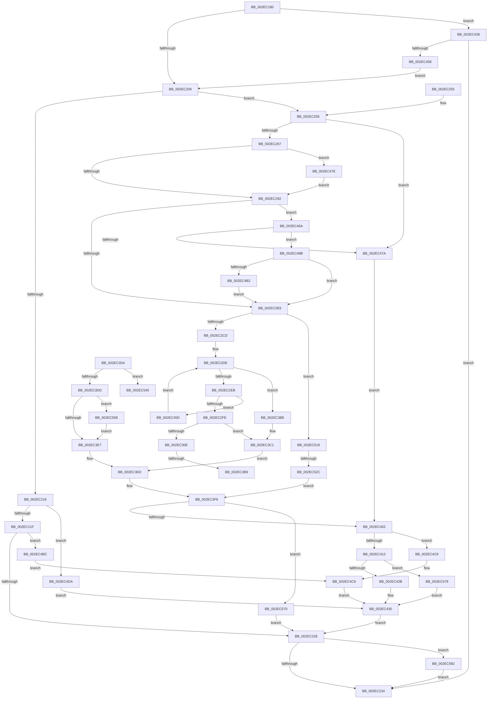

# RtlpHpMetadataAlloc

- RVA: `0x002EC180`–`0x002EC598` (길이 `1,048` bytes)
- VA: `0x00000001402EC180`
- 실행 섹션: `.text`
- PDB 이름 있음: `예`; PDB Function 태그: `예`
- unwind 정보 RVA: `0x00071794`
- 디코드: `250`개 명령, `1,048/1,048` bytes 표시
- 미해석 바이트: `0` (있으면 어셈블리에 `.byte`로 보존)

> 이 문서는 커널 이미지의 기계어와 PDB 기호를 분석해 생성했습니다. 4번과 5번은 함수 원형과 자료형을 바이너리 사용 방식에서 추정한 C 해석이며 원본 소스 복구 결과는 아닙니다.

## 1. Dependencies

- 직접 호출 지점: **12**; 고유 호출 대상: **11**
- 직접 호출자로 확인된 함수: **5**
- RIP 상대 이미지 참조: **4**

### Outgoing calls
- `0x002EC284` → [RtlpHpEnvTlsGetValue](RtlpHpEnvTlsGetValue_function_002E9850.md) (function, `0x002E9850`)
- `0x002EC3CA` → [RtlpHpLfhSlotAllocateSlow](RtlpHpLfhSlotAllocateSlow_function_002E8FBC.md) (function, `0x002E8FBC`)
- `0x002EC42B` → [RtlpHpLargeAlloc](RtlpHpLargeAlloc_function_002EBD5C.md) (function, `0x002EBD5C`)
- `0x002EC44B` → [RtlRunOnceExecuteOnce](../../page/95/RtlRunOnceExecuteOnce_function_0095DC00.md) (function, `0x0095DC00`)
- `0x002EC470` → [RtlpHpLfhBucketCheckAndUpdate](../4F/RtlpHpLfhBucketCheckAndUpdate_function_004FC894.md) (function, `0x004FC894`)
- `0x002EC481` → [RtlpHpLfhThreadDataInitializeSet](../4F/RtlpHpLfhThreadDataInitializeSet_function_004F6334.md) (function, `0x004F6334`)
- `0x002EC4D0` → [RtlpHpVsContextAllocate](RtlpHpVsContextAllocate_function_002EA944.md) (function, `0x002EA944`)
- `0x002EC50F` → [RtlpHpSegAlloc](../32/RtlpHpSegAlloc_function_003265BC.md) (function, `0x003265BC`)
- `0x002EC538` → [RtlpHpLfhSlotAllocateSlow](RtlpHpLfhSlotAllocateSlow_function_002E8FBC.md) (function, `0x002E8FBC`)
- `0x002EC566` → [RtlpHpLfhBucketUpdateAffinityMapping](../4D/RtlpHpLfhBucketUpdateAffinityMapping_function_004D0008.md) (function, `0x004D0008`)
- `0x002EC578` → [RtlpHpAllocateHeapBackend](../32/RtlpHpAllocateHeapBackend_function_00326580.md) (function, `0x00326580`)
- `0x002EC58E` → [RtlpLogHeapAllocateEvent](../5F/RtlpLogHeapAllocateEvent_function_005F1638.md) (function, `0x005F1638`)

### Direct callers
- [RtlpHpLargeAlloc](RtlpHpLargeAlloc_function_002EBD5C.md) at `0x002EBDBE`
- [RtlpHpCustomVaCallbacksRegistrarRegister](../60/RtlpHpCustomVaCallbacksRegistrarRegister_function_00602804.md) at `0x00602921`
- [RtlpHpHeapAllocate](../60/RtlpHpHeapAllocate_function_00602D98.md) at `0x00602E67`
- [ExpSecurePoolCreate](../65/ExpSecurePoolCreate_function_0065AB70.md) at `0x0065ABB9`
- [ExpPrivatePoolCreate](../../page/7D/ExpPrivatePoolCreate_function_007D5F98.md) at `0x007D6044`

### Static image references
- `0x002EC1A3` → RVA `0x00000000` (`image boundary/outside`; read)
- `0x002EC1D3` → RVA `0x00E6BE98` (`.data`; read)
- `0x002EC321` → RVA `0x00E28308` (`.data`; read)
- `0x002EC444` → RVA `0x00603680` (`RtlpHpMetadataHeapCreate`; read)

## 2. Other-region calls and transfers

- 다른 실행 섹션으로 향하는 call: **1**
  - `0x002EC44B` → [RtlRunOnceExecuteOnce](../../page/95/RtlRunOnceExecuteOnce_function_0095DC00.md) (`.text` → `PAGE`)
- call이 아닌 외부 분기/꼬리 이동: **4**
  - `0x002EC3B3` → [sub_006DE832 + 0x100](../6D/Unknown_function_006DE832.md) (`tail-transfer`)
  - `0x002EC3B9` → [sub_006DE832 + 0x1B0](../6D/Unknown_function_006DE832.md) (`tail-transfer`)
  - `0x002EC526` → [sub_006DE832](../6D/Unknown_function_006DE832.md) (`tail-transfer`)
  - `0x002EC553` → [sub_006DE832 + 0x257](../6D/Unknown_function_006DE832.md) (`tail-transfer`)

## 3. Assembly (complete function range)

```asm
002EC180  48 89 5C 24 08                  mov qword ptr [rsp + 8], rbx
002EC185  48 89 6C 24 10                  mov qword ptr [rsp + 0x10], rbp
002EC18A  48 89 74 24 18                  mov qword ptr [rsp + 0x18], rsi
002EC18F  57                              push rdi
002EC190  41 54                           push r12
002EC192  41 55                           push r13
002EC194  41 56                           push r14
002EC196  41 57                           push r15
002EC198  48 83 EC 70                     sub rsp, 0x70
002EC19C  41 0F 10 01                     movups xmm0, xmmword ptr [r9]
002EC1A0  49 8B 01                        mov rax, qword ptr [r9]
002EC1A3  4C 8D 25 56 3E D1 FF            lea r12, [rip - 0x2ec1aa]
002EC1AA  48 C1 E8 08                     shr rax, 8
002EC1AE  33 DB                           xor ebx, ebx
002EC1B0  0F B6 C0                        movzx eax, al
002EC1B3  41 8B F0                        mov esi, r8d
002EC1B6  F3 0F 7F 44 24 50               movdqu xmmword ptr [rsp + 0x50], xmm0
002EC1BC  88 5C 24 53                     mov byte ptr [rsp + 0x53], bl
002EC1C0  48 8B EA                        mov rbp, rdx
002EC1C3  48 89 5C 24 58                  mov qword ptr [rsp + 0x58], rbx
002EC1C8  48 8B F9                        mov rdi, rcx
002EC1CB  45 8B BC 84 28 EA 01 00         mov r15d, dword ptr [r12 + rax*4 + 0x1ea28]
002EC1D3  48 8D 05 BE FC B7 00            lea rax, [rip + 0xb7fcbe]
002EC1DA  49 C1 E7 04                     shl r15, 4
002EC1DE  4C 03 F8                        add r15, rax
002EC1E1  0F B6 44 24 51                  movzx eax, byte ptr [rsp + 0x51]
002EC1E6  41 8B 84 84 28 EA 01 00         mov eax, dword ptr [r12 + rax*4 + 0x1ea28]
002EC1EE  88 44 24 51                     mov byte ptr [rsp + 0x51], al
002EC1F2  0F 28 44 24 50                  movaps xmm0, xmmword ptr [rsp + 0x50]
002EC1F7  66 0F 7F 44 24 60               movdqa xmmword ptr [rsp + 0x60], xmm0
002EC1FD  49 8B 07                        mov rax, qword ptr [r15]
002EC200  48 85 C0                        test rax, rax
002EC203  0F 84 2F 02 00 00               je 0x1402ec438
002EC209  4D 8B 3F                        mov r15, qword ptr [r15]
002EC20C  41 BD 03 00 00 00               mov r13d, 3
002EC212  85 F6                           test esi, esi
002EC214  74 40                           je 0x1402ec256
002EC216  83 EE 01                        sub esi, 1
002EC219  0F 84 BB 02 00 00               je 0x1402ec4da
002EC21F  83 FE 01                        cmp esi, 1
002EC222  0F 84 94 02 00 00               je 0x1402ec4bc
002EC228  41 8B 47 14                     mov eax, dword ptr [r15 + 0x14]
002EC22C  84 C0                           test al, al
002EC22E  0F 88 4E 03 00 00               js 0x1402ec582
002EC234  4C 8D 5C 24 70                  lea r11, [rsp + 0x70]
002EC239  48 8B C3                        mov rax, rbx
002EC23C  49 8B 5B 30                     mov rbx, qword ptr [r11 + 0x30]
002EC240  49 8B 6B 38                     mov rbp, qword ptr [r11 + 0x38]
002EC244  49 8B 73 40                     mov rsi, qword ptr [r11 + 0x40]
002EC248  49 8B E3                        mov rsp, r11
002EC24B  41 5F                           pop r15
002EC24D  41 5E                           pop r14
002EC24F  41 5D                           pop r13
002EC251  41 5C                           pop r12
002EC253  5F                              pop rdi
002EC254  C3                              ret
002EC255  CC                              int3
002EC256  41 0F B7 87 84 03 00 00         movzx eax, word ptr [r15 + 0x384]
002EC25E  48 3B F8                        cmp rdi, rax
002EC261  0F 83 13 02 00 00               jae 0x1402ec47a
002EC267  8D 47 0F                        lea eax, [rdi + 0xf]
002EC26A  C1 E8 04                        shr eax, 4
002EC26D  4D 8D B7 40 03 00 00            lea r14, [r15 + 0x340]
002EC274  41 8B 4E 4C                     mov ecx, dword ptr [r14 + 0x4c]
002EC278  46 0F B6 A4 20 80 0B 01 00      movzx r12d, byte ptr [rax + r12 + 0x10b80]
002EC281  41 FF CC                        dec r12d
002EC284  E8 C7 D5 FF FF                  call 0x1402e9850
002EC289  48 85 C0                        test rax, rax
002EC28C  0F 84 EC 01 00 00               je 0x1402ec47e
002EC292  0F B7 F0                        movzx esi, ax
002EC295  C1 E6 06                        shl esi, 6
002EC298  49 03 F6                        add rsi, r14
002EC29B  48 89 84 24 B8 00 00 00         mov qword ptr [rsp + 0xb8], rax
002EC2A3  42 0F B7 04 66                  movzx eax, word ptr [rsi + r12*2]
002EC2A8  44 8B C0                        mov r8d, eax
002EC2AB  85 C0                           test eax, eax
002EC2AD  0F 84 B7 01 00 00               je 0x1402ec46a
002EC2B3  41 C1 E0 06                     shl r8d, 6
002EC2B7  41 BC 02 00 00 00               mov r12d, 2
002EC2BD  41 8B E8                        mov ebp, r8d
002EC2C0  49 03 EE                        add rbp, r14
002EC2C3  66 39 5D 04                     cmp word ptr [rbp + 4], bx
002EC2C7  0F 85 4C 02 00 00               jne 0x1402ec519
002EC2CD  89 5C 24 34                     mov dword ptr [rsp + 0x34], ebx
002EC2D1  0F 0D 4D 38                     prefetchw byte ptr [rbp + 0x38]
002EC2D5  48 8B 75 38                     mov rsi, qword ptr [rbp + 0x38]
002EC2D9  45 8D 5C 24 FF                  lea r11d, [r12 - 1]
002EC2DE  48 F7 C6 FF 0F 00 00            test rsi, 0xfff
002EC2E5  0F 84 D3 00 00 00               je 0x1402ec3be
002EC2EB  48 8D 4E FF                     lea rcx, [rsi - 1]
002EC2EF  48 8B C6                        mov rax, rsi
002EC2F2  F0 48 0F B1 4D 38               lock cmpxchg qword ptr [rbp + 0x38], rcx
002EC2F8  0F 85 5F 01 00 00               jne 0x1402ec45d
002EC2FE  44 8B C7                        mov r8d, edi
002EC301  48 81 E6 00 F0 FF FF            and rsi, 0xfffffffffffff000
002EC308  0F 84 B3 00 00 00               je 0x1402ec3c1
002EC30E  65 4C 8B 0C 25 88 01 00 00      mov r9, qword ptr gs:[0x188]
002EC317  48 8B C6                        mov rax, rsi
002EC31A  48 C1 E8 0C                     shr rax, 0xc
002EC31E  33 46 28                        xor eax, dword ptr [rsi + 0x28]
002EC321  33 05 E1 BF B3 00               xor eax, dword ptr [rip + 0xb3bfe1]
002EC327  49 8B 89 60 07 00 00            mov rcx, qword ptr [r9 + 0x760]
002EC32E  49 8B 91 68 07 00 00            mov rdx, qword ptr [r9 + 0x768]
002EC335  89 44 24 38                     mov dword ptr [rsp + 0x38], eax
002EC339  0F B7 C0                        movzx eax, ax
002EC33C  89 44 24 44                     mov dword ptr [rsp + 0x44], eax
002EC340  48 8D 46 18                     lea rax, [rsi + 0x18]
002EC344  44 0F B6 28                     movzx r13d, byte ptr [rax]
002EC348  4C 8D 04 0A                     lea r8, [rdx + rcx]
002EC34C  48 33 D1                        xor rdx, rcx
002EC34F  48 89 44 24 48                  mov qword ptr [rsp + 0x48], rax
002EC354  48 C1 C1 18                     rol rcx, 0x18
002EC358  48 8B C2                        mov rax, rdx
002EC35B  48 C1 E0 10                     shl rax, 0x10
002EC35F  41 83 C5 F8                     add r13d, -8
002EC363  48 33 C8                        xor rcx, rax
002EC366  49 C1 E8 20                     shr r8, 0x20
002EC36A  48 33 CA                        xor rcx, rdx
002EC36D  45 0F B6 E0                     movzx r12d, r8b
002EC371  49 89 89 60 07 00 00            mov qword ptr [r9 + 0x760], rcx
002EC378  48 8D 4E 40                     lea rcx, [rsi + 0x40]
002EC37C  48 C1 C2 25                     rol rdx, 0x25
002EC380  49 89 91 68 07 00 00            mov qword ptr [r9 + 0x768], rdx
002EC387  49 FF CD                        dec r13
002EC38A  8A 46 27                        mov al, byte ptr [rsi + 0x27]
002EC38D  44 0F B6 4E 32                  movzx r9d, byte ptr [rsi + 0x32]
002EC392  88 84 24 B8 00 00 00            mov byte ptr [rsp + 0xb8], al
002EC399  0F B6 46 24                     movzx eax, byte ptr [rsi + 0x24]
002EC39D  4E 8D 2C E9                     lea r13, [rcx + r13*8]
002EC3A1  44 89 4C 24 30                  mov dword ptr [rsp + 0x30], r9d
002EC3A6  48 8D 14 C1                     lea rdx, [rcx + rax*8]
002EC3AA  4C 8B 02                        mov r8, qword ptr [rdx]
002EC3AD  49 F7 D0                        not r8
002EC3B0  4D 85 C0                        test r8, r8
002EC3B3  0F 85 79 25 3F 00               jne 0x1406de932
002EC3B9  E9 24 26 3F 00                  jmp 0x1406de9e2
002EC3BE  44 8B C7                        mov r8d, edi
002EC3C1  45 33 C9                        xor r9d, r9d
002EC3C4  48 8B D5                        mov rdx, rbp
002EC3C7  49 8B CE                        mov rcx, r14
002EC3CA  E8 ED CB FF FF                  call 0x1402e8fbc
002EC3CF  4C 8B E0                        mov r12, rax
002EC3D2  EB 19                           jmp 0x1402ec3ed
002EC3D4  4D 85 E4                        test r12, r12
002EC3D7  0F 84 68 01 00 00               je 0x1402ec545
002EC3DD  39 5C 24 34                     cmp dword ptr [rsp + 0x34], ebx
002EC3E1  0F 85 71 01 00 00               jne 0x1402ec558
002EC3E7  41 BD 03 00 00 00               mov r13d, 3
002EC3ED  49 8B DC                        mov rbx, r12
002EC3F0  41 BC 02 00 00 00               mov r12d, 2
002EC3F6  8B D7                           mov edx, edi
002EC3F8  48 83 FB FF                     cmp rbx, -1
002EC3FC  0F 85 6E 01 00 00               jne 0x1402ec570
002EC402  45 33 C9                        xor r9d, r9d
002EC405  48 81 FF 00 00 02 00            cmp rdi, 0x20000
002EC40C  0F 86 B4 00 00 00               jbe 0x1402ec4c6
002EC412  41 8B 87 10 02 00 00            mov eax, dword ptr [r15 + 0x210]
002EC419  4C 8B C7                        mov r8, rdi
002EC41C  48 8B D7                        mov rdx, rdi
002EC41F  49 8B CF                        mov rcx, r15
002EC422  48 3B F8                        cmp rdi, rax
002EC425  0F 86 4D 01 00 00               jbe 0x1402ec578
002EC42B  E8 2C F9 FF FF                  call 0x1402ebd5c
002EC430  48 8B D8                        mov rbx, rax
002EC433  E9 F0 FD FF FF                  jmp 0x1402ec228
002EC438  49 8D 4F 08                     lea rcx, [r15 + 8]
002EC43C  45 33 C9                        xor r9d, r9d
002EC43F  4C 8D 44 24 60                  lea r8, [rsp + 0x60]
002EC444  48 8D 15 35 72 31 00            lea rdx, [rip + 0x317235]
002EC44B  E8 B0 17 67 00                  call 0x14095dc00
002EC450  85 C0                           test eax, eax
002EC452  0F 88 DC FD FF FF               js 0x1402ec234
002EC458  E9 AC FD FF FF                  jmp 0x1402ec209
002EC45D  44 89 5C 24 34                  mov dword ptr [rsp + 0x34], r11d
002EC462  48 8B F0                        mov rsi, rax
002EC465  E9 74 FE FF FF                  jmp 0x1402ec2de
002EC46A  41 8B D4                        mov edx, r12d
002EC46D  49 8B CE                        mov rcx, r14
002EC470  E8 1F 04 21 00                  call 0x1404fc894
002EC475  48 85 C0                        test rax, rax
002EC478  75 11                           jne 0x1402ec48b
002EC47A  8B D7                           mov edx, edi
002EC47C  EB 84                           jmp 0x1402ec402
002EC47E  49 8B CE                        mov rcx, r14
002EC481  E8 AE 9E 20 00                  call 0x1404f6334
002EC486  E9 07 FE FF FF                  jmp 0x1402ec292
002EC48B  0F B6 8C 24 BC 00 00 00         movzx ecx, byte ptr [rsp + 0xbc]
002EC493  48 C1 E1 08                     shl rcx, 8
002EC497  48 81 C1 C0 05 00 00            add rcx, 0x5c0
002EC49E  49 03 CE                        add rcx, r14
002EC4A1  42 0F B7 04 61                  movzx eax, word ptr [rcx + r12*2]
002EC4A6  44 8B C0                        mov r8d, eax
002EC4A9  48 3B F1                        cmp rsi, rcx
002EC4AC  0F 84 01 FE FF FF               je 0x1402ec2b3
002EC4B2  66 42 89 04 66                  mov word ptr [rsi + r12*2], ax
002EC4B7  E9 F7 FD FF FF                  jmp 0x1402ec2b3
002EC4BC  45 33 C9                        xor r9d, r9d
002EC4BF  44 8B C5                        mov r8d, ebp
002EC4C2  8B D5                           mov edx, ebp
002EC4C4  EB 03                           jmp 0x1402ec4c9
002EC4C6  44 8B C2                        mov r8d, edx
002EC4C9  49 8D 8F C0 02 00 00            lea rcx, [r15 + 0x2c0]
002EC4D0  E8 6F E4 FF FF                  call 0x1402ea944
002EC4D5  E9 56 FF FF FF                  jmp 0x1402ec430
002EC4DA  41 8B 87 50 01 00 00            mov eax, dword ptr [r15 + 0x150]
002EC4E1  48 3B EF                        cmp rbp, rdi
002EC4E4  4C 8B CD                        mov r9, rbp
002EC4E7  4C 8B C7                        mov r8, rdi
002EC4EA  1B D2                           sbb edx, edx
002EC4EC  81 E2 00 00 00 04               and edx, 0x4000000
002EC4F2  48 3B C7                        cmp rax, rdi
002EC4F5  89 54 24 20                     mov dword ptr [rsp + 0x20], edx
002EC4F9  48 8B D7                        mov rdx, rdi
002EC4FC  48 1B C9                        sbb rcx, rcx
002EC4FF  81 E1 C0 00 00 00               and ecx, 0xc0
002EC505  48 81 C1 40 01 00 00            add rcx, 0x140
002EC50C  49 03 CF                        add rcx, r15
002EC50F  E8 A8 A0 03 00                  call 0x1403265bc
002EC514  E9 17 FF FF FF                  jmp 0x1402ec430
002EC519  48 8B 45 38                     mov rax, qword ptr [rbp + 0x38]
002EC51D  41 BB FF 0F 00 00               mov r11d, 0xfff
002EC523  49 85 C3                        test r11, rax
002EC526  0F 85 06 23 3F 00               jne 0x1406de832
002EC52C  45 33 C9                        xor r9d, r9d
002EC52F  44 8B C7                        mov r8d, edi
002EC532  48 8B D5                        mov rdx, rbp
002EC535  49 8B CE                        mov rcx, r14
002EC538  E8 7F CA FF FF                  call 0x1402e8fbc
002EC53D  48 8B D8                        mov rbx, rax
002EC540  E9 B1 FE FF FF                  jmp 0x1402ec3f6
002EC545  48 8B 46 10                     mov rax, qword ptr [rsi + 0x10]
002EC549  41 BD 01 00 00 00               mov r13d, 1
002EC54F  45 8D 55 01                     lea r10d, [r13 + 1]
002EC553  E9 31 25 3F 00                  jmp 0x1406dea89
002EC558  0F B7 55 02                     movzx edx, word ptr [rbp + 2]
002EC55C  49 8B CE                        mov rcx, r14
002EC55F  48 C1 E2 06                     shl rdx, 6
002EC563  49 03 D6                        add rdx, r14
002EC566  E8 9D 3A 1E 00                  call 0x1404d0008
002EC56B  E9 77 FE FF FF                  jmp 0x1402ec3e7
002EC570  45 8B EC                        mov r13d, r12d
002EC573  E9 B0 FC FF FF                  jmp 0x1402ec228
002EC578  E8 03 A0 03 00                  call 0x140326580
002EC57D  E9 AE FE FF FF                  jmp 0x1402ec430
002EC582  45 8B CD                        mov r9d, r13d
002EC585  4C 8B C7                        mov r8, rdi
002EC588  48 8B D3                        mov rdx, rbx
002EC58B  49 8B CF                        mov rcx, r15
002EC58E  E8 A5 50 30 00                  call 0x1405f1638
002EC593  E9 9C FC FF FF                  jmp 0x1402ec234
```

## 4. C-style interpretation (structured pseudocode)

```c
__int64 __fastcall RtlpHpMetadataAlloc(__int64 a1, __int64 a2, int a3, __int64 a4)
{
    __int64 result;
    __int64 v_r12;
    __int64 v_r13;
    __int64 v_r15;
    __int64 v_rbp;
    __int64 v_rbx;
    __int64 v_rsi;
    __int64 v_rsp;
    unsigned __int64 v_stack_m10;
    unsigned __int64 v_stack_m28;
    unsigned int v_stack_m2C;
    unsigned __int64 v_stack_m38;
    unsigned int v_stack_m3C;
    unsigned __int64 v_stack_m40;
    unsigned __int8 v_stack_m45;
    unsigned __int8 v_stack_m47;
    unsigned __int64 v_stack_m48;
    unsigned int v_stack_m50;
    unsigned __int64 v_stack_p10;
    unsigned __int64 v_stack_p18;
    unsigned __int64 v_stack_p48;
    unsigned __int8 v_stack_p4C;
    unsigned __int64 v_stack_p8;

    v_stack_p8 = v_rbx;
    v_stack_p10 = v_rbp;
    v_stack_p18 = v_rsi;
    v_rsp = (v_rsp) - (112);
    result = (*(unsigned __int64 *)(a4)) >> (8);
    v_rbx = 0;
    v_stack_m48 = v_xmm0;
    v_stack_m45 = 0;
    v_stack_m40 = 0;
    v_r15 = ((unsigned int)(*(unsigned int *)(v_rip - 3064234 + (unsigned __int8)(result) * 4 + 125480))) << (4);
    v_r15 = (v_r15) + (v_rip + 12057790);
    v_stack_m47 = (unsigned __int8)((unsigned int)(*(unsigned int *)(v_rip - 3064234 + v_stack_m47 * 4 + 125480)));
    v_stack_m38 = v_xmm0;
    if (*(unsigned __int64 *)(v_r15) == 0) goto loc_002EC438;
loc_002EC209:
    if ((unsigned int)((unsigned int)(a3)) == 0) goto loc_002EC256;
    v_rsi = (unsigned int)(((unsigned int)(a3)) - (1));
    if (condition_is_equal) goto loc_002EC4DA;
    if (((unsigned int)(v_rsi)) == 1) goto loc_002EC4BC;
loc_002EC228:
    if (sign_flag) goto loc_002EC582;
loc_002EC234:
    return 0;
loc_002EC256:
    if (a1 >= (*(unsigned __int16 *)(*(unsigned __int64 *)(v_r15) + 900))) goto loc_002EC47A;
    result = (unsigned int)((a1 + 15) >> (4));
    v_r12 = (unsigned int)((*(unsigned __int8 *)(result + v_rip - 3064234 * 1 + 68480)) - 1);
    result = RtlpHpEnvTlsGetValue((unsigned int)(*(unsigned int *)(*(unsigned __int64 *)(v_r15) + 832 + 76)), a2, a3, a4);
    if (result == 0) goto loc_002EC47E;
loc_002EC292:
    v_rsi = (unsigned int)(((unsigned __int16)(result)) << (6));
    v_rsi = (v_rsi) + (*(unsigned __int64 *)(v_r15) + 832);
    v_stack_p48 = result;
    if ((unsigned int)(*(unsigned __int16 *)(v_rsi + v_r12 * 2)) == 0) goto loc_002EC46A;
loc_002EC2B3:
    a3 = (unsigned int)(((unsigned int)((unsigned int)(*(unsigned __int16 *)(v_rsi + v_r12 * 2)))) << (6));
    v_rbp = ((unsigned int)(a3)) + (*(unsigned __int64 *)(v_r15) + 832);
    if ((*(unsigned __int16 *)(v_rbp + 4)) != ((unsigned __int16)(*(unsigned __int64 *)(v_stack_m28 + 48)))) goto loc_002EC519;
    v_stack_m3C = (unsigned int)(*(unsigned __int64 *)(v_stack_m28 + 48));
loc_002EC2DE:
    if (((*(unsigned __int64 *)(v_rbp + 56)) & (0xFFFULL)) == 0) goto loc_002EC3BE;
    if (((*(unsigned __int64 *)(v_rbp + 56)) & (0xFFFULL)) != 0) goto loc_002EC45D;
    v_rsi = (*(unsigned __int64 *)(v_rbp + 56)) & (0xFFFFFFFFFFFFF000ULL);
    if (condition_is_equal) goto loc_002EC3C1;
    result = (v_rsi) >> (12);
    result = (unsigned int)((result) ^ (*(unsigned int *)(v_rsi + 40)));
    result = (unsigned int)((result) ^ (*(unsigned int *)(v_rip + 11780065)));
    v_stack_m38 = (unsigned int)(result);
    v_stack_m2C = (unsigned int)((unsigned __int16)(result));
    a2 = (*(unsigned __int64 *)(*(unsigned __int64 *)(gs_base + (0 + 392)) + 1896)) ^ (*(unsigned __int64 *)(*(unsigned __int64 *)(gs_base + (0 + 392)) + 1888));
    v_stack_m28 = v_rsi + 24;
    result = (a2) << (16);
    v_r13 = (unsigned int)((*(unsigned __int8 *)(v_rsi + 24)) + (-8));
    a1 = (*(unsigned __int64 *)(*(unsigned __int64 *)(gs_base + (0 + 392)) + 1888)) ^ (result);
    a3 = (*(unsigned __int64 *)(*(unsigned __int64 *)(gs_base + (0 + 392)) + 1896) + *(unsigned __int64 *)(*(unsigned __int64 *)(gs_base + (0 + 392)) + 1888) * 1) >> (32);
    a1 = (a1) ^ (a2);
    *(unsigned __int64 *)(*(unsigned __int64 *)(gs_base + (0 + 392)) + 1888) = a1;
    *(unsigned __int64 *)(*(unsigned __int64 *)(gs_base + (0 + 392)) + 1896) = a2;
    v_r13 = (v_r13) - 1;
    v_stack_p48 = (unsigned __int8)(*(unsigned __int8 *)(v_rsi + 39));
    v_stack_m40 = (unsigned int)(*(unsigned __int8 *)(v_rsi + 50));
    a3 = ~(*(unsigned __int64 *)(v_rsi + 64 + *(unsigned __int8 *)(v_rsi + 36) * 8));
loc_002EC3BE:
loc_002EC3C1:
    a4 = 0;
    result = RtlpHpLfhSlotAllocateSlow(*(unsigned __int64 *)(v_r15) + 832, v_rbp, (unsigned int)((unsigned int)(a1)), a4);
    goto loc_002EC3ED;
loc_002EC3ED:
loc_002EC3F6:
    if (result != -1) goto loc_002EC570;
loc_002EC402:
    a4 = 0;
    if (a1 <= 0x20000ULL) goto loc_002EC4C6;
    if (a1 <= ((unsigned int)(*(unsigned int *)(*(unsigned __int64 *)(v_r15) + 528)))) goto loc_002EC578;
    result = RtlpHpLargeAlloc(*(unsigned __int64 *)(v_r15), a1, a1, a4);
loc_002EC430:
    goto loc_002EC228;
loc_002EC438:
    a4 = 0;
    result = RtlRunOnceExecuteOnce(*(unsigned __int64 *)(v_r15) + 8, v_rip + 3240501, v_stack_m10, a4);
    if (sign_flag) goto loc_002EC234;
    goto loc_002EC209;
loc_002EC45D:
    v_stack_m3C = (unsigned int)(2 - 1);
    goto loc_002EC2DE;
loc_002EC46A:
    result = RtlpHpLfhBucketCheckAndUpdate(*(unsigned __int64 *)(v_r15) + 832, 2, v_stack_m10, a4);
    if (result != 0) goto loc_002EC48B;
loc_002EC47A:
    goto loc_002EC402;
loc_002EC47E:
    result = RtlpHpLfhThreadDataInitializeSet(*(unsigned __int64 *)(v_r15) + 832, (unsigned int)((unsigned int)(a1)), v_stack_m10, a4);
    goto loc_002EC292;
loc_002EC48B:
    a1 = (v_stack_p4C) << (8);
    a1 = (a1) + (0x5C0ULL);
    a1 = (a1) + (*(unsigned __int64 *)(v_r15) + 832);
    if (result == a1) goto loc_002EC2B3;
    *(unsigned __int16 *)(result + 2 * 2) = (unsigned __int16)(*(unsigned __int16 *)(a1 + 2 * 2));
    goto loc_002EC2B3;
loc_002EC4BC:
    a4 = 0;
    goto loc_002EC4C9;
loc_002EC4C6:
loc_002EC4C9:
    result = RtlpHpVsContextAllocate(*(unsigned __int64 *)(v_r15) + 704, (unsigned int)((unsigned int)(v_rbp)), (unsigned int)((unsigned int)((unsigned int)((unsigned int)(v_rbp)))), a4);
    goto loc_002EC430;
loc_002EC4DA:
    a2 = (unsigned int)(((unsigned int)((unsigned int)(v_rbp))) & (0x4000000ULL));
    v_stack_m50 = (unsigned int)(a2);
    a1 = (unsigned int)((*(unsigned __int64 *)(v_r15) + 704) & (192));
    a1 = (a1) + (320);
    a1 = (a1) + (*(unsigned __int64 *)(v_r15));
    result = RtlpHpSegAlloc(a1, a1, a1, v_rbp);
    goto loc_002EC430;
loc_002EC519:
    a4 = 0;
    result = RtlpHpLfhSlotAllocateSlow(*(unsigned __int64 *)(v_r15) + 832, v_rbp, (unsigned int)((unsigned int)(a1)), a4);
    goto loc_002EC3F6;
loc_002EC570:
    goto loc_002EC228;
loc_002EC578:
    result = RtlpHpAllocateHeapBackend(*(unsigned __int64 *)(v_r15) + 832, v_rbp, (unsigned int)((unsigned int)(a1)), a4);
    goto loc_002EC430;
loc_002EC582:
    result = RtlpLogHeapAllocateEvent(*(unsigned __int64 *)(v_r15), result, a1, 2);
    goto loc_002EC234;
}
```

## 5. (Beta) C Style

```c
int64_t RtlpHpMetadataAlloc(int64_t Arg1, int64_t Arg2, int32_t Arg3, void *Arg4)
{
    uint8_t *arg4 = (uint8_t *)Arg4;

    int64_t result;
    int64_t local_r12;
    int64_t local_r13;
    int64_t local_r15;
    int64_t local_rbp;
    int64_t local_rbx;
    int64_t local_rsi;
    int64_t local_rsp;
    uint64_t v_stack_m10;
    uint64_t v_stack_m28;
    uint32_t v_stack_m2C;
    uint64_t v_stack_m38;
    uint32_t v_stack_m3C;
    uint64_t v_stack_m40;
    uint8_t v_stack_m45;
    uint8_t v_stack_m47;
    uint64_t v_stack_m48;
    uint32_t v_stack_m50;
    uint64_t v_stack_p10;
    uint64_t v_stack_p18;
    uint64_t v_stack_p48;
    uint8_t v_stack_p4C;
    uint64_t v_stack_p8;

    v_stack_p8 = local_rbx;
    v_stack_p10 = local_rbp;
    v_stack_p18 = local_rsi;
    local_rsp = (local_rsp) - (112);
    result = (*(uint64_t *)(arg4)) >> (8);
    local_rbx = 0;
    v_stack_m48 = v_xmm0;
    v_stack_m45 = 0;
    v_stack_m40 = 0;
    local_r15 = ((uint32_t)(*(uint32_t *)(v_rip - 0x2EC1AA + (uint8_t)(result) * 4 + 0x1EA28))) << (4);
    local_r15 = (local_r15) + (v_rip + 12057790);
    v_stack_m47 = (uint8_t)((uint32_t)(*(uint32_t *)(v_rip - 0x2EC1AA + v_stack_m47 * 4 + 0x1EA28)));
    v_stack_m38 = v_xmm0;
    if (*(uint64_t *)(local_r15) == 0) goto loc_002EC438;
loc_002EC209:
    if ((uint32_t)((uint32_t)(Arg3)) == 0) goto loc_002EC256;
    local_rsi = (uint32_t)(((uint32_t)(Arg3)) - (1));
    if (condition_is_equal) goto loc_002EC4DA;
    if (((uint32_t)(local_rsi)) == 1) goto loc_002EC4BC;
loc_002EC228:
    if (sign_flag) goto loc_002EC582;
loc_002EC234:
    return 0;
loc_002EC256:
    if (Arg1 >= (*(uint16_t *)(*(uint64_t *)(local_r15) + 0x384))) goto loc_002EC47A;
    result = (uint32_t)((Arg1 + 15) >> (4));
    local_r12 = (uint32_t)((*(uint8_t *)(result + v_rip - 0x2EC1AA * 1 + 0x10B80)) - 1);
    result = RtlpHpEnvTlsGetValue((uint32_t)(*(uint32_t *)(*(uint64_t *)(local_r15) + 0x340 + 0x4C)), Arg2, Arg3, Arg4);
    if (result == 0) goto loc_002EC47E;
loc_002EC292:
    local_rsi = (uint32_t)(((uint16_t)(result)) << (6));
    local_rsi = (local_rsi) + (*(uint64_t *)(local_r15) + 832);
    v_stack_p48 = result;
    if ((uint32_t)(*(uint16_t *)(local_rsi + local_r12 * 2)) == 0) goto loc_002EC46A;
loc_002EC2B3:
    Arg3 = (uint32_t)(((uint32_t)((uint32_t)(*(uint16_t *)(local_rsi + local_r12 * 2)))) << (6));
    local_rbp = ((uint32_t)(Arg3)) + (*(uint64_t *)(local_r15) + 832);
    if ((*(uint16_t *)(local_rbp + 0x4)) != ((uint16_t)(*(uint64_t *)(v_stack_m28 + 0x30)))) goto loc_002EC519;
    v_stack_m3C = (uint32_t)(*(uint64_t *)(v_stack_m28 + 0x30));
loc_002EC2DE:
    if (((*(uint64_t *)(local_rbp + 0x38)) & (0xFFFULL)) == 0) goto loc_002EC3BE;
    if (((*(uint64_t *)(local_rbp + 0x38)) & (0xFFFULL)) != 0) goto loc_002EC45D;
    local_rsi = (*(uint64_t *)(local_rbp + 0x38)) & (0xFFFFFFFFFFFFF000ULL);
    if (condition_is_equal) goto loc_002EC3C1;
    result = (local_rsi) >> (12);
    result = (uint32_t)((result) ^ (*(uint32_t *)(local_rsi + 0x28)));
    result = (uint32_t)((result) ^ (*(uint32_t *)(v_rip + 0xB3BFE1)));
    v_stack_m38 = (uint32_t)(result);
    v_stack_m2C = (uint32_t)((uint16_t)(result));
    Arg2 = (*(uint64_t *)(*(uint64_t *)(gs_base + (0 + 0x188)) + 0x768)) ^ (*(uint64_t *)(*(uint64_t *)(gs_base + (0 + 0x188)) + 0x760));
    v_stack_m28 = local_rsi + 24;
    result = (Arg2) << (16);
    local_r13 = (uint32_t)((*(uint8_t *)(local_rsi + 0x18)) + (-8));
    Arg1 = (*(uint64_t *)(*(uint64_t *)(gs_base + (0 + 0x188)) + 0x760)) ^ (result);
    Arg3 = (*(uint64_t *)(*(uint64_t *)(gs_base + (0 + 0x188)) + 0x768) + *(uint64_t *)(*(uint64_t *)(gs_base + (0 + 0x188)) + 0x760) * 1) >> (32);
    Arg1 = (Arg1) ^ (Arg2);
    *(uint64_t *)(*(uint64_t *)(gs_base + (0 + 0x188)) + 0x760) = Arg1;
    *(uint64_t *)(*(uint64_t *)(gs_base + (0 + 0x188)) + 0x768) = Arg2;
    local_r13 = (local_r13) - 1;
    v_stack_p48 = (uint8_t)(*(uint8_t *)(local_rsi + 0x27));
    v_stack_m40 = (uint32_t)(*(uint8_t *)(local_rsi + 0x32));
    Arg3 = ~(*(uint64_t *)(local_rsi + 0x40 + *(uint8_t *)(local_rsi + 0x24) * 8));
loc_002EC3BE:
loc_002EC3C1:
    Arg4 = 0;
    result = RtlpHpLfhSlotAllocateSlow(*(uint64_t *)(local_r15) + 832, local_rbp, (uint32_t)((uint32_t)(Arg1)), Arg4);
    goto loc_002EC3ED;
loc_002EC3ED:
loc_002EC3F6:
    if (result != -1) goto loc_002EC570;
loc_002EC402:
    Arg4 = 0;
    if (Arg1 <= 0x20000ULL) goto loc_002EC4C6;
    if (Arg1 <= ((uint32_t)(*(uint32_t *)(*(uint64_t *)(local_r15) + 0x210)))) goto loc_002EC578;
    result = RtlpHpLargeAlloc(*(uint64_t *)(local_r15), Arg1, Arg1, Arg4);
loc_002EC430:
    goto loc_002EC228;
loc_002EC438:
    Arg4 = 0;
    result = RtlRunOnceExecuteOnce(*(uint64_t *)(local_r15) + 8, v_rip + 3240501, v_stack_m10, Arg4);
    if (sign_flag) goto loc_002EC234;
    goto loc_002EC209;
loc_002EC45D:
    v_stack_m3C = (uint32_t)(2 - 1);
    goto loc_002EC2DE;
loc_002EC46A:
    result = RtlpHpLfhBucketCheckAndUpdate(*(uint64_t *)(local_r15) + 832, 2, v_stack_m10, Arg4);
    if (result != 0) goto loc_002EC48B;
loc_002EC47A:
    goto loc_002EC402;
loc_002EC47E:
    result = RtlpHpLfhThreadDataInitializeSet(*(uint64_t *)(local_r15) + 832, (uint32_t)((uint32_t)(Arg1)), v_stack_m10, Arg4);
    goto loc_002EC292;
loc_002EC48B:
    Arg1 = (v_stack_p4C) << (8);
    Arg1 = (Arg1) + (0x5C0ULL);
    Arg1 = (Arg1) + (*(uint64_t *)(local_r15) + 832);
    if (result == Arg1) goto loc_002EC2B3;
    *(uint16_t *)(result + 0x2 * 2) = (uint16_t)(*(uint16_t *)(Arg1 + 0x2 * 2));
    goto loc_002EC2B3;
loc_002EC4BC:
    Arg4 = 0;
    goto loc_002EC4C9;
loc_002EC4C6:
loc_002EC4C9:
    result = RtlpHpVsContextAllocate(*(uint64_t *)(local_r15) + 704, (uint32_t)((uint32_t)(local_rbp)), (uint32_t)((uint32_t)((uint32_t)((uint32_t)(local_rbp)))), Arg4);
    goto loc_002EC430;
loc_002EC4DA:
    Arg2 = (uint32_t)(((uint32_t)((uint32_t)(local_rbp))) & (0x4000000ULL));
    v_stack_m50 = (uint32_t)(Arg2);
    Arg1 = (uint32_t)((*(uint64_t *)(local_r15) + 704) & (192));
    Arg1 = (Arg1) + (320);
    Arg1 = (Arg1) + (*(uint64_t *)(local_r15));
    result = RtlpHpSegAlloc(Arg1, Arg1, Arg1, local_rbp);
    goto loc_002EC430;
loc_002EC519:
    Arg4 = 0;
    result = RtlpHpLfhSlotAllocateSlow(*(uint64_t *)(local_r15) + 832, local_rbp, (uint32_t)((uint32_t)(Arg1)), Arg4);
    goto loc_002EC3F6;
loc_002EC570:
    goto loc_002EC228;
loc_002EC578:
    result = RtlpHpAllocateHeapBackend(*(uint64_t *)(local_r15) + 832, local_rbp, (uint32_t)((uint32_t)(Arg1)), Arg4);
    goto loc_002EC430;
loc_002EC582:
    result = RtlpLogHeapAllocateEvent(*(uint64_t *)(local_r15), result, Arg1, 2);
    goto loc_002EC234;
}
```

### 관측된 메모리 오프셋

구조체 형식이 확인되지 않은 접근은 인자 기준의 오프셋으로만 기록했습니다.

| 기준 인자 | 오프셋 표현 | 폭 (bit) | 접근 |
|---|---:|---:|---|
| `Arg4` | `+ 0x0` | `64` | `R` |
| `Arg4` | `+ 0x0` | `128` | `R` |

## 6. Execution-region graph

[열기: 2D/3D 그래프와 함수 탐색 컨트롤 패널](../../../control-panel.html?section=text&rva=0x002EC180&view=graph)

- 2D 그래프는 위에서 아래로 흐르고, 3D 그래프는 빈 공간을 드래그해 회전합니다. Shift+드래그는 이동, 휠은 확대·축소, 함수 노드 선택은 대상 보고서 이동입니다.

### Static fallback


