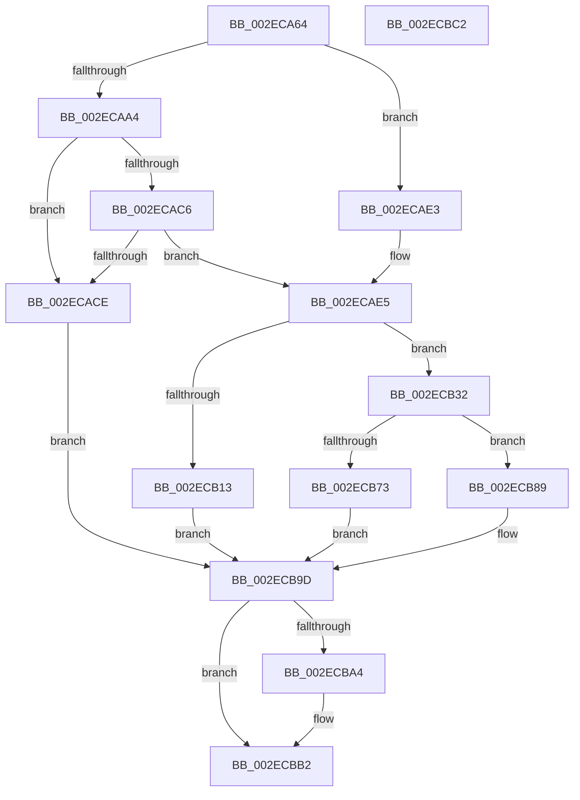

# RtlpHpMetadataFree

- RVA: `0x002ECA64`–`0x002ECBC3` (길이 `351` bytes)
- VA: `0x00000001402ECA64`
- 실행 섹션: `.text`
- PDB 이름 있음: `예`; PDB Function 태그: `아니요`
- unwind 정보 RVA: `0x000717F8`
- 디코드: `97`개 명령, `351/351` bytes 표시
- 미해석 바이트: `0` (있으면 어셈블리에 `.byte`로 보존)

> 이 문서는 커널 이미지의 기계어와 PDB 기호를 분석해 생성했습니다. 4번과 5번은 함수 원형과 자료형을 바이너리 사용 방식에서 추정한 C 해석이며 원본 소스 복구 결과는 아닙니다.

## 1. Dependencies

- 직접 호출 지점: **6**; 고유 호출 대상: **6**
- 직접 호출자로 확인된 함수: **8**
- RIP 상대 이미지 참조: **4**

### Outgoing calls
- `0x002ECABC` → [RtlCSparseBitmapBitmaskRead](../36/RtlCSparseBitmapBitmaskRead_function_0036190C.md) (function, `0x0036190C`)
- `0x002ECAD4` → [RtlpHpLargeFree](RtlpHpLargeFree_function_002EC89C.md) (function, `0x002EC89C`)
- `0x002ECB2B` → [RtlpLogHeapFailure](../35/RtlpLogHeapFailure_function_0035B7BC.md) (function, `0x0035B7BC`)
- `0x002ECB7D` → [RtlpHpLfhContextFree](../35/RtlpHpLfhContextFree_function_0035B2A0.md) (function, `0x0035B2A0`)
- `0x002ECB94` → [RtlpHpSegFreeInternal](../36/RtlpHpSegFreeInternal_function_0036198C.md) (function, `0x0036198C`)
- `0x002ECBAD` → [RtlpLogHeapFreeEvent](../5F/RtlpLogHeapFreeEvent_function_005F1740.md) (function, `0x005F1740`)

### Direct callers
- [RtlpHpLargeAlloc](RtlpHpLargeAlloc_function_002EBD5C.md) at `0x002EC007`
- [RtlpHpLargeFree](RtlpHpLargeFree_function_002EC89C.md) at `0x002EC9B7`
- [RtlpHpCustomVaCallbacksRegistrarRegister](../60/RtlpHpCustomVaCallbacksRegistrarRegister_function_00602804.md) at `0x00602A53`
- [RtlpHpCustomVaCallbacksRegistrarUnregister](../60/RtlpHpCustomVaCallbacksRegistrarUnregister_function_00602B9C.md) at `0x00602CBC`
- [RtlpHpHeapDestroy](../60/RtlpHpHeapDestroy_function_006033AC.md) at `0x006034FC`
- [RtlpHpLargeAllocationDestroy](../60/RtlpHpLargeAllocationDestroy_function_006054D8.md) at `0x0060556F`
- [ExpSecurePoolCreate](../65/ExpSecurePoolCreate_function_0065AB70.md) at `0x0065ABEF`
- [ExpPrivatePoolDestroy](../../page/7D/ExpPrivatePoolDestroy_function_007D61C4.md) at `0x007D6236`

### Static image references
- `0x002ECA76` → RVA `0x00000000` (`image boundary/outside`; read)
- `0x002ECAA7` → RVA `0x00E68610` (`.data`; read)
- `0x002ECAAE` → RVA `0x00E68608` (`.data`; read)
- `0x002ECB07` → RVA `0x00E28300` (`.data`; read)

## 2. Other-region calls and transfers

- 다른 실행 섹션으로 향하는 call: **0**
- 별도 외부 분기/꼬리 이동을 확인하지 못했습니다.

## 3. Assembly (complete function range)

```asm
002ECA64  48 89 5C 24 10                  mov qword ptr [rsp + 0x10], rbx
002ECA69  48 89 74 24 18                  mov qword ptr [rsp + 0x18], rsi
002ECA6E  57                              push rdi
002ECA6F  48 83 EC 30                     sub rsp, 0x30
002ECA73  48 8B 02                        mov rax, qword ptr [rdx]
002ECA76  48 8D 35 83 35 D1 FF            lea rsi, [rip - 0x2eca7d]
002ECA7D  48 C1 E8 08                     shr rax, 8
002ECA81  33 DB                           xor ebx, ebx
002ECA83  0F B6 D0                        movzx edx, al
002ECA86  48 8B F9                        mov rdi, rcx
002ECA89  89 5C 24 40                     mov dword ptr [rsp + 0x40], ebx
002ECA8D  8B 84 96 28 EA 01 00            mov eax, dword ptr [rsi + rdx*4 + 0x1ea28]
002ECA94  48 03 C0                        add rax, rax
002ECA97  48 8B B4 C6 98 BE E6 00         mov rsi, qword ptr [rsi + rax*8 + 0xe6be98]
002ECA9F  66 85 C9                        test cx, cx
002ECAA2  75 3F                           jne 0x1402ecae3
002ECAA4  48 8B D1                        mov rdx, rcx
002ECAA7  48 8D 0D 62 BB B7 00            lea rcx, [rip + 0xb7bb62]
002ECAAE  48 2B 15 53 BB B7 00            sub rdx, qword ptr [rip + 0xb7bb53]
002ECAB5  48 C1 EA 14                     shr rdx, 0x14
002ECAB9  48 03 D2                        add rdx, rdx
002ECABC  E8 4B 4E 07 00                  call 0x14036190c
002ECAC1  48 85 C0                        test rax, rax
002ECAC4  74 08                           je 0x1402ecace
002ECAC6  8D 48 FF                        lea ecx, [rax - 1]
002ECAC9  83 F9 02                        cmp ecx, 2
002ECACC  75 17                           jne 0x1402ecae5
002ECACE  48 8B D7                        mov rdx, rdi
002ECAD1  48 8B CE                        mov rcx, rsi
002ECAD4  E8 C3 FD FF FF                  call 0x1402ec89c
002ECAD9  BB 03 00 00 00                  mov ebx, 3
002ECADE  E9 BA 00 00 00                  jmp 0x1402ecb9d
002ECAE3  8B CB                           mov ecx, ebx
002ECAE5  83 F9 01                        cmp ecx, 1
002ECAE8  BA 40 01 00 00                  mov edx, 0x140
002ECAED  41 BA 00 02 00 00               mov r10d, 0x200
002ECAF3  44 0F 45 D2                     cmovne r10d, edx
002ECAF7  48 8B D7                        mov rdx, rdi
002ECAFA  4C 03 D6                        add r10, rsi
002ECAFD  49 23 12                        and rdx, qword ptr [r10]
002ECB00  48 8B C2                        mov rax, rdx
002ECB03  48 33 42 10                     xor rax, qword ptr [rdx + 0x10]
002ECB07  48 33 05 F2 B7 B3 00            xor rax, qword ptr [rip + 0xb3b7f2]
002ECB0E  49 3B C2                        cmp rax, r10
002ECB11  74 1F                           je 0x1402ecb32
002ECB13  49 8B 52 38                     mov rdx, qword ptr [r10 + 0x38]
002ECB17  45 33 C9                        xor r9d, r9d
002ECB1A  48 89 5C 24 28                  mov qword ptr [rsp + 0x28], rbx
002ECB1F  4C 8B C7                        mov r8, rdi
002ECB22  48 89 5C 24 20                  mov qword ptr [rsp + 0x20], rbx
002ECB27  41 8D 49 09                     lea ecx, [r9 + 9]
002ECB2B  E8 8C EC 06 00                  call 0x14035b7bc
002ECB30  EB 6B                           jmp 0x1402ecb9d
002ECB32  41 8A 4A 08                     mov cl, byte ptr [r10 + 8]
002ECB36  44 8B C7                        mov r8d, edi
002ECB39  44 2B C2                        sub r8d, edx
002ECB3C  49 D3 E8                        shr r8, cl
002ECB3F  49 C1 E0 05                     shl r8, 5
002ECB43  4C 03 C2                        add r8, rdx
002ECB46  41 0F B6 40 1A                  movzx eax, byte ptr [r8 + 0x1a]
002ECB4B  48 F7 D8                        neg rax
002ECB4E  48 C1 E0 05                     shl rax, 5
002ECB52  4C 03 C0                        add r8, rax
002ECB55  4D 8B C8                        mov r9, r8
002ECB58  4C 2B CA                        sub r9, rdx
002ECB5B  49 C1 F9 05                     sar r9, 5
002ECB5F  49 D3 E1                        shl r9, cl
002ECB62  4C 03 CA                        add r9, rdx
002ECB65  4C 3B CF                        cmp r9, rdi
002ECB68  0F 94 C0                        sete al
002ECB6B  41 02 40 18                     add al, byte ptr [r8 + 0x18]
002ECB6F  3C 0B                           cmp al, 0xb
002ECB71  75 16                           jne 0x1402ecb89
002ECB73  49 8B 4A 18                     mov rcx, qword ptr [r10 + 0x18]
002ECB77  4C 8B C7                        mov r8, rdi
002ECB7A  49 8B D1                        mov rdx, r9
002ECB7D  E8 1E E7 06 00                  call 0x14035b2a0
002ECB82  BB 02 00 00 00                  mov ebx, 2
002ECB87  EB 14                           jmp 0x1402ecb9d
002ECB89  4C 8D 4C 24 40                  lea r9, [rsp + 0x40]
002ECB8E  48 8B D7                        mov rdx, rdi
002ECB91  49 8B CA                        mov rcx, r10
002ECB94  E8 F3 4D 07 00                  call 0x14036198c
002ECB99  8B 5C 24 40                     mov ebx, dword ptr [rsp + 0x40]
002ECB9D  8B 46 14                        mov eax, dword ptr [rsi + 0x14]
002ECBA0  84 C0                           test al, al
002ECBA2  79 0E                           jns 0x1402ecbb2
002ECBA4  44 8B C3                        mov r8d, ebx
002ECBA7  48 8B D7                        mov rdx, rdi
002ECBAA  48 8B CE                        mov rcx, rsi
002ECBAD  E8 8E 4B 30 00                  call 0x1405f1740
002ECBB2  48 8B 5C 24 48                  mov rbx, qword ptr [rsp + 0x48]
002ECBB7  48 8B 74 24 50                  mov rsi, qword ptr [rsp + 0x50]
002ECBBC  48 83 C4 30                     add rsp, 0x30
002ECBC0  5F                              pop rdi
002ECBC1  C3                              ret
002ECBC2  CC                              int3
```

## 4. C-style interpretation (structured pseudocode)

```c
__int64 __fastcall RtlpHpMetadataFree(__int64 a1, __int64 a2, __int64 a3, int a4)
{
    __int64 result;
    __int64 v_r10;
    __int64 v_rbx;
    __int64 v_rsp;
    unsigned __int64 v_stack_m10;
    unsigned __int64 v_stack_m18;
    unsigned __int64 v_stack_p10;
    unsigned __int64 v_stack_p18;
    unsigned int v_stack_p8;

    v_stack_p10 = v_rbx;
    v_stack_p18 = v_rsi;
    v_rsp = (v_rsp) - (48);
    result = (*(unsigned __int64 *)(a2)) >> (8);
    v_rbx = 0;
    v_stack_p8 = 0;
    result = ((unsigned int)(*(unsigned int *)(v_rip - 3066493 + (unsigned __int8)(result) * 4 + 125480))) + ((unsigned int)(*(unsigned int *)(v_rip - 3066493 + (unsigned __int8)(result) * 4 + 125480)));
    if ((unsigned __int16)(a1) != 0) goto loc_002ECAE3;
    a2 = (a1) - (*(unsigned __int64 *)(v_rip + 12041043));
    a2 = (a2) >> (20);
    a2 = (a2) + (a2);
    result = RtlCSparseBitmapBitmaskRead(v_rip + 12041058, a2, a3, a4);
    if (result == 0) goto loc_002ECACE;
    if (((unsigned int)(result - 1)) != 2) goto loc_002ECAE5;
loc_002ECACE:
    result = RtlpHpLargeFree(*(unsigned __int64 *)(v_rip - 3066493 + result * 8 + 15122072), a1, a3, a4);
    goto loc_002ECB9D;
loc_002ECAE3:
loc_002ECAE5:
    v_r10 = 512;
    if (3 != 1) { v_r10 = 320; }
    v_r10 = (v_r10) + (*(unsigned __int64 *)(v_rip - 3066493 + result * 8 + 15122072));
    a2 = (a1) & (*(unsigned __int64 *)(v_r10));
    result = (a2) ^ (*(unsigned __int64 *)(a2 + 16));
    result = (result) ^ (*(unsigned __int64 *)(v_rip + 11778034));
    if (result == v_r10) goto loc_002ECB32;
    a4 = 0;
    v_stack_m10 = 3;
    v_stack_m18 = 3;
    result = RtlpLogHeapFailure(a4 + 9, *(unsigned __int64 *)(v_r10 + 56), a1, a4);
    goto loc_002ECB9D;
loc_002ECB32:
    a3 = (unsigned int)(((unsigned int)((unsigned int)(a1))) - ((unsigned int)(*(unsigned __int64 *)(v_r10 + 56))));
    a3 = (a3) >> ((unsigned __int8)(*(unsigned __int8 *)(v_r10 + 8)));
    a3 = (a3) << (5);
    a3 = (a3) + (*(unsigned __int64 *)(v_r10 + 56));
    result = -(*(unsigned __int8 *)(a3 + 26));
    result = (result) << (5);
    a3 = (a3) + (result);
    a4 = (a3) - (*(unsigned __int64 *)(v_r10 + 56));
    a4 = (a4) >> (5);
    a4 = (a4) << ((unsigned __int8)(*(unsigned __int8 *)(v_r10 + 8)));
    a4 = (a4) + (*(unsigned __int64 *)(v_r10 + 56));
    result = (a4 == a1) ? 1 : 0;
    result = (unsigned __int8)((result) + (*(unsigned __int8 *)(a3 + 24)));
    if (((unsigned __int8)(result)) != 11) goto loc_002ECB89;
    result = RtlpHpLfhContextFree(*(unsigned __int64 *)(v_r10 + 24), a4, a1, a4);
    goto loc_002ECB9D;
loc_002ECB89:
    result = RtlpHpSegFreeInternal(v_r10, a1, a1, v_stack_p8);
loc_002ECB9D:
    result = (unsigned int)(*(unsigned int *)(*(unsigned __int64 *)(v_rip - 3066493 + result * 8 + 15122072) + 20));
    if (sign_flag) {
        a3 = (unsigned int)((unsigned int)(v_stack_p8));
        a2 = a1;
        a1 = *(unsigned __int64 *)(v_rip - 3066493 + result * 8 + 15122072);
        result = RtlpLogHeapFreeEvent(a1, a2, a3, v_stack_p8);
    }
    v_rsp = (v_rsp) + (48);
    return result;
}
```

## 5. (Beta) C Style

```c
int64_t RtlpHpMetadataFree(void *Arg1, void *Arg2, int64_t Arg3, int32_t Arg4)
{
    uint8_t *arg1 = (uint8_t *)Arg1;
    uint8_t *arg2 = (uint8_t *)Arg2;

    int64_t result;
    int64_t local_r10;
    int64_t local_rbx;
    int64_t local_rsp;
    uint64_t v_stack_m10;
    uint64_t v_stack_m18;
    uint64_t v_stack_p10;
    uint64_t v_stack_p18;
    uint32_t v_stack_p8;

    v_stack_p10 = local_rbx;
    v_stack_p18 = local_rsi;
    local_rsp = (local_rsp) - (48);
    result = (*(uint64_t *)(arg2)) >> (8);
    local_rbx = 0;
    v_stack_p8 = 0;
    result = ((uint32_t)(*(uint32_t *)(v_rip - 0x2ECA7D + (uint8_t)(result) * 4 + 0x1EA28))) + ((uint32_t)(*(uint32_t *)(v_rip - 0x2ECA7D + (uint8_t)(result) * 4 + 0x1EA28)));
    if ((uint16_t)(Arg1) != 0) goto loc_002ECAE3;
    Arg2 = (Arg1) - (*(uint64_t *)(v_rip + 0xB7BB53));
    Arg2 = (Arg2) >> (20);
    Arg2 = (Arg2) + (Arg2);
    result = RtlCSparseBitmapBitmaskRead(v_rip + 12041058, Arg2, Arg3, Arg4);
    if (result == 0) goto loc_002ECACE;
    if (((uint32_t)(result - 1)) != 2) goto loc_002ECAE5;
loc_002ECACE:
    result = RtlpHpLargeFree(*(uint64_t *)(v_rip - 0x2ECA7D + result * 8 + 0xE6BE98), Arg1, Arg3, Arg4);
    goto loc_002ECB9D;
loc_002ECAE3:
loc_002ECAE5:
    local_r10 = 512;
    if (3 != 1) { local_r10 = 320; }
    local_r10 = (local_r10) + (*(uint64_t *)(v_rip - 0x2ECA7D + result * 8 + 0xE6BE98));
    Arg2 = (Arg1) & (*(uint64_t *)(local_r10));
    result = (Arg2) ^ (*(uint64_t *)(arg2 + 0x10));
    result = (result) ^ (*(uint64_t *)(v_rip + 0xB3B7F2));
    if (result == local_r10) goto loc_002ECB32;
    Arg4 = 0;
    v_stack_m10 = 3;
    v_stack_m18 = 3;
    result = RtlpLogHeapFailure(Arg4 + 9, *(uint64_t *)(local_r10 + 0x38), Arg1, Arg4);
    goto loc_002ECB9D;
loc_002ECB32:
    Arg3 = (uint32_t)(((uint32_t)((uint32_t)(Arg1))) - ((uint32_t)(*(uint64_t *)(local_r10 + 0x38))));
    Arg3 = (Arg3) >> ((uint8_t)(*(uint8_t *)(local_r10 + 0x8)));
    Arg3 = (Arg3) << (5);
    Arg3 = (Arg3) + (*(uint64_t *)(local_r10 + 0x38));
    result = -(*(uint8_t *)(Arg3 + 0x1A));
    result = (result) << (5);
    Arg3 = (Arg3) + (result);
    Arg4 = (Arg3) - (*(uint64_t *)(local_r10 + 0x38));
    Arg4 = (Arg4) >> (5);
    Arg4 = (Arg4) << ((uint8_t)(*(uint8_t *)(local_r10 + 0x8)));
    Arg4 = (Arg4) + (*(uint64_t *)(local_r10 + 0x38));
    result = (Arg4 == Arg1) ? 1 : 0;
    result = (uint8_t)((result) + (*(uint8_t *)(Arg3 + 0x18)));
    if (((uint8_t)(result)) != 11) goto loc_002ECB89;
    result = RtlpHpLfhContextFree(*(uint64_t *)(local_r10 + 0x18), Arg4, Arg1, Arg4);
    goto loc_002ECB9D;
loc_002ECB89:
    result = RtlpHpSegFreeInternal(local_r10, Arg1, Arg1, v_stack_p8);
loc_002ECB9D:
    result = (uint32_t)(*(uint32_t *)(*(uint64_t *)(v_rip - 0x2ECA7D + result * 8 + 0xE6BE98) + 0x14));
    if (sign_flag) {
        Arg3 = (uint32_t)((uint32_t)(v_stack_p8));
        Arg2 = Arg1;
        Arg1 = *(uint64_t *)(v_rip - 0x2ECA7D + result * 8 + 0xE6BE98);
        result = RtlpLogHeapFreeEvent(Arg1, Arg2, Arg3, v_stack_p8);
    }
    local_rsp = (local_rsp) + (48);
    return result;
}
```

### 관측된 메모리 오프셋

구조체 형식이 확인되지 않은 접근은 인자 기준의 오프셋으로만 기록했습니다.

| 기준 인자 | 오프셋 표현 | 폭 (bit) | 접근 |
|---|---:|---:|---|
| `Arg1` | `+ 0x10` | `64` | `R` |
| `Arg2` | `+ 0x0` | `64` | `R` |

## 6. Execution-region graph

[열기: 2D/3D 그래프와 함수 탐색 컨트롤 패널](../../../control-panel.html?section=text&rva=0x002ECA64&view=graph)

- 2D 그래프는 위에서 아래로 흐르고, 3D 그래프는 빈 공간을 드래그해 회전합니다. Shift+드래그는 이동, 휠은 확대·축소, 함수 노드 선택은 대상 보고서 이동입니다.

### Static fallback


