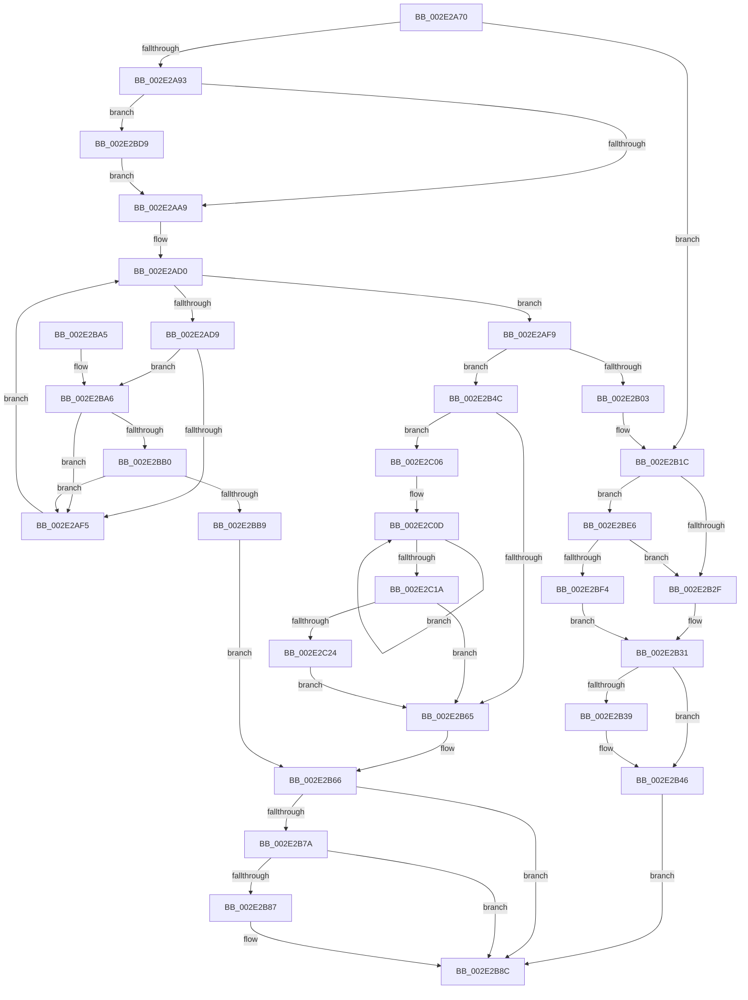

# RtlpHpReleaseQueuedLockExclusive

- RVA: `0x002E2A70`–`0x002E2C2E` (길이 `446` bytes)
- VA: `0x00000001402E2A70`
- 실행 섹션: `.text`
- PDB 이름 있음: `예`; PDB Function 태그: `아니요`
- unwind 정보 RVA: `0x00070D74`
- 디코드: `112`개 명령, `446/446` bytes 표시
- 미해석 바이트: `0` (있으면 어셈블리에 `.byte`로 보존)

> 이 문서는 커널 이미지의 기계어와 PDB 기호를 분석해 생성했습니다. 4번과 5번은 함수 원형과 자료형을 바이너리 사용 방식에서 추정한 C 해석이며 원본 소스 복구 결과는 아닙니다.

## 1. Dependencies

- 직접 호출 지점: **7**; 고유 호출 대상: **7**
- 직접 호출자로 확인된 함수: **8**
- RIP 상대 이미지 참조: **3**

### Outgoing calls
- `0x002E2B16` → [KeBugCheckEx](../4F/KeBugCheckEx_function_004FD660.md) (function, `0x004FD660`)
- `0x002E2B41` → [KiLowerIrqlProcessIrqlFlags](../4F/KiLowerIrqlProcessIrqlFlags_function_004F5698.md) (function, `0x004F5698`)
- `0x002E2B87` → [KiCheckForKernelApcDelivery](KiCheckForKernelApcDelivery_function_002E2C80.md) (function, `0x002E2C80`)
- `0x002E2BD2` → [KiAbEntryFreeAndEnableInterrupts](../26/KiAbEntryFreeAndEnableInterrupts_function_002622D0.md) (function, `0x002622D0`)
- `0x002E2BDC` → [ExfTryToWakePushLock](../26/ExfTryToWakePushLock_function_00265DD0.md) (function, `0x00265DD0`)
- `0x002E2BFC` → [ExpReleaseSpinLockExclusiveFromDpcLevelInstrumented](../2C/ExpReleaseSpinLockExclusiveFromDpcLevelInstrumented_function_002C0F44.md) (function, `0x002C0F44`)
- `0x002E2C24` → [KiRemoveSystemWorkPriorityKick](../26/KiRemoveSystemWorkPriorityKick_function_002631D0.md) (function, `0x002631D0`)

### Direct callers
- [RtlpHpVsChunkFree](RtlpHpVsChunkFree_function_002E3980.md) at `0x002E40DC`
- [RtlpHpVsChunkSplit](RtlpHpVsChunkSplit_function_002E5C80.md) at `0x002E66F2`
- [RtlpHpVsChunkSplit](RtlpHpVsChunkSplit_function_002E5C80.md) at `0x002E6853`
- [RtlpHpVsChunkSplit](RtlpHpVsChunkSplit_function_002E5C80.md) at `0x002E695D`
- [RtlpHpVsSubsegmentCommitPages](RtlpHpVsSubsegmentCommitPages_function_002E6C74.md) at `0x002E6D47`
- [sub_002E6E90](Unknown_function_002E6E90.md) at `0x002E71C1`
- [RtlpHpVsContextAllocate](RtlpHpVsContextAllocate_function_002EA944.md) at `0x002EAA31`
- [RtlpHpVsSlotAllocate](RtlpHpVsSlotAllocate_function_002EAB38.md) at `0x002EACF9`
- [RtlpHpVsSlotAllocate](RtlpHpVsSlotAllocate_function_002EAB38.md) at `0x002EADFC`
- [RtlpHpVsContextMultiAlloc](RtlpHpVsContextMultiAlloc_function_002EB6B4.md) at `0x002EB7A9`
- [RtlpHpVsSlotFreeList](../36/RtlpHpVsSlotFreeList_function_00361ACC.md) at `0x00361C61`

### Static image references
- `0x002E2B22` → RVA `0x00FC6B06` (`ALMOSTRO`; read)
- `0x002E2B31` → RVA `0x00FC6D20` (`ALMOSTRO`; read)
- `0x002E2BE6` → RVA `0x00F0DE58` (`.data`; read)

## 2. Other-region calls and transfers

- 다른 실행 섹션으로 향하는 call: **0**
- 별도 외부 분기/꼬리 이동을 확인하지 못했습니다.

## 3. Assembly (complete function range)

```asm
002E2A70  48 89 5C 24 08                  mov qword ptr [rsp + 8], rbx
002E2A75  48 89 6C 24 10                  mov qword ptr [rsp + 0x10], rbp
002E2A7A  48 89 74 24 18                  mov qword ptr [rsp + 0x18], rsi
002E2A7F  57                              push rdi
002E2A80  48 83 EC 30                     sub rsp, 0x30
002E2A84  48 8B 72 08                     mov rsi, qword ptr [rdx + 8]
002E2A88  48 8B DA                        mov rbx, rdx
002E2A8B  85 C9                           test ecx, ecx
002E2A8D  0F 85 89 00 00 00               jne 0x1402e2b1c
002E2A93  48 C7 C0 FF FF FF FF            mov rax, 0xffffffffffffffff
002E2A9A  F0 48 0F C1 06                  lock xadd qword ptr [rsi], rax
002E2A9F  24 06                           and al, 6
002E2AA1  3C 02                           cmp al, 2
002E2AA3  0F 84 30 01 00 00               je 0x1402e2bd9
002E2AA9  65 4C 8B 1C 25 88 01 00 00      mov r11, qword ptr gs:[0x188]
002E2AB2  FA                              cli
002E2AB3  4D 8B 83 70 04 00 00            mov r8, qword ptr [r11 + 0x470]
002E2ABA  4C 8B CE                        mov r9, rsi
002E2ABD  48 BD FC FF FF FF FF FF FF 7F   movabs rbp, 0x7ffffffffffffffc
002E2AC7  4C 23 CD                        and r9, rbp
002E2ACA  33 FF                           xor edi, edi
002E2ACC  8B C7                           mov eax, edi
002E2ACE  66 90                           nop
002E2AD0  41 0F B6 48 0C                  movzx ecx, byte ptr [r8 + 0xc]
002E2AD5  3B C1                           cmp eax, ecx
002E2AD7  73 20                           jae 0x1402e2af9
002E2AD9  8B C8                           mov ecx, eax
002E2ADB  4C 6B D1 58                     imul r10, rcx, 0x58
002E2ADF  4D 03 D0                        add r10, r8
002E2AE2  49 8B 52 10                     mov rdx, qword ptr [r10 + 0x10]
002E2AE6  48 8B CA                        mov rcx, rdx
002E2AE9  48 23 CD                        and rcx, rbp
002E2AEC  49 3B C9                        cmp rcx, r9
002E2AEF  0F 84 B1 00 00 00               je 0x1402e2ba6
002E2AF5  FF C0                           inc eax
002E2AF7  EB D7                           jmp 0x1402e2ad0
002E2AF9  41 8B 43 78                     mov eax, dword ptr [r11 + 0x78]
002E2AFD  0F BA E0 10                     bt eax, 0x10
002E2B01  72 49                           jb 0x1402e2b4c
002E2B03  45 33 C9                        xor r9d, r9d
002E2B06  48 89 7C 24 20                  mov qword ptr [rsp + 0x20], rdi
002E2B0B  4C 8B C6                        mov r8, rsi
002E2B0E  49 8B D3                        mov rdx, r11
002E2B11  B9 62 01 00 00                  mov ecx, 0x162
002E2B16  E8 45 AB 21 00                  call 0x1404fd660
002E2B1B  CC                              int3
002E2B1C  0F B6 6A 10                     movzx ebp, byte ptr [rdx + 0x10]
002E2B20  33 FF                           xor edi, edi
002E2B22  F6 05 DD 3F CE 00 01            test byte ptr [rip + 0xce3fdd], 1
002E2B29  0F 85 B7 00 00 00               jne 0x1402e2be6
002E2B2F  89 3E                           mov dword ptr [rsi], edi
002E2B31  39 3D E9 41 CE 00               cmp dword ptr [rip + 0xce41e9], edi
002E2B37  74 0D                           je 0x1402e2b46
002E2B39  44 0F 20 C1                     mov rcx, cr8
002E2B3D  40 0F B6 D5                     movzx edx, bpl
002E2B41  E8 52 2B 21 00                  call 0x1404f5698
002E2B46  44 0F 22 C5                     mov cr8, rbp
002E2B4A  EB 40                           jmp 0x1402e2b8c
002E2B4C  65 48 8B 0C 25 20 00 00 00      mov rcx, qword ptr gs:[0x20]
002E2B55  4C 8B 81 B8 8E 00 00            mov r8, qword ptr [rcx + 0x8eb8]
002E2B5C  4D 85 C0                        test r8, r8
002E2B5F  0F 85 A1 00 00 00               jne 0x1402e2c06
002E2B65  FB                              sti
002E2B66  65 48 8B 0C 25 88 01 00 00      mov rcx, qword ptr gs:[0x188]
002E2B6F  90                              nop
002E2B70  66 83 81 E6 01 00 00 01         add word ptr [rcx + 0x1e6], 1
002E2B78  75 12                           jne 0x1402e2b8c
002E2B7A  48 8D 81 98 00 00 00            lea rax, [rcx + 0x98]
002E2B81  90                              nop
002E2B82  48 39 00                        cmp qword ptr [rax], rax
002E2B85  74 05                           je 0x1402e2b8c
002E2B87  E8 F4 00 00 00                  call 0x1402e2c80
002E2B8C  48 8B 6C 24 48                  mov rbp, qword ptr [rsp + 0x48]
002E2B91  48 8B 74 24 50                  mov rsi, qword ptr [rsp + 0x50]
002E2B96  48 89 7B 08                     mov qword ptr [rbx + 8], rdi
002E2B9A  48 8B 5C 24 40                  mov rbx, qword ptr [rsp + 0x40]
002E2B9F  48 83 C4 30                     add rsp, 0x30
002E2BA3  5F                              pop rdi
002E2BA4  C3                              ret
002E2BA5  CC                              int3
002E2BA6  41 38 7A 1A                     cmp byte ptr [r10 + 0x1a], dil
002E2BAA  0F 84 45 FF FF FF               je 0x1402e2af5
002E2BB0  F6 C2 01                        test dl, 1
002E2BB3  0F 85 3C FF FF FF               jne 0x1402e2af5
002E2BB9  41 B9 01 00 00 00               mov r9d, 1
002E2BBF  41 88 7A 1A                     mov byte ptr [r10 + 0x1a], dil
002E2BC3  4C 8B C6                        mov r8, rsi
002E2BC6  48 89 7C 24 20                  mov qword ptr [rsp + 0x20], rdi
002E2BCB  49 8B D3                        mov rdx, r11
002E2BCE  49 8D 4A 10                     lea rcx, [r10 + 0x10]
002E2BD2  E8 F9 F6 F7 FF                  call 0x1402622d0
002E2BD7  EB 8D                           jmp 0x1402e2b66
002E2BD9  48 8B CE                        mov rcx, rsi
002E2BDC  E8 EF 31 F8 FF                  call 0x140265dd0
002E2BE1  E9 C3 FE FF FF                  jmp 0x1402e2aa9
002E2BE6  8B 05 6C B2 C2 00               mov eax, dword ptr [rip + 0xc2b26c]
002E2BEC  85 C0                           test eax, eax
002E2BEE  0F 85 3B FF FF FF               jne 0x1402e2b2f
002E2BF4  48 8B 54 24 38                  mov rdx, qword ptr [rsp + 0x38]
002E2BF9  48 8B CE                        mov rcx, rsi
002E2BFC  E8 43 E3 FD FF                  call 0x1402c0f44
002E2C01  E9 2B FF FF FF                  jmp 0x1402e2b31
002E2C06  41 0F 0D 08                     prefetchw byte ptr [r8]
002E2C0A  41 8B 00                        mov eax, dword ptr [r8]
002E2C0D  8B D0                           mov edx, eax
002E2C0F  0F BA F2 15                     btr edx, 0x15
002E2C13  F0 41 0F B1 10                  lock cmpxchg dword ptr [r8], edx
002E2C18  75 F3                           jne 0x1402e2c0d
002E2C1A  0F BA E0 15                     bt eax, 0x15
002E2C1E  0F 83 41 FF FF FF               jae 0x1402e2b65
002E2C24  E8 A7 05 F8 FF                  call 0x1402631d0
002E2C29  E9 37 FF FF FF                  jmp 0x1402e2b65
```

## 4. C-style interpretation (structured pseudocode)

```c
__int64 __fastcall RtlpHpReleaseQueuedLockExclusive(int a1, __int64 a2)
{
    __int64 result;
    __int64 v_r10;
    __int64 v_rdi;
    __int64 v_rsp;
    unsigned __int64 v_stack_m18;
    unsigned __int64 v_stack_p10;
    unsigned __int64 v_stack_p18;
    unsigned __int64 v_stack_p20;
    unsigned __int64 v_stack_p38;
    unsigned __int64 v_stack_p8;

    v_stack_p8 = v_rbx;
    v_stack_p10 = v_rbp;
    v_stack_p18 = v_rsi;
    v_rsp = (v_rsp) - (48);
    if (a1 != 0) goto loc_002E2B1C;
    result = (unsigned __int8)((-1) & (6));
    if (((unsigned __int8)(result)) == 2) goto loc_002E2BD9;
loc_002E2AA9:
    a4 = (*(unsigned __int64 *)(a2 + 8)) & (v_rbp);
    v_rdi = 0;
loc_002E2AD0:
    if (0 >= ((unsigned int)(*(unsigned __int8 *)(*(unsigned __int64 *)(*(unsigned __int64 *)(gs_base + (0 + 392)) + 1136) + 12)))) goto loc_002E2AF9;
    v_r10 = (v_r10) * (0);
    v_r10 = (v_r10) + (*(unsigned __int64 *)(*(unsigned __int64 *)(gs_base + (0 + 392)) + 1136));
    a1 = (*(unsigned __int64 *)(v_r10 + 16)) & (v_rbp);
    if (a1 == a4) goto loc_002E2BA6;
loc_002E2AF5:
    result = (unsigned int)((0) + 1);
    goto loc_002E2AD0;
loc_002E2AF9:
    if (a1 < a4) goto loc_002E2B4C;
    a4 = 0;
    v_stack_m18 = 0;
    result = KeBugCheckEx(354, *(unsigned __int64 *)(gs_base + (0 + 392)), *(unsigned __int64 *)(a2 + 8), a4);
loc_002E2B1C:
    v_rdi = 0;
    if (((*(unsigned __int8 *)(v_rip + 13516765)) & (1)) != 0) goto loc_002E2BE6;
loc_002E2B2F:
    *(unsigned int *)(*(unsigned __int64 *)(a2 + 8)) = 0;
loc_002E2B31:
    if ((*(unsigned int *)(v_rip + 13517289)) != 0) {
        a1 = v_cr8;
        a2 = (unsigned __int8)(*(unsigned __int8 *)(*(unsigned __int64 *)(gs_base + (0 + 392)) + 16));
        result = KiLowerIrqlProcessIrqlFlags(a1, a2, *(unsigned __int64 *)(a2 + 8), a4);
    }
    goto loc_002E2B8C;
loc_002E2B4C:
    if (*(unsigned __int64 *)(*(unsigned __int64 *)(gs_base + (0 + 32)) + 36536) != 0) goto loc_002E2C06;
loc_002E2B65:
loc_002E2B66:
    if (*(unsigned __int64 *)(*(unsigned __int64 *)(gs_base + (0 + 32)) + 36536) != 0) goto loc_002E2B8C;
    result = *(unsigned __int64 *)(gs_base + (0 + 392)) + 152;
    if ((*(unsigned __int64 *)(*(unsigned __int64 *)(gs_base + (0 + 392)) + 152)) != (*(unsigned __int64 *)(gs_base + (0 + 392)) + 152)) {
        result = KiCheckForKernelApcDelivery(*(unsigned __int64 *)(gs_base + (0 + 392)), a2, *(unsigned __int64 *)(*(unsigned __int64 *)(gs_base + (0 + 32)) + 36536), a4);
    }
    *(unsigned __int64 *)(a2 + 8) = 0;
    v_rsp = (v_rsp) + (48);
    return result;
loc_002E2BA6:
    if ((*(unsigned __int8 *)(v_r10 + 26)) == 0) goto loc_002E2AF5;
    if ((((unsigned __int8)(a2)) & (1)) != 0) goto loc_002E2AF5;
    *(unsigned __int8 *)(v_r10 + 26) = 0;
    v_stack_p20 = 0;
    result = KiAbEntryFreeAndEnableInterrupts(v_r10 + 16, *(unsigned __int64 *)(gs_base + (0 + 392)), v_stack_p18, 1);
    goto loc_002E2B66;
loc_002E2BD9:
    result = ExfTryToWakePushLock(v_stack_p18, *(unsigned __int64 *)(gs_base + (0 + 392)), v_stack_p18, 1);
    goto loc_002E2AA9;
loc_002E2BE6:
    if ((unsigned int)((unsigned int)(*(unsigned int *)(v_rip + 12759660))) != 0) goto loc_002E2B2F;
    result = ExpReleaseSpinLockExclusiveFromDpcLevelInstrumented(v_stack_p18, v_stack_p38, v_stack_p18, 1);
    goto loc_002E2B31;
loc_002E2C06:
loc_002E2C0D:
    if ((unsigned int)((unsigned int)(*(unsigned int *)(v_rip + 12759660))) != 0) goto loc_002E2C0D;
    if (condition_is_above_or_equal) goto loc_002E2B65;
    result = KiRemoveSystemWorkPriorityKick(v_stack_p18, (unsigned int)((unsigned int)((unsigned int)(*(unsigned int *)(v_stack_p18)))), v_stack_p18, 1);
    goto loc_002E2B65;
}
```

## 5. (Beta) C Style

```c
int64_t RtlpHpReleaseQueuedLockExclusive(int32_t Arg1, void *Arg2)
{
    uint8_t *arg2 = (uint8_t *)Arg2;

    int64_t result;
    int64_t local_r10;
    int64_t local_rdi;
    int64_t local_rsp;
    uint64_t v_stack_m18;
    uint64_t v_stack_p10;
    uint64_t v_stack_p18;
    uint64_t v_stack_p20;
    uint64_t v_stack_p38;
    uint64_t v_stack_p8;

    v_stack_p8 = local_rbx;
    v_stack_p10 = local_rbp;
    v_stack_p18 = local_rsi;
    local_rsp = (local_rsp) - (48);
    if (Arg1 != 0) goto loc_002E2B1C;
    result = (uint8_t)((-1) & (6));
    if (((uint8_t)(result)) == 2) goto loc_002E2BD9;
loc_002E2AA9:
    a4 = (*(uint64_t *)(arg2 + 0x8)) & (local_rbp);
    local_rdi = 0;
loc_002E2AD0:
    if (0 >= ((uint32_t)(*(uint8_t *)(*(uint64_t *)(*(uint64_t *)(gs_base + (0 + 0x188)) + 0x470) + 0xC)))) goto loc_002E2AF9;
    local_r10 = (local_r10) * (0);
    local_r10 = (local_r10) + (*(uint64_t *)(*(uint64_t *)(gs_base + (0 + 0x188)) + 0x470));
    Arg1 = (*(uint64_t *)(local_r10 + 0x10)) & (local_rbp);
    if (Arg1 == a4) goto loc_002E2BA6;
loc_002E2AF5:
    result = (uint32_t)((0) + 1);
    goto loc_002E2AD0;
loc_002E2AF9:
    if (Arg1 < a4) goto loc_002E2B4C;
    a4 = 0;
    v_stack_m18 = 0;
    result = KeBugCheckEx(354, *(uint64_t *)(gs_base + (0 + 0x188)), *(uint64_t *)(arg2 + 0x8), a4);
loc_002E2B1C:
    local_rdi = 0;
    if (((*(uint8_t *)(v_rip + 0xCE3FDD)) & (1)) != 0) goto loc_002E2BE6;
loc_002E2B2F:
    *(uint32_t *)(*(uint64_t *)(arg2 + 0x8)) = 0;
loc_002E2B31:
    if ((*(uint32_t *)(v_rip + 0xCE41E9)) != 0) {
        Arg1 = v_cr8;
        Arg2 = (uint8_t)(*(uint8_t *)(*(uint64_t *)(gs_base + (0 + 0x188)) + 0x10));
        result = KiLowerIrqlProcessIrqlFlags(Arg1, Arg2, *(uint64_t *)(arg2 + 0x8), a4);
    }
    goto loc_002E2B8C;
loc_002E2B4C:
    if (*(uint64_t *)(*(uint64_t *)(gs_base + (0 + 0x20)) + 0x8EB8) != 0) goto loc_002E2C06;
loc_002E2B65:
loc_002E2B66:
    if (*(uint64_t *)(*(uint64_t *)(gs_base + (0 + 0x20)) + 0x8EB8) != 0) goto loc_002E2B8C;
    result = *(uint64_t *)(gs_base + (0 + 0x188)) + 152;
    if ((*(uint64_t *)(*(uint64_t *)(gs_base + (0 + 0x188)) + 0x98)) != (*(uint64_t *)(gs_base + (0 + 0x188)) + 152)) {
        result = KiCheckForKernelApcDelivery(*(uint64_t *)(gs_base + (0 + 0x188)), Arg2, *(uint64_t *)(*(uint64_t *)(gs_base + (0 + 0x20)) + 0x8EB8), a4);
    }
    *(uint64_t *)(arg2 + 0x8) = 0;
    local_rsp = (local_rsp) + (48);
    return result;
loc_002E2BA6:
    if ((*(uint8_t *)(local_r10 + 0x1A)) == 0) goto loc_002E2AF5;
    if ((((uint8_t)(Arg2)) & (1)) != 0) goto loc_002E2AF5;
    *(uint8_t *)(local_r10 + 0x1A) = 0;
    v_stack_p20 = 0;
    result = KiAbEntryFreeAndEnableInterrupts(local_r10 + 16, *(uint64_t *)(gs_base + (0 + 0x188)), v_stack_p18, 1);
    goto loc_002E2B66;
loc_002E2BD9:
    result = ExfTryToWakePushLock(v_stack_p18, *(uint64_t *)(gs_base + (0 + 0x188)), v_stack_p18, 1);
    goto loc_002E2AA9;
loc_002E2BE6:
    if ((uint32_t)((uint32_t)(*(uint32_t *)(v_rip + 0xC2B26C))) != 0) goto loc_002E2B2F;
    result = ExpReleaseSpinLockExclusiveFromDpcLevelInstrumented(v_stack_p18, v_stack_p38, v_stack_p18, 1);
    goto loc_002E2B31;
loc_002E2C06:
loc_002E2C0D:
    if ((uint32_t)((uint32_t)(*(uint32_t *)(v_rip + 0xC2B26C))) != 0) goto loc_002E2C0D;
    if (condition_is_above_or_equal) goto loc_002E2B65;
    result = KiRemoveSystemWorkPriorityKick(v_stack_p18, (uint32_t)((uint32_t)((uint32_t)(*(uint32_t *)(v_stack_p18)))), v_stack_p18, 1);
    goto loc_002E2B65;
}
```

### 관측된 메모리 오프셋

구조체 형식이 확인되지 않은 접근은 인자 기준의 오프셋으로만 기록했습니다.

| 기준 인자 | 오프셋 표현 | 폭 (bit) | 접근 |
|---|---:|---:|---|
| `Arg2` | `+ 0x8` | `64` | `R` |
| `Arg2` | `+ 0x8` | `64` | `W` |

## 6. Execution-region graph

[열기: 2D/3D 그래프와 함수 탐색 컨트롤 패널](../../../control-panel.html?section=text&rva=0x002E2A70&view=graph)

- 2D 그래프는 위에서 아래로 흐르고, 3D 그래프는 빈 공간을 드래그해 회전합니다. Shift+드래그는 이동, 휠은 확대·축소, 함수 노드 선택은 대상 보고서 이동입니다.

### Static fallback


