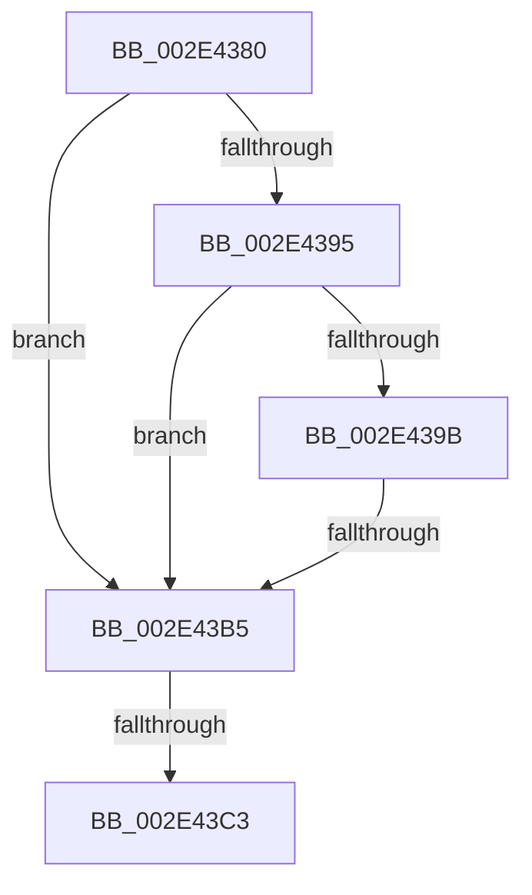

# RtlpHpSegFreeRangeInsert

- RVA: `0x002E4380`–`0x002E4421` (길이 `161` bytes)
- VA: `0x00000001402E4380`
- 실행 섹션: `.text`
- PDB 이름 있음: `예`; PDB Function 태그: `아니요`
- unwind 정보 RVA: `0x00070EFC`
- 디코드: `48`개 명령, `161/161` bytes 표시
- 미해석 바이트: `0` (있으면 어셈블리에 `.byte`로 보존)

> 이 문서는 커널 이미지의 기계어와 PDB 기호를 분석해 생성했습니다. 4번과 5번은 함수 원형과 자료형을 바이너리 사용 방식에서 추정한 C 해석이며 원본 소스 복구 결과는 아닙니다.

## 1. Dependencies

- 직접 호출 지점: **0**; 고유 호출 대상: **0**
- 직접 호출자로 확인된 함수: **4**
- RIP 상대 이미지 참조: **0**

### Outgoing calls
- 직접 디코드된 call 명령이 없습니다.

### Direct callers
- [RtlpHpSegLargeRangeAllocate](RtlpHpSegLargeRangeAllocate_function_002E7398.md) at `0x002E750F`
- [sub_003267E9](../32/Unknown_function_003267E9.md) at `0x00326A1F`
- [RtlpHpSegContextCompact](../32/RtlpHpSegContextCompact_function_00326F90.md) at `0x003270EB`
- [RtlpHpSegContextReserve](../60/RtlpHpSegContextReserve_function_00604338.md) at `0x006043E6`

### Static image references
- 디코드된 RIP-relative 메모리 참조가 없습니다.

## 2. Other-region calls and transfers

- 다른 실행 섹션으로 향하는 call: **0**
- call이 아닌 외부 분기/꼬리 이동: **3**
  - `0x002E43AF` → [sub_002E444F + 0x96](Unknown_function_002E444F.md) (`tail-transfer`)
  - `0x002E43BD` → [sub_002E444F + 0xD9](Unknown_function_002E444F.md) (`tail-transfer`)
  - `0x002E441F` → [sub_002E444F](Unknown_function_002E444F.md) (`tail-transfer`)

## 3. Assembly (complete function range)

```asm
002E4380  48 89 5C 24 10                  mov qword ptr [rsp + 0x10], rbx
002E4385  57                              push rdi
002E4386  48 83 EC 20                     sub rsp, 0x20
002E438A  48 8B FA                        mov rdi, rdx
002E438D  48 8B D9                        mov rbx, rcx
002E4390  45 85 C0                        test r8d, r8d
002E4393  75 20                           jne 0x1402e43b5
002E4395  F6 41 0D 10                     test byte ptr [rcx + 0xd], 0x10
002E4399  74 1A                           je 0x1402e43b5
002E439B  0F B6 41 0A                     movzx eax, byte ptr [rcx + 0xa]
002E439F  41 B8 00 01 00 00               mov r8d, 0x100
002E43A5  44 2B C0                        sub r8d, eax
002E43A8  0F B6 42 1F                     movzx eax, byte ptr [rdx + 0x1f]
002E43AC  41 3B C0                        cmp eax, r8d
002E43AF  0F 84 30 01 00 00               je 0x1402e44e5
002E43B5  0F B6 41 0D                     movzx eax, byte ptr [rcx + 0xd]
002E43B9  24 07                           and al, 7
002E43BB  3C 01                           cmp al, 1
002E43BD  0F 82 65 01 00 00               jb 0x1402e4528
002E43C3  4C 8B 09                        mov r9, qword ptr [rcx]
002E43C6  4C 8B C7                        mov r8, rdi
002E43C9  0F B6 49 08                     movzx ecx, byte ptr [rcx + 8]
002E43CD  49 8B C1                        mov rax, r9
002E43D0  44 0F B6 52 1F                  movzx r10d, byte ptr [rdx + 0x1f]
002E43D5  48 23 C7                        and rax, rdi
002E43D8  4C 2B C0                        sub r8, rax
002E43DB  41 D3 E2                        shl r10d, cl
002E43DE  49 C1 F8 05                     sar r8, 5
002E43E2  45 33 DB                        xor r11d, r11d
002E43E5  49 D3 E0                        shl r8, cl
002E43E8  4C 03 C0                        add r8, rax
002E43EB  4D 23 C8                        and r9, r8
002E43EE  41 8D 4A FF                     lea ecx, [r10 - 1]
002E43F2  45 2B C1                        sub r8d, r9d
002E43F5  41 03 C8                        add ecx, r8d
002E43F8  41 8B C0                        mov eax, r8d
002E43FB  48 C1 E9 15                     shr rcx, 0x15
002E43FF  49 8B 51 18                     mov rdx, qword ptr [r9 + 0x18]
002E4403  48 C1 E8 15                     shr rax, 0x15
002E4407  4C 8D 0C 4A                     lea r9, [rdx + rcx*2]
002E440B  48 8D 0C 42                     lea rcx, [rdx + rax*2]
002E440F  49 8B D1                        mov rdx, r9
002E4412  48 2B D1                        sub rdx, rcx
002E4415  33 C0                           xor eax, eax
002E4417  48 D1 FA                        sar rdx, 1
002E441A  FF C2                           inc edx
002E441C  49 3B C9                        cmp rcx, r9
002E441F  77 2E                           ja 0x1402e444f
```

## 4. C-style interpretation (structured pseudocode)

```c
__int64 __fastcall RtlpHpSegFreeRangeInsert(__int64 a1, __int64 a2, int a3)
{
    __int64 result;
    __int64 v_r10;
    __int64 v_r11;
    __int64 v_rsp;
    unsigned __int64 v_stack_p10;

    v_stack_p10 = v_rbx;
    v_rsp = (v_rsp) - (32);
    if (a3 != 0) goto loc_002E43B5;
    if (((*(unsigned __int8 *)(a1 + 13)) & (16)) == 0) goto loc_002E43B5;
    a3 = (unsigned int)((256) - ((unsigned int)(*(unsigned __int8 *)(a1 + 10))));
loc_002E43B5:
    result = (unsigned __int8)((*(unsigned __int8 *)(a1 + 13)) & (7));
    result = (*(unsigned __int64 *)(a1)) & (a2);
    a3 = (a2) - (result);
    v_r10 = (unsigned int)((*(unsigned __int8 *)(a2 + 31)) << ((unsigned __int8)(*(unsigned __int8 *)(a1 + 8))));
    a3 = (a3) >> (5);
    v_r11 = 0;
    a3 = (a3) << ((unsigned __int8)(*(unsigned __int8 *)(a1 + 8)));
    a3 = (a3) + (result);
    a4 = (*(unsigned __int64 *)(a1)) & (a3);
    a3 = (unsigned int)((a3) - ((unsigned int)(a4)));
    a1 = (unsigned int)((v_r10 - 1) + (a3));
    a1 = (a1) >> (21);
    result = ((unsigned int)(a3)) >> (21);
    a2 = (*(unsigned __int64 *)(a4 + 24) + a1 * 2) - (*(unsigned __int64 *)(a4 + 24) + result * 2);
    result = 0;
    a2 = (a2) >> (1);
    a2 = (unsigned int)((a2) + 1);
}
```

## 5. (Beta) C Style

```c
int64_t RtlpHpSegFreeRangeInsert(void *Arg1, void *Arg2, int32_t Arg3)
{
    uint8_t *arg1 = (uint8_t *)Arg1;
    uint8_t *arg2 = (uint8_t *)Arg2;

    int64_t result;
    int64_t local_r10;
    int64_t local_r11;
    int64_t local_rsp;
    uint64_t v_stack_p10;

    v_stack_p10 = local_rbx;
    local_rsp = (local_rsp) - (32);
    if (Arg3 != 0) goto loc_002E43B5;
    if (((*(uint8_t *)(arg1 + 0xD)) & (16)) == 0) goto loc_002E43B5;
    Arg3 = (uint32_t)((256) - ((uint32_t)(*(uint8_t *)(arg1 + 0xA))));
loc_002E43B5:
    result = (uint8_t)((*(uint8_t *)(arg1 + 0xD)) & (7));
    result = (*(uint64_t *)(arg1)) & (Arg2);
    Arg3 = (Arg2) - (result);
    local_r10 = (uint32_t)((*(uint8_t *)(arg2 + 0x1F)) << ((uint8_t)(*(uint8_t *)(arg1 + 0x8))));
    Arg3 = (Arg3) >> (5);
    local_r11 = 0;
    Arg3 = (Arg3) << ((uint8_t)(*(uint8_t *)(arg1 + 0x8)));
    Arg3 = (Arg3) + (result);
    a4 = (*(uint64_t *)(arg1)) & (Arg3);
    Arg3 = (uint32_t)((Arg3) - ((uint32_t)(a4)));
    Arg1 = (uint32_t)((local_r10 - 1) + (Arg3));
    Arg1 = (Arg1) >> (21);
    result = ((uint32_t)(Arg3)) >> (21);
    Arg2 = (*(uint64_t *)(a4 + 0x18) + Arg1 * 2) - (*(uint64_t *)(a4 + 0x18) + result * 2);
    result = 0;
    Arg2 = (Arg2) >> (1);
    Arg2 = (uint32_t)((Arg2) + 1);
}
```

### 관측된 메모리 오프셋

구조체 형식이 확인되지 않은 접근은 인자 기준의 오프셋으로만 기록했습니다.

| 기준 인자 | 오프셋 표현 | 폭 (bit) | 접근 |
|---|---:|---:|---|
| `Arg1` | `+ 0x0` | `64` | `R` |
| `Arg1` | `+ 0x8` | `8` | `R` |
| `Arg1` | `+ 0xA` | `8` | `R` |
| `Arg1` | `+ 0xD` | `8` | `R` |
| `Arg2` | `+ 0x1F` | `8` | `R` |

## 6. Execution-region graph

[열기: 2D/3D 그래프와 함수 탐색 컨트롤 패널](../../../control-panel.html?section=text&rva=0x002E4380&view=graph)

- 2D 그래프는 위에서 아래로 흐르고, 3D 그래프는 빈 공간을 드래그해 회전합니다. Shift+드래그는 이동, 휠은 확대·축소, 함수 노드 선택은 대상 보고서 이동입니다.

### Static fallback


