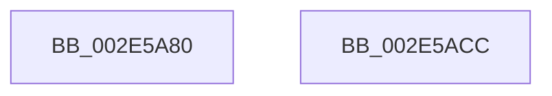

# RtlpHpSegFreeRangeRemove

- RVA: `0x002E5A80`–`0x002E5ACD` (길이 `77` bytes)
- VA: `0x00000001402E5A80`
- 실행 섹션: `.text`
- PDB 이름 있음: `예`; PDB Function 태그: `아니요`
- unwind 정보 RVA: `0x0005CAAC`
- 디코드: `23`개 명령, `77/77` bytes 표시
- 미해석 바이트: `0` (있으면 어셈블리에 `.byte`로 보존)

> 이 문서는 커널 이미지의 기계어와 PDB 기호를 분석해 생성했습니다. 4번과 5번은 함수 원형과 자료형을 바이너리 사용 방식에서 추정한 C 해석이며 원본 소스 복구 결과는 아닙니다.

## 1. Dependencies

- 직접 호출 지점: **1**; 고유 호출 대상: **1**
- 직접 호출자로 확인된 함수: **1**
- RIP 상대 이미지 참조: **0**

### Outgoing calls
- `0x002E5A94` → [RtlRbRemoveNode](RtlRbRemoveNode_function_002E4C10.md) (function, `0x002E4C10`)

### Direct callers
- [RtlpHpSegLargeRangeAllocate](RtlpHpSegLargeRangeAllocate_function_002E7398.md) at `0x002E7461`

### Static image references
- 디코드된 RIP-relative 메모리 참조가 없습니다.

## 2. Other-region calls and transfers

- 다른 실행 섹션으로 향하는 call: **0**
- 별도 외부 분기/꼬리 이동을 확인하지 못했습니다.

## 3. Assembly (complete function range)

```asm
002E5A80  48 89 5C 24 08                  mov qword ptr [rsp + 8], rbx
002E5A85  57                              push rdi
002E5A86  48 83 EC 20                     sub rsp, 0x20
002E5A8A  48 8B F9                        mov rdi, rcx
002E5A8D  48 8B DA                        mov rbx, rdx
002E5A90  48 83 C1 60                     add rcx, 0x60
002E5A94  E8 77 F1 FF FF                  call 0x1402e4c10
002E5A99  33 C0                           xor eax, eax
002E5A9B  0F 57 C0                        xorps xmm0, xmm0
002E5A9E  0F 11 03                        movups xmmword ptr [rbx], xmm0
002E5AA1  48 89 43 10                     mov qword ptr [rbx + 0x10], rax
002E5AA5  8B 43 1C                        mov eax, dword ptr [rbx + 0x1c]
002E5AA8  F7 D0                           not eax
002E5AAA  C7 03 DD CC DD CC               mov dword ptr [rbx], 0xccddccdd
002E5AB0  0F B7 D0                        movzx edx, ax
002E5AB3  48 0F BF 47 16                  movsx rax, word ptr [rdi + 0x16]
002E5AB8  48 F7 DA                        neg rdx
002E5ABB  F0 48 01 54 38 10               lock add qword ptr [rax + rdi + 0x10], rdx
002E5AC1  48 8B 5C 24 30                  mov rbx, qword ptr [rsp + 0x30]
002E5AC6  48 83 C4 20                     add rsp, 0x20
002E5ACA  5F                              pop rdi
002E5ACB  C3                              ret
002E5ACC  CC                              int3
```

## 4. C-style interpretation (structured pseudocode)

```c
__int64 __fastcall RtlpHpSegFreeRangeRemove(__int64 a1, __int64 a2)
{
    __int64 result;
    __int64 v_rsp;
    unsigned __int64 v_stack_p8;

    v_stack_p8 = v_rbx;
    v_rsp = (v_rsp) - (32);
    a1 = (a1) + (96);
    result = RtlRbRemoveNode(a1, a2, a3, a4);
    result = 0;
    *(unsigned __int64 *)(a2) = v_xmm0;
    *(unsigned __int64 *)(a2 + 16) = 0;
    result = (unsigned int)(~((unsigned int)(*(unsigned int *)(a2 + 28))));
    *(unsigned int *)(a2) = 0xCCDDCCDDULL;
    a2 = -((unsigned __int16)(result));
    v_rsp = (v_rsp) + (32);
    return (__int16)(*(unsigned __int16 *)(a1 + 22));
}
```

## 5. (Beta) C Style

```c
int64_t RtlpHpSegFreeRangeRemove(void *Arg1, void *Arg2)
{
    uint8_t *arg1 = (uint8_t *)Arg1;
    uint8_t *arg2 = (uint8_t *)Arg2;

    int64_t result;
    int64_t local_rsp;
    uint64_t v_stack_p8;

    v_stack_p8 = local_rbx;
    local_rsp = (local_rsp) - (32);
    Arg1 = (Arg1) + (96);
    result = RtlRbRemoveNode(Arg1, Arg2, a3, a4);
    result = 0;
    *(uint64_t *)(arg2) = v_xmm0;
    *(uint64_t *)(arg2 + 0x10) = 0;
    result = (uint32_t)(~((uint32_t)(*(uint32_t *)(arg2 + 0x1C))));
    *(uint32_t *)(arg2) = 0xCCDDCCDDULL;
    Arg2 = -((uint16_t)(result));
    local_rsp = (local_rsp) + (32);
    return (int16_t)(*(uint16_t *)(arg1 + 0x16));
}
```

### 관측된 메모리 오프셋

구조체 형식이 확인되지 않은 접근은 인자 기준의 오프셋으로만 기록했습니다.

| 기준 인자 | 오프셋 표현 | 폭 (bit) | 접근 |
|---|---:|---:|---|
| `Arg1` | `+ 0x16` | `16` | `R` |
| `Arg2` | `+ 0x0` | `32` | `W` |
| `Arg2` | `+ 0x0` | `128` | `R` |
| `Arg2` | `+ 0x10` | `64` | `W` |
| `Arg2` | `+ 0x1C` | `32` | `R` |

## 6. Execution-region graph

[열기: 2D/3D 그래프와 함수 탐색 컨트롤 패널](../../../control-panel.html?section=text&rva=0x002E5A80&view=graph)

- 2D 그래프는 위에서 아래로 흐르고, 3D 그래프는 빈 공간을 드래그해 회전합니다. Shift+드래그는 이동, 휠은 확대·축소, 함수 노드 선택은 대상 보고서 이동입니다.

### Static fallback


