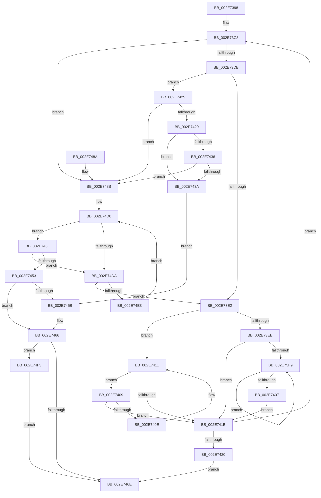

# RtlpHpSegLargeRangeAllocate

- RVA: `0x002E7398`–`0x002E751C` (길이 `388` bytes)
- VA: `0x00000001402E7398`
- 실행 섹션: `.text`
- PDB 이름 있음: `예`; PDB Function 태그: `아니요`
- unwind 정보 RVA: `0x000712EC`
- 디코드: `120`개 명령, `388/388` bytes 표시
- 미해석 바이트: `0` (있으면 어셈블리에 `.byte`로 보존)

> 이 문서는 커널 이미지의 기계어와 PDB 기호를 분석해 생성했습니다. 4번과 5번은 함수 원형과 자료형을 바이너리 사용 방식에서 추정한 C 해석이며 원본 소스 복구 결과는 아닙니다.

## 1. Dependencies

- 직접 호출 지점: **3**; 고유 호출 대상: **3**
- 직접 호출자로 확인된 함수: **2**
- RIP 상대 이미지 참조: **0**

### Outgoing calls
- `0x002E7461` → [RtlpHpSegFreeRangeRemove](RtlpHpSegFreeRangeRemove_function_002E5A80.md) (function, `0x002E5A80`)
- `0x002E74FE` → [RtlpHpSegPageRangeSplit](../43/RtlpHpSegPageRangeSplit_function_004359B0.md) (function, `0x004359B0`)
- `0x002E750F` → [RtlpHpSegFreeRangeInsert](RtlpHpSegFreeRangeInsert_function_002E4380.md) (function, `0x002E4380`)

### Direct callers
- [sub_003267E9](../32/Unknown_function_003267E9.md) at `0x00326A32`
- [sub_00326A50](../32/Unknown_function_00326A50.md) at `0x00326A64`

### Static image references
- 디코드된 RIP-relative 메모리 참조가 없습니다.

## 2. Other-region calls and transfers

- 다른 실행 섹션으로 향하는 call: **0**
- 별도 외부 분기/꼬리 이동을 확인하지 못했습니다.

## 3. Assembly (complete function range)

```asm
002E7398  48 89 5C 24 08                  mov qword ptr [rsp + 8], rbx
002E739D  48 89 6C 24 10                  mov qword ptr [rsp + 0x10], rbp
002E73A2  48 89 74 24 20                  mov qword ptr [rsp + 0x20], rsi
002E73A7  57                              push rdi
002E73A8  41 56                           push r14
002E73AA  41 57                           push r15
002E73AC  48 83 EC 20                     sub rsp, 0x20
002E73B0  0F B6 69 08                     movzx ebp, byte ptr [rcx + 8]
002E73B4  48 8B F1                        mov rsi, rcx
002E73B7  8B CD                           mov ecx, ebp
002E73B9  45 8B D8                        mov r11d, r8d
002E73BC  41 D3 E3                        shl r11d, cl
002E73BF  45 8B F1                        mov r14d, r9d
002E73C2  45 33 FF                        xor r15d, r15d
002E73C5  48 8B FA                        mov rdi, rdx
002E73C8  44 0F B6 47 1F                  movzx r8d, byte ptr [rdi + 0x1f]
002E73CD  8B CD                           mov ecx, ebp
002E73CF  41 D3 E0                        shl r8d, cl
002E73D2  45 85 F6                        test r14d, r14d
002E73D5  0F 84 B0 00 00 00               je 0x1402e748b
002E73DB  8A 47 1E                        mov al, byte ptr [rdi + 0x1e]
002E73DE  3C 02                           cmp al, 2
002E73E0  76 43                           jbe 0x1402e7425
002E73E2  48 8B 47 08                     mov rax, qword ptr [rdi + 8]
002E73E6  48 8B CF                        mov rcx, rdi
002E73E9  48 85 C0                        test rax, rax
002E73EC  74 23                           je 0x1402e7411
002E73EE  48 8B 08                        mov rcx, qword ptr [rax]
002E73F1  48 8B F8                        mov rdi, rax
002E73F4  48 85 C9                        test rcx, rcx
002E73F7  74 22                           je 0x1402e741b
002E73F9  48 8B 01                        mov rax, qword ptr [rcx]
002E73FC  48 8B F9                        mov rdi, rcx
002E73FF  48 8B C8                        mov rcx, rax
002E7402  48 85 C0                        test rax, rax
002E7405  75 F2                           jne 0x1402e73f9
002E7407  EB 12                           jmp 0x1402e741b
002E7409  48 39 0F                        cmp qword ptr [rdi], rcx
002E740C  74 0D                           je 0x1402e741b
002E740E  48 8B CF                        mov rcx, rdi
002E7411  48 8B 7F 10                     mov rdi, qword ptr [rdi + 0x10]
002E7415  48 83 E7 FC                     and rdi, 0xfffffffffffffffc
002E7419  75 EE                           jne 0x1402e7409
002E741B  48 85 FF                        test rdi, rdi
002E741E  75 A8                           jne 0x1402e73c8
002E7420  49 8B FF                        mov rdi, r15
002E7423  EB 49                           jmp 0x1402e746e
002E7425  84 C0                           test al, al
002E7427  75 62                           jne 0x1402e748b
002E7429  41 8B C0                        mov eax, r8d
002E742C  25 FF FF 1F 00                  and eax, 0x1fffff
002E7431  44 3B D8                        cmp r11d, eax
002E7434  76 04                           jbe 0x1402e743a
002E7436  85 C0                           test eax, eax
002E7438  75 51                           jne 0x1402e748b
002E743A  41 8B DF                        mov ebx, r15d
002E743D  EB 1C                           jmp 0x1402e745b
002E743F  49 3B CA                        cmp rcx, r10
002E7442  49 0F 43 CA                     cmovae rcx, r10
002E7446  8B C1                           mov eax, ecx
002E7448  2B C3                           sub eax, ebx
002E744A  41 3B C3                        cmp eax, r11d
002E744D  0F 82 87 00 00 00               jb 0x1402e74da
002E7453  41 2B D9                        sub ebx, r9d
002E7456  45 85 F6                        test r14d, r14d
002E7459  74 0B                           je 0x1402e7466
002E745B  48 8B D7                        mov rdx, rdi
002E745E  48 8B CE                        mov rcx, rsi
002E7461  E8 1A E6 FF FF                  call 0x1402e5a80
002E7466  85 DB                           test ebx, ebx
002E7468  0F 85 85 00 00 00               jne 0x1402e74f3
002E746E  48 8B 5C 24 40                  mov rbx, qword ptr [rsp + 0x40]
002E7473  48 8B C7                        mov rax, rdi
002E7476  48 8B 6C 24 48                  mov rbp, qword ptr [rsp + 0x48]
002E747B  48 8B 74 24 58                  mov rsi, qword ptr [rsp + 0x58]
002E7480  48 83 C4 20                     add rsp, 0x20
002E7484  41 5F                           pop r15
002E7486  41 5E                           pop r14
002E7488  5F                              pop rdi
002E7489  C3                              ret
002E748A  CC                              int3
002E748B  48 8B 16                        mov rdx, qword ptr [rsi]
002E748E  4C 8B CF                        mov r9, rdi
002E7491  48 8B C2                        mov rax, rdx
002E7494  45 8B D0                        mov r10d, r8d
002E7497  48 23 C7                        and rax, rdi
002E749A  4C 2B C8                        sub r9, rax
002E749D  49 C1 F9 05                     sar r9, 5
002E74A1  49 D3 E1                        shl r9, cl
002E74A4  4C 03 C8                        add r9, rax
002E74A7  49 23 D1                        and rdx, r9
002E74AA  49 8B C9                        mov rcx, r9
002E74AD  48 2B CA                        sub rcx, rdx
002E74B0  4D 03 D1                        add r10, r9
002E74B3  48 C1 E9 15                     shr rcx, 0x15
002E74B7  49 8B D9                        mov rbx, r9
002E74BA  48 8B 42 18                     mov rax, qword ptr [rdx + 0x18]
002E74BE  48 8D 14 48                     lea rdx, [rax + rcx*2]
002E74C2  49 8D 89 00 00 20 00            lea rcx, [r9 + 0x200000]
002E74C9  48 81 E1 00 00 E0 FF            and rcx, 0xffffffffffe00000
002E74D0  66 44 39 3A                     cmp word ptr [rdx], r15w
002E74D4  0F 8C 65 FF FF FF               jl 0x1402e743f
002E74DA  49 3B CA                        cmp rcx, r10
002E74DD  0F 83 FF FE FF FF               jae 0x1402e73e2
002E74E3  48 8B D9                        mov rbx, rcx
002E74E6  48 81 C1 00 00 20 00            add rcx, 0x200000
002E74ED  48 83 C2 02                     add rdx, 2
002E74F1  EB DD                           jmp 0x1402e74d0
002E74F3  8A 4E 08                        mov cl, byte ptr [rsi + 8]
002E74F6  48 8B D7                        mov rdx, rdi
002E74F9  D3 EB                           shr ebx, cl
002E74FB  44 8B C3                        mov r8d, ebx
002E74FE  E8 AD E4 14 00                  call 0x1404359b0
002E7503  45 33 C0                        xor r8d, r8d
002E7506  48 8B D7                        mov rdx, rdi
002E7509  48 8B CE                        mov rcx, rsi
002E750C  48 8B D8                        mov rbx, rax
002E750F  E8 6C CE FF FF                  call 0x1402e4380
002E7514  48 8B FB                        mov rdi, rbx
002E7517  E9 52 FF FF FF                  jmp 0x1402e746e
```

## 4. C-style interpretation (structured pseudocode)

```c
__int64 __fastcall RtlpHpSegLargeRangeAllocate(__int64 a1, __int64 a2, int a3, int a4)
{
    __int64 result;
    __int64 v_r10;
    __int64 v_r11;
    __int64 v_r15;
    __int64 v_rbx;
    __int64 v_rdi;
    __int64 v_rsp;
    unsigned __int64 v_stack_p10;
    unsigned __int64 v_stack_p20;
    unsigned __int64 v_stack_p8;

    v_stack_p8 = v_rbx;
    v_stack_p10 = v_rbp;
    v_stack_p20 = v_rsi;
    v_rsp = (v_rsp) - (32);
    v_r11 = (unsigned int)(((unsigned int)(a3)) << ((unsigned __int8)((unsigned int)((unsigned int)(*(unsigned __int8 *)(a1 + 8))))));
    v_r15 = 0;
loc_002E73C8:
    a3 = (unsigned int)((*(unsigned __int8 *)(a2 + 31)) << ((unsigned __int8)((unsigned int)((unsigned int)(*(unsigned __int8 *)(a1 + 8))))));
    if ((unsigned int)((unsigned int)(a4)) == 0) goto loc_002E748B;
    if (((unsigned __int8)(*(unsigned __int8 *)(a2 + 30))) <= 2) goto loc_002E7425;
loc_002E73E2:
    if (*(unsigned __int64 *)(a2 + 8) == 0) goto loc_002E7411;
    if (*(unsigned __int64 *)(*(unsigned __int64 *)(a2 + 8)) == 0) goto loc_002E741B;
loc_002E73F9:
    if (*(unsigned __int64 *)(*(unsigned __int64 *)(*(unsigned __int64 *)(a2 + 8))) != 0) goto loc_002E73F9;
    goto loc_002E741B;
loc_002E7409:
    if ((*(unsigned __int64 *)(*(unsigned __int64 *)(*(unsigned __int64 *)(a2 + 8)))) == (*(unsigned __int64 *)(*(unsigned __int64 *)(*(unsigned __int64 *)(a2 + 8))))) goto loc_002E741B;
loc_002E7411:
    v_rdi = (*(unsigned __int64 *)(*(unsigned __int64 *)(*(unsigned __int64 *)(a2 + 8)) + 16)) & (-4);
    if (condition_is_not_equal) goto loc_002E7409;
loc_002E741B:
    if (v_rdi != 0) goto loc_002E73C8;
    goto loc_002E746E;
loc_002E7425:
    if ((unsigned __int8)(*(unsigned __int64 *)(*(unsigned __int64 *)(*(unsigned __int64 *)(a2 + 8)))) != 0) goto loc_002E748B;
    result = (unsigned int)(((unsigned int)(a3)) & (0x1FFFFFULL));
    if (((unsigned int)(v_r11)) <= ((unsigned int)(result))) goto loc_002E743A;
    if ((unsigned int)(result) != 0) goto loc_002E748B;
loc_002E743A:
    goto loc_002E745B;
loc_002E743F:
    a1 = *(unsigned __int64 *)(*(unsigned __int64 *)(a2 + 8));
    if ((*(unsigned __int64 *)(*(unsigned __int64 *)(a2 + 8))) >= v_r10) { a1 = v_r10; }
    result = (unsigned int)(((unsigned int)((unsigned int)(a1))) - (0));
    if (((unsigned int)(result)) < ((unsigned int)(v_r11))) goto loc_002E74DA;
    v_rbx = (unsigned int)((0) - (a4));
    if ((unsigned int)((unsigned int)(a4)) != 0) {
        a2 = 0;
        a1 = a1;
        result = RtlpHpSegFreeRangeRemove(a1, a2, a3, a4);
    }
    if ((unsigned int)(v_rbx) != 0) goto loc_002E74F3;
loc_002E746E:
    v_rsp = (v_rsp) + (32);
    return 0;
loc_002E748B:
    result = (*(unsigned __int64 *)(v_stack_p20)) & (0);
    a4 = (0) - (result);
    a4 = (a4) >> (5);
    a4 = (a4) << ((unsigned __int8)(a1));
    a4 = (a4) + (result);
    a2 = (*(unsigned __int64 *)(v_stack_p20)) & (a4);
    a1 = (a4) - (a2);
    v_r10 = ((unsigned int)(a3)) + (a4);
    a1 = (a1) >> (21);
    a1 = (a4 + 2097152) & (0xFFFFFFFFFFE00000ULL);
loc_002E74D0:
    if ((*(unsigned __int16 *)(*(unsigned __int64 *)(a2 + 24) + a1 * 2)) < 0) goto loc_002E743F;
loc_002E74DA:
    if (a1 >= v_r10) goto loc_002E73E2;
    a1 = (a1) + (0x200000ULL);
    a2 = (*(unsigned __int64 *)(a2 + 24) + a1 * 2) + (2);
    goto loc_002E74D0;
loc_002E74F3:
    v_rbx = (unsigned int)((a1) >> ((unsigned __int8)(*(unsigned __int8 *)(v_stack_p20 + 8))));
    result = RtlpHpSegPageRangeSplit(*(unsigned __int8 *)(v_stack_p20 + 8), 0, (unsigned int)((unsigned int)(v_rbx)), a4);
    a3 = 0;
    result = RtlpHpSegFreeRangeInsert(v_stack_p20, 0, a3, a4);
    goto loc_002E746E;
}
```

## 5. (Beta) C Style

```c
int64_t RtlpHpSegLargeRangeAllocate(void *Arg1, int64_t Arg2, int32_t Arg3, int32_t Arg4)
{
    uint8_t *arg1 = (uint8_t *)Arg1;

    int64_t result;
    int64_t local_r10;
    int64_t local_r11;
    int64_t local_r15;
    int64_t local_rbx;
    int64_t local_rdi;
    int64_t local_rsp;
    uint64_t v_stack_p10;
    uint64_t v_stack_p20;
    uint64_t v_stack_p8;

    v_stack_p8 = local_rbx;
    v_stack_p10 = local_rbp;
    v_stack_p20 = local_rsi;
    local_rsp = (local_rsp) - (32);
    local_r11 = (uint32_t)(((uint32_t)(Arg3)) << ((uint8_t)((uint32_t)((uint32_t)(*(uint8_t *)(arg1 + 0x8))))));
    local_r15 = 0;
loc_002E73C8:
    Arg3 = (uint32_t)((*(uint8_t *)(Arg2 + 0x1F)) << ((uint8_t)((uint32_t)((uint32_t)(*(uint8_t *)(arg1 + 0x8))))));
    if ((uint32_t)((uint32_t)(Arg4)) == 0) goto loc_002E748B;
    if (((uint8_t)(*(uint8_t *)(Arg2 + 0x1E))) <= 2) goto loc_002E7425;
loc_002E73E2:
    if (*(uint64_t *)(Arg2 + 0x8) == 0) goto loc_002E7411;
    if (*(uint64_t *)(*(uint64_t *)(Arg2 + 0x8)) == 0) goto loc_002E741B;
loc_002E73F9:
    if (*(uint64_t *)(*(uint64_t *)(*(uint64_t *)(Arg2 + 0x8))) != 0) goto loc_002E73F9;
    goto loc_002E741B;
loc_002E7409:
    if ((*(uint64_t *)(*(uint64_t *)(*(uint64_t *)(Arg2 + 0x8)))) == (*(uint64_t *)(*(uint64_t *)(*(uint64_t *)(Arg2 + 0x8))))) goto loc_002E741B;
loc_002E7411:
    local_rdi = (*(uint64_t *)(*(uint64_t *)(*(uint64_t *)(Arg2 + 0x8)) + 0x10)) & (-4);
    if (condition_is_not_equal) goto loc_002E7409;
loc_002E741B:
    if (local_rdi != 0) goto loc_002E73C8;
    goto loc_002E746E;
loc_002E7425:
    if ((uint8_t)(*(uint64_t *)(*(uint64_t *)(*(uint64_t *)(Arg2 + 0x8)))) != 0) goto loc_002E748B;
    result = (uint32_t)(((uint32_t)(Arg3)) & (0x1FFFFFULL));
    if (((uint32_t)(local_r11)) <= ((uint32_t)(result))) goto loc_002E743A;
    if ((uint32_t)(result) != 0) goto loc_002E748B;
loc_002E743A:
    goto loc_002E745B;
loc_002E743F:
    Arg1 = *(uint64_t *)(*(uint64_t *)(Arg2 + 0x8));
    if ((*(uint64_t *)(*(uint64_t *)(Arg2 + 0x8))) >= local_r10) { Arg1 = local_r10; }
    result = (uint32_t)(((uint32_t)((uint32_t)(Arg1))) - (0));
    if (((uint32_t)(result)) < ((uint32_t)(local_r11))) goto loc_002E74DA;
    local_rbx = (uint32_t)((0) - (Arg4));
    if ((uint32_t)((uint32_t)(Arg4)) != 0) {
        Arg2 = 0;
        Arg1 = Arg1;
        result = RtlpHpSegFreeRangeRemove(Arg1, Arg2, Arg3, Arg4);
    }
    if ((uint32_t)(local_rbx) != 0) goto loc_002E74F3;
loc_002E746E:
    local_rsp = (local_rsp) + (32);
    return 0;
loc_002E748B:
    result = (*(uint64_t *)(v_stack_p20)) & (0);
    Arg4 = (0) - (result);
    Arg4 = (Arg4) >> (5);
    Arg4 = (Arg4) << ((uint8_t)(Arg1));
    Arg4 = (Arg4) + (result);
    Arg2 = (*(uint64_t *)(v_stack_p20)) & (Arg4);
    Arg1 = (Arg4) - (Arg2);
    local_r10 = ((uint32_t)(Arg3)) + (Arg4);
    Arg1 = (Arg1) >> (21);
    Arg1 = (Arg4 + 2097152) & (0xFFFFFFFFFFE00000ULL);
loc_002E74D0:
    if ((*(uint16_t *)(*(uint64_t *)(Arg2 + 0x18) + arg1 * 2)) < 0) goto loc_002E743F;
loc_002E74DA:
    if (Arg1 >= local_r10) goto loc_002E73E2;
    Arg1 = (Arg1) + (0x200000ULL);
    Arg2 = (*(uint64_t *)(Arg2 + 0x18) + Arg1 * 2) + (2);
    goto loc_002E74D0;
loc_002E74F3:
    local_rbx = (uint32_t)((Arg1) >> ((uint8_t)(*(uint8_t *)(v_stack_p20 + 0x8))));
    result = RtlpHpSegPageRangeSplit(*(uint8_t *)(v_stack_p20 + 0x8), 0, (uint32_t)((uint32_t)(local_rbx)), Arg4);
    Arg3 = 0;
    result = RtlpHpSegFreeRangeInsert(v_stack_p20, 0, Arg3, Arg4);
    goto loc_002E746E;
}
```

### 관측된 메모리 오프셋

구조체 형식이 확인되지 않은 접근은 인자 기준의 오프셋으로만 기록했습니다.

| 기준 인자 | 오프셋 표현 | 폭 (bit) | 접근 |
|---|---:|---:|---|
| `Arg1` | `+ 0x0` | `64` | `R` |
| `Arg1` | `+ 0x8` | `8` | `R` |

## 6. Execution-region graph

[열기: 2D/3D 그래프와 함수 탐색 컨트롤 패널](../../../control-panel.html?section=text&rva=0x002E7398&view=graph)

- 2D 그래프는 위에서 아래로 흐르고, 3D 그래프는 빈 공간을 드래그해 회전합니다. Shift+드래그는 이동, 휠은 확대·축소, 함수 노드 선택은 대상 보고서 이동입니다.

### Static fallback


