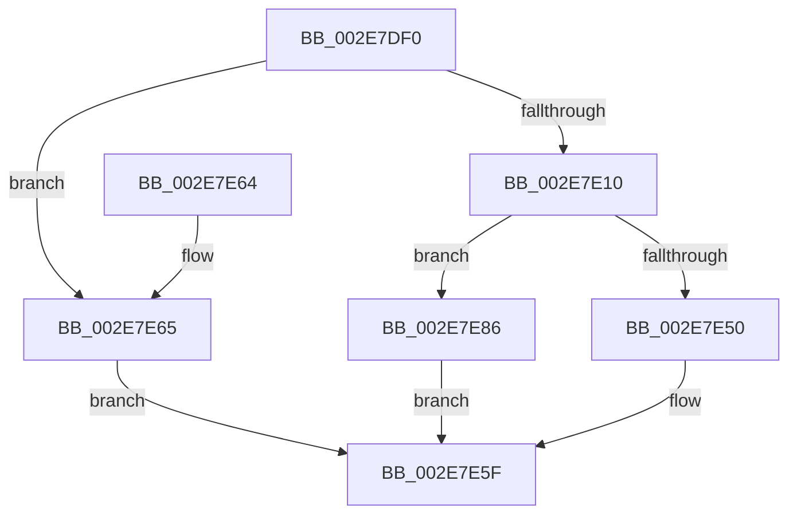

# RtlpHpSegLfhVsFree

- RVA: `0x002E7DF0`–`0x002E7E96` (길이 `166` bytes)
- VA: `0x00000001402E7DF0`
- 실행 섹션: `.text`
- PDB 이름 있음: `예`; PDB Function 태그: `아니요`
- unwind 정보 RVA: `0x000713B4`
- 디코드: `49`개 명령, `166/166` bytes 표시
- 미해석 바이트: `0` (있으면 어셈블리에 `.byte`로 보존)

> 이 문서는 커널 이미지의 기계어와 PDB 기호를 분석해 생성했습니다. 4번과 5번은 함수 원형과 자료형을 바이너리 사용 방식에서 추정한 C 해석이며 원본 소스 복구 결과는 아닙니다.

## 1. Dependencies

- 직접 호출 지점: **3**; 고유 호출 대상: **3**
- 직접 호출자로 확인된 함수: **4**
- RIP 상대 이미지 참조: **1**

### Outgoing calls
- `0x002E7E5A` → [RtlpHpLfhContextFree](../35/RtlpHpLfhContextFree_function_0035B2A0.md) (function, `0x0035B2A0`)
- `0x002E7E7F` → [RtlpLogHeapFailure](../35/RtlpLogHeapFailure_function_0035B7BC.md) (function, `0x0035B7BC`)
- `0x002E7E8F` → [RtlpHpSegFreeInternal](../36/RtlpHpSegFreeInternal_function_0036198C.md) (function, `0x0036198C`)

### Direct callers
- [RtlpHpLfhSubsegmentFree](RtlpHpLfhSubsegmentFree_function_002E7CA0.md) at `0x002E7D23`
- [RtlpHpVsSubsegmentFree](RtlpHpVsSubsegmentFree_function_002E7D9C.md) at `0x002E7DD1`
- [RtlpHpVsSubsegmentCreate](RtlpHpVsSubsegmentCreate_function_002EAE30.md) at `0x002EAF7F`
- [RtlpHpLfhSubsegmentCreate](RtlpHpLfhSubsegmentCreate_function_002EC5A0.md) at `0x002EC721`

### Static image references
- `0x002E7E01` → RVA `0x00E28300` (`.data`; read)

## 2. Other-region calls and transfers

- 다른 실행 섹션으로 향하는 call: **0**
- 별도 외부 분기/꼬리 이동을 확인하지 못했습니다.

## 3. Assembly (complete function range)

```asm
002E7DF0  48 83 EC 38                     sub rsp, 0x38
002E7DF4  4C 8B C2                        mov r8, rdx
002E7DF7  4C 8B D1                        mov r10, rcx
002E7DFA  4C 23 01                        and r8, qword ptr [rcx]
002E7DFD  49 8B 40 10                     mov rax, qword ptr [r8 + 0x10]
002E7E01  48 33 05 F8 04 B4 00            xor rax, qword ptr [rip + 0xb404f8]
002E7E08  49 33 C0                        xor rax, r8
002E7E0B  48 3B C1                        cmp rax, rcx
002E7E0E  75 55                           jne 0x1402e7e65
002E7E10  8A 49 08                        mov cl, byte ptr [rcx + 8]
002E7E13  44 8B DA                        mov r11d, edx
002E7E16  45 2B D8                        sub r11d, r8d
002E7E19  49 D3 EB                        shr r11, cl
002E7E1C  49 C1 E3 05                     shl r11, 5
002E7E20  4D 03 D8                        add r11, r8
002E7E23  41 0F B6 43 1A                  movzx eax, byte ptr [r11 + 0x1a]
002E7E28  48 F7 D8                        neg rax
002E7E2B  48 C1 E0 05                     shl rax, 5
002E7E2F  4C 03 D8                        add r11, rax
002E7E32  4D 8B CB                        mov r9, r11
002E7E35  4D 2B C8                        sub r9, r8
002E7E38  49 C1 F9 05                     sar r9, 5
002E7E3C  49 D3 E1                        shl r9, cl
002E7E3F  4D 03 C8                        add r9, r8
002E7E42  4C 3B CA                        cmp r9, rdx
002E7E45  0F 94 C0                        sete al
002E7E48  41 02 43 18                     add al, byte ptr [r11 + 0x18]
002E7E4C  3C 0B                           cmp al, 0xb
002E7E4E  75 36                           jne 0x1402e7e86
002E7E50  49 8B 4A 18                     mov rcx, qword ptr [r10 + 0x18]
002E7E54  4C 8B C2                        mov r8, rdx
002E7E57  49 8B D1                        mov rdx, r9
002E7E5A  E8 41 34 07 00                  call 0x14035b2a0
002E7E5F  48 83 C4 38                     add rsp, 0x38
002E7E63  C3                              ret
002E7E64  CC                              int3
002E7E65  48 83 64 24 28 00               and qword ptr [rsp + 0x28], 0
002E7E6B  45 33 C9                        xor r9d, r9d
002E7E6E  48 83 64 24 20 00               and qword ptr [rsp + 0x20], 0
002E7E74  4C 8B C2                        mov r8, rdx
002E7E77  48 8B 51 38                     mov rdx, qword ptr [rcx + 0x38]
002E7E7B  41 8D 49 09                     lea ecx, [r9 + 9]
002E7E7F  E8 38 39 07 00                  call 0x14035b7bc
002E7E84  EB D9                           jmp 0x1402e7e5f
002E7E86  45 33 C9                        xor r9d, r9d
002E7E89  4D 8B C3                        mov r8, r11
002E7E8C  49 8B CA                        mov rcx, r10
002E7E8F  E8 F8 9A 07 00                  call 0x14036198c
002E7E94  EB C9                           jmp 0x1402e7e5f
```

## 4. C-style interpretation (structured pseudocode)

```c
__int64 __fastcall RtlpHpSegLfhVsFree(__int64 a1, __int64 a2)
{
    __int64 result;
    __int64 v_r11;
    __int64 v_rsp;
    unsigned __int64 v_stack_p20;
    unsigned __int64 v_stack_p28;

    v_rsp = (v_rsp) - (56);
    a3 = (a2) & (*(unsigned __int64 *)(a1));
    result = (*(unsigned __int64 *)(a3 + 16)) ^ (*(unsigned __int64 *)(v_rip + 11797752));
    result = (result) ^ (a3);
    if (result != a1) goto loc_002E7E65;
    v_r11 = (unsigned int)(((unsigned int)((unsigned int)(a2))) - ((unsigned int)(a3)));
    v_r11 = (v_r11) >> ((unsigned __int8)(*(unsigned __int8 *)(a1 + 8)));
    v_r11 = (v_r11) << (5);
    v_r11 = (v_r11) + (a3);
    result = -(*(unsigned __int8 *)(v_r11 + 26));
    result = (result) << (5);
    v_r11 = (v_r11) + (result);
    a4 = (v_r11) - (a3);
    a4 = (a4) >> (5);
    a4 = (a4) << ((unsigned __int8)(*(unsigned __int8 *)(a1 + 8)));
    a4 = (a4) + (a3);
    result = (a4 == a2) ? 1 : 0;
    result = (unsigned __int8)((result) + (*(unsigned __int8 *)(v_r11 + 24)));
    if (((unsigned __int8)(result)) != 11) goto loc_002E7E86;
    result = RtlpHpLfhContextFree(*(unsigned __int64 *)(a1 + 24), a4, a2, a4);
loc_002E7E5F:
    v_rsp = (v_rsp) + (56);
    return result;
loc_002E7E65:
    a4 = 0;
    result = RtlpLogHeapFailure(a4 + 9, *(unsigned __int64 *)(*(unsigned __int64 *)(a1 + 24) + 56), 0, a4);
    goto loc_002E7E5F;
loc_002E7E86:
    a4 = 0;
    result = RtlpHpSegFreeInternal(a1, *(unsigned __int64 *)(*(unsigned __int64 *)(a1 + 24) + 56), v_r11, a4);
    goto loc_002E7E5F;
}
```

## 5. (Beta) C Style

```c
int64_t RtlpHpSegLfhVsFree(void *Arg1, void *Arg2)
{
    uint8_t *arg1 = (uint8_t *)Arg1;
    uint8_t *arg2 = (uint8_t *)Arg2;

    int64_t result;
    int64_t local_r11;
    int64_t local_rsp;
    uint64_t v_stack_p20;
    uint64_t v_stack_p28;

    local_rsp = (local_rsp) - (56);
    a3 = (Arg2) & (*(uint64_t *)(arg1));
    result = (*(uint64_t *)(a3 + 0x10)) ^ (*(uint64_t *)(v_rip + 0xB404F8));
    result = (result) ^ (a3);
    if (result != Arg1) goto loc_002E7E65;
    local_r11 = (uint32_t)(((uint32_t)((uint32_t)(Arg2))) - ((uint32_t)(a3)));
    local_r11 = (local_r11) >> ((uint8_t)(*(uint8_t *)(arg1 + 0x8)));
    local_r11 = (local_r11) << (5);
    local_r11 = (local_r11) + (a3);
    result = -(*(uint8_t *)(local_r11 + 0x1A));
    result = (result) << (5);
    local_r11 = (local_r11) + (result);
    a4 = (local_r11) - (a3);
    a4 = (a4) >> (5);
    a4 = (a4) << ((uint8_t)(*(uint8_t *)(arg1 + 0x8)));
    a4 = (a4) + (a3);
    result = (a4 == Arg2) ? 1 : 0;
    result = (uint8_t)((result) + (*(uint8_t *)(local_r11 + 0x18)));
    if (((uint8_t)(result)) != 11) goto loc_002E7E86;
    result = RtlpHpLfhContextFree(*(uint64_t *)(arg1 + 0x18), a4, Arg2, a4);
loc_002E7E5F:
    local_rsp = (local_rsp) + (56);
    return result;
loc_002E7E65:
    a4 = 0;
    result = RtlpLogHeapFailure(a4 + 9, *(uint64_t *)(*(uint64_t *)(arg1 + 0x18) + 0x38), 0, a4);
    goto loc_002E7E5F;
loc_002E7E86:
    a4 = 0;
    result = RtlpHpSegFreeInternal(Arg1, *(uint64_t *)(*(uint64_t *)(arg1 + 0x18) + 0x38), local_r11, a4);
    goto loc_002E7E5F;
}
```

### 관측된 메모리 오프셋

구조체 형식이 확인되지 않은 접근은 인자 기준의 오프셋으로만 기록했습니다.

| 기준 인자 | 오프셋 표현 | 폭 (bit) | 접근 |
|---|---:|---:|---|
| `Arg1` | `+ 0x0` | `64` | `R` |
| `Arg1` | `+ 0x8` | `8` | `R` |
| `Arg1` | `+ 0x18` | `64` | `R` |
| `Arg1` | `+ 0x38` | `64` | `R` |
| `Arg2` | `+ 0x10` | `64` | `R` |

## 6. Execution-region graph

[열기: 2D/3D 그래프와 함수 탐색 컨트롤 패널](../../../control-panel.html?section=text&rva=0x002E7DF0&view=graph)

- 2D 그래프는 위에서 아래로 흐르고, 3D 그래프는 빈 공간을 드래그해 회전합니다. Shift+드래그는 이동, 휠은 확대·축소, 함수 노드 선택은 대상 보고서 이동입니다.

### Static fallback


